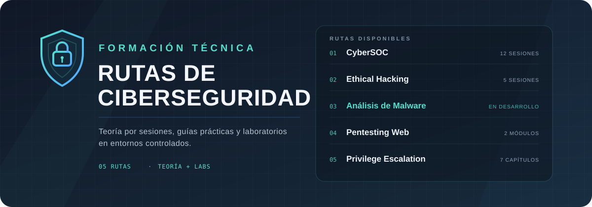

<p align="center">
  
</p>

# Rutas de ciberseguridad

Repositorio de formación en ciberseguridad con cursos organizados por sesiones, teoría, guías prácticas y laboratorios para entornos controlados.

[Catálogo](#catálogo) · [Cómo estudiar](#cómo-estudiar) · [Laboratorio](./setup/README.md) · [Recursos](./resources/README.md)

## Qué incluye

- **Teoría por sesiones:** cada tema se desarrolla en su propio `README.md`, con conceptos, comandos y criterios de finalización.
- **Laboratorios guiados:** prácticas paso a paso sobre máquinas virtuales aisladas, con el código vulnerable incluido cuando corresponde.
- **Guías de entorno:** configuración de red host-only, recursos por ruta y recomendaciones de hardware.
- **Material reutilizable:** referencias rápidas, diccionarios y scripts compartidos entre cursos.

## Catálogo

| # | Ruta | Enfoque | Contenido | Estado |
|---|---|---|---|---|
| 1 | [CyberSOC](./cybersoc/) | Datos, defensa, SOC, Wazuh, Threat Intelligence y Threat Hunting | 12 sesiones + laboratorio integrador | `Disponible` |
| 2 | [Ethical Hacking](./ethical-hacking/) | Ética, OSINT, reconocimiento, enumeración y explotación controlada | 5 sesiones | `Disponible` |
| 3 | [C-MA: Análisis de malware](./malware-analysis/) | FLARE-VM y REMnux, Windows internals, arquitectura x86, análisis estático y bases de ensamblador | 7 bloques de teoría | `En desarrollo` |
| 4 | [Pentesting Web](./pentesting-web/) | HTTP, SQL Injection, Burp Suite y mitigaciones | 2 módulos | `Disponible` |
| 5 | [Privilege Escalation](./privilege-escalation/) | Enumeración y escalada de privilegios en Linux | 7 capítulos | `Disponible` |

## Ruta de aprendizaje sugerida

Las rutas pueden estudiarse de forma independiente, pero este orden aprovecha los conceptos de la anterior:

```text
CyberSOC  →  Ethical Hacking  →  Pentesting Web  →  Privilege Escalation  →  Análisis de malware
defensa       reconocimiento      aplicación web     post-explotación Linux    artefactos y reversing
```

## Cómo estudiar

1. **Prepara el entorno.** Configura una red aislada y revisa los recursos de cada ruta en la [guía de laboratorio](./setup/README.md).
2. **Elige una ruta.** Revisa el `README.md` de la carpeta: ahí están el índice, los objetivos y los prerrequisitos.
3. **Estudia la teoría.** Lee la sesión completa antes de ejecutar comandos.
4. **Ejecuta el laboratorio.** Sigue la guía, registra comandos, salidas, capturas y conclusiones.
5. **Valida el cierre.** Comprueba los criterios de finalización antes de avanzar a la siguiente sesión.

## Estructura del repositorio

```text
.
├── cybersoc/                 Ruta de operaciones y defensa
├── ethical-hacking/          Ruta ofensiva introductoria
├── malware-analysis/         Análisis de malware e ingeniería inversa
├── pentesting-web/           Seguridad de aplicaciones web
├── privilege-escalation/     Escalada de privilegios en Linux
├── images/                   Portadas y diagramas del repositorio
├── resources/                Material compartido entre rutas
├── setup/                    Configuración del laboratorio
└── README.md
```

Cada ruta sigue la misma convención:

```text
<ruta>/
├── README.md                 Índice, objetivos y orden de estudio
├── NN-nombre-del-tema/
│   ├── README.md             Teoría de la sesión
│   └── lab/                  Guía y recursos del laboratorio
└── ...
```

## Requisitos

Los materiales se ejecutan en máquinas virtuales con red host-only. Como referencia: 8 GB de RAM para la mayoría de laboratorios y 16 GB para CyberSOC, con 80 GB de disco libre para VMs e instantáneas. Los detalles por ruta están en [setup](./setup/README.md).

## Uso responsable

- No pruebes técnicas contra sistemas de terceros sin autorización.
- No conectes máquinas vulnerables directamente a Internet.
- No subas credenciales, datos personales, malware real ni archivos generados por las VMs.
- El código vulnerable de los laboratorios es intencional y educativo.
