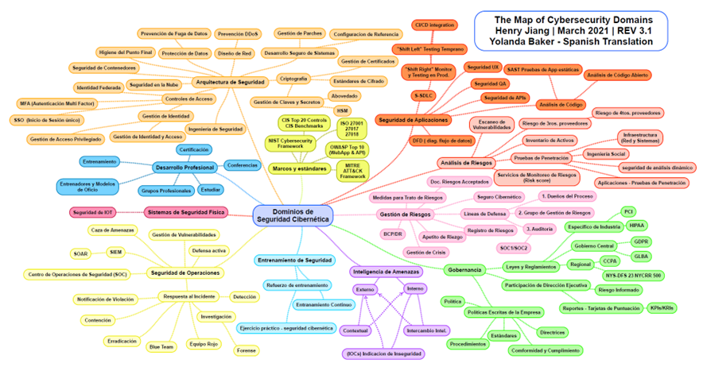
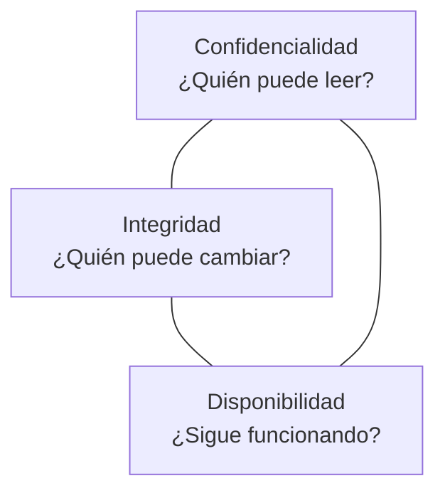
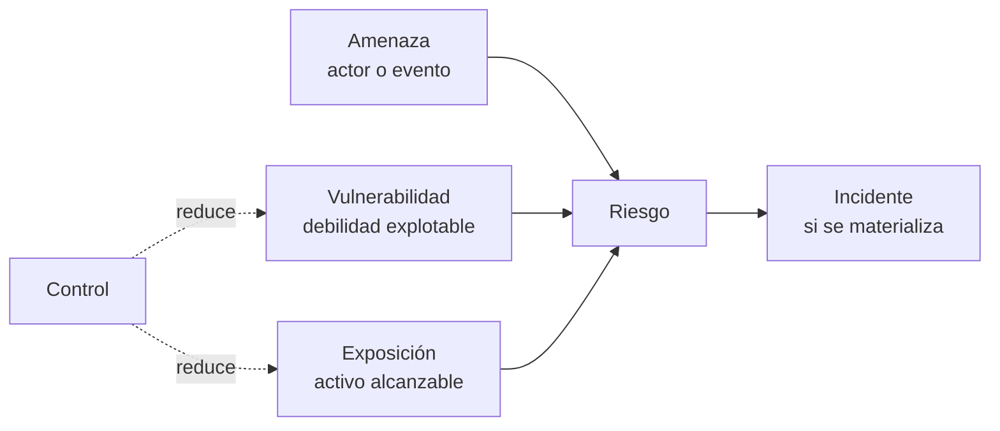
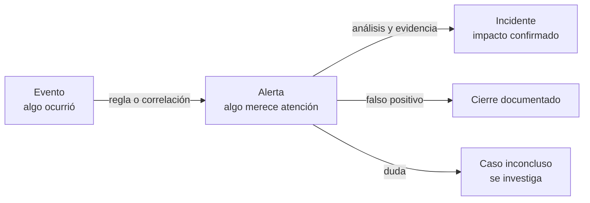
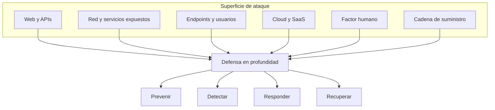
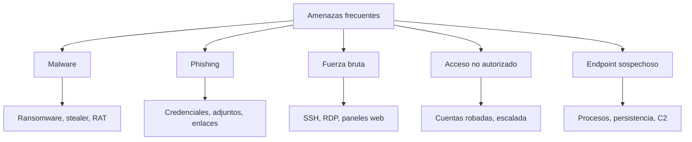

# 01 — Fundamentos de ciberseguridad

**Curso:** C|CS · CyberSOC  
**Tiempo de lectura:** 25–35 min  
**Laboratorio asociado:** lectura de `auth.log` y primeras consultas en Wazuh

---

## 1.1 ¿Qué es la ciberseguridad?

La ciberseguridad es el conjunto de **prácticas, controles y decisiones** que protegen sistemas, redes, aplicaciones y datos frente a accesos, cambios o interrupciones no autorizadas. No es un producto que se instala ni un estado que se alcanza: es un proceso continuo de gestión de riesgo.

Una definición útil para el trabajo diario tiene tres partes:

| Parte | Pregunta | Ejemplo |
|---|---|---|
| **Activo** | ¿Qué protegemos? | La base de datos de clientes, el servidor de nómina, la reputación de la universidad |
| **Amenaza** | ¿De quién o de qué nos protegemos? | Un atacante con credenciales filtradas, un ransomware, un empleado descuidado |
| **Control** | ¿Qué hacemos al respecto? | MFA, segmentación, copias de seguridad, monitoreo con Wazuh |

> [!NOTE]
> La seguridad no elimina el riesgo. Lo reduce a un nivel que la organización puede **aceptar, transferir o mitigar** con los recursos disponibles.



*Mapa de áreas y dominios de la ciberseguridad. Fuente: material del curso.*

### Seguridad de la información vs. ciberseguridad

- **Seguridad de la información** protege la información en cualquier formato: papel, voz, disco, nube.
- **Ciberseguridad** se enfoca en la información y los sistemas que dependen de medios digitales.
- **Seguridad informática** suele referirse a la protección técnica de equipos y redes.

En la práctica los tres términos se solapan. Lo importante es no confundir *protección* con *cumplimiento*: un sistema puede cumplir una norma y seguir siendo inseguro.

---

## 1.2 La tríada CIA y sus extensiones

La tríada **CIA** (Confidencialidad, Integridad, Disponibilidad) sigue siendo el marco más útil para explicar qué protege un SOC.



| Propiedad | Definición | Se rompe cuando… | Control típico |
|---|---|---|---|
| **Confidencialidad** | Solo personas y servicios autorizados acceden a la información | Un usuario sin permiso lee expedientes; se filtra una base de datos | Cifrado, ACL, MFA, segmentación |
| **Integridad** | Los datos y la configuración cambian por las vías previstas y dejan rastro | Alguien modifica una nota de evaluación o un binario del sistema | Hashing, FIM, firmas, control de cambios |
| **Disponibilidad** | Los servicios operan cuando la organización los necesita | Un ransomware cifra archivos; un DDoS tumba el portal | Copias, redundancia, anti-DDoS, planes de continuidad |

### Propiedades adicionales que verás en el SOC

- **Autenticidad:** el mensaje o usuario es quien dice ser. Se apoya en certificados, firmas y MFA.
- **Trazabilidad:** cada acción queda asociada a un sujeto, un momento y un recurso. Es la base de la evidencia forense.
- **No repudio:** alguien no puede negar haber realizado una acción registrada. Requiere logs íntegros y relojes sincronizados.
- **Privacidad:** la protección de datos personales, que puede entrar en tensión con la monitorización. Un SOC debe operar con base legal y proporcionalidad.

> [!IMPORTANT]
> Un incidente puede afectar una sola propiedad y las otras dos convertirse en el daño colateral. Un ransomware ataca disponibilidad, pero también puede exfiltrar datos (confidencialidad) y alterar registros (integridad).

---

## 1.3 Amenaza, vulnerabilidad, riesgo y exposición

Estos cuatro términos se usan como sinónimos en conversaciones informales, pero en un reporte significan cosas distintas.



| Término | Definición operativa | Ejemplo |
|---|---|---|
| **Amenaza** | Actor, herramienta o evento con capacidad de causar daño | Atacante que compra credenciales en un foro |
| **Vulnerabilidad** | Falla o condición que puede explotarse | SSH con contraseña débil y sin MFA |
| **Exposición** | Grado en que el activo es alcanzable | El puerto 22 está publicado a Internet |
| **Riesgo** | Probabilidad e impacto de que una amenaza explote una vulnerabilidad | Alta probabilidad de acceso inicial y alto impacto sobre nómina |
| **Incidente** | Materialización confirmada que afecta o puede afectar la seguridad | La cuenta `root` inicia sesión desde una IP desconocida |

### La fórmula que ordena prioridades

\[
\text{Riesgo} \approx \text{Probabilidad} \times \text{Impacto}
\]

No es una fórmula matemática exacta; es una herramienta de priorización. Dos organizaciones pueden tener la misma vulnerabilidad y riesgos distintos porque sus activos, exposición y controles son distintos.

**Ejemplo aplicado**

| Escenario | Probabilidad | Impacto | Prioridad |
|---|---|---|---|
| Servidor de laboratorio con SSH débil, aislado | Baja | Bajo | Baja |
| Servidor de nómina con SSH débil, expuesto a Internet | Alta | Alto | Crítica |
| Laptop de un docente sin cifrado, con acceso a correo | Media | Medio | Media |

> [!WARNING]
> "Tenemos un firewall" no significa "no hay riesgo". El firewall reduce exposición, pero no corrige una aplicación vulnerable ni un usuario con permisos excesivos.

---

## 1.4 Evento, alerta e incidente

En un SOC se confunden constantemente. La diferencia determina si cierras un ticket o activas el protocolo de respuesta.



| Nivel | Qué es | Quién lo genera | Ejemplo |
|---|---|---|---|
| **Evento** | Registro de algo que ocurre | Sistema, aplicación, red, endpoint | `Failed password for invalid user admin` |
| **Alerta** | Aviso cuando un evento o patrón supera un umbral | Regla del SIEM, EDR, IDS | 20 fallos en 10 segundos desde la misma IP |
| **Incidente** | Evento confirmado con impacto real o potencial | Analista, tras investigar | La cuenta `svc-backup` inició sesión después de los fallos |

### Ejemplo concreto: fuerza bruta SSH

1. **Eventos:** cien líneas `Failed password` en `/var/log/auth.log`.
2. **Alerta:** Wazuh correlaciona y dispara una regla de fuerza bruta.
3. **Investigación:** se revisa si hubo un `Accepted password` desde la misma IP.
4. **Incidente:** si hubo acceso exitoso, se activa respuesta; si no, se documenta como intento fallido y se refuerza el control.

> [!TIP]
> Un fallo aislado suele ser un error de tipeo. Una ráfaga con éxito desde la misma IP es una señal de compromiso. La **secuencia** importa más que el conteo aislado.

### Campos que siempre debes mirar en un log de autenticación

| Campo | Pregunta | Por qué importa |
|---|---|---|
| Hora y frecuencia | ¿Cuándo y cada cuánto? | Distingue error humano de automatización |
| Usuario | ¿Existe? ¿Tiene privilegios? | `root` y cuentas de servicio son objetivos preferidos |
| IP de origen | ¿Conocida? ¿Repetida? | Permite correlacionar con otros casos |
| Servicio y host | ¿SSH, RDP, web? | Cambia el vector y el alcance |
| Resultado | ¿Fallo o éxito? | Un éxito después de fallos es crítico |

---

## 1.5 Actores y motivaciones

No todos los atacantes tienen el mismo objetivo ni el mismo nivel. El tipo de actor orienta la detección y la respuesta.

| Actor | Motivación | Capacidad | Señal típica |
|---|---|---|---|
| **Script kiddie** | Curiosidad, reconocimiento | Baja; usa herramientas existentes | Escaneos ruidosos, exploits públicos |
| **Cibercriminal** | Dinero | Media-alta; trabaja por objetivos | Ransomware, fraude, venta de accesos |
| **Insider** | Venganza, dinero, negligencia | Alta; conoce la organización | Accesos fuera de horario, copias masivas |
| **Hacktivista** | Ideología | Variable | Defacement, DDoS, filtración |
| **APT / estado-nación** | Espionaje, sabotaje, influencia | Muy alta; paciencia y recursos | Persistencia sigilosa, herramientas propias |
| **Investigador / bug bounty** | Hallazgo y reputación | Variable | Reporte responsable, alcance autorizado |

> [!NOTE]
> La misma técnica puede provenir de actores distintos. El contexto —horario, activo, geografía, historial— es lo que permite atribuir con mayor confianza. La atribución nunca es automática.

---

## 1.6 Superficie de ataque y defensa en profundidad

La **superficie de ataque** es el conjunto de puntos por donde un atacante puede interactuar con el sistema. Incluye tecnología, personas y procesos.



### Defensa en profundidad

Es la idea de superponer controles para que el fallo de uno no implique el compromiso total:

1. **Perímetro:** firewall, WAF, segmentación.
2. **Identidad:** MFA, mínimo privilegio, revisión de accesos.
3. **Endpoint:** EDR, hardening, parches.
4. **Aplicación:** validación de entrada, pruebas de seguridad, SDLC.
5. **Datos:** cifrado, clasificación, copias verificadas.
6. **Detección:** SIEM, IDS, threat hunting.
7. **Respuesta:** runbooks, comunicación, forense.
8. **Recuperación:** backups, continuidad, lecciones aprendidas.

### Principios que se repiten en todo el curso

- **Mínimo privilegio:** cada cuenta y servicio tiene solo los permisos necesarios.
- **Separación de funciones:** quien administra no debería ser quien audita.
- **Fallo seguro:** si un control falla, debe cerrar el acceso, no abrirlo.
- **Verificación por defecto:** no confiar en un usuario, dispositivo o red solo por su ubicación.
- **Trazabilidad:** toda acción relevante deja evidencia.

---

## 1.7 Amenazas que monitorea un SOC



| Amenaza | Qué se observa | Indicadores típicos |
|---|---|---|
| **Malware** | Ejecución de software no deseado | Procesos raros, conexiones a dominios nuevos, cifrado masivo |
| **Phishing** | Mensaje que suplanta identidad | Remitente extraño, urgencia, enlaces acortados, adjuntos |
| **Fuerza bruta** | Pruebas repetidas de credenciales | Ráfagas de fallos, usuarios inexistentes, IP única |
| **Acceso no autorizado** | Uso de cuenta o recurso sin permiso | Login exitoso anómalo, acceso a rutas restringidas |
| **Endpoint sospechoso** | Comportamiento fuera de lo normal | Persistencia, procesos hijos inusuales, conexiones salientes |

### Ejemplo de lectura de un log real

```bash
# Ver los últimos intentos fallidos de SSH
sudo grep "Failed password" /var/log/auth.log | tail -n 20

# Ver fallos y éxitos de la última hora
sudo journalctl -u ssh --since "1 hour ago" | grep -iE "failed|accepted"
```

**Cómo interpretar el resultado**

- Si todos los fallos vienen de la misma IP y el mismo usuario, puede ser un error de configuración o un ataque dirigido.
- Si los usuarios probados son nombres comunes (`admin`, `root`, `test`), es enumeración automatizada.
- Si después de los fallos aparece un `Accepted password`, la prioridad sube de inmediato.
- Si la IP es interna, revisa si el equipo origen está comprometido.

> [!WARNING]
> No bloquees una IP solo por un fallo. Primero confirma que no sea una cuenta de servicio, un escaneo autorizado o un usuario legítimo con un problema de credenciales.

---

## 1.8 Caso integrador: de un log a una decisión

**Contexto:** el servidor `srv-nomina` está expuesto por SSH. Wazuh alerta 150 fallos en 5 minutos desde `203.0.113.45`.

**Paso 1 — Confirmar el evento**

```bash
sudo grep "203.0.113.45" /var/log/auth.log | tail -n 30
```

**Paso 2 — Buscar éxito posterior**

```bash
sudo grep "Accepted" /var/log/auth.log | grep "203.0.113.45"
```

**Paso 3 — Revisar el usuario y sus privilegios**

```bash
id nomina
sudo -l -U nomina
```

**Paso 4 — Decidir**

| Resultado | Decisión |
|---|---|
| Solo fallos, usuario inexistente | Cerrar como intento fallido; bloquear IP y reforzar reglas |
| Fallos y luego éxito | Incidente: contener, rotar credenciales, revisar acciones |
| IP interna | Investigar el equipo origen; puede ser un equipo comprometido |
| Cuenta de servicio | Revisar configuración; no rotar a ciegas sin coordinar |

**Paso 5 — Documentar**

- Hora de la alerta y hora de la investigación.
- Consultas ejecutadas y su salida.
- Decisión tomada y responsable.
- Acciones de contención y seguimiento.

---

## 1.9 Glosario mínimo

| Término | Definición breve |
|---|---|
| **Activo** | Recurso con valor para la organización |
| **Amenaza** | Actor o evento con capacidad de dañar |
| **Vulnerabilidad** | Debilidad explotable |
| **Riesgo** | Probabilidad e impacto de un incidente |
| **Control** | Medida que reduce riesgo |
| **Evento** | Registro de una acción |
| **Alerta** | Aviso generado por una regla |
| **Incidente** | Evento confirmado con impacto |
| **IOC** | Indicador de compromiso (IP, hash, dominio) |
| **TTP** | Táctica, técnica y procedimiento del atacante |
| **SOC** | Centro de operaciones de seguridad |
| **SIEM** | Gestión de eventos e información de seguridad |
| **EDR** | Detección y respuesta en endpoint |
| **XDR** | Detección y respuesta extendida |
| **FIM** | Monitoreo de integridad de archivos |
| **MITRE ATT&CK** | Base de conocimiento de tácticas y técnicas adversarias |

---

## 1.10 Autoevaluación

1. Explica con un ejemplo propio la diferencia entre amenaza, vulnerabilidad y riesgo.
2. ¿Por qué un evento no es lo mismo que una alerta?
3. ¿Qué propiedad de la tríada CIA se ve afectada por un ransomware? ¿Solo una?
4. ¿Qué harías si ves 200 fallos de SSH y ningún éxito?
5. ¿Por qué la atribución de un ataque no debe basarse solo en una IP?
6. Nombra tres controles de defensa en profundidad y explica qué capa cubren.
7. ¿Qué evidencia guardarías para demostrar que investigaste una alerta?

---

## Para profundizar

- NIST Cybersecurity Framework 2.0 — funciones *Govern, Identify, Protect, Detect, Respond, Recover*.
- MITRE ATT&CK — tácticas y técnicas adversarias.
- Wazuh Documentation — reglas, decodificadores y módulos.
- SANS Incident Handler's Handbook — ciclo de respuesta a incidentes.

---

**Anterior:** [README](README.md) · **Siguiente:** [02 — SOC y Blue Team](02-soc-blue-team.md)
