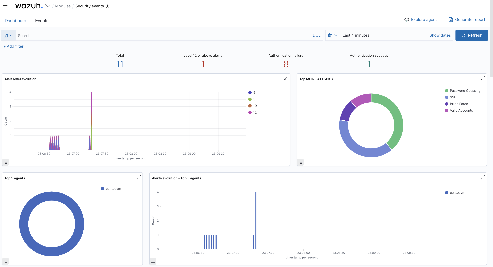
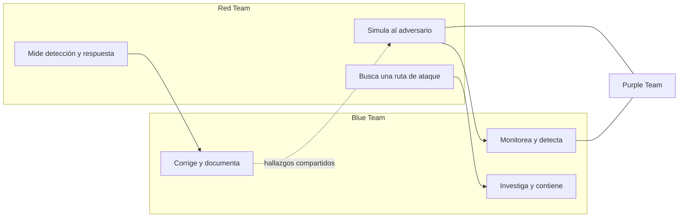
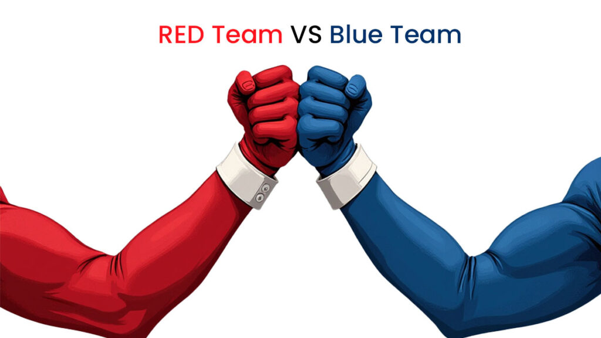
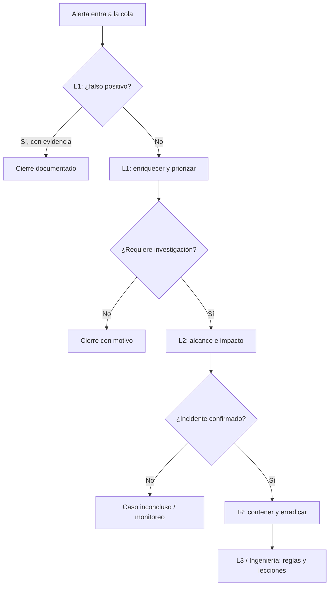
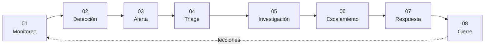
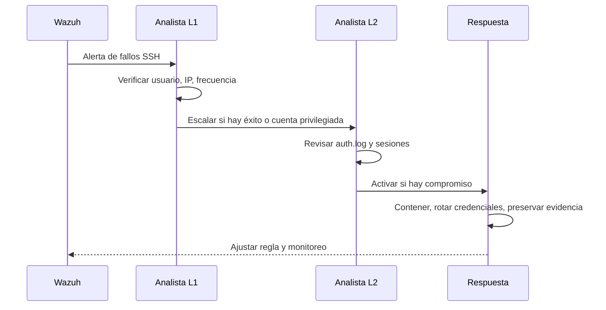

# 02 — SOC y Blue Team

**Curso:** C|CS · CyberSOC  
**Tiempo de lectura:** 30–40 min  
**Laboratorio asociado:** recorrido por el dashboard de Wazuh y el flujo de triage

---

## 2.1 Qué es un SOC

Un **Security Operations Center (SOC)** es el equipo, la operación y la tecnología donde se monitorea, analiza y responde a la seguridad de la organización. No es solo una sala con pantallas: es un **proceso continuo** con personas, turnos, reglas, responsables y evidencia.

*Panel de operaciones con alertas y métricas de seguridad. Fuente: material del curso.*

```mermaid
flowchart LR
    subgraph P [Personas]
        L1["Analista L1"]
        L2["Analista L2"]
        L3["Analista L3"]
        IR["Respuesta a incidentes"]
        TH["Threat Hunter"]
        EN["Ingeniero SOC"]
    end
    subgraph PR [Procesos]
        MON["Monitoreo"]
        TRI["Triage"]
        INV["Investigación"]
        RESP["Respuesta"]
        MEJ["Mejora continua"]
    end
    subgraph T [Tecnología]
        SIEM["SIEM"]
        EDR["EDR / XDR"]
        IDS["IDS / NDR"]
        TIP["Threat Intelligence"]
        SOAR["SOAR"]
    end
    P --> PR
    PR --> T
    T --> P
```

### Las tres funciones irreducibles

| Función | Pregunta | Salida |
|---|---|---|
| **Monitorear** | ¿Qué está pasando ahora? | Eventos, alertas, tableros |
| **Analizar** | ¿Qué significa y qué alcance tiene? | Hipótesis, evidencia, conclusión |
| **Responder** | ¿Qué hacemos y cómo evitamos que se repita? | Contención, erradicación, recuperación, lecciones |

> [!NOTE]
> Un SOC maduro no se mide por la cantidad de alertas que genera, sino por la **calidad de las decisiones** que permite tomar.

---

## 2.2 Red Team, Blue Team y Purple Team

| Equipo | Objetivo | Método | Éxito |
|---|---|---|---|
| **Red Team** | Probar si una ruta de ataque es posible | Tácticas y técnicas reales, con autorización | Hallazgo demostrado sin daño |
| **Blue Team** | Prevenir, detectar y responder | Monitoreo, reglas, investigación, hardening | Incidente contenido y aprendizaje |
| **Purple Team** | Mejorar la defensa con ambos | Colaboración y ejercicios conjuntos | Detección y respuesta medibles |

*Red Team, Blue Team y colaboración purple. Fuente: material del curso.*

### Lo que realmente distingue a un Red Team profesional

- **Autorización escrita** y alcance definido.
- **Reglas de enfrentamiento (RoE):** qué se puede tocar, cuándo y cómo.
- **Minimización del daño:** no se exfiltran datos reales ni se altera producción.
- **Evidencia y reporte:** el valor está en el hallazgo documentado, no en el acceso.
- **Coordinación con el Blue Team:** en un ejercicio purple, se comparte el timeline.

> [!WARNING]
> "Somos el Red Team" no autoriza a atacar cualquier sistema. Sin permiso, la misma técnica es un delito, aunque el objetivo sea "probar la seguridad".

---

## 2.3 Modelos de implementación de un SOC

| Modelo | Quién opera | Ventajas | Riesgos |
|---|---|---|---|
| **Interno** | Equipo propio | Conocimiento del negocio, control total | Costo alto, difícil cubrir 24×7 |
| **Virtual** | Equipo remoto | Menor costo de infraestructura, flexibilidad | Depende de conectividad y confianza |
| **Externalizado (MSSP)** | Proveedor de servicios | Experiencia, cobertura, herramientas | Pérdida de contexto, dependencia contractual |
| **Híbrido o cogestionado** | Interno + MSSP | Equilibrio entre contexto y escala | Gobernanza y traspaso de información complejos |

### Cómo elegir

1. **Criticidad de los activos:** no es lo mismo un laboratorio que un core bancario.
2. **Regulación:** datos personales, salud, financiero.
3. **Presupuesto:** personas, licencias, infraestructura.
4. **Madurez:** ¿hay inventario, logs, procesos, responsables?
5. **Cobertura horaria:** 8×5, 16×5 o 24×7.

> [!TIP]
> Un SOC pequeño puede empezar con un modelo híbrido: el equipo interno conserva el contexto y el MSSP cubre fuera de horario. Lo importante es definir **quién decide** en cada severidad.

---

## 2.4 Roles y responsabilidades

| Rol | Responsabilidad principal | Decide sobre | No debería |
|---|---|---|---|
| **SOC Analyst L1** | Triage inicial, cierre de falsos positivos | Si una alerta se escala | Investigar a fondo sin apoyo |
| **SOC Analyst L2** | Investigación, alcance, contención | Contención táctica | Cambiar reglas sin control |
| **SOC Analyst L3** | Casos complejos, hunting, mejora | Estrategia de detección | Apagar alertas para bajar volumen |
| **Incident Responder** | Coordinar respuesta y recuperación | Acciones de contención mayores | Actuar sin comunicación |
| **Threat Hunter** | Buscar amenazas sin alerta previa | Hipótesis de búsqueda | Convertir hallazgos en ruido |
| **SOC Engineer** | SIEM, reglas, integraciones, salud | Plataforma y pipelines | Operar casos sin contexto |

### Reparto típico por turno

> [!IMPORTANT]
> En equipos pequeños, varios roles recaen en la misma persona. Eso no elimina la necesidad de **separar decisiones críticas**: quien investiga no debería aprobar solo el cierre de un incidente grave.

---

## 2.5 Flujo de trabajo de un SOC

| Paso | Entrada | Actividad | Salida |
|---|---|---|---|
| 1. Monitoreo | Logs, métricas, feeds | Vigilar fuentes y salud del pipeline | Eventos disponibles |
| 2. Detección | Eventos | Aplicar reglas, correlación, umbrales | Candidatos a alerta |
| 3. Alerta | Candidato | Priorizar por severidad y activo | Ticket o caso |
| 4. Triage | Ticket | Confirmar, enriquecer, descartar | Decisión de escalar |
| 5. Investigación | Caso | Alcance, línea de tiempo, evidencia | Hipótesis y conclusión |
| 6. Escalamiento | Conclusión | Pasar a L2/L3/IR o al área responsable | Responsable asignado |
| 7. Respuesta | Incidente | Contener, erradicar, recuperar | Servicio restaurado |
| 8. Cierre | Evidencia | Documentar, medir, mejorar | Lección y acción |

### Métricas que importan

| Métrica | Qué mide | Por qué importa |
|---|---|---|
| **MTTD** | Tiempo medio hasta detectar | Cuánto tiempo tuvo el atacante |
| **MTTR** | Tiempo medio hasta responder | Cuánto duró el impacto |
| **Tasa de falsos positivos** | Ruido de las reglas | Cansa al analista y oculta lo importante |
| **Cobertura de detección** | Técnicas ATT&CK cubiertas | Qué tan ciego está el SOC |
| **Tiempo de enriquecimiento** | Velocidad de contexto | Calidad de la decisión |
| **Backlog de alertas** | Deuda operativa | Riesgo de alertas sin revisar |

> [!TIP]
> No optimices solo el volumen de alertas. Una regla que genera 10 000 alertas y nadie revisa es peor que una regla que genera 10 y todas se investigan.

---

## 2.6 Triage: la primera decisión

El triage es el proceso de decidir si una alerta es **real, relevante y urgente**. No es "cerrar rápido".

### Preguntas de triage

1. **¿Qué activo está afectado?** ¿Producción, laboratorio, endpoint de usuario?
2. **¿Qué usuario o servicio?** ¿Privilegiado, cuentas de servicio, usuario común?
3. **¿Qué evidencia hay?** Logs, proceso, conexión, archivo, hash.
4. **¿Hay correlación?** ¿Otros eventos en la misma ventana?
5. **¿Es esperado?** ¿Mantenimiento, escaneo autorizado, despliegue?
6. **¿Cuál es el peor caso?** Si es real, ¿qué podría pasar?
7. **¿Qué hago ahora?** Cerrar, escalar, contener o pedir contexto.

### Matriz de prioridad

| Impacto \ Probabilidad | Baja | Media | Alta |
|---|---|---|---|
| **Alto** | Media | Alta | Crítica |
| **Medio** | Baja | Media | Alta |
| **Bajo** | Baja | Baja | Media |

### Ejemplo de triage

**Alerta:** `Multiple authentication failures` en `srv-web-01`, 300 eventos en 2 minutos.

| Pregunta | Respuesta |
|---|---|
| Activo | Servidor web de producción |
| Usuario | `root` y usuarios inexistentes |
| Evidencia | Fallos desde una IP externa; sin éxito |
| Correlación | No hay otros servicios afectados |
| Esperado | No |
| Peor caso | Acceso root por fuerza bruta |
| Acción | Escalar a L2, bloquear IP, revisar `Accepted`, reforzar SSH |

---

## 2.7 Runbook: qué hacer con una alerta de fuerza bruta

**Checklist**

- [ ] Confirmar hora, host, usuario e IP.
- [ ] Contar intentos y ventana temporal.
- [ ] Buscar `Accepted` posterior.
- [ ] Revisar privilegios del usuario.
- [ ] Revisar otros hosts desde la misma IP.
- [ ] Decidir bloqueo temporal o permanente.
- [ ] Documentar evidencia y decisión.
- [ ] Ajustar regla si hay falsos positivos.

---

## 2.8 Cultura y comunicación

Un SOC falla menos por falta de herramientas que por falta de **comunicación**. Algunas reglas de trabajo:

- **Una alerta, un dueño.** Si nadie es responsable, nadie la cierra.
- **Evidencia antes que opinión.** "Me parece raro" no es un hallazgo.
- **Escalar temprano no es fracasar.** Es parte del proceso.
- **No castigar el reporte.** Si un usuario reporta un phishing, refuerza la conducta.
- **Documentar para el siguiente turno.** El contexto que no se escribe se pierde.
- **Cuidar la privacidad.** Monitorear no autoriza a revisar la vida personal de nadie.

> [!WARNING]
> Un SOC que oculta incidentes para "no alarmar" pierde la confianza de la organización y empeora el impacto cuando el caso sale a la luz.

---

## 2.9 Autoevaluación

1. ¿Qué diferencia hay entre Red Team y Purple Team?
2. ¿Cuándo conviene un SOC externalizado y cuándo uno interno?
3. Describe el flujo de una alerta desde el evento hasta el cierre.
4. ¿Qué preguntas harías en el triage de un acceso exitoso a las 3 a.m.?
5. ¿Por qué el MTTR no basta como métrica?
6. ¿Qué harías si una regla genera demasiados falsos positivos?
7. ¿Qué información no deberías compartir en un ticket?

---

**Anterior:** [01 — Fundamentos](01-fundamentos-ciberseguridad.md) · **Siguiente:** [03 — Tecnologías de un SOC](03-tecnologias-soc.md)
