# 03 — Tecnologías de un SOC

**Curso:** C|CS · CyberSOC  
**Tiempo de lectura:** 30–40 min  
**Laboratorio asociado:** exploración de módulos de Wazuh y fuentes de telemetría

---

## 3.1 El problema que resuelve la tecnología

Un SOC recibe millones de eventos por día. La tecnología no está para "ver todo", sino para **convertir ruido en señales priorizadas**. Esa cadena tiene cuatro etapas:

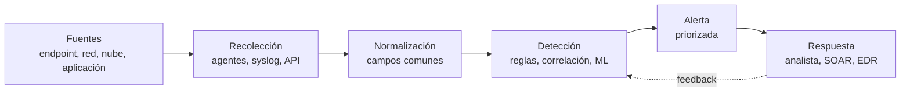

| Etapa | Pregunta | Fallo típico |
|---|---|---|
| Fuentes | ¿Tengo la telemetría necesaria? | Solo logs de firewall, sin endpoint |
| Recolección | ¿Llega completa y a tiempo? | Agente caído, reloj desincronizado |
| Normalización | ¿Puedo comparar campos? | Cada fuente usa nombres distintos |
| Detección | ¿La regla distingue lo importante? | Umbral mal calibrado, mucho ruido |
| Respuesta | ¿Puedo actuar rápido? | Sin runbook ni permisos |

---

## 3.2 Familias de herramientas

| Familia | Función | Ejemplos | Pregunta que responde |
|---|---|---|---|
| **SIEM** | Centraliza logs, correlaciona y alerta | Wazuh, Splunk, Elastic Security, QRadar | ¿Qué pasó en toda la organización? |
| **EDR** | Telemetría y respuesta en endpoint | ESET PROTECT, CrowdStrike, Defender for Endpoint | ¿Qué hizo un proceso en este equipo? |
| **XDR** | Correlación extendida entre capas | Wazuh XDR, Trend Micro, Palo Alto XDR | ¿Cómo se conecta endpoint, red y correo? |
| **NDR** | Análisis de tráfico de red | Suricata, Zeek, Darktrace | ¿Qué conversaciones son anómalas? |
| **SOAR** | Automatización de respuesta | Shuffle, Cortex XSOAR, n8n | ¿Qué acciones puedo automatizar con seguridad? |
| **TIP** | Gestión de threat intelligence | MISP, OpenCTI | ¿Qué indicadores conozco y cómo los aplico? |
| **FIM** | Integridad de archivos | Wazuh FIM, Tripwire | ¿Cambió algo que no debía cambiar? |
| **Escáner de vulnerabilidades** | Inventario de CVEs | OpenVAS, Nessus | ¿Qué fallas conocidas tengo? |

> [!NOTE]
> Las categorías se solapan. Wazuh, por ejemplo, combina SIEM, XDR, FIM, SCA y respuesta activa. Lo importante es saber **qué evidencia produce** cada herramienta y **qué decisión habilita**.

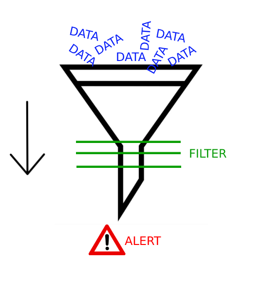

*Del volumen de eventos a la alerta priorizada: el embudo del SIEM. Fuente: material del curso.*

---

## 3.3 Wazuh

Wazuh es una plataforma **open source** de SIEM y XDR. Recolecta eventos de endpoints, servidores, red y servicios cloud; los decodifica, aplica reglas y genera alertas. Su arquitectura se estudia en el capítulo 04.

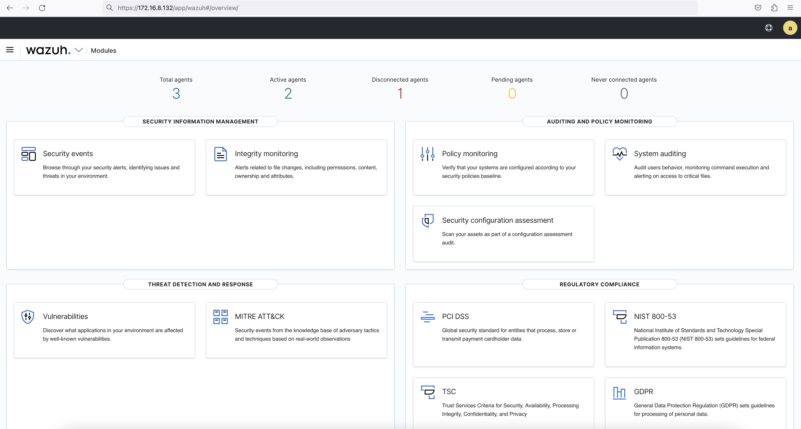

*Vista de módulos de Wazuh. Fuente: documentación oficial de Wazuh, uso educativo.*

### Qué aporta al SOC

- **Visibilidad:** agente en endpoints, syslog, API, contenedores.
- **Detección:** reglas propias y comunidad, MITRE ATT&CK.
- **Integridad:** FIM con hashes y cambios en tiempo real.
- **Cumplimiento:** SCA con checks de configuración.
- **Vulnerabilidades:** inventario de CVEs por activo.
- **Respuesta:** active response para bloquear o aislar.

---

## 3.4 ESET PROTECT e Inspect

ESET PROTECT es la consola de administración de endpoints; **Inspect** permite investigar el detalle de un equipo: procesos, conexiones, archivos, usuarios y eventos.

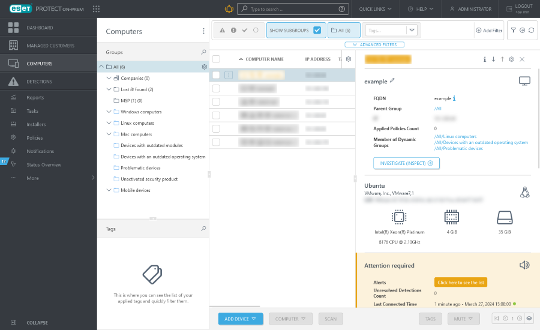

*Consola de ESET PROTECT con acceso a Investigate/Inspect. Fuente: documentación oficial de ESET PROTECT On-Prem 11.1.*

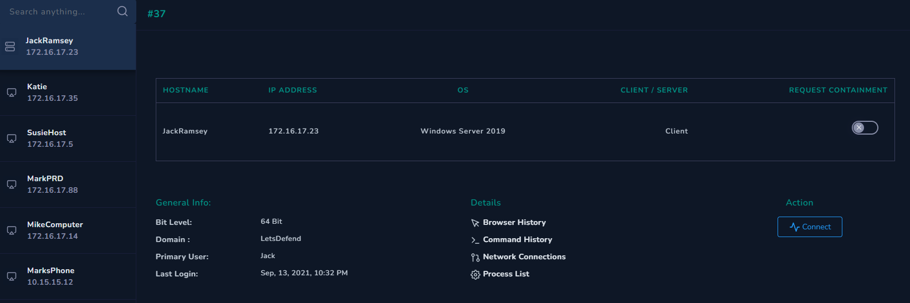

*Vista de telemetría de un endpoint en el EDR. Fuente: material del curso.*

| Función | Uso en el SOC |
|---|---|
| Inventario de endpoints | Saber qué equipos están protegidos |
| Detecciones | Confirmar malware y su ruta |
| Investigate/Inspect | Ver procesos y conexiones de un host |
| Políticas | Aplicar hardening y exclusiones controladas |
| Cuarentena | Aislar un equipo comprometido |

> [!WARNING]
> Una consola de EDR no reemplaza al SIEM. El EDR ve el endpoint; el SIEM correlaciona ese endpoint con red, identidad y aplicaciones.

---

## 3.5 Sysmon

Sysmon (System Monitor) es un componente de Microsoft Sysinternals que registra eventos detallados de Windows: creación de procesos, conexiones de red, cambios de archivo, carga de drivers y más. Escribe en el Visor de eventos y se integra con Wazuh.

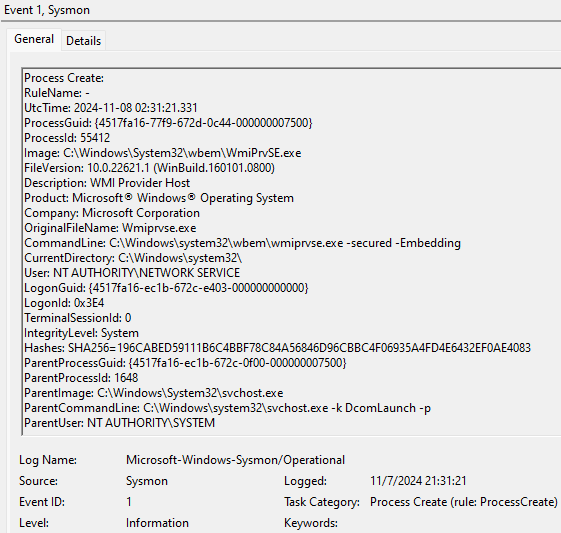

*Evento de Sysmon en el Visor de eventos de Windows. Fuente: Microsoft Sysinternals.*

### Eventos que más se usan

| Event ID | Evento | Uso |
|---|---|---|
| 1 | Creación de proceso | Ver línea de comandos, padre e hijo |
| 3 | Conexión de red | Detectar C2 y movimiento lateral |
| 7 | Carga de imagen | DLLs sospechosas |
| 8 | CreateRemoteThread | Inyección de código |
| 11 | Creación de archivo | Droppers y persistencia |
| 12/13/14 | Registro | Persistencia y configuración |
| 22 | Consulta DNS | Dominios maliciosos |

> [!TIP]
> Sin una configuración de Sysmon adecuada, el volumen puede ser enorme. Empieza con un baseline de la comunidad y ajusta exclusiones con evidencia.

---

## 3.6 Suricata y EveBox

Suricata es un IDS/IPS y monitor de seguridad de red. Inspecciona tráfico, aplica firmas y genera eventos en formato EVE JSON. EveBox es una interfaz para visualizar esas alertas.

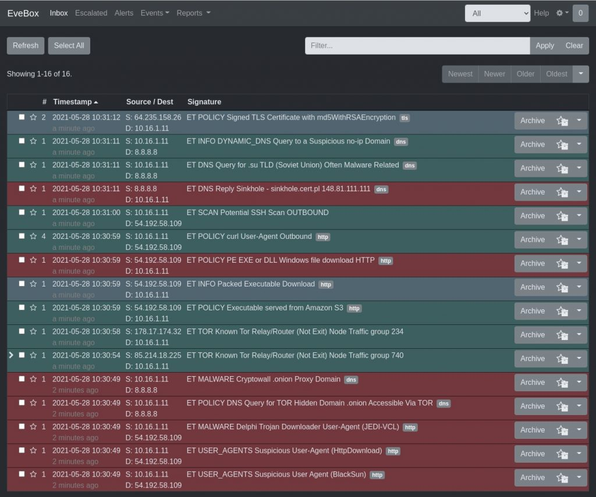

*Alertas de Suricata visualizadas en EveBox. Fuente: Suricata features, uso educativo.*

| Concepto | Significado |
|---|---|
| **Firma** | Regla que describe un patrón de tráfico |
| **Alerta** | Coincidencia de una firma |
| **Flow** | Conversación completa entre dos endpoints |
| **EVE JSON** | Formato de eventos de Suricata |
| **IPS** | Modo bloqueo; requiere despliegue en línea |

### Lo que Suricata no ve

- Tráfico cifrado sin inspección TLS.
- Actividad puramente local en el endpoint.
- Fraude de usuario legítimo sin patrón de red.

Por eso se complementa con EDR y logs de aplicación.

---

## 3.7 Velociraptor

Velociraptor es una plataforma de **respuesta y visibilidad forense** en endpoints. Permite ejecutar consultas (VQL) sobre miles de equipos, recolectar artefactos y buscar indicadores.

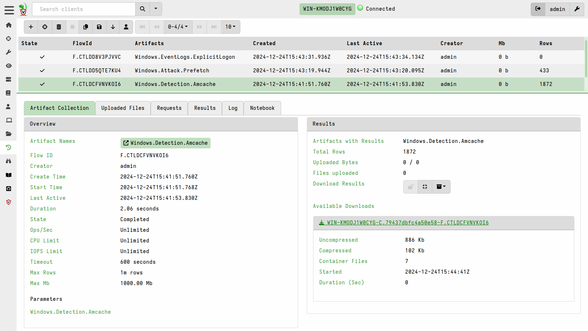

*Colecciones de clientes en Velociraptor. Fuente: documentación oficial de Velociraptor.*

| Caso de uso | Ejemplo |
|---|---|
| Hunting | Buscar un hash en todos los endpoints |
| Forense | Recolectar procesos, autoruns, prefetch |
| Respuesta | Aislar o consultar un equipo |
| Inventario | Versiones, parches, software |

> [!NOTE]
> Velociraptor es especialmente útil cuando el SIEM ya dio la alerta y necesitas **profundidad** en el endpoint sin moverte equipo por equipo.

---

## 3.8 VirusTotal

VirusTotal agrega resultados de decenas de motores antivirus y análisis de comportamiento. Se usa para enriquecer hashes, URLs, dominios e IPs.

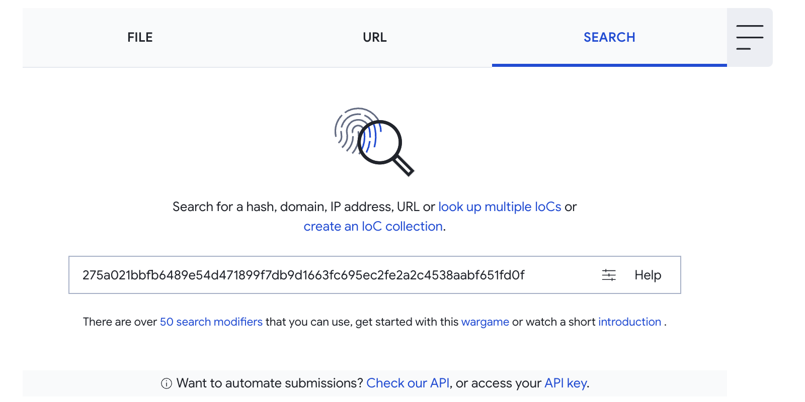

*Búsqueda de hash en VirusTotal. Fuente: documentación oficial de VirusTotal.*

### Cómo usarlo sin equivocarte

1. **No subas información confidencial.** Un hash es más seguro que un archivo.
2. **Un resultado limpio no prueba inocencia.** Puede ser malware nuevo o evasivo.
3. **Mira el contexto:** firma, comportamiento, relaciones, primera aparición.
4. **Corrobora con otras fuentes:** sandbox, threat intel, telemetría propia.

> [!WARNING]
> "0/70 detecciones" no significa "seguro". Significa "ningún motor de ese conjunto lo detectó en ese momento".

---

## 3.9 MITRE ATT&CK

MITRE ATT&CK es una base de conocimiento de **tácticas, técnicas y procedimientos** observados en ataques reales. Organiza el comportamiento adversario en una matriz.

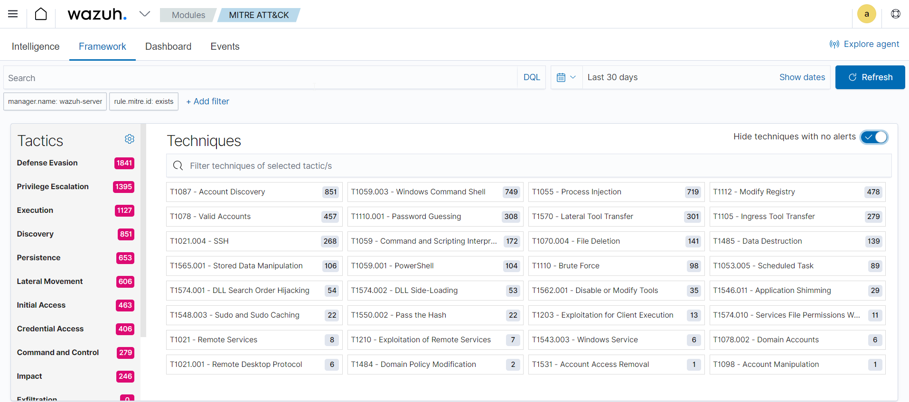

*Módulo MITRE ATT&CK de Wazuh. Fuente: documentación de Wazuh.*

| Concepto | Definición | Ejemplo |
|---|---|---|
| **Táctica** | El "por qué": objetivo del atacante | Credential Access |
| **Técnica** | El "cómo": forma de lograrlo | Brute Force (T1110) |
| **Subtécnica** | Variante específica | Password Guessing (T1110.001) |
| **Procedimiento** | Implementación concreta de un actor | Herramienta y comando usados |

### Tácticas principales

1. Reconnaissance
2. Resource Development
3. Initial Access
4. Execution
5. Persistence
6. Privilege Escalation
7. Defense Evasion
8. Credential Access
9. Discovery
10. Lateral Movement
11. Collection
12. Command and Control
13. Exfiltration
14. Impact

> [!TIP]
> Usa ATT&CK para **nombrar** lo que detectas y para **medir cobertura**. Una regla que detecta fuerza bruta cubre T1110; si no tienes nada para T1059 (ejecución de comandos), sabes dónde falta.

---

## 3.10 Arquitectura de referencia de un SOC

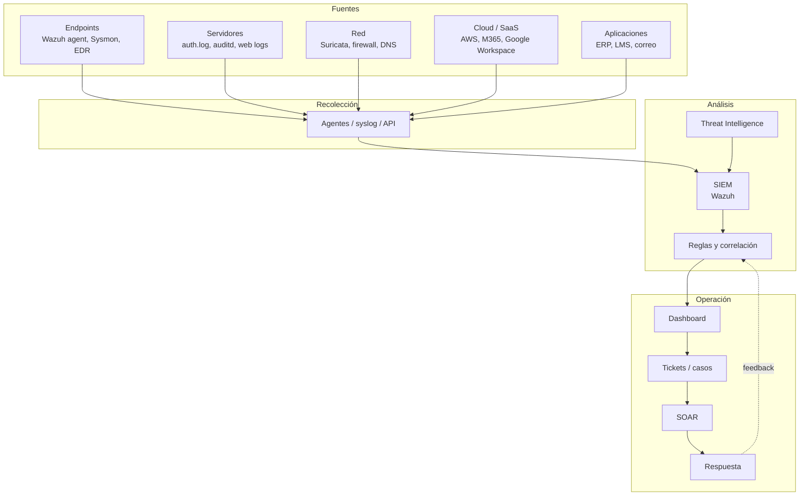

### Preguntas de diseño

- ¿Qué activos son críticos y qué telemetría producen?
- ¿Dónde se almacenan los logs y por cuánto tiempo?
- ¿Cómo se sincroniza el tiempo (NTP)?
- ¿Qué se correlaciona y qué se deja solo para forense?
- ¿Quién puede ver datos sensibles?
- ¿Qué acciones se automatizan y cuáles requieren aprobación humana?

---

## 3.11 Detección: de la regla al hallazgo

Una regla de detección tiene cuatro partes:

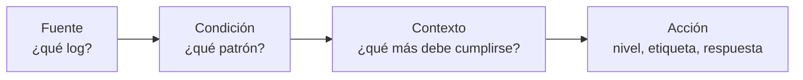

**Ejemplo conceptual**

| Parte | Ejemplo |
|---|---|
| Fuente | `auth.log` de Linux |
| Condición | `Failed password` |
| Contexto | 10 eventos en 60 s desde la misma IP |
| Acción | Alerta nivel 10, etiqueta T1110, notificar |

### Calidad de una regla

| Criterio | Pregunta |
|---|---|
| **Precisión** | ¿Detecta lo que dice detectar? |
| **Cobertura** | ¿Deja fuera variantes importantes? |
| **Ruido** | ¿Cuántos falsos positivos genera? |
| **Accionabilidad** | ¿El analista puede hacer algo con ella? |
| **Mantenibilidad** | ¿Se entiende y se puede ajustar? |

> [!IMPORTANT]
> Una regla sin dueño, sin documentación y sin prueba es deuda técnica. Cada regla debería tener un caso de prueba y una fecha de revisión.

---

## 3.12 Autoevaluación

1. ¿Qué diferencia hay entre SIEM, EDR y XDR?
2. ¿Qué evidencia aporta Sysmon que no da un firewall?
3. ¿Por qué VirusTotal no determina por sí solo que un archivo es seguro?
4. ¿Cómo usarías MITRE ATT&CK para medir la cobertura del SOC?
5. ¿Qué fuentes faltarían si solo tuvieras logs de red?
6. ¿Qué automatizarías con SOAR y qué dejarías a un humano?
7. ¿Qué pasa si los relojes de los equipos no están sincronizados?

---

**Anterior:** [02 — SOC y Blue Team](02-soc-blue-team.md) · **Siguiente:** [04 — Wazuh: arquitectura y reglas](04-wazuh-arquitectura.md)
