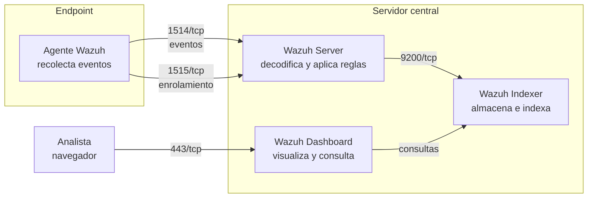
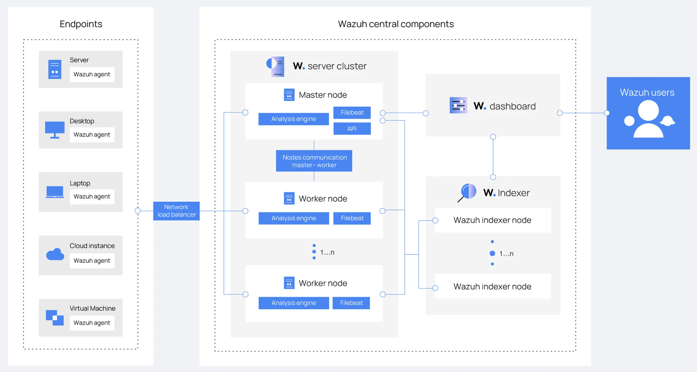
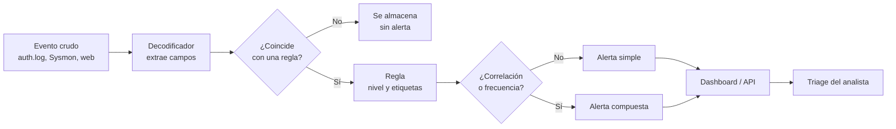
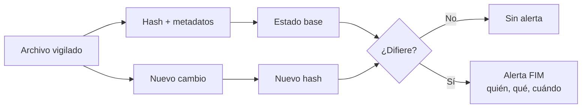
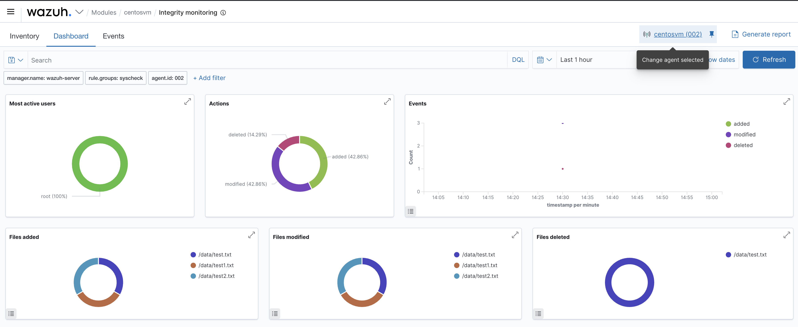

# 04 — Wazuh: arquitectura y reglas

**Curso:** C|CS · CyberSOC  
**Tiempo de lectura:** 35–45 min  
**Laboratorio asociado:** despliegue all-in-one y creación de una regla

---

## 4.1 Qué es Wazuh

Wazuh es una plataforma **open source** de SIEM y XDR. Recolecta, analiza y correlaciona eventos de endpoints, servidores y red; genera alertas y permite ejecutar acciones de respuesta.

| Capacidad | Qué hace | Ejemplo |
|---|---|---|
| **SIEM** | Centraliza logs, decodifica y correlaciona | Fallos SSH, eventos de Windows, logs web |
| **XDR** | Visibilidad y respuesta en endpoints | Procesos, FIM, vulnerabilidades |
| **FIM** | Monitorea integridad de archivos | Cambio en `/etc/passwd` |
| **SCA** | Evalúa configuración de seguridad | CIS Benchmark |
| **Vulnerabilidades** | Detecta CVEs en paquetes | OpenSSL desactualizado |
| **Active Response** | Ejecuta acciones automáticas | Bloquear IP, aislar host |
| **MITRE ATT&CK** | Etiqueta técnicas detectadas | T1110 Brute Force |

> [!NOTE]
> Wazuh no es "un antivirus". Es una plataforma de visibilidad y detección que se apoya en la telemetría de muchas fuentes. Su valor depende de la calidad de esos datos.

---

## 4.2 Los cuatro componentes





*Arquitectura de referencia: agente, server, indexer y dashboard. Fuente: material del curso.*

| Componente | Función | Puerto típico |
|---|---|---|
| **Agente** | Recolecta logs, FIM, SCA y eventos del endpoint | 1514/tcp (eventos), 1515/tcp (enrolamiento) |
| **Server** | Recibe, decodifica, aplica reglas y correlaciona | 1514, 1515, 55000 (API) |
| **Indexer** | Almacena y busca eventos (OpenSearch) | 9200 |
| **Dashboard** | Interfaz web de consulta y administración | 443 |

### All-in-one vs. distribuido

| Topología | Cuándo usarla | Ventaja | Limitación |
|---|---|---|---|
| **All-in-one** | Laboratorio, pocas fuentes | Simple de desplegar | No escala a miles de agentes |
| **Distribuido** | Producción | Escala y separa funciones | Más complejo de operar |
| **Agentes + server remoto** | Varias sedes | Centraliza detección | Depende de red y latencia |

> [!TIP]
> En el laboratorio del curso, Server, Indexer y Dashboard comparten una VM. En producción se separan para aislar fallos y escalar.

---

## 4.3 Del evento a la alerta



### Ejemplo de evento

```text
Jan 15 03:12:44 srv-web sshd[2451]: Failed password for invalid user admin from 203.0.113.45 port 51234 ssh2
```

### Ejemplo de decodificación

| Campo extraído | Valor |
|---|---|
| `srcip` | 203.0.113.45 |
| `user` | admin |
| `program_name` | sshd |
| `action` | failed |
| `id` | 5710 (ejemplo) |

La regla decide si ese evento importa, con qué nivel y qué etiquetas recibe.

---

## 4.4 Decodificadores

Un **decodificador** transforma una línea de log en campos estructurados. Sin decodificador, la regla solo puede hacer coincidir texto; con él, puede comparar `srcip`, `user`, `status` y correlacionar.

```xml
<decoder name="ssh-failed">
  <program_name>sshd</program_name>
  <regex>Failed password for (?:invalid user )?(\S+) from (\S+) port (\d+)</regex>
  <order>user, srcip, srcport</order>
</decoder>
```

| Elemento | Función |
|---|---|
| `<program_name>` | Filtra por programa |
| `<regex>` | Captura campos |
| `<order>` | Nombra los campos capturados |
| `<parent>` | Relaciona con otro decodificador |
| `<prematch>` | Filtro rápido antes de la regex |

> [!WARNING]
> Un decodificador mal escrito puede generar campos vacíos o incorrectos. Siempre prueba con `wazuh-logtest` antes de confiar en la regla.

---

## 4.5 Reglas

Una **regla** evalúa eventos decodificados y decide si generan alerta. Se escriben en XML y viven en `/var/ossec/etc/rules/`.

```xml
<group name="syslog,sshd,">
  <rule id="100010" level="10">
    <if_sid>5710</if_sid>
    <description>Fallo de autenticación SSH para usuario inválido</description>
    <mitre>
      <id>T1110</id>
    </mitre>
  </rule>
</group>
```

| Campo | Significado |
|---|---|
| `id` | Identificador único (las locales suelen empezar en 100000) |
| `level` | Severidad de 0 a 15 |
| `if_sid` | Se evalúa si otra regla ya coincidió |
| `if_group` | Se evalúa si el evento pertenece a un grupo |
| `frequency` | Número de ocurrencias para disparar |
| `timeframe` | Ventana de tiempo en segundos |
| `same_source_ip` | Exige que las ocurrencias vengan de la misma IP |
| `description` | Texto legible de la alerta |
| `mitre` | Técnica ATT&CK asociada |

### Regla de fuerza bruta

```xml
<rule id="100020" level="12" frequency="8" timeframe="120">
  <if_matched_sid>100010</if_matched_sid>
  <same_source_ip />
  <description>Posible fuerza bruta SSH desde la misma IP</description>
  <mitre>
    <id>T1110</id>
  </mitre>
</rule>
```

Esta regla no alerta por un fallo aislado: exige **8 fallos en 120 segundos desde la misma IP**.

### Niveles de severidad

| Nivel | Interpretación | Acción típica |
|---|---|---|
| 0 | Sin alerta | Solo registro |
| 1–3 | Informativo | Sin acción |
| 4–7 | Bajo / medio | Revisar en horario |
| 8–11 | Alto | Triage prioritario |
| 12–15 | Crítico | Escalar y contener |

> [!IMPORTANT]
> El nivel orienta, no decide solo. Un nivel 7 en un servidor de nómina puede ser más urgente que un nivel 12 en un laboratorio.

---

## 4.6 FIM: integridad de archivos

FIM (File Integrity Monitoring) vigila cambios en archivos y directorios: creación, modificación, borrado y atributos. Wazuh calcula hashes y compara contra el estado anterior.



### Qué configurar

```xml
<syscheck>
  <frequency>43200</frequency>
  <directories check_all="yes" realtime="yes">/etc</directories>
  <directories check_all="yes" realtime="yes">/bin</directories>
  <directories check_all="yes">/var/www/html</directories>
  <ignore>/etc/mtab</ignore>
</syscheck>
```

| Opción | Efecto |
|---|---|
| `realtime="yes"` | Detecta cambios en tiempo real |
| `check_all="yes"` | Hash, permisos, propietario, tamaño |
| `whodata="yes"` | Intenta identificar el proceso/usuario |
| `ignore` | Excluye archivos que cambian solos |

> [!TIP]
> FIM sin baseline es ruido. Primero deja que el sistema se estabilice, luego revisa los cambios esperados (actualizaciones, logs rotados) y exclúyelos con justificación.



*Vista de integridad de archivos en Wazuh. Fuente: documentación de Wazuh.*

---

## 4.7 Capacidades que se integran

| Módulo | Qué detecta | Ejemplo de alerta |
|---|---|---|
| **FIM** | Cambios en archivos | `/etc/passwd` modificado |
| **SCA** | Configuración insegura | SSH permite login de root |
| **Vulnerabilidades** | CVEs en paquetes | OpenSSL vulnerable |
| **Active Response** | Acción automática | Bloquear IP con `iptables` |
| **MITRE** | Técnica asociada | T1110 Brute Force |
| **Security Configuration Assessment** | Checklist CIS | Puntaje de hardening |

### Active Response: poder y riesgo

```xml
<active-response>
  <command>firewall-drop</command>
  <location>local</location>
  <rules_id>100020</rules_id>
  <timeout>600</timeout>
</active-response>
```

> [!WARNING]
> Bloquear automáticamente puede cortar el acceso a un usuario legítimo o a una IP compartida (NAT, proxy). Empieza en modo alerta, valida y luego automatiza con timeout y lista blanca.

---

## 4.8 Despliegue y operación

### Requisitos típicos de laboratorio

| Recurso | Mínimo | Recomendado |
|---|---|---|
| CPU | 2 vCPU | 4 vCPU |
| RAM | 4 GB | 8 GB |
| Disco | 50 GB | 100 GB |
| Red | Host-only / NAT | Host-only + NAT |
| SO | Ubuntu Server 22.04/24.04 | Ubuntu Server LTS |

### Checklist de instalación

- [ ] VM creada y snapshot inicial.
- [ ] IP fija o reservada.
- [ ] NTP sincronizado.
- [ ] Wazuh indexer, server y dashboard instalados.
- [ ] Dashboard accesible por HTTPS.
- [ ] Agente instalado y enrolado.
- [ ] Eventos llegando al dashboard.
- [ ] Regla de prueba funcionando.
- [ ] Backup/snapshot posterior.

### Comandos útiles

```bash
# Estado de servicios
sudo systemctl status wazuh-manager
sudo systemctl status wazuh-indexer
sudo systemctl status wazuh-dashboard

# Ver logs del manager
sudo tail -f /var/ossec/logs/ossec.log

# Probar una regla con un log de ejemplo
sudo /var/ossec/bin/wazuh-logtest

# Listar agentes
sudo /var/ossec/bin/agent_control -l

# Ver reglas cargadas
sudo /var/ossec/bin/wazuh-control info
```

---

## 4.9 Errores frecuentes

| Síntoma | Causa probable | Solución |
|---|---|---|
| El agente no aparece | Puerto 1515 cerrado o clave incorrecta | Revisar firewall y enrolamiento |
| No llegan eventos | Agente detenido o configuración vacía | `systemctl status wazuh-agent` |
| Alerta no dispara | Regla mal escrita o decodificador no coincide | `wazuh-logtest` |
| Dashboard no carga | Indexer caído o certificado | Revisar servicios y logs |
| FIM genera ruido | Archivos que cambian constantemente | Excluir con justificación |
| Hora incorrecta | NTP desincronizado | Configurar `chrony`/`systemd-timesyncd` |

> [!NOTE]
> La mayoría de fallos de un SIEM no son de "reglas", sino de **tubería**: el evento no llega, llega tarde, llega sin campos o llega con hora incorrecta.

---

## 4.10 Autoevaluación

1. ¿Qué hace cada uno de los cuatro componentes de Wazuh?
2. ¿Qué diferencia hay entre decodificador y regla?
3. ¿Para qué sirven `frequency`, `timeframe` y `same_source_ip`?
4. ¿Por qué FIM necesita un baseline?
5. ¿Qué riesgo tiene Active Response y cómo lo mitigarías?
6. ¿Qué revisarías si un agente no envía eventos?
7. ¿Cómo probarías una regla antes de ponerla en producción?

---

**Anterior:** [03 — Tecnologías](03-tecnologias-soc.md) · **Siguiente:** [05 — Laboratorio Wazuh](05-laboratorio-wazuh.md)
