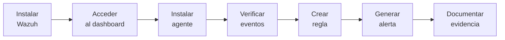
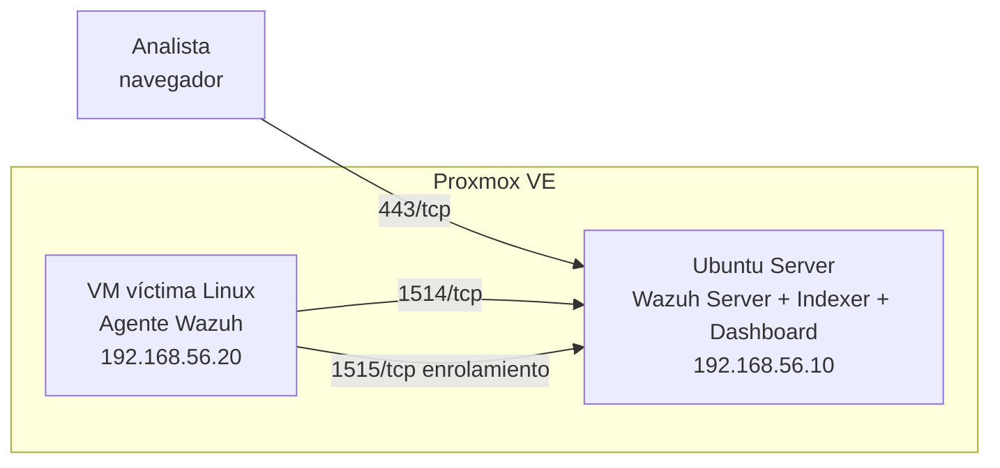
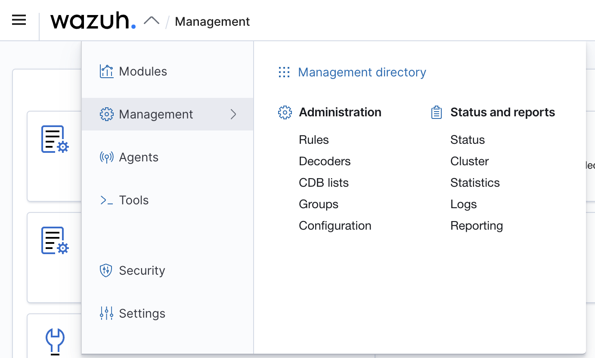
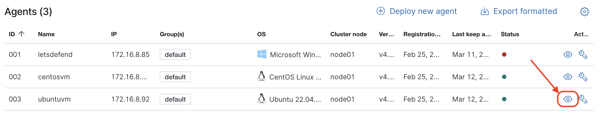

# 05 — Laboratorio: implementación de Wazuh SIEM

**Curso:** C|CS · CyberSOC  
**Duración estimada:** 90–120 min  
**Entorno:** Proxmox VE + Ubuntu Server + endpoint Linux/Windows

---

## 5.1 Objetivo del laboratorio

Montar un SIEM funcional con Wazuh, enrolar un endpoint y demostrar el ciclo completo:



Al terminar debes poder responder: **¿qué evento generé, en qué host, a qué hora, qué regla lo detectó y qué evidencia conservé?**

---

## 5.2 Arquitectura del laboratorio



| Nodo | Rol | IP sugerida | Recursos |
|---|---|---|---|
| `wazuh-srv` | Server + Indexer + Dashboard | 192.168.56.10 | 4 vCPU, 8 GB RAM, 80 GB |
| `victima-linux` | Endpoint monitoreado | 192.168.56.20 | 2 vCPU, 2 GB RAM, 20 GB |
| `analista` | Navegador del estudiante | DHCP | — |

> [!WARNING]
> Usa una red **host-only** o un laboratorio aislado. No conectes la VM vulnerable a la red de producción ni publiques el dashboard a Internet.

---

## 5.3 Preparación

### Checklist previo

- [ ] Proxmox VE operativo y accesible.
- [ ] ISO de Ubuntu Server descargada.
- [ ] Virtualización activa (VT-x/AMD-V).
- [ ] Red host-only creada.
- [ ] Snapshot limpio antes de instalar.
- [ ] NTP funcionando en el host y las VM.

### Crear la VM

1. Sube la ISO a Proxmox.
2. Crea una VM con 4 vCPU, 8 GB RAM y 80 GB de disco.
3. Configura red `vmbr1` (host-only) con IP estática `192.168.56.10/24`.
4. Instala Ubuntu Server con OpenSSH.
5. Actualiza el sistema:

```bash
sudo apt update && sudo apt upgrade -y
sudo apt install -y curl wget gnupg lsb-release
```

---

## 5.4 Instalación de Wazuh (all-in-one)

Wazuh ofrece un asistente de instalación. Los pasos exactos cambian según la versión; usa siempre la documentación oficial vigente.

```bash
# Descargar el asistente (verifica la versión actual en la documentación)
curl -sO https://packages.wazuh.com/4.x/wazuh-install.sh
curl -sO https://packages.wazuh.com/4.x/config.yml

# Revisar y ajustar config.yml (IPs, contraseñas, nodos)
nano config.yml

# Instalación all-in-one
sudo bash wazuh-install.sh -a -i
```

> [!TIP]
> Guarda las contraseñas generadas en un gestor de secretos, no en un archivo plano dentro de la VM. En laboratorio, anótalas en tu bitácora privada.

### Verificar servicios

```bash
sudo systemctl status wazuh-manager
sudo systemctl status wazuh-indexer
sudo systemctl status wazuh-dashboard
```

### Acceder al dashboard

1. Abre `https://192.168.56.10`.
2. Acepta el certificado autofirmado (solo en laboratorio).
3. Inicia sesión con el usuario administrador.
4. Verifica que el dashboard muestre el manager activo.



*Menú de gestión de Wazuh: reglas, decodificadores, agentes y estado del clúster. Fuente: documentación de Wazuh.*

---

## 5.5 Instalar el agente en Linux

### En la VM víctima

```bash
# Añadir el repositorio de Wazuh (verifica la versión)
curl -s https://packages.wazuh.com/key/GPG-KEY-WAZUH | \
  sudo gpg --dearmor -o /usr/share/keyrings/wazuh.gpg

echo "deb [signed-by=/usr/share/keyrings/wazuh.gpg] https://packages.wazuh.com/4.x/apt/ stable main" | \
  sudo tee /etc/apt/sources.list.d/wazuh.list

sudo apt update
sudo apt install -y wazuh-agent
```

### Configurar el manager

Edita `/var/ossec/etc/ossec.conf` y apunta al server:

```xml
<client>
  <server>
    <address>192.168.56.10</address>
    <port>1514</port>
    <protocol>tcp</protocol>
  </server>
</client>
```

### Enrolar y arrancar

```bash
sudo /var/ossec/bin/agent-auth -m 192.168.56.10
sudo systemctl daemon-reload
sudo systemctl enable --now wazuh-agent
sudo systemctl status wazuh-agent
```

### Verificar en el dashboard

- Ve a **Agents**.
- Debe aparecer `victima-linux` como **Active**.
- Revisa **Security events** para confirmar que llegan eventos.



*Vista de agentes. Fuente: documentación de Wazuh.*

---

## 5.6 Instalar el agente en Windows (opcional)

1. Descarga el MSI desde la documentación oficial.
2. Ejecuta el instalador y define el manager `192.168.56.10`.
3. Inicia el servicio `WazuhSvc`.
4. Verifica el agente en el dashboard.
5. Opcional: instala Sysmon y configura Wazuh para leer su canal de eventos.

```powershell
# Verificar servicio
Get-Service WazuhSvc

# Ver eventos de Sysmon (si está instalado)
Get-WinEvent -LogName "Microsoft-Windows-Sysmon/Operational" -MaxEvents 5
```

---

## 5.7 Prueba 1: evento de autenticación

### Generar el evento

```bash
# En la VM víctima: fallar SSH a propósito
ssh usuario_inexistente@localhost
# Introduce una contraseña incorrecta varias veces
```

### Buscar en Wazuh

- **Security events** → filtra por `agent.name:victima-linux`.
- Busca `Failed password` o `authentication_failed`.
- Abre el evento y revisa los campos decodificados.

### Documentar

| Campo | Valor |
|---|---|
| Fecha/hora | |
| Host | `victima-linux` |
| Usuario | |
| IP origen | |
| Regla | |
| Nivel | |
| Conclusión | |

---

## 5.8 Prueba 2: integridad de archivos (FIM)

### Configurar FIM

En `/var/ossec/etc/ossec.conf` del agente:

```xml
<syscheck>
  <frequency>300</frequency>
  <directories check_all="yes" realtime="yes">/home/alumno/pruebas</directories>
</syscheck>
```

Reinicia el agente:

```bash
sudo systemctl restart wazuh-agent
```

### Generar el cambio

```bash
mkdir -p /home/alumno/pruebas
echo "contenido inicial" > /home/alumno/pruebas/evidencia.txt
sleep 5
echo "cambio no autorizado" >> /home/alumno/pruebas/evidencia.txt
```

### Verificar

- **File integrity monitoring** en el dashboard.
- Debe aparecer el archivo, el hash anterior y el nuevo.
- Revisa si `whodata` identifica el proceso.

> [!NOTE]
> Si no ves el cambio, espera la frecuencia configurada o fuerza un escaneo con `sudo /var/ossec/bin/wazuh-control restart`.

---

## 5.9 Prueba 3: regla personalizada

### Crear la regla

En el server, `/var/ossec/etc/rules/local_rules.xml`:

```xml
<group name="local,pruebas,">
  <rule id="100100" level="8">
    <if_sid>5710</if_sid>
    <description>Fallo SSH de prueba en laboratorio</description>
    <mitre>
      <id>T1110</id>
    </mitre>
  </rule>
</group>
```

### Validar y recargar

```bash
sudo /var/ossec/bin/wazuh-logtest
sudo systemctl restart wazuh-manager
```

### Probar con `wazuh-logtest`

Pega una línea como:

```text
Jan 15 03:12:44 srv-web sshd[2451]: Failed password for invalid user admin from 203.0.113.45 port 51234 ssh2
```

Debe mostrar la regla `100100` y el nivel 8.

### Generar la alerta real

```bash
ssh usuario_inexistente@192.168.56.20
```

Verifica la alerta en el dashboard.

---

## 5.10 Prueba 4: fuerza bruta y correlación

### Regla de correlación

```xml
<rule id="100110" level="12" frequency="5" timeframe="60">
  <if_matched_sid>100100</if_matched_sid>
  <same_source_ip />
  <description>Posible fuerza bruta SSH (5 fallos en 60 s)</description>
  <mitre>
    <id>T1110</id>
  </mitre>
</rule>
```

### Generar los fallos

```bash
for i in $(seq 1 8); do
  ssh usuario_inexistente@192.168.56.20
done
```

### Verificar

- Debe aparecer una alerta de nivel 12.
- Revisa que `same_source_ip` haya agrupado correctamente.
- Si no aparece, revisa la ventana temporal y el `if_matched_sid`.

> [!WARNING]
> No ejecutes este bucle contra sistemas fuera del laboratorio. Es un ataque de fuerza bruta, aunque sea de prueba.

---

## 5.11 Evidencia y reporte

### Qué conservar

- Captura del dashboard con la alerta.
- Salida de `wazuh-logtest`.
- Línea de log original.
- Regla aplicada (XML).
- Hora exacta y zona horaria.
- Conclusión del analista.

### Plantilla de reporte

```markdown
## Reporte de laboratorio

**Alumno:**
**Fecha:**
**Host:**
**Objetivo:**

### 1. Arquitectura
...

### 2. Evento generado
...

### 3. Evidencia
...

### 4. Regla aplicada
...

### 5. Conclusión
...

### 6. Recomendaciones
...
```

---

## 5.12 Troubleshooting

| Problema | Verificación | Solución |
|---|---|---|
| Dashboard no responde | `curl -k https://IP` | Revisar indexer/dashboard |
| Agente no enrola | `telnet IP 1515` | Abrir puerto, revisar clave |
| No llegan eventos | `tail -f /var/ossec/logs/ossec.log` | Revisar configuración del agente |
| Regla no dispara | `wazuh-logtest` | Corregir regex o `if_sid` |
| FIM no alerta | `grep syscheck` | Revisar rutas y frecuencia |
| Hora desfasada | `timedatectl` | Configurar NTP |

---

## 5.13 Autoevaluación

1. ¿Por qué el laboratorio debe estar aislado?
2. ¿Qué diferencia hay entre el puerto 1514 y el 1515?
3. ¿Cómo compruebas que un agente está activo?
4. ¿Qué evidencia demuestra que una regla funcionó?
5. ¿Por qué una regla de fuerza bruta necesita `same_source_ip`?
6. ¿Qué harías si el dashboard muestra el agente activo pero no hay eventos?
7. ¿Qué datos no deberías subir a un repositorio público?

---

**Anterior:** [04 — Wazuh: arquitectura](04-wazuh-arquitectura.md) · **Siguiente:** [06 — Detección en la práctica](06-deteccion-practica.md)
