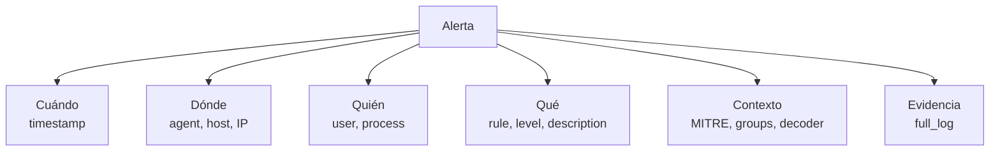
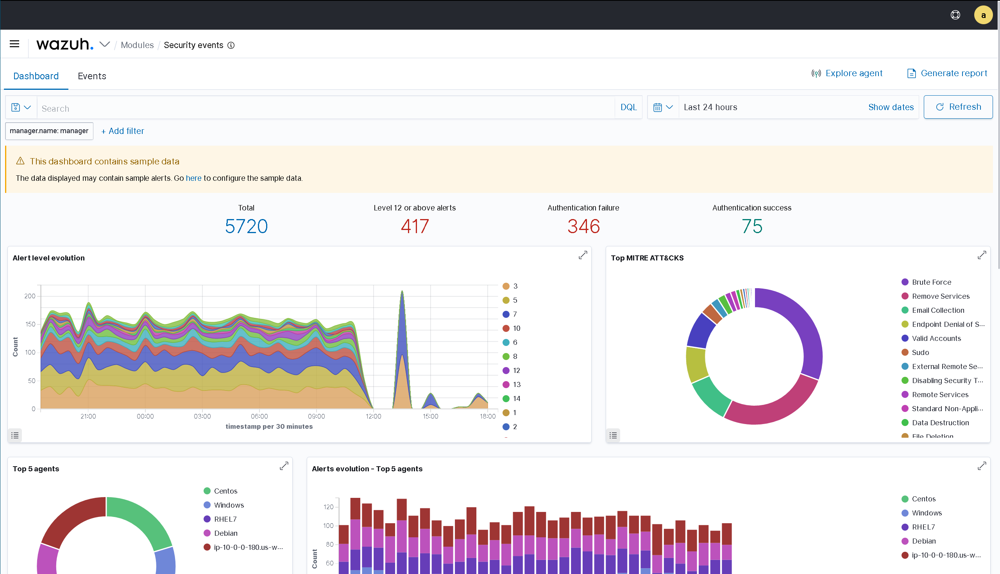
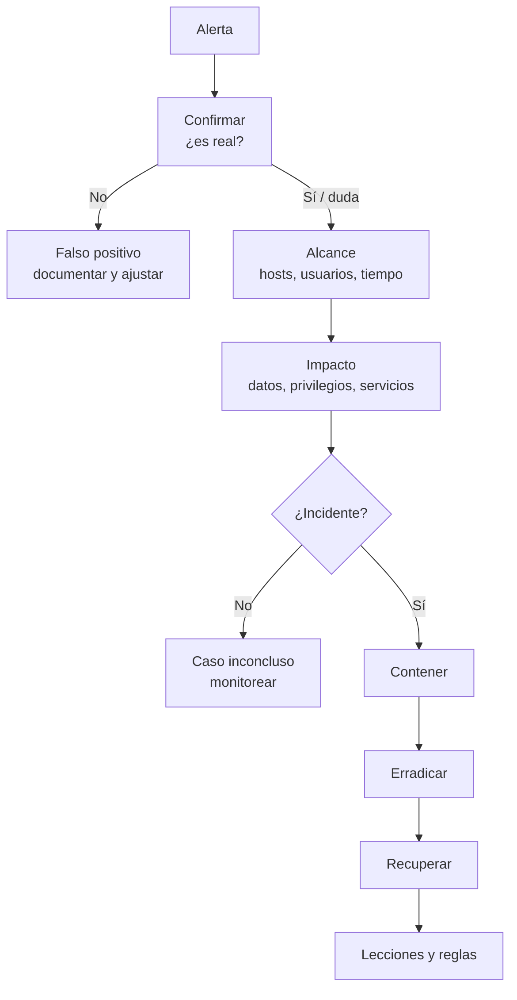
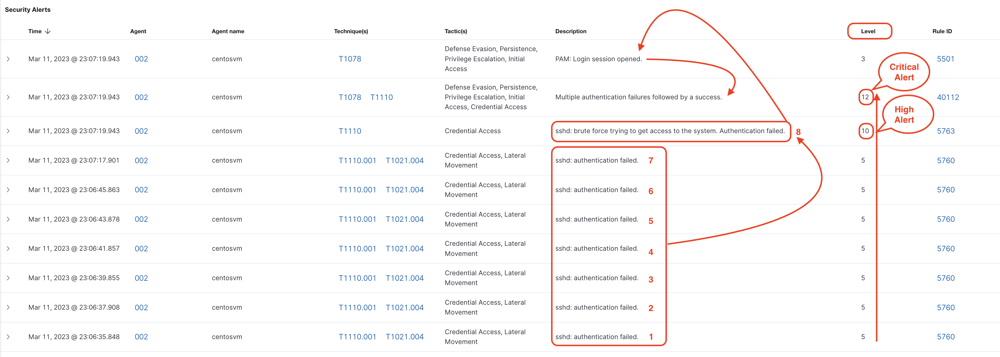
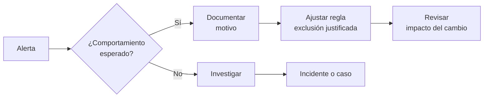

# 06 — Detección en la práctica

**Curso:** C|CS · CyberSOC  
**Tiempo de lectura:** 30–40 min  
**Laboratorio asociado:** triage de alertas en Wazuh y redacción de evidencia

---

## 6.1 Anatomía de una alerta

Una alerta de Wazuh no es un texto aislado: es un objeto con campos que permiten reconstruir lo ocurrido.



| Campo | Pregunta | Uso |
|---|---|---|
| `timestamp` | ¿Cuándo? | Línea de tiempo |
| `agent.name` | ¿Qué host? | Alcance |
| `data.srcip` | ¿Desde dónde? | Correlación y bloqueo |
| `data.user` | ¿Quién? | Privilegios e impacto |
| `rule.id` | ¿Qué regla? | Trazabilidad |
| `rule.level` | ¿Qué severidad? | Prioridad |
| `rule.mitre` | ¿Qué técnica? | Cobertura |
| `full_log` | ¿Qué pasó exactamente? | Evidencia cruda |

> [!NOTE]
> La alerta es una **hipótesis**. La investigación convierte esa hipótesis en conclusión con evidencia.



*Vista de un dashboard de SOC con eventos y alertas. Fuente: material del curso.*

---

## 6.2 Flujo de investigación



### Las cinco preguntas

1. **¿Qué activo?** Producción, laboratorio, endpoint de usuario.
2. **¿Qué usuario?** Privilegiado, servicio, común, inexistente.
3. **¿Qué acción?** Login, proceso, archivo, conexión.
4. **¿Qué evidencia?** Logs, hashes, capturas, timeline.
5. **¿Qué impacto?** Confidencialidad, integridad, disponibilidad.

---

## 6.3 Caso 1: fuerza bruta SSH

### Alerta

```text
Rule: 100110 - Posible fuerza bruta SSH (5 fallos en 60 s)
Level: 12
Agent: victima-linux
Src IP: 203.0.113.45
User: admin
```



*Ejemplo de alerta de fuerza bruta SSH en Wazuh. Fuente: documentación de Wazuh.*

### Investigación paso a paso

**1. Confirmar los fallos**

```bash
sudo grep "203.0.113.45" /var/log/auth.log | tail -n 50
```

**2. Buscar un acceso exitoso**

```bash
sudo grep "Accepted" /var/log/auth.log | grep "203.0.113.45"
```

**3. Revisar el usuario**

```bash
id admin
sudo -l -U admin
lastlog -u admin
```

**4. Revisar otros hosts**

```bash
# Desde el server, busca la IP en todos los agentes
sudo grep -R "203.0.113.45" /var/ossec/logs/alerts/ | tail -n 20
```

**5. Revisar sesiones activas**

```bash
who
w
last -a | head
```

### Matriz de decisión

| Hallazgo | Clasificación | Acción |
|---|---|---|
| Solo fallos, usuario inexistente | Intento fallido | Bloquear IP, ajustar regla, monitorear |
| Fallos + éxito | Incidente confirmado | Contener, rotar credenciales, forense |
| IP interna | Posible equipo comprometido | Aislar origen, investigar |
| Cuenta de servicio | Riesgo operativo | Coordinar, revisar configuración |

### Errores comunes

- Bloquear la IP sin revisar si es un proxy o una IP compartida.
- Cerrar como falso positivo sin buscar `Accepted`.
- No revisar otros servicios (RDP, web, VPN).
- No documentar la hora exacta y la ventana.

---

## 6.4 Caso 2: cambio en un archivo crítico

### Alerta

```text
Rule: 550 - Integrity checksum changed
Level: 7
File: /etc/passwd
Agent: srv-web-01
```

### Investigación

```bash
# Ver el cambio y el usuario
sudo grep -i "passwd" /var/ossec/logs/alerts/alerts.log | tail

# Comparar con el baseline
sudo /var/ossec/bin/syscheck_control -d /etc/passwd

# Revisar usuarios recientes
sudo tail -n 10 /etc/passwd
sudo awk -F: '$3 == 0 {print}' /etc/passwd
```

### Interpretación

| Cambio | Riesgo |
|---|---|
| Nuevo usuario `uid=0` | Crítico: puerta trasera |
| Cambio de shell de un usuario | Alto: persistencia |
| Cambio de contraseña legítimo | Bajo: verificar ticket |
| Actualización del sistema | Bajo: validar ventana |

> [!WARNING]
> Un cambio en `/etc/passwd` puede ser legítimo (alta de usuario) o malicioso (creación de root). La diferencia está en el **proceso**, el **ticket** y el **contexto**, no solo en el hash.

---

## 6.5 Caso 3: endpoint sospechoso

### Señales

- Proceso hijo de Office que abre PowerShell.
- Conexión saliente a un dominio recién registrado.
- Archivo en `%TEMP%` con nombre aleatorio.
- Persistencia en `Run` o `Task Scheduler`.

### Investigación

```powershell
# Árbol de procesos
Get-CimInstance Win32_Process | Select-Object ProcessId,ParentProcessId,Name,CommandLine

# Conexiones
Get-NetTCPConnection | Where-Object State -eq Established

# Tareas programadas recientes
Get-ScheduledTask | Sort-Object Date | Select-Object -Last 10
```

### Preguntas

1. ¿El proceso padre es esperado?
2. ¿La línea de comandos tiene ofuscación?
3. ¿El dominio tiene reputación?
4. ¿El archivo es nuevo o firmado?
5. ¿Hay otros equipos con el mismo patrón?

---

## 6.6 Enriquecimiento con threat intelligence

| Indicador | Fuente | Qué mirar |
|---|---|---|
| Hash | VirusTotal | Detecciones, primera aparición, comportamiento |
| IP | VirusTotal / AbuseIPDB | Reputación, reportes, geolocalización |
| Dominio | VirusTotal / URLScan | Categoría, relaciones, capturas |
| Técnica | MITRE ATT&CK | Táctica, procedimiento, detecciones |

> [!IMPORTANT]
> La inteligencia **contextualiza**, no decide. Un IOC puede estar limpio porque es nuevo, o marcado porque es un falso positivo conocido. Corrobora con tu propia telemetría.

---

## 6.7 Redacción de evidencia

Una evidencia útil responde **qué, dónde, cuándo, cómo y por qué importa**.

### Plantilla

```markdown
### Hallazgo

**Título:** Intento de fuerza bruta SSH desde 203.0.113.45
**Fecha/hora:** 2026-10-30 03:12:44 UTC-5
**Host:** srv-web-01 (192.168.56.10)
**Usuario afectado:** root
**Regla:** 100110 (nivel 12)

**Descripción:**
Entre las 03:12 y las 03:14 se registraron 150 fallos de autenticación SSH
desde la IP 203.0.113.45 contra usuarios root, admin y test. No se observó
un inicio de sesión exitoso posterior.

**Evidencia:**
- `auth.log`: 150 líneas `Failed password`.
- Dashboard Wazuh: alerta 100110.
- `last`: sin sesiones desde la IP.

**Impacto:**
Intento de acceso no autorizado. Sin compromiso confirmado.

**Acciones:**
- Bloqueo temporal de la IP en el firewall.
- Revisión de reglas SSH y MFA.
- Monitoreo durante 72 horas.

**Recomendaciones:**
- Deshabilitar login de root por SSH.
- Implementar MFA.
- Revisar exposición del puerto 22.
```

### Reglas de redacción

- Usa horas con zona horaria.
- Distingue **hecho** de **interpretación**.
- No incluyas datos personales innecesarios.
- Adjunta evidencia reproducible, no solo capturas.
- Cierra con acciones concretas y responsables.

---

## 6.8 Falsos positivos y tuning



### Cómo ajustar sin romper la detección

1. **Entiende la causa:** ¿mantenimiento, escaneo, aplicación legítima?
2. **Documenta la excepción:** quién, por qué, hasta cuándo.
3. **Haz la excepción específica:** host, usuario, ruta, horario.
4. **Prueba que la regla sigue detectando lo malo.**
5. **Revisa periódicamente:** las excepciones caducan.

> [!WARNING]
> Nunca desactives una regla completa para silenciar un caso. Crea una excepción acotada y deja rastro.

---

## 6.9 Métricas de detección

| Métrica | Cómo se calcula | Uso |
|---|---|---|
| **MTTD** | Tiempo desde el evento hasta la alerta | Evaluar detección |
| **MTTR** | Tiempo desde la alerta hasta la contención | Evaluar respuesta |
| **Precisión** | Alertas verdaderas / total | Calidad de reglas |
| **Cobertura ATT&CK** | Técnicas con detección / total | Brechas |
| **Backlog** | Alertas sin revisar | Riesgo operativo |
| **Tiempo de evidencia** | Desde el evento hasta la evidencia | Calidad forense |

---

## 6.10 Autoevaluación

1. ¿Qué campos de una alerta usarías para construir una línea de tiempo?
2. ¿Cómo distingues un intento fallido de un compromiso?
3. ¿Qué evidencia guardarías de un cambio en `/etc/passwd`?
4. ¿Por qué un IOC limpio no prueba que un archivo sea seguro?
5. ¿Cómo documentarías un falso positivo?
6. ¿Qué métrica usarías para justificar una mejora en detección?
7. ¿Qué harías si una alerta crítica llega sin `full_log`?

---

## 6.11 Cierre del curso

Ya tienes el ciclo completo: **fundamentos → SOC → tecnologías → Wazuh → laboratorio → detección**. El siguiente paso es convertir este material en hábito:

- Repite el laboratorio con otro evento (FIM, Windows, web).
- Escribe una regla propia y pruébala.
- Documenta un incidente simulado de principio a fin.
- Mide tu tiempo de detección y respuesta.
- Comparte hallazgos con el equipo y actualiza el runbook.

> [!TIP]
> La diferencia entre un curso aprobado y un analista competente es la **práctica deliberada**: repetir, medir, documentar y corregir.

---

**Anterior:** [05 — Laboratorio Wazuh](05-laboratorio-wazuh.md) · **Volver al índice:** [README](README.md)
