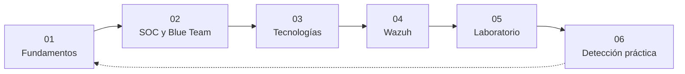
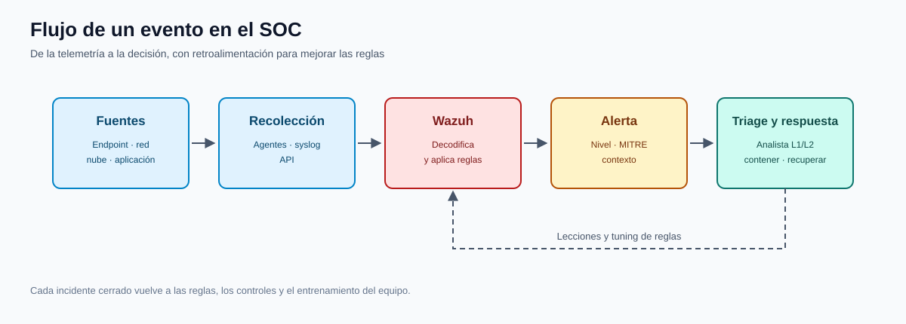

# CyberSOC — Teoría expandida

[CyberSOC](../README.md) | [Inicio](../../README.md)

**Curso:** C|CS · Ciberseguridad CyberSOC  
**Edición:** 11va Edición  
**Instructor:** Anthony Gonzalo Quispe Cordova  
**Institución:** Oficina de Tecnologías de la Información (OTI) — UNI

Este directorio desarrolla, con mayor profundidad, los conceptos que aparecen en los slides del curso. No reemplaza al deck: lo complementa con definiciones, ejemplos, diagramas, comandos, laboratorios y preguntas de repaso.

---

## Cómo está organizado

| # | Capítulo | Pregunta que responde |
|---|---|---|
| 01 | [Fundamentos de ciberseguridad](01-fundamentos-ciberseguridad.md) | ¿Qué protegemos, de quién y con qué criterio? |
| 02 | [SOC y Blue Team](02-soc-blue-team.md) | ¿Cómo se organiza la defensa y quién hace qué? |
| 03 | [Tecnologías de un SOC](03-tecnologias-soc.md) | ¿Qué herramientas producen y consumen la evidencia? |
| 04 | [Wazuh: arquitectura y reglas](04-wazuh-arquitectura.md) | ¿Cómo pasa un evento de un endpoint a una alerta? |
| 05 | [Laboratorio: implementación de Wazuh](05-laboratorio-wazuh.md) | ¿Cómo se monta el SIEM del curso paso a paso? |
| 06 | [Detección en la práctica](06-deteccion-practica.md) | ¿Cómo se investiga una alerta real y se documenta? |

## Ruta de aprendizaje

La última flecha es intencional: cada incidente cerrado debe volver a los fundamentos y mejorar las reglas, los controles y el entrenamiento del equipo.

## Diagrama de referencia

*Diagrama propio: de la telemetría al triage y la respuesta, con retroalimentación para ajustar las reglas.*

## Convenciones visuales

> [!NOTE]
> Concepto clave o definición que conviene memorizar.

> [!TIP]
> Atajo, buena práctica o forma de trabajar más rápido.

> [!WARNING]
> Error frecuente, riesgo operativo o límite legal.

> [!IMPORTANT]
> Idea que se evalúa o que cambia la forma de tomar una decisión.

## Origen de las imágenes

Las capturas incluidas en `imagenes/` provienen de los slides del curso y de documentación oficial citada en cada capítulo (Wazuh, ESET, Microsoft Sysinternals, Suricata, Velociraptor, VirusTotal, MITRE ATT&CK). Se usan con fines educativos. Cuando una imagen es una recreación o un diagrama propio, se indica expresamente.

## Cómo estudiar cada capítulo

1. Lee la definición y el diagrama principal.
2. Reproduce los comandos en el laboratorio aislado.
3. Responde las preguntas de autoevaluación sin mirar el texto.
4. Redacta un párrafo de evidencia: qué viste, dónde, cuándo y por qué importa.
5. Si algo no se puede reproducir, anótalo como duda abierta; no lo inventes.

---

**Siguiente:** [01 — Fundamentos de ciberseguridad](01-fundamentos-ciberseguridad.md)
