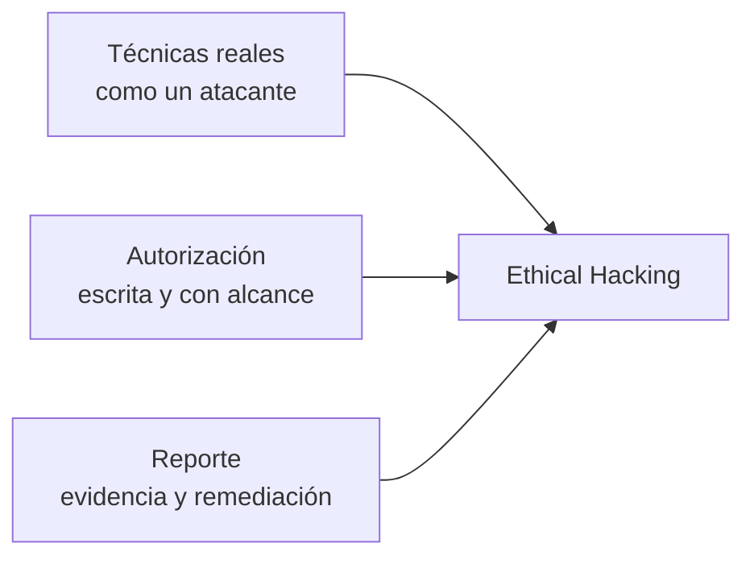
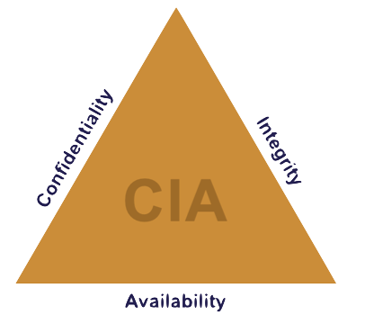
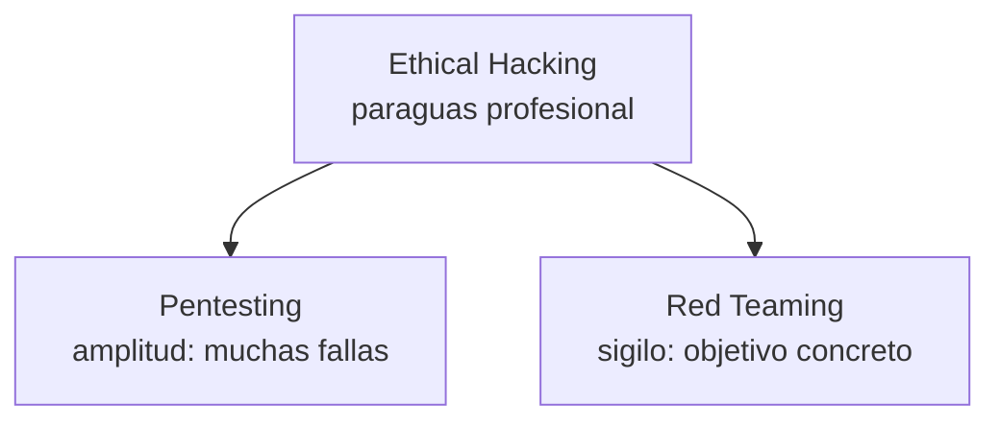
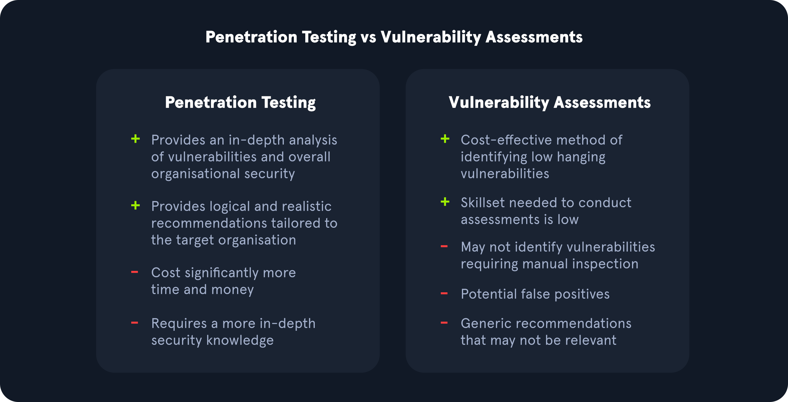
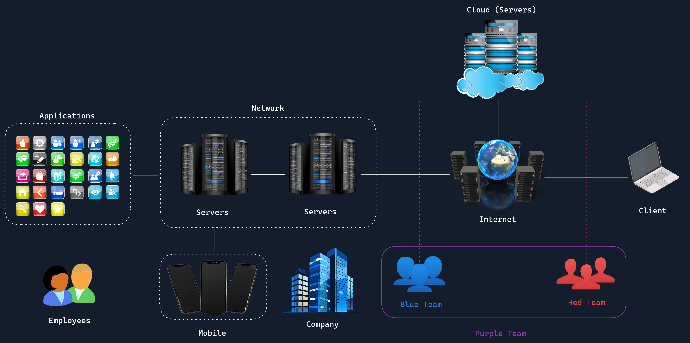
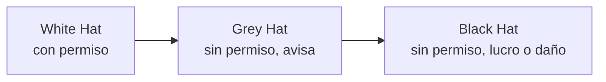
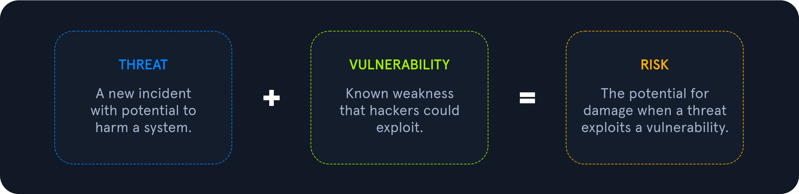
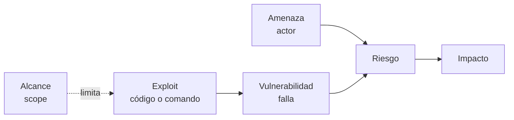
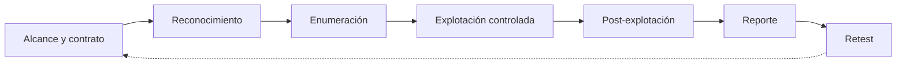

# 01 — Fundamentos del Ethical Hacking

**Curso:** C|EH · Ethical Hacking  
**Tiempo de lectura:** 30–40 min  
**Laboratorio asociado:** análisis de alcance y autorización de un caso ficticio

---

## 1.1 ¿Qué es el Ethical Hacking?

El Ethical Hacking es la práctica de usar **técnicas reales de ataque** contra sistemas propios o autorizados, con el objetivo de **encontrar fallas antes que un adversario** y ayudar a corregirlas.

La ecuación del curso:

| Componente | Sin él… |
|---|---|
| **Técnicas reales** | No descubres fallas explotables, solo teóricas |
| **Autorización** | Cometes un delito, aunque avises después |
| **Reporte** | El hallazgo no sirve para corregir nada |

> [!IMPORTANT]
> Lo que separa al profesional del delincuente no es la herramienta: es la **autorización**.

---

## 1.2 La tríada CIA

*Tríada de Confidencialidad, Integridad y Disponibilidad. Fuente: Wikimedia Commons.*

| Propiedad | Pregunta | Ejemplo de falla |
|---|---|---|
| **Confidencialidad** | ¿Quién puede leer? | Un IDOR permite ver facturas de otro cliente |
| **Integridad** | ¿Quién puede cambiar? | Un usuario modifica su rol en la base de datos |
| **Disponibilidad** | ¿El servicio sigue funcionando? | Un ataque deja fuera el portal de matrícula |

En un pentest, cada hallazgo se describe por la propiedad que afecta y por el **impacto real** sobre el negocio. "Hay un XSS" no es un hallazgo completo; "un XSS almacenado permite robar la sesión de un administrador y cambiar permisos" sí lo es.

---

## 1.3 Ethical Hacking, Pentesting y Red Teaming

| Dimensión | Pentesting | Red Teaming |
|---|---|---|
| **Objetivo** | Hallar el mayor número de fallas | Llegar a un objetivo concreto |
| **Alcance** | Sistemas definidos | Toda la organización |
| **Duración** | Días o semanas | Semanas o meses |
| **Sigilo** | Bajo; el Blue Team suele estar avisado | Alto; el Blue Team no conoce la prueba |
| **Mide** | Vulnerabilidades | Detección y respuesta |
| **Entregable** | Informe técnico y ejecutivo | Narrativa de ataque y brechas de detección |

*Diferencia entre pentesting y análisis de vulnerabilidades. Fuente: HTB Academy.*

*Equipos de seguridad y sus funciones. Fuente: material del curso.*

### Otras variantes

- **Auditoría de seguridad:** verifica controles contra un estándar (ISO 27001, CIS).
- **Análisis de vulnerabilidades:** inventario automatizado, sin explotación.
- **Bug bounty:** programa público o privado con reglas y recompensas.
- **Ingeniería social:** evalúa el factor humano.
- **Revisión de código:** busca fallas en el código fuente.
- **Purple Team:** colaboración entre ataque y defensa.

> [!NOTE]
> Un pentest no es un "escaneo con Nessus". El escaneo encuentra candidatos; el pentester valida impacto, encadena fallas y documenta evidencia.

---

## 1.4 Tipos de hackers

| Tipo | Permiso | Motivación | Legalidad |
|---|---|---|---|
| **White Hat** | Sí, escrito | Mejorar la seguridad | Legal |
| **Grey Hat** | No, pero reporta | Curiosidad, reputación | Ilegal, aunque el fin sea bueno |
| **Black Hat** | No | Lucro, daño, espionaje | Ilegal |

> [!WARNING]
> "Encontré la falla y avisé" no convierte un acceso no autorizado en legal. El consentimiento debe ser **previo**, no posterior.

---

## 1.5 Amenaza, vulnerabilidad, riesgo, exploit y alcance

*Relación entre amenaza, vulnerabilidad y riesgo. Fuente: HTB Academy, Vulnerability Assessment.*

| Término | Definición | Ejemplo |
|---|---|---|
| **Amenaza** | Actor o evento con capacidad de dañar | Atacante que busca servidores expuestos |
| **Vulnerabilidad** | Falla explotable | `vsftpd 3.0.3` con login anónimo |
| **Exploit** | Código, comando o técnica que aprovecha la falla | `ftp anonymous@target` |
| **Riesgo** | Probabilidad × impacto | Acceso a archivos internos |
| **Alcance** | Límites autorizados de la prueba | Solo `10.129.x.x`, no producción |

### Requisitos antes de auditar

1. **Autorización escrita** del propietario del sistema.
2. **Alcance (scope):** IPs, dominios, aplicaciones y exclusiones.
3. **Reglas de enfrentamiento (RoE):** horarios, técnicas permitidas, contactos.
4. **NDA:** confidencialidad de hallazgos y datos.
5. **Plan de contingencia:** qué hacer si algo se cae.

> [!TIP]
> Un buen contrato de pentest define también qué **no** se puede hacer: DoS, exfiltración real, modificación de datos, acceso a datos personales.

---

## 1.6 Marco legal: Perú y más allá

En Perú, la **Ley N.° 30096 — Ley de Delitos Informáticos** sanciona, entre otros:

- **Art. 2:** acceso ilícito a sistemas informáticos.
- **Art. 3:** atentado contra la integridad de datos informáticos.
- **Art. 4:** atentado contra la integridad de sistemas informáticos.
- **Art. 5:** interceptación ilegal de datos.
- **Art. 6:** sabotaje informático.

> [!WARNING]
> Escanear, acceder o modificar un sistema sin autorización puede constituir delito, incluso si no hay ánimo de lucro y aunque se trate de una "prueba".

### Qué debe decir una autorización

| Elemento | Pregunta |
|---|---|
| Partes | ¿Quién autoriza y quién ejecuta? |
| Activos | ¿Qué IPs, dominios y aplicaciones? |
| Ventana | ¿Fechas y horarios? |
| Técnicas | ¿Escaneo, explotación, ingeniería social? |
| Exclusiones | ¿Qué no se toca? |
| Contactos | ¿A quién avisar si algo falla? |
| Datos | ¿Cómo se tratan y destruyen? |
| Firmas | ¿Quién firma y con qué facultad? |

### Ética profesional

- **Minimiza el daño:** no exfiltres datos reales ni alteres producción.
- **Confidencialidad:** no publiques hallazgos sin permiso.
- **Reporte responsable:** da tiempo razonable para corregir.
- **No extorsiones:** el hallazgo no es una palanca de cobro.
- **Respeta la privacidad:** no accedas a datos que no necesitas.

---

## 1.7 Tipos de evaluaciones

| Tipo | Qué evalúa | Ejemplo |
|---|---|---|
| **Externa** | Perímetro expuesto a Internet | Portal web, VPN, correo |
| **Interna** | Red desde dentro | Segmentación, Active Directory |
| **Web** | Aplicaciones y APIs | SQLi, XSS, control de acceso |
| **Móvil** | Apps iOS/Android | Almacenamiento, tráfico, autenticación |
| **WiFi** | Redes inalámbricas | WPA2, rogue AP, portal cautivo |
| **Ingeniería social** | Personas y procesos | Phishing, pretexting, vishing |
| **Física** | Acceso a instalaciones | Tailgating, badges, cámaras |
| **Código** | Implementación | SAST, revisión manual |
| **Cloud** | Configuración y permisos | Buckets públicos, IAM excesivo |

---

## 1.8 El ciclo de un engagement

| Fase | Entregable |
|---|---|
| Alcance | Contrato, RoE, contactos |
| Reconocimiento | Inventario de activos y superficie |
| Enumeración | Servicios, versiones, posibles fallas |
| Explotación | Prueba de impacto con evidencia |
| Post-explotación | Alcance real del compromiso |
| Reporte | Hallazgos priorizados y remediación |
| Retest | Verificación de correcciones |

---

## 1.9 Glosario

| Término | Definición |
|---|---|
| **Scope** | Alcance autorizado |
| **RoE** | Reglas de enfrentamiento |
| **NDA** | Acuerdo de confidencialidad |
| **OSINT** | Inteligencia de fuentes abiertas |
| **CVE** | Identificador público de vulnerabilidad |
| **CVSS** | Puntaje de severidad |
| **Exploit** | Código que aprovecha una falla |
| **Payload** | Carga que se ejecuta tras el exploit |
| **Shell** | Acceso a una consola remota |
| **Post-explotación** | Acciones tras el acceso inicial |
| **Lateral movement** | Movimiento entre equipos |
| **Persistencia** | Mecanismo para mantener acceso |

---

## 1.10 Autoevaluación

1. ¿Cuál es la diferencia entre ethical hacking, pentesting y red teaming?
2. ¿Por qué la autorización debe ser previa y escrita?
3. ¿Qué elementos debe incluir un scope?
4. ¿Qué diferencia hay entre vulnerabilidad, exploit y riesgo?
5. ¿Qué harías si durante una prueba encuentras datos personales?
6. ¿Por qué un grey hat sigue siendo ilegal?
7. ¿Qué cláusulas incluirías en un contrato de pentest?

---

**Siguiente:** [02 — Metodología de un pentesting](02-metodologia-pentesting.md)
