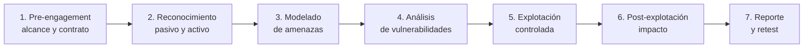
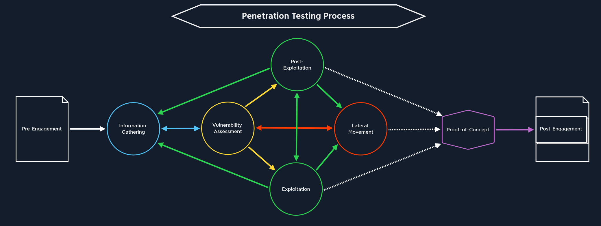
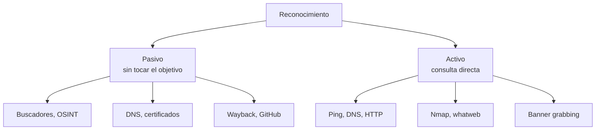
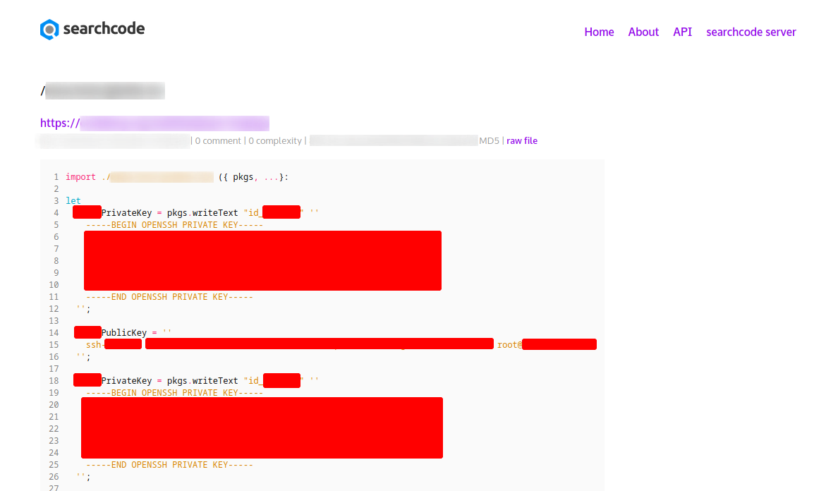
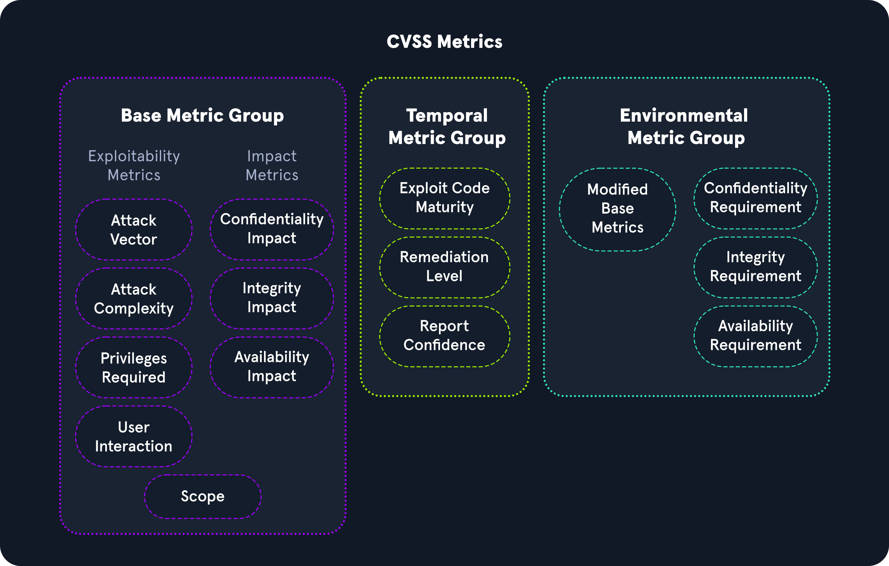
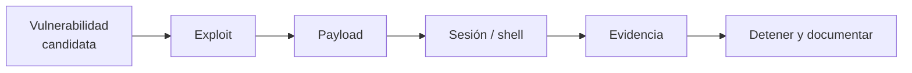

# 02 — Metodología de un pentesting

**Curso:** C|EH · Ethical Hacking  
**Tiempo de lectura:** 35–45 min  
**Laboratorio asociado:** planificación de un engagement ficticio

---

## 2.1 Por qué una metodología

Un pentest no es una secuencia aleatoria de herramientas. La metodología garantiza que la prueba sea **repetible, completa, autorizada y documentada**. Sin ella, es fácil dejar vectores sin probar, romper algo o no poder demostrar el hallazgo.





*Vista general del proceso de un pentesting. Fuente: HTB Academy.*

### Marcos de referencia

| Marco | Uso |
|---|---|
| **PTES** | Fases prácticas de un pentest |
| **NIST SP 800-115** | Guía técnica de evaluación de seguridad |
| **OWASP Testing Guide** | Pruebas de aplicaciones web |
| **OSSTMM** | Metodología de seguridad operacional |
| **MITRE ATT&CK** | Catálogo de técnicas adversarias |

---

## 2.2 Fase 1: pre-engagement

Antes de tocar un sistema:

- **Alcance:** activos, dominios, IPs, aplicaciones, exclusiones.
- **Reglas de enfrentamiento:** ventanas, técnicas permitidas, límites.
- **Contactos:** técnico, legal, escalamiento.
- **Autorización:** documento firmado por quien tiene facultad.
- **NDA:** tratamiento de hallazgos y datos.
- **Logística:** credenciales, VPN, accesos, horarios.

> [!WARNING]
> Si no puedes responder "¿quién autorizó esto y hasta dónde?", no empieces. La prisa es la causa más común de un incidente legal.

### Preguntas que debes cerrar antes de empezar

1. ¿Qué activos están dentro y cuáles fuera?
2. ¿Se permite explotación o solo análisis?
3. ¿Se permite ingeniería social?
4. ¿Qué horarios y qué ventanas de mantenimiento?
5. ¿Qué hacer si se cae un servicio?
6. ¿Cómo se manejan datos sensibles?
7. ¿Quién recibe el informe y en qué formato?

---

## 2.3 Fase 2: reconocimiento

El reconocimiento recopila información del objetivo. Se divide en **pasivo** y **activo**.



| Tipo | Ventaja | Riesgo | Ejemplo |
|---|---|---|---|
| **Pasivo** | No alerta al objetivo | Información desactualizada | `crt.sh`, Google, Wayback |
| **Activo** | Datos actuales | Deja huella en logs | `nmap`, `curl`, `dig` |



*Fuentes de reconocimiento pasivo y activo. Fuente: material del curso.*

### Fuentes OSINT útiles

- **DNS:** `dig`, `nslookup`, `dnsrecon`, `dnsenum`.
- **Certificados:** `crt.sh` revela subdominios por CT logs.
- **Buscadores:** operadores `site:`, `filetype:`, `inurl:`.
- **Wayback Machine:** versiones antiguas de la web.
- **GitHub:** repositorios con credenciales o rutas internas.
- **Shodan/Censys:** servicios expuestos.
- **Redes sociales:** empleados, tecnologías, ubicaciones.

> [!NOTE]
> El reconocimiento pasivo no es "gratis": consultar servicios de terceros también deja rastro y puede violar sus términos. Usa APIs y límites razonables.

---

## 2.4 Fase 3: modelado de amenazas

Antes de explotar, pregúntate:

- ¿Cuáles son los activos críticos?
- ¿Quién podría atacarlos y con qué motivación?
- ¿Qué rutas de ataque son plausibles?
- ¿Qué impacto tendría cada una?
- ¿Qué evidencia demostraría el fallo?

| Activo | Amenaza | Ruta posible | Impacto |
|---|---|---|---|
| Portal de notas | Estudiante | IDOR en `/notas/{id}` | Ver notas ajenas |
| VPN | Externo | Credenciales débiles | Acceso a red interna |
| Servidor FTP | Externo | Login anónimo | Lectura de archivos |
| Active Directory | Insider | Kerberoasting | Escalada a dominio |

---

## 2.5 Fase 4: análisis de vulnerabilidades

Aquí se identifican las fallas candidatas. No todas se explotan; se priorizan por riesgo y alcance.

### CVE y CVSS

| Concepto | Qué es |
|---|---|
| **CVE** | Identificador único de una vulnerabilidad pública |
| **CVSS** | Puntaje de severidad de 0 a 10 |
| **Vector CVSS** | Métricas que explican el puntaje |
| **CWE** | Tipo de debilidad (por ejemplo, CWE-89 SQL Injection) |



*Métricas CVSS. Fuente: HTB Academy, Vulnerability Assessment.*

**Ejemplo de lectura:** `CVSS:3.1/AV:N/AC:L/PR:N/UI:N/S:U/C:H/I:H/A:H` → 9.8 (crítico). Significa red, baja complejidad, sin privilegios, sin interacción, impacto alto en confidencialidad, integridad y disponibilidad.

> [!WARNING]
> Un CVSS 9.8 no siempre es prioritario. Si el servicio no es alcanzable o está compensado, el riesgo real puede ser menor. El puntaje orienta; el contexto decide.

### Herramientas

| Herramienta | Uso |
|---|---|
| **Nmap** | Descubrimiento y versiones |
| **Nessus / OpenVAS** | Escaneo de vulnerabilidades |
| **Nikto** | Servidores web |
| **WPScan** | WordPress |
| **SearchSploit** | Búsqueda local de exploits |
| **Metasploit** | Validación y explotación |

---

## 2.6 Fase 5: explotación controlada

Explotar significa **demostrar** que una falla tiene impacto real, no causar el mayor daño posible.



### Conceptos clave

| Término | Definición |
|---|---|
| **Exploit** | Código que aprovecha la falla |
| **Payload** | Acción que se ejecuta (shell, comando, archivo) |
| **Listener** | Receptor de la conexión |
| **Bind shell** | El objetivo abre el puerto y espera |
| **Reverse shell** | El objetivo se conecta al atacante |
| **Staged payload** | Se descarga en etapas |
| **Stageless payload** | Se ejecuta completo |

### Regla de mínima intrusión

- Usa el payload menos invasivo que demuestre el impacto.
- No cifres datos reales ni borres archivos.
- No te muevas lateralmente más allá de lo autorizado.
- Detén la prueba si afectas disponibilidad.
- Guarda la evidencia antes de limpiar.

---

## 2.7 Fase 6: post-explotación

La post-explotación responde: **¿hasta dónde llega el compromiso?**

| Objetivo | Pregunta | Evidencia |
|---|---|---|
| **Situational awareness** | ¿Dónde estoy? | `id`, `hostname`, `ip a` |
| **Privilege escalation** | ¿Puedo ser root/admin? | `sudo -l`, `whoami /priv` |
| **Credential access** | ¿Qué credenciales hay? | Hashes, tickets, archivos |
| **Lateral movement** | ¿A qué otros equipos llego? | Sesiones, túneles |
| **Persistence** | ¿Puedo volver? | Tareas, servicios, claves |
| **Collection** | ¿Qué datos son sensibles? | Inventario, no exfiltración real |
| **Cleanup** | ¿Qué dejé? | Registro de cambios |

> [!IMPORTANT]
> En un pentest profesional, la post-explotación se detiene en el **impacto demostrable**. No se exfiltran datos reales ni se comprometen sistemas fuera del alcance.

---

## 2.8 Fase 7: reporte

El informe es el producto principal. Debe ser claro para dos audiencias: **técnica** y **ejecutiva**.

### Estructura

1. **Resumen ejecutivo:** contexto, alcance, riesgo global, principales hallazgos.
2. **Metodología:** fases, herramientas, limitaciones.
3. **Hallazgos:** uno por uno, con evidencia y severidad.
4. **Impacto:** qué puede pasar si no se corrige.
5. **Recomendaciones:** concretas, priorizadas y verificables.
6. **Anexos:** logs, capturas, comandos, timeline.

### Ficha de hallazgo

```markdown
### Hallazgo 01 — Acceso anónimo a FTP

**Severidad:** Alta (CVSS 7.5)
**Activo:** 10.129.x.x:21
**CWE:** CWE-287 (Improper Authentication)

**Descripción:**
El servicio vsftpd permite inicio de sesión anónimo y expone el directorio
personal del usuario ftp.

**Evidencia:**
- `ftp 10.129.x.x` → usuario `anonymous` → listado de archivos.
- Captura y transcripción en anexo A.

**Impacto:**
Un atacante puede leer archivos internos y obtener información para
otras fases del ataque.

**Recomendación:**
Deshabilitar el acceso anónimo, revisar permisos y segmentar el servicio.

**Referencias:**
- CWE-287
- Configuración de vsftpd
```

### Errores frecuentes en reportes

- Copiar salida de herramientas sin explicar el impacto.
- Mezclar hechos con opiniones.
- No incluir la fecha y la versión del sistema.
- Recomendar "actualizar todo" sin priorizar.
- No adjuntar evidencia reproducible.

---

## 2.9 Checklist del engagement

- [ ] Autorización firmada y vigente.
- [ ] Alcance y exclusiones documentados.
- [ ] Contactos de emergencia.
- [ ] Herramientas y versiones registradas.
- [ ] Snapshot del laboratorio.
- [ ] Bitácora de comandos y horas.
- [ ] Evidencia guardada y hasheada.
- [ ] Datos sensibles tratados según NDA.
- [ ] Informe revisado por pares.
- [ ] Retest planificado.

---

## 2.10 Autoevaluación

1. ¿Qué diferencia hay entre reconocimiento pasivo y activo?
2. ¿Para qué sirve el modelado de amenazas?
3. ¿Cómo priorizarías dos vulnerabilidades con el mismo CVSS?
4. ¿Qué es un reverse shell y por qué se usa?
5. ¿Dónde se detiene la post-explotación en un pentest?
6. ¿Qué debe contener una ficha de hallazgo?
7. ¿Por qué el retest es parte del servicio?

---

**Anterior:** [01 — Fundamentos](01-fundamentos-ethical-hacking.md) · **Siguiente:** [03 — Preparación del entorno](03-preparacion-entorno.md)
