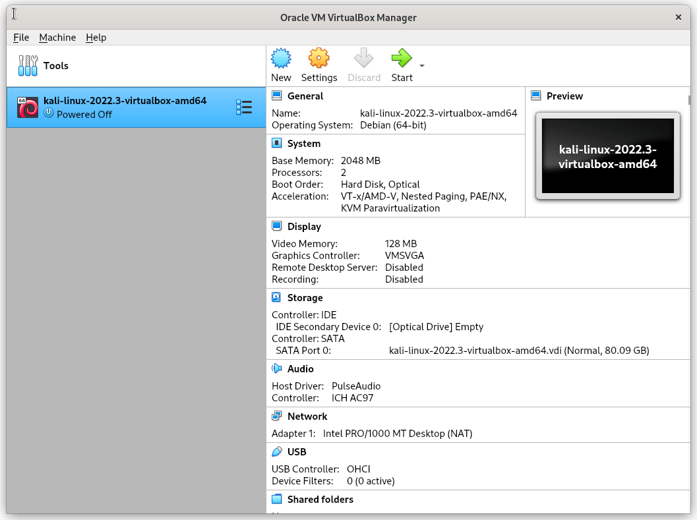
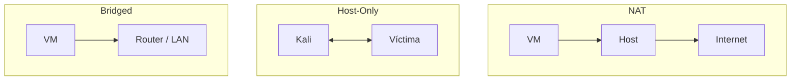
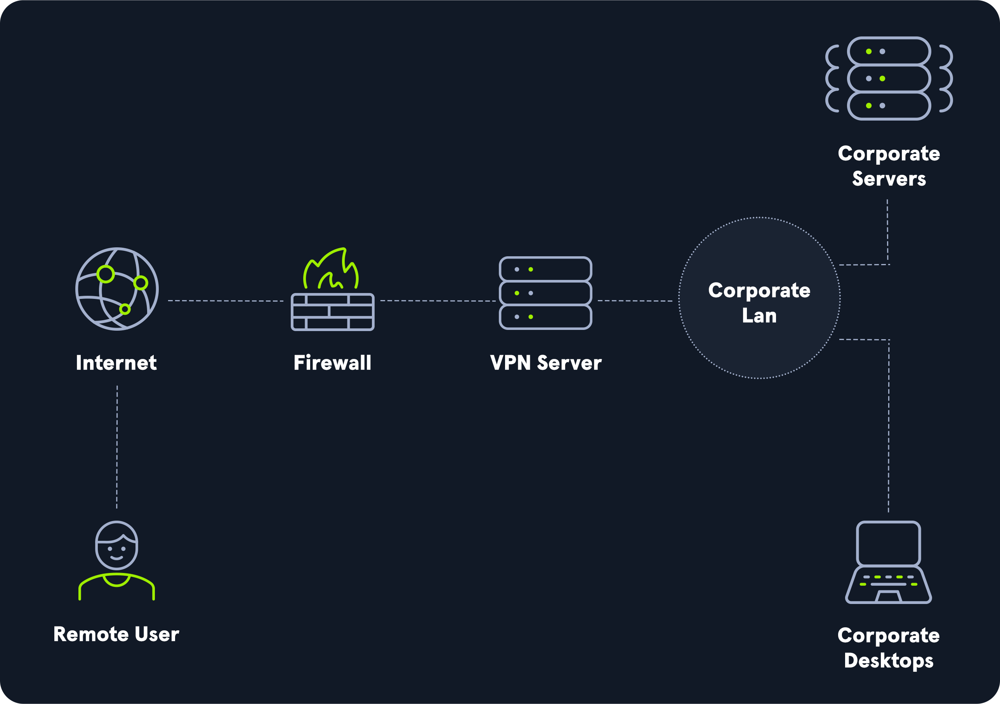
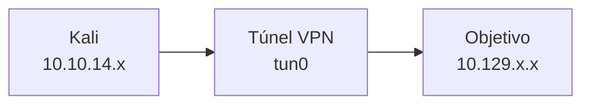

# 03 — Preparación del entorno de pentesting

**Curso:** C|EH · Ethical Hacking  
**Tiempo de lectura:** 25–35 min  
**Laboratorio asociado:** Kali en VM + VPN a Hack The Box

---

## 3.1 Kali Linux

Kali Linux es una distribución basada en Debian, mantenida por OffSec, con cientos de herramientas de auditoría preinstaladas. No es obligatoria, pero es un estándar de facto en el curso.



*Kali Linux ejecutándose en una VM. Fuente: Wikimedia Commons.*

| Categoría | Herramientas típicas |
|---|---|
| **Escaneo** | `nmap`, `masscan`, `arp-scan` |
| **Web** | `burpsuite`, `gobuster`, `ffuf`, `nikto` |
| **Explotación** | `metasploit`, `searchsploit` |
| **Contraseñas** | `hydra`, `john`, `hashcat` |
| **Red** | `nc`, `socat`, `openvpn`, `wireshark` |
| **Post-explotación** | `linpeas`, `winpeas`, `mimikatz` (en lab) |

> [!NOTE]
> Tener la herramienta no te hace pentester. La diferencia está en saber **qué preguntar**, **cómo interpretar** y **cuándo detenerse**.

---

## 3.2 Virtualización

| Tipo | Ejemplos | Uso |
|---|---|---|
| **Tipo 1 (bare-metal)** | Proxmox, ESXi, Hyper-V | Servidores y labs |
| **Tipo 2 (hosted)** | VirtualBox, VMware Workstation | Escritorio y curso |

### Requisitos del equipo

- CPU con VT-x/AMD-V habilitado.
- RAM suficiente para host + VM(s).
- Disco SSD con espacio para snapshots.
- BIOS/UEFI con virtualización activa.

### Snapshots

Un **snapshot** guarda el estado de la VM. Antes de instalar herramientas, cambiar configuración o ejecutar malware:

```text
VM → Snapshot → Take Snapshot → "limpio-pre-lab"
```

> [!TIP]
> Nombra los snapshots con fecha y propósito: `2026-10-30-limpio`, `2026-10-30-antes-metasploit`. Así sabes a dónde volver.

---

## 3.3 Modos de red



| Modo | Salida a Internet | Visibilidad | Uso recomendado |
|---|---|---|---|
| **NAT** | Sí, a través del host | La VM no es visible desde la LAN | Descargar herramientas, VPN |
| **Host-Only** | No | Solo entre VMs y host | Laboratorio aislado con víctimas |
| **Bridged** | Sí, directo | La VM toma IP de la LAN | Cuidado: expone la VM |
| **Internal Network** | No | Solo entre VMs | Laboratorio completamente aislado |

> [!WARNING]
> No uses **Bridged** con máquinas vulnerables. Una VM con servicios débiles queda expuesta a toda la red local.

### Configuración recomendada del curso

- **Adaptador 1:** NAT (para VPN/Internet).
- **Adaptador 2:** Host-Only (para la víctima).
- Snapshot limpio antes de conectar.

---

## 3.4 Atacante, objetivo y VPN



*Arquitectura de conexión VPN a un laboratorio. Fuente: HTB Academy, Getting Started.*



### Conectar a Hack The Box

1. Descarga el archivo `.ovpn` desde tu perfil.
2. Conéctate:

```bash
sudo openvpn starting_point.ovpn
```

3. Verifica la interfaz:

```bash
ip -br a show tun0
```

4. Prueba conectividad:

```bash
ping -c 3 10.129.x.x
```

5. Si no responde, revisa la IP asignada y el firewall.

### Pwnbox

HTB ofrece **Pwnbox**, una instancia de Parrot OS en el navegador, ya conectada a la VPN. Es útil si tu equipo no tiene recursos, pero no reemplaza aprender a montar tu propio entorno.

---

## 3.5 OpSec básica del laboratorio

| Práctica | Por qué |
|---|---|
| Usar una VM dedicada | Aísla herramientas y datos |
| No usar cuentas personales | Evita exponer identidad y credenciales |
| Navegador separado | Evita cookies y sesiones reales |
| VPN del laboratorio | Separa el tráfico del curso |
| Snapshot antes de cambios | Recuperación rápida |
| Bitácora de comandos | Evidencia y repetición |
| No subir capturas con datos reales | Privacidad y NDA |

> [!IMPORTANT]
> La OpSec no es "ocultarse de la ley". Es **higiene operativa**: separar el laboratorio de tu vida digital y evitar daños colaterales.

---

## 3.6 Herramientas mínimas

```bash
# Verificar que Kali está actualizado
sudo apt update && sudo apt upgrade -y

# Comprobar herramientas clave
nmap --version
msfconsole --version
burpsuite --version
```

| Herramienta | Verificación |
|---|---|
| `nmap` | `nmap --version` |
| `metasploit` | `msfconsole --version` |
| `burpsuite` | abrir desde menú |
| `openvpn` | `openvpn --version` |
| `netcat` | `nc -h` |
| `python3` | `python3 --version` |

---

## 3.7 Troubleshooting

| Problema | Causa | Solución |
|---|---|---|
| La VM no arranca | Virtualización desactivada | Activar VT-x/AMD-V en BIOS |
| No hay Internet en Kali | Adaptador NAT mal configurado | Revisar NAT y DNS |
| `tun0` no aparece | VPN no conectada | Revisar `.ovpn` y permisos |
| No hay ping al objetivo | Ruta o firewall | Revisar `ip route`, VPN |
| Kali muy lento | Pocos recursos | Aumentar RAM/CPU, cerrar apps |
| Snapshot ocupa mucho | Discos dinámicos | Compactar o recrear |

---

## 3.8 Autoevaluación

1. ¿Qué diferencia hay entre NAT, Host-Only y Bridged?
2. ¿Por qué no se debe usar Bridged con una VM vulnerable?
3. ¿Para qué sirve un snapshot?
4. ¿Cómo verificas que la VPN está conectada?
5. ¿Qué herramientas mínimas necesita tu laboratorio?
6. ¿Qué prácticas de OpSec aplicarías antes de un ejercicio?
7. ¿Qué harías si el objetivo no responde al ping?

---

**Anterior:** [02 — Metodología](02-metodologia-pentesting.md) · **Siguiente:** [04 — Linux y redes](04-linux-redes.md)
