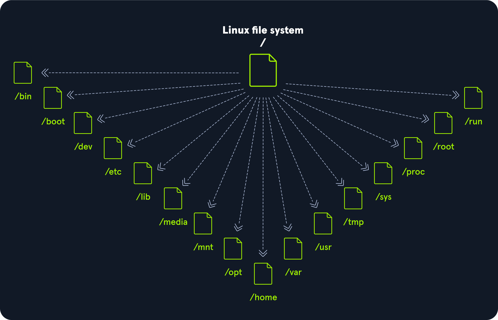
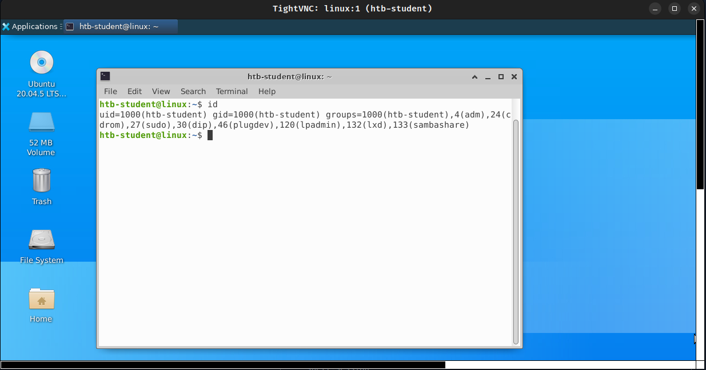
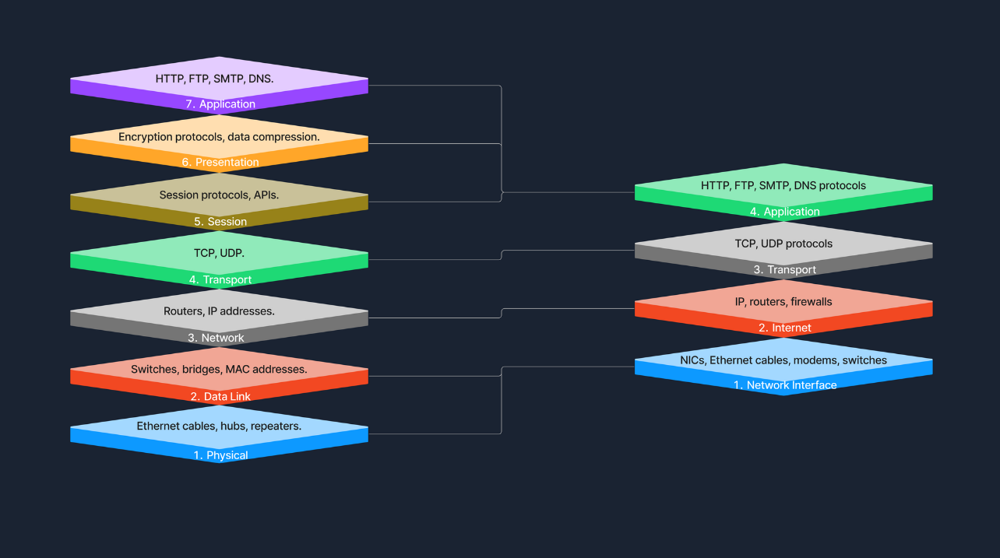
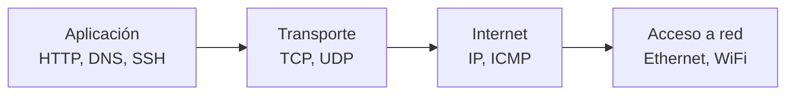
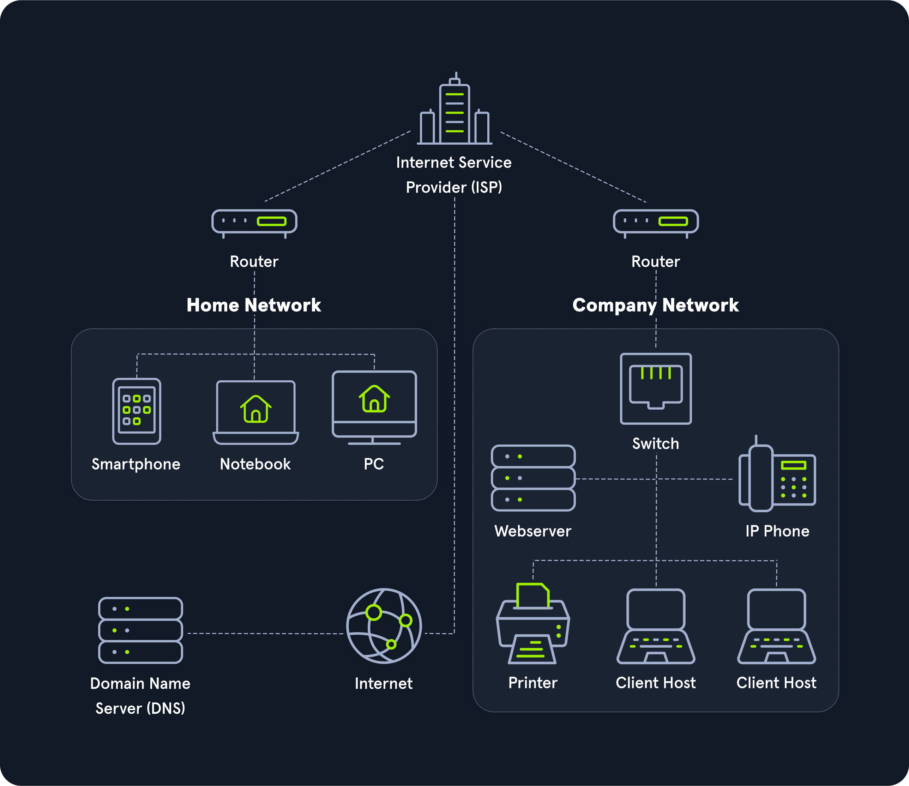
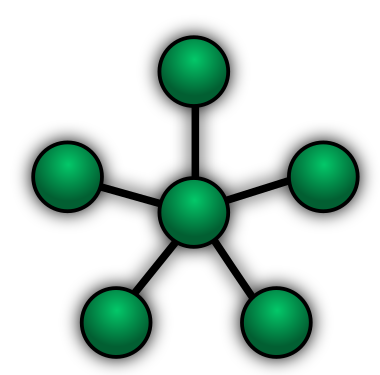
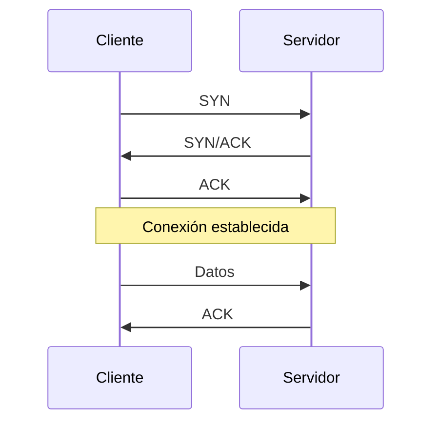

# 04 — Fundamentos de Linux y redes

**Curso:** C|EH · Ethical Hacking  
**Tiempo de lectura:** 40–50 min  
**Laboratorio asociado:** navegación, permisos y diagnóstico de red en Kali

---

## 4.1 El sistema de archivos Linux

Linux organiza todo en un único árbol que empieza en `/`. No hay unidades `C:` ni `D:`: los discos se montan en directorios.



*Jerarquía estándar de Linux. Fuente: HTB Academy, Linux Fundamentals.*

| Ruta | Contenido |
|---|---|
| `/` | Raíz del sistema |
| `/bin`, `/usr/bin` | Binarios esenciales |
| `/etc` | Configuración del sistema |
| `/home` | Directorios de usuarios |
| `/root` | Home del superusuario |
| `/var` | Datos variables: logs, colas, web |
| `/tmp` | Archivos temporales |
| `/dev` | Dispositivos |
| `/proc` | Información de procesos y kernel |
| `/opt` | Software adicional |

### Comandos esenciales

| Comando | Acción |
|---|---|
| `pwd` | Ruta actual |
| `ls -la` | Listar, incluidos ocultos, con permisos |
| `cd /ruta` | Cambiar de directorio |
| `cat archivo` | Leer archivo |
| `less archivo` | Leer por páginas |
| `find / -name archivo 2>/dev/null` | Buscar archivo |
| `grep "texto" archivo` | Filtrar líneas |
| `whoami` | Usuario actual |
| `id` | UID, GID y grupos |
| `sudo -l` | Comandos permitidos como root |
| `ps aux` | Procesos en ejecución |
| `ss -tulpn` | Puertos escuchando |
| `history` | Historial de comandos |

> [!TIP]
> Aprende a combinar comandos con pipes: `ps aux | grep root`, `ss -tulpn | grep 22`, `find / -perm -4000 2>/dev/null`.

---

## 4.2 Usuarios, grupos y permisos



*Identidad y grupos de un usuario. Fuente: HTB Academy, Linux Fundamentals.*

### Archivos de identidad

| Archivo | Contenido | Permisos típicos |
|---|---|---|
| `/etc/passwd` | Usuarios, UID, GID, home, shell | `644` |
| `/etc/shadow` | Hashes de contraseña | `640 root:shadow` |
| `/etc/group` | Grupos y miembros | `644` |
| `/etc/sudoers` | Reglas de sudo | `440 root:root` |

### Permisos POSIX

```text
-rwxr-xr--  1 ana dev  1234 Oct 30 10:00 script.sh
│└┬┘└┬┘└┬┘
│ │  │  └── otros: r--
│ │  └───── grupo: r-x
│ └──────── usuario: rwx
└────────── tipo: - archivo, d directorio
```

| Letra | Valor | Significado en archivo | Significado en directorio |
|---|---|---|---|
| `r` | 4 | Leer | Listar contenido |
| `w` | 2 | Escribir | Crear/borrar archivos |
| `x` | 1 | Ejecutar | Entrar (`cd`) |

```bash
chmod 754 script.sh   # rwxr-xr--
chmod u+x script.sh   # añadir ejecución al dueño
chown ana:dev archivo # cambiar dueño y grupo
```

### Bits especiales

| Bit | Símbolo | Efecto | Riesgo |
|---|---|---|---|
| **SUID** | `s` en usuario | Se ejecuta con UID del dueño | Escalada si el binario es explotable |
| **SGID** | `s` en grupo | Se ejecuta con GID del grupo | Acceso a grupos privilegiados |
| **Sticky** | `t` en otros | Solo el dueño borra sus archivos | Protección en `/tmp` |

```bash
# Buscar binarios SUID
find / -perm -4000 -type f 2>/dev/null

# Ver bits especiales
ls -l /usr/bin/passwd
```

> [!WARNING]
> Un binario SUID propiedad de root que permita ejecutar comandos o leer archivos es un vector clásico de escalada. No lo ignores en la enumeración.

---

## 4.3 Procesos y servicios

```bash
# Árbol de procesos
ps auxf

# Procesos de root
ps aux | grep root

# Servicios systemd
systemctl list-units --type=service --state=running

# Puertos locales
ss -tulpn

# Tareas programadas
crontab -l
cat /etc/crontab
ls -la /etc/cron.*
```

| Concepto | Descripción |
|---|---|
| **PID** | Identificador del proceso |
| **PPID** | PID del padre |
| **Daemon** | Proceso en segundo plano |
| **systemd** | Gestor de servicios |
| **cron** | Programador de tareas |
| **Log** | Registro de eventos |

### Logs útiles

| Ruta | Contenido |
|---|---|
| `/var/log/auth.log` | Autenticación |
| `/var/log/syslog` | Sistema |
| `/var/log/apache2/` | Web |
| `/var/log/nginx/` | Web |
| `journalctl` | Logs de systemd |

---

## 4.4 Redes: modelo OSI y TCP/IP



*Comparación OSI y TCP/IP. Fuente: HTB Academy.*



| Capa OSI | Función | Protocolos |
|---|---|---|
| 7 Aplicación | Interfaz con el usuario | HTTP, DNS, SSH, FTP |
| 6 Presentación | Formato, cifrado | TLS, JPEG |
| 5 Sesión | Diálogo | NetBIOS, RPC |
| 4 Transporte | Extremo a extremo | TCP, UDP |
| 3 Red | Direccionamiento y rutas | IP, ICMP |
| 2 Enlace | Tramas y MAC | Ethernet, ARP |
| 1 Física | Bits y medio | Cables, radio |



*Ejemplo de topología de red para un laboratorio. Fuente: material del curso.*

---

## 4.5 Direccionamiento IP y subredes



*Direccionamiento IPv4 y prefijo. Fuente: HTB Academy.*

### IPv4

Una dirección IPv4 tiene 32 bits, escritos como cuatro octetos: `192.168.56.10`.

| Clase | Rango privado | Máscara típica |
|---|---|---|
| A | `10.0.0.0/8` | `255.0.0.0` |
| B | `172.16.0.0/12` | `255.240.0.0` |
| C | `192.168.0.0/16` | `255.255.0.0` |

### Prefijo y hosts

| Prefijo | Máscara | Hosts útiles |
|---|---|---|
| `/24` | `255.255.255.0` | 254 |
| `/25` | `255.255.255.128` | 126 |
| `/30` | `255.255.255.252` | 2 |
| `/32` | `255.255.255.255` | 1 (host único) |

**Ejemplo:** `10.129.1.14/24`

- Red: `10.129.1.0`
- Broadcast: `10.129.1.255`
- Hosts: `10.129.1.1` – `10.129.1.254`
- Host: `10.129.1.14`

```bash
ip -4 a
ip route
```

---

## 4.6 TCP y UDP



| Característica | TCP | UDP |
|---|---|---|
| Conexión | Sí (3 vías) | No |
| Confiabilidad | Retransmisión, orden | Sin garantía |
| Velocidad | Mayor overhead | Menor overhead |
| Uso | HTTP, SSH, SMB | DNS, DHCP, SNMP |
| Escaneo | `-sS`, `-sT` | `-sU` |

### Three-way handshake

1. **SYN:** el cliente solicita conexión.
2. **SYN/ACK:** el servidor acepta.
3. **ACK:** el cliente confirma.

Un escaneo SYN (`-sS`) envía SYN y, si recibe SYN/ACK, envía RST para no completar la conexión. Es más sigiloso que `-sT`, que abre la conexión completa.

---

## 4.7 Puertos y servicios

| Puerto | Servicio | Uso |
|---|---|---|
| 21 | FTP | Transferencia de archivos |
| 22 | SSH | Consola cifrada |
| 23 | Telnet | Consola sin cifrar |
| 25 | SMTP | Correo saliente |
| 53 | DNS | Resolución de nombres |
| 80 | HTTP | Web |
| 139/445 | SMB | Compartición Windows |
| 443 | HTTPS | Web cifrada |
| 3306 | MySQL | Base de datos |
| 3389 | RDP | Escritorio remoto |
| 5985 | WinRM | Gestión Windows |

> [!WARNING]
> Telnet transmite usuario, contraseña y comandos en texto plano. Nunca lo uses en producción.

---

## 4.8 Protocolos que verás en el curso

| Protocolo | Qué hace | Comando de prueba |
|---|---|---|
| **DNS** | Resuelve nombres | `dig dominio`, `nslookup` |
| **HTTP** | Transferencia web | `curl -I http://host` |
| **SSH** | Acceso remoto cifrado | `ssh user@host` |
| **FTP** | Archivos | `ftp host` |
| **SMB** | Recursos Windows | `smbclient -L //host` |
| **RDP** | Escritorio remoto | `xfreerdp /v:host` |
| **WinRM** | Gestión remota | `evil-winrm -i host` |

---

## 4.9 Diagnóstico de red

```bash
# Interfaces y rutas
ip -br a
ip route

# Conectividad
ping -c 3 10.129.x.x
traceroute 10.129.x.x

# DNS
dig dominio.com
nslookup dominio.com

# Puertos
ss -tulpn
nc -zv 10.129.x.x 22

# HTTP
curl -I http://10.129.x.x
```

| Síntoma | Herramienta | Qué mirar |
|---|---|---|
| No hay ping | `ping`, `ip route` | Ruta, firewall, VPN |
| Nombre no resuelve | `dig` | DNS, `/etc/hosts` |
| Puerto cerrado | `nc -zv` | Servicio, firewall |
| Web no responde | `curl -v` | Código, headers, TLS |
| Ruta extraña | `traceroute` | Saltos, NAT |

---

## 4.10 Autoevaluación

1. ¿Qué diferencia hay entre `/etc/passwd` y `/etc/shadow`?
2. ¿Qué significa `chmod 754`?
3. ¿Qué es un binario SUID y por qué es riesgoso?
4. ¿Cómo distingues TCP de UDP?
5. ¿Qué hace un escaneo SYN?
6. ¿Qué puerto usa SSH y qué riesgo tiene Telnet?
7. ¿Cómo verificas que tienes ruta a un objetivo?

---

**Anterior:** [03 — Preparación del entorno](03-preparacion-entorno.md) · **Siguiente:** [05 — Introducción a Nmap](05-nmap.md)
