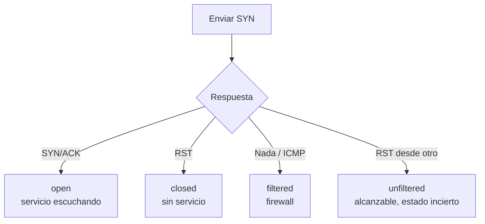
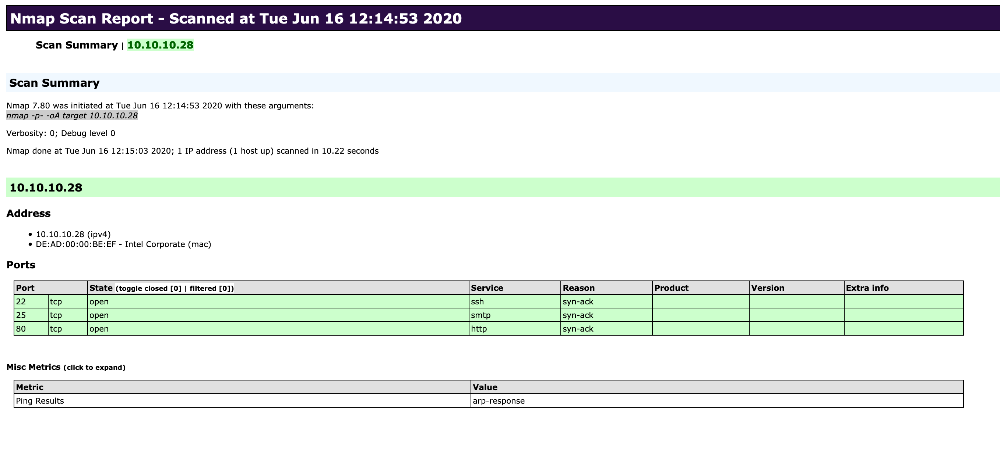
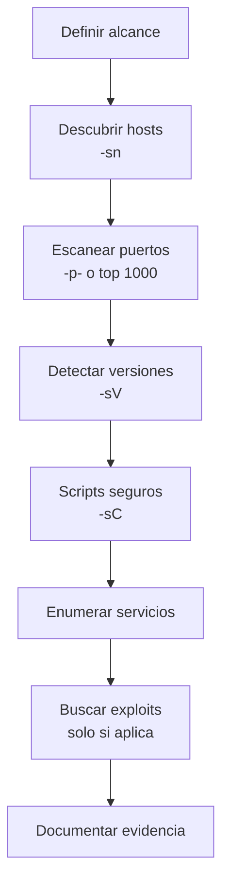

# 05 — Introducción a Nmap

**Curso:** C|EH · Ethical Hacking  
**Tiempo de lectura:** 30–40 min  
**Laboratorio asociado:** escaneo de la máquina Meow en HTB

---

## 5.1 Qué es Nmap

Nmap (Network Mapper) es una herramienta de descubrimiento de hosts y servicios. Responde cuatro preguntas:

1. ¿Qué hosts están activos?
2. ¿Qué puertos están abiertos?
3. ¿Qué servicios y versiones corren?
4. ¿Qué información adicional exponen?

> [!WARNING]
> Escanear sistemas sin autorización puede ser ilegal y puede alertar al objetivo. Úsalo solo en laboratorios o con permiso escrito.

---

## 5.2 Descubrimiento de hosts

```bash
# Descubrir hosts activos sin escanear puertos
nmap -sn 10.129.1.0/24

# Asumir que el host está activo (omite ping)
nmap -Pn 10.129.x.x

# No resolver DNS (más rápido)
nmap -n 10.129.x.x
```

| Opción | Efecto | Cuándo usarla |
|---|---|---|
| `-sn` | Solo descubrimiento | Inventario inicial |
| `-Pn` | No hacer ping | Firewalls que bloquean ICMP |
| `-n` | No resolver DNS | Red grande o prisa |
| `-PR` | ARP scan | Red local |

> [!TIP]
> En una red local, ARP es más confiable que ICMP. En Internet, muchos hosts bloquean ping; `-Pn` evita falsos negativos.

---

## 5.3 Estados de un puerto



| Estado | Significado | Interpretación |
|---|---|---|
| **open** | Hay un servicio escuchando | Candidato a enumerar |
| **closed** | El host responde, pero no hay servicio | Puerto alcanzable |
| **filtered** | Un firewall descarta | No se puede determinar |
| **unfiltered** | Alcanzable, pero sin respuesta clara | Requiere otro escaneo |
| **open\|filtered** | Nmap no distingue | Común en UDP |

---

## 5.4 Tipos de escaneo

| Tipo | Comando | Ventaja | Limitación |
|---|---|---|---|
| **SYN** | `-sS` | Rápido y sigiloso | Requiere root |
| **Connect** | `-sT` | No requiere root | Más ruidoso |
| **UDP** | `-sU` | Detecta DNS, SNMP, DHCP | Lento |
| **FIN/XMAS/NULL** | `-sF`, `-sX`, `-sN` | Evasión de algunos firewalls | No confiable en todos los sistemas |
| **Ping sweep** | `-sn` | Descubre hosts | No ve puertos |

### Escaneo completo

```bash
# Todos los puertos TCP
nmap -p- -Pn -n 10.129.x.x

# Rango específico
nmap -p 1-1000 10.129.x.x

# Puertos comunes + UDP
nmap -sS -sU -p 53,123,161 10.129.x.x
```

> [!NOTE]
> `-p-` escanea los 65535 puertos y puede tardar. Empieza con los 1000 más comunes y amplía si es necesario.

---

## 5.5 Detección de servicios y versiones

```bash
nmap -sV -sC -Pn -n 10.129.x.x
```

| Opción | Efecto |
|---|---|
| `-sV` | Detecta producto y versión |
| `-sC` | Ejecuta scripts por defecto |
| `-O` | Intenta detectar sistema operativo |
| `-A` | Combina `-sV`, `-O`, `-sC` y traceroute |
| `--version-intensity` | Ajusta agresividad de `-sV` |



*Ejemplo de salida de Nmap. Fuente: HTB Academy, Network Enumeration with Nmap.*

### Cómo leer la salida

```text
PORT   STATE SERVICE VERSION
21/tcp open  ftp     vsftpd 3.0.3
22/tcp open  ssh     OpenSSH 7.2p2 Ubuntu
80/tcp open  http    Apache httpd 2.4.18
```

| Columna | Qué te dice |
|---|---|
| `PORT` | Número y protocolo |
| `STATE` | Abierto, cerrado, filtrado |
| `SERVICE` | Servicio estimado |
| `VERSION` | Producto y versión |

> [!IMPORTANT]
> La versión es una **estimación**. Confírmala con el banner o con una consulta directa antes de buscar un exploit.

---

## 5.6 NSE: Nmap Scripting Engine

Los scripts NSE automatizan tareas de enumeración y detección.

```bash
# Scripts por categoría
nmap --script vuln 10.129.x.x
nmap --script ftp-anon 10.129.x.x
nmap --script smb-enum-shares 10.129.x.x

# Scripts por nombre
nmap --script http-title,http-headers 10.129.x.x
```

| Categoría | Uso |
|---|---|
| `default` | Scripts seguros y comunes (`-sC`) |
| `safe` | No invasivos |
| `discovery` | Enumeración |
| `auth` | Pruebas de autenticación |
| `vuln` | Detección de vulnerabilidades |
| `exploit` | Explotación (cuidado) |
| `brute` | Fuerza bruta (cuidado) |

> [!WARNING]
> Los scripts `exploit` y `brute` pueden afectar el servicio. No los uses sin autorización explícita y ventana acordada.

---

## 5.7 Timing y rendimiento

| Plantilla | Opción | Uso |
|---|---|---|
| Paranoica | `-T0` | Evasión máxima |
| Sigilosa | `-T1` | Redes sensibles |
| Educada | `-T2` | Menor carga |
| Normal | `-T3` | Predeterminada |
| Agresiva | `-T4` | Laboratorio |
| Insana | `-T5` | Redes rápidas y estables |

```bash
# Laboratorio: rápido pero razonable
nmap -T4 -sV -sC -Pn -n 10.129.x.x
```

> [!TIP]
> Si el escaneo es muy lento, primero confirma que el host responde y que no hay un firewall descartando paquetes. `-T5` no arregla una ruta rota.

---

## 5.8 Guardar evidencia

```bash
# Guardar en formato normal, XML y grepable
nmap -sV -sC -oA escaneo-meow 10.129.x.x

# Solo normal
nmap -sV -oN escaneo.txt 10.129.x.x
```

| Formato | Uso |
|---|---|
| `-oN` | Lectura humana |
| `-oX` | XML para herramientas |
| `-oG` | Grepable |
| `-oA` | Todos los anteriores |

> [!NOTE]
> Un escaneo sin evidencia no sirve para el informe. Guarda siempre la salida y anota la hora y el comando exacto.

---

## 5.9 Flujo de trabajo con Nmap



### Ejemplo completo

```bash
# 1. Descubrir
nmap -sn 10.129.1.0/24

# 2. Puertos comunes
nmap -Pn -n -T4 10.129.1.14

# 3. Versiones y scripts
nmap -Pn -n -T4 -sV -sC -p 21,22,80 10.129.1.14

# 4. Guardar
nmap -Pn -n -T4 -sV -sC -p 21,22,80 -oA meow 10.129.1.14
```

---

## 5.10 Errores comunes

| Error | Consecuencia | Corrección |
|---|---|---|
| Escanear sin permiso | Delito y alerta | Autorización escrita |
| Confundir `filtered` con cerrado | Se ignoran servicios | Probar `-Pn`, otros puertos |
| Creer ciegamente `-sV` | Exploit equivocado | Confirmar banner |
| Usar `-T5` en producción | Caídas o ruido | `-T3`/`-T4` |
| No guardar salida | Sin evidencia | `-oA` |
| Escanear todos los puertos primero | Pérdida de tiempo | Top 1000 y ampliar |

---

## 5.11 Autoevaluación

1. ¿Qué diferencia hay entre `open`, `closed` y `filtered`?
2. ¿Cuándo usarías `-Pn`?
3. ¿Qué hace `-sV` y por qué no es infalible?
4. ¿Qué riesgo tiene `--script vuln`?
5. ¿Cómo guardarías evidencia de un escaneo?
6. ¿Qué plantilla de timing usarías en un laboratorio?
7. ¿Qué harías si `-p-` tarda demasiado?

---

**Anterior:** [04 — Linux y redes](04-linux-redes.md) · **Siguiente:** [06 — Laboratorio HTB Meow](06-laboratorio-meow.md)
