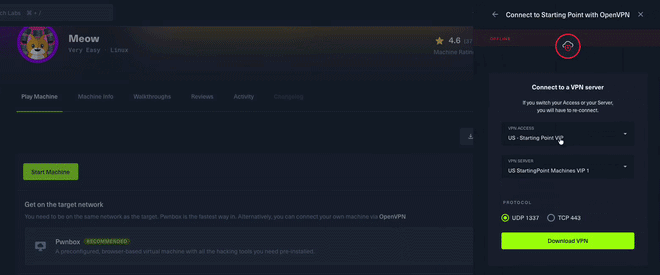
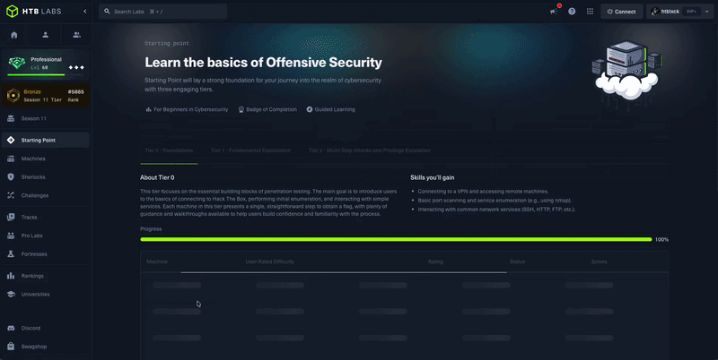
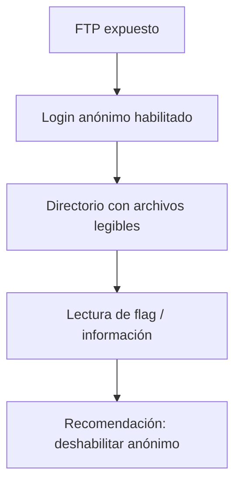

# 06 — Laboratorio HTB Meow

**Curso:** C|EH · Ethical Hacking  
**Dificultad:** Muy fácil  
**Plataforma:** Hack The Box — Starting Point  
**Objetivo:** aplicar reconocimiento, enumeración y acceso controlado en una máquina autorizada

---

## 6.1 Contexto

Meow es una máquina introductoria de Hack The Box. El objetivo no es "romper" nada complejo, sino practicar el método:


> [!WARNING]
> Este laboratorio solo se ejecuta contra la instancia de Hack The Box. No repitas estos pasos contra sistemas ajenos.

---

## 6.2 Conexión



*Conexión a la máquina desde HTB Starting Point. Fuente: Hack The Box.*

1. Inicia la máquina en HTB y copia su IP.
2. Conecta la VPN:

```bash
sudo openvpn starting_point.ovpn
```

3. Verifica la interfaz:

```bash
ip -br a show tun0
```

4. Comprueba conectividad:

```bash
ping -c 3 <IP>
```

> [!TIP]
> Si el ping falla pero la máquina está activa, puede estar bloqueando ICMP. Usa `nmap -Pn`.

---

## 6.3 Reconocimiento

```bash
# Escaneo inicial de puertos comunes
nmap -Pn -n -T4 <IP>

# Versiones y scripts por defecto
nmap -Pn -n -T4 -sV -sC <IP>

# Guardar evidencia
nmap -Pn -n -T4 -sV -sC -oA meow <IP>
```

### Qué buscar

| Hallazgo | Pregunta |
|---|---|
| Puerto 21 abierto | ¿FTP permite login anónimo? |
| `vsftpd 3.0.3` | ¿Hay vulnerabilidades conocidas? ¿La configuración es débil? |
| Otros puertos | ¿Hay servicios de gestión o web? |
| Banner | ¿Revela sistema, versión o usuario? |



*Inspección inicial de la máquina. Fuente: Hack The Box.*

---

## 6.4 Enumeración del servicio FTP

```bash
# Conexión interactiva
ftp <IP>

# Usuario anónimo
# Name: anonymous
# Password: (vacío o correo)
```

Si el acceso anónimo está habilitado:

```bash
ftp> ls
ftp> pwd
ftp> cat flag.txt
```

También puedes usar `curl` o `wget`:

```bash
curl -s ftp://anonymous@<IP>/flag.txt
```

> [!NOTE]
> El login anónimo es una configuración heredada para servidores de descarga pública. En un servidor moderno casi nunca debería estar habilitado, y menos con acceso al home del usuario `ftp`.

---

## 6.5 Por qué funciona



| Causa | Control |
|---|---|
| Servicio FTP expuesto innecesariamente | Cerrar el puerto o segmentar |
| Login anónimo habilitado | `anonymous_enable=NO` |
| Permisos laxos en el directorio | Revisar propietario y ACL |
| Falta de monitoreo | Alertar sobre accesos anónimos |

### Configuración segura de vsftpd (referencia)

```conf
anonymous_enable=NO
local_enable=YES
write_enable=NO
chroot_local_user=YES
```

> [!WARNING]
> Deshabilitar el anónimo no basta si el servicio sigue expuesto con credenciales débiles. Revisa también autenticación, cifrado (FTPS/SFTP) y segmentación.

---

## 6.6 Documentación del hallazgo

```markdown
### Hallazgo — Acceso anónimo a FTP

**Activo:** <IP>:21
**Servicio:** vsftpd 3.0.3
**Severidad:** Alta
**CWE:** CWE-287

**Descripción:**
El servicio FTP permite autenticación anónima y expone archivos
del directorio del usuario ftp.

**Evidencia:**
- `nmap -sV -sC` muestra `ftp vsftpd 3.0.3`.
- `ftp anonymous@<IP>` permite `ls` y `cat flag.txt`.
- Captura y transcripción en anexo.

**Impacto:**
Lectura de archivos internos y posible información para otras fases.

**Recomendación:**
- Deshabilitar `anonymous_enable`.
- Revisar permisos del directorio.
- Evaluar migración a SFTP.
- Monitorear accesos anómalos.
```

---

## 6.7 Lecciones del laboratorio

1. **El método importa más que la herramienta.** Un escaneo ordenado evita perder tiempo.
2. **La configuración por defecto puede ser insegura.** FTP anónimo sigue apareciendo en labs y en producción.
3. **La evidencia se guarda desde el inicio.** No reconstruyas el ataque después.
4. **El impacto se explica en lenguaje de negocio.** "FTP anónimo" no dice nada a un gerente; "cualquiera puede leer archivos internos" sí.
5. **La remediación es parte del trabajo.** Sin recomendación, el hallazgo queda incompleto.

---

## 6.8 Ejercicios de ampliación

- Repite el laboratorio con `-p-` y compara tiempos.
- Usa `ftp-anon` de NSE y compara con la enumeración manual.
- Documenta el hallazgo con CVSS y justifica el puntaje.
- Propón tres controles adicionales además de deshabilitar el anónimo.
- Investiga qué otros servicios suelen venir con configuraciones débiles por defecto.

---

## 6.9 Autoevaluación

1. ¿Qué comandos usaste para descubrir el servicio?
2. ¿Cómo confirmaste que el login anónimo estaba habilitado?
3. ¿Qué evidencia guardaste?
4. ¿Cuál es el impacto real del hallazgo?
5. ¿Qué recomendación darías además de deshabilitar el anónimo?
6. ¿Qué harías si el ping inicial fallara?
7. ¿Por qué no debes probar esto fuera de HTB?

---

**Anterior:** [05 — Introducción a Nmap](05-nmap.md) · **Volver al índice:** [README](README.md)
