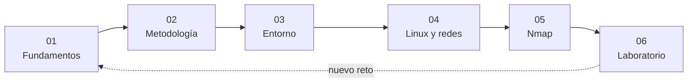
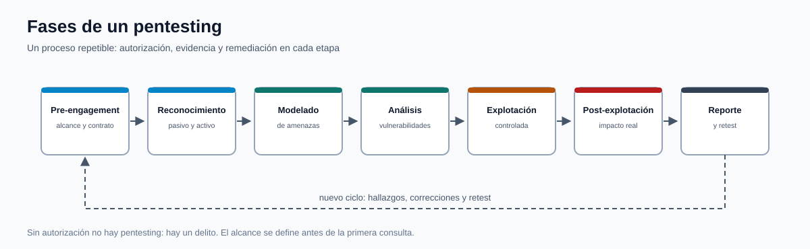

# Ethical Hacking — Teoría expandida

[Ethical Hacking](../README.md) | [Inicio](../../README.md)

**Curso:** C|EH · Ciberseguridad Ethical Hacking  
**Edición:** 11va Edición  
**Instructor:** Anthony Gonzalo Quispe Cordova  
**Institución:** Oficina de Tecnologías de la Información (OTI) — UNI

Este directorio expande la teoría de los slides con definiciones, diagramas, comandos, ejemplos y ejercicios de laboratorio. La regla del curso es simple: **mismas técnicas que un atacante, pero con autorización, alcance y reporte**.

---

## Índice

| # | Capítulo | Pregunta que responde |
|---|---|---|
| 01 | [Fundamentos del Ethical Hacking](01-fundamentos-ethical-hacking.md) | ¿Qué es y dónde está el límite legal? |
| 02 | [Metodología de un pentesting](02-metodologia-pentesting.md) | ¿Cómo se estructura una prueba profesional? |
| 03 | [Preparación del entorno](03-preparacion-entorno.md) | ¿Cómo monto un laboratorio seguro? |
| 04 | [Fundamentos de Linux y redes](04-linux-redes.md) | ¿Qué necesito saber antes de escanear? |
| 05 | [Introducción a Nmap](05-nmap.md) | ¿Cómo descubro servicios y versiones? |
| 06 | [Laboratorio HTB Meow](06-laboratorio-meow.md) | ¿Cómo aplico todo en una máquina real? |

## Ruta de aprendizaje

## Diagrama de referencia

*Diagrama propio: las siete fases del engagement y el ciclo de retest.*

## Convenciones

> [!NOTE]
> Definición o concepto que debes poder explicar sin mirar apuntes.

> [!TIP]
> Comando, atajo o buena práctica de laboratorio.

> [!WARNING]
> Riesgo legal, técnico o ético. Léelo antes de ejecutar.

> [!IMPORTANT]
> Idea central que se evalúa o que cambia la decisión.

## Regla de oro

> **Sin autorización escrita no hay ethical hacking. Hay un delito.**

Todas las técnicas de este curso se practican en laboratorios aislados o plataformas que autorizan explícitamente las pruebas (Hack The Box, TryHackMe, PortSwigger, VulnHub).

## Imágenes

Las capturas provienen de los slides del curso y de materiales educativos de Hack The Box Academy, Wikimedia Commons y documentación oficial. Se usan con fines académicos.

---

**Siguiente:** [01 — Fundamentos del Ethical Hacking](01-fundamentos-ethical-hacking.md)
