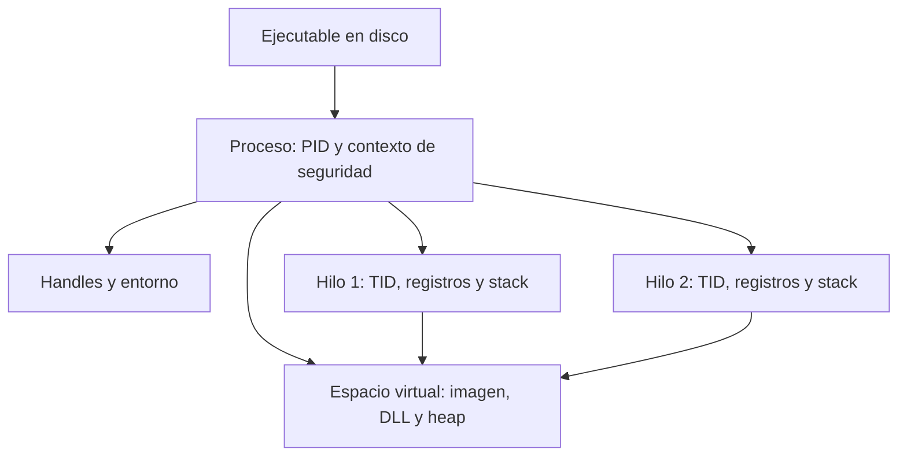
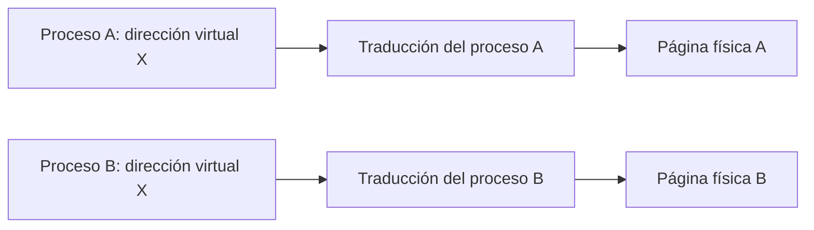
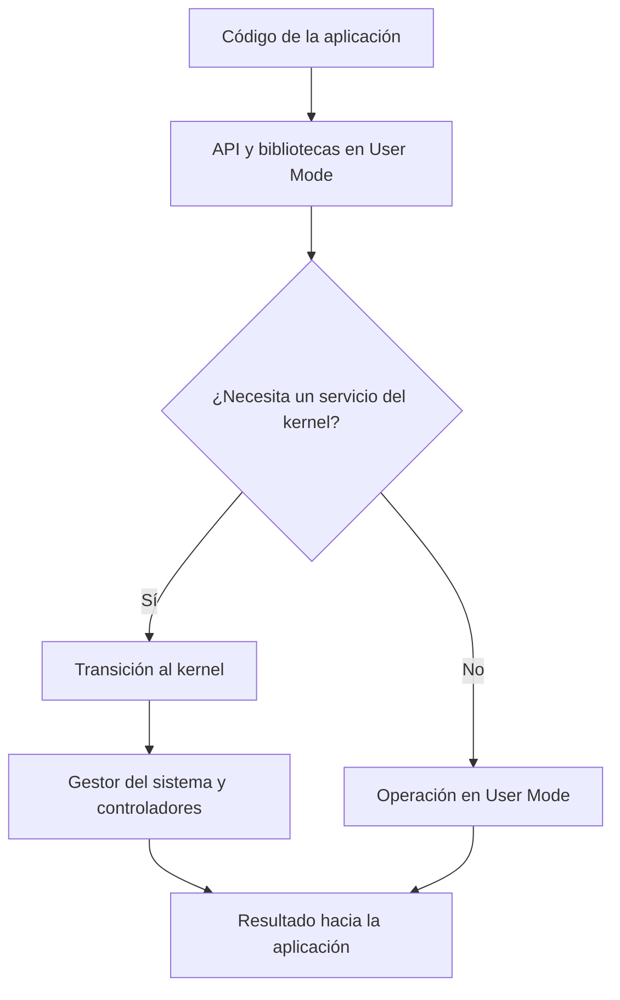
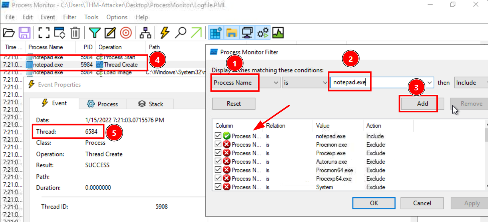

# 03 · Windows internals para análisis

[Anterior](../02-fundamentos-del-malware/README.md) · [Índice](../README.md) · [Siguiente](../04-arquitectura-x86-y-memoria/README.md)

## 1. Del programa al proceso

Un programa almacenado en disco contiene instrucciones y datos. Cuando Windows lo inicia, crea un proceso: una instancia con recursos e identidad propios. El mismo archivo puede originar varias instancias, cada una con su PID y su estado.

El proceso aporta un espacio de direcciones virtual, código, handles, entorno y contexto de seguridad. Los hilos realizan la ejecución dentro de ese contexto. Esta distinción permite interpretar por separado el archivo de origen, los recursos utilizados y la unidad que ejecutó una operación.



## 2. Identificadores, handles y seguridad

| Elemento | Significado | Precaución al interpretarlo |
|---|---|---|
| PID | Identifica un proceso mientras existe. | Puede reutilizarse después de terminar. Registra también tiempo y ruta. |
| TID | Identifica un hilo. | Varios TID pueden pertenecer al mismo PID. |
| Handle | Referencia del proceso a un objeto del sistema. | Lleva derechos de acceso concretos; no da acceso ilimitado al objeto. |
| Token | Representa usuario, grupos y privilegios. | La cuenta visible no describe por sí sola todos los permisos efectivos. |
| Nivel de integridad | Participa en restricciones de interacción entre objetos. | Integridad alta y cuenta SYSTEM no son conceptos equivalentes. |
| Entorno | Variables disponibles para el proceso. | Una ruta de entorno puede variar entre usuarios y procesos. |

Un archivo llamado `svchost.exe` no queda autenticado por su nombre. Para examinarlo se combinan la ruta, el origen, la firma, la identidad, el tiempo de creación y la actividad. Tampoco un PID concreto se asocia permanentemente a un programa.

## 3. Hilos, contexto y planificación

El planificador asigna tiempo de CPU a hilos que pueden ejecutarse. Cada hilo conserva registros y una pila propios, mientras comparte la memoria del proceso con sus hilos hermanos. La concurrencia no significa que todos se ejecuten simultáneamente: un hilo también puede estar esperando entrada, un bloqueo o un evento.

La clase de prioridad del proceso y la prioridad de sus hilos influyen en la planificación; no reservan un núcleo. El contexto guardado permite reanudar un hilo tras un cambio de ejecución. El almacenamiento local de hilo, o TLS, mantiene datos asociados a cada hilo.

En una captura de eventos conviene relacionar **PID → TID → operación → resultado**. Un evento `Thread Create` significa creación de un hilo; no demuestra por sí mismo que exista una inyección.

## 4. Memoria virtual y memoria física

Cada proceso observa direcciones virtuales. Las tablas de páginas y la gestión de memoria del sistema participan en su traducción. Dos procesos pueden usar el mismo número de dirección virtual y referirse a contenidos físicos diferentes.



Esto no impide que ciertas páginas sean compartidas deliberadamente, por ejemplo páginas de código de bibliotecas. «Espacio privado de direcciones» no significa «toda la RAM de ese proceso es exclusiva».

Conceptos que deben distinguirse:

- **Reserva:** aparta un rango de direcciones virtuales para un uso posterior.
- **Compromiso o commit:** establece respaldo para páginas; no exige que todas estén residentes en RAM en ese instante.
- **Working set:** páginas del proceso que están residentes en memoria física en ese momento.
- **Heap:** asignaciones dinámicas gestionadas durante la ejecución.
- **Stack:** memoria asociada a las llamadas y al estado de un hilo.

En x86 de 32 bits hay un espacio lineal teórico de 4 GiB. En Windows x86 clásico era habitual la división 2 GiB para usuario y 2 GiB para sistema, con variantes según configuración e imagen. No se debe aplicar esa división sin cambios a un proceso x86 bajo Windows x64. En x64, el espacio implementado depende de la arquitectura y de la versión del sistema; disponer de registros de 64 bits no implica que todo el rango de 2^64 esté utilizable.

Los permisos de página controlan lectura, escritura y ejecución. Un dato puede existir en memoria sin que esa página sea ejecutable. Un cambio de permisos o una región ejecutable merece contexto: no basta una propiedad aislada para afirmar que sea maliciosa.

## 5. DLL, PE y carga de una imagen

Una DLL agrupa código y datos que otros componentes pueden utilizar mediante funciones exportadas. Una importación declara una función o un símbolo que la imagen necesita; una exportación ofrece un símbolo a otros consumidores. No todas las DLL contienen las mismas estructuras o exportan funciones por nombre.

El formato PE organiza cabeceras, secciones y directorios del archivo. Al cargarlo, Windows no se limita a copiar todos los bytes seguidos: mapea secciones con alineación y permisos, resuelve dependencias y realiza los ajustes necesarios.

| Concepto | Representación |
|---|---|
| Offset de archivo | Posición de un byte dentro del archivo en disco. |
| RVA | Dirección relativa a la base de la imagen cargada. |
| VA | Dirección virtual dentro del proceso. Para una RVA de la imagen: `VA = base + RVA`. |
| IAT | Tabla utilizada para las direcciones de funciones importadas resueltas por el cargador. |

ASLR puede cambiar la base de carga. Por eso una dirección absoluta vista en otra ejecución no es automáticamente reutilizable. El [capítulo de triaje](../06-triaje-estatico/README.md) muestra dónde inspeccionar estas estructuras.

## 6. Windows API, User Mode y Kernel Mode

La Windows API es una interfaz de programación. Una operación como abrir un archivo suele recorrer bibliotecas de usuario y servicios del sistema. Algunas funciones resuelven su trabajo en User Mode; otras necesitan una transición al kernel. **Llamada a API** y **llamada al sistema** no son sinónimos.



User Mode limita el acceso directo a recursos privilegiados. Kernel Mode dispone de capacidades que permiten administrar el sistema y los dispositivos. Elevar una aplicación como administrador no convierte su código de usuario en un controlador del kernel.

Al observar una API se identifican sus parámetros, los derechos solicitados y su resultado. Funciones relacionadas con memoria o procesos también se utilizan en software legítimo; importarlas no demuestra que se haya completado una acción.

## 7. Observar sin instalar herramientas adicionales

El Administrador de tareas permite revisar procesos e identificadores. En PowerShell, estos comandos consultan propiedades de procesos existentes:

```powershell
Get-Process | Select-Object Id, ProcessName, WorkingSet64
Get-CimInstance Win32_Process |
    Select-Object ProcessId, ParentProcessId, ExecutablePath
```

`WorkingSet64` se expresa en bytes y no equivale al espacio virtual total. Algunas rutas pueden aparecer vacías por permisos o porque el proceso ya terminó. El PID del padre debe interpretarse junto al tiempo: su número también puede reutilizarse.

## 8. Preparar Process Monitor y revisar un evento

Process Monitor registra operaciones sobre archivos, Registro y procesos/hilos. Para esta demostración utiliza Bloc de notas dentro de la VM preparada.

1. Comprueba si Process Monitor ya está disponible en FLARE-VM. Si falta, descarga el ZIP desde [Microsoft Sysinternals](https://learn.microsoft.com/en-us/sysinternals/downloads/procmon), extráelo en una carpeta de herramientas de la VM y abre el ejecutable compatible con la arquitectura. Acepta su licencia si se solicita.
2. Detén momentáneamente la captura con **Ctrl+E** y limpia los eventos visibles con **Ctrl+X**.
3. Abre **Filter → Filter** o **Ctrl+L**. Añade **Process Name → is → notepad.exe → Include** y confirma con **Add**, después **OK**.


4. Reanuda la captura con **Ctrl+E**, inicia Bloc de notas y después detén la captura. En algunas versiones de Windows puede intervenir un lanzador o una aplicación empaquetada; revisa el PID y el árbol realmente observados.
5. Abre un evento de proceso o hilo. Relaciona nombre, PID, operación, resultado y TID. Si hay varias instancias, refina el filtro con el PID de interés.



Las capturas contienen identificadores de ejemplo. No copies sus PID/TID: los de tu VM serán distintos. En un evento `Thread Create`, el campo **Thread** identifica al hilo que realizó la operación, mientras que **Thread ID** en el detalle corresponde al hilo creado; por eso pueden mostrar números diferentes. El filtro de visualización tampoco demuestra que no haya actividad fuera de las filas que muestra.

## Documentación técnica

- [Microsoft: procesos e hilos](https://learn.microsoft.com/en-us/windows/win32/procthread/about-processes-and-threads).
- [Microsoft: espacios de direcciones virtuales](https://learn.microsoft.com/en-us/windows/win32/memory/virtual-address-spaces).
- [Microsoft: formato PE](https://learn.microsoft.com/en-us/windows/win32/debug/pe-format).
- [Process Monitor](https://learn.microsoft.com/en-us/sysinternals/downloads/procmon).

[Continuar con arquitectura x86](../04-arquitectura-x86-y-memoria/README.md)
