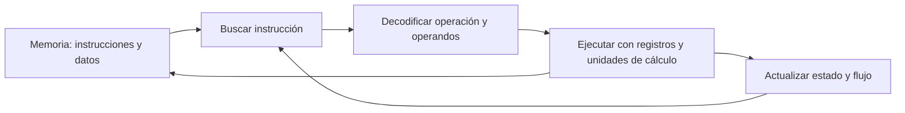
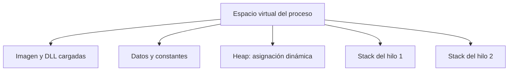

# 04 · Arquitectura x86 y organización de memoria

[Anterior](../03-windows-internals/README.md) · [Índice](../README.md) · [Siguiente](../05-enfoques-de-analisis/README.md)

## 1. CPU, memoria y arquitectura de Von Neumann

El modelo de Von Neumann describe un sistema en el que instrucciones y datos se almacenan en memoria. La CPU mantiene registros de trabajo, una unidad de control y unidades que realizan operaciones aritméticas y lógicas. El puntero de instrucción permite seguir la secuencia que se está ejecutando.

Para aprender se utiliza el ciclo **buscar → decodificar → ejecutar**. Los procesadores modernos superponen y reorganizan trabajo internamente; el ciclo es un modelo conceptual, no una descripción de sus tiempos físicos.



Las instrucciones x86 tienen longitud variable. No se puede asumir que la siguiente instrucción se encuentre siempre a cuatro bytes de la anterior. Además, una secuencia de bytes necesita el modo y el punto de inicio correctos para desensamblarse de forma coherente.

## 2. Registros y sus funciones habituales

Un registro guarda un valor de trabajo dentro de la CPU. Ese valor puede representar un entero, una máscara, un contador o una dirección; el nombre del registro no decide el significado del dato.

| 32 bits | 64 bits | Uso que suele encontrarse |
|---|---|---|
| EAX | RAX | Acumulador y resultados de funciones según la convención. |
| EBX | RBX | Valor de trabajo o base; su conservación depende de la convención. |
| ECX | RCX | Contador en algunas instrucciones; también argumento en la ABI Windows x64. |
| EDX | RDX | Datos, argumentos y parte de resultados implícitos de ciertas operaciones. |
| ESI | RSI | Índice de origen en operaciones de cadenas. |
| EDI | RDI | Índice de destino en operaciones de cadenas. |
| ESP | RSP | Puntero de pila. |
| EBP | RBP | Referencia de frame cuando el compilador la utiliza. |
| EIP | RIP | Puntero de instrucción; los depuradores muestran dónde se encuentra la ejecución. |

En modo de 64 bits existen también `R8` a `R15`. La forma `R8D` accede a 32 bits, `R8W` a 16 y `R8B` a 8. No todos los registros empiezan por E o R: existen otros grupos, como registros de segmento y registros vectoriales.

Los usos de la tabla son convenciones o funciones de instrucciones concretas. No significa que `ECX` tenga que actuar siempre como contador ni que toda función utilice `RBP`.

## 3. Subregistros: una misma región con varios tamaños

```text
RAX  [63 .................................................. 0]
                         EAX [31 .......................... 0]
                                         AX [15 ........... 0]
                                            AH [15..8] AL [7..0]
```

Partimos de `EAX = 0x12345678`:

| Instrucción | Resultado de EAX | Parte reemplazada |
|---|---|---|
| `mov al, 0xAA` | `0x123456AA` | Bits 7–0. |
| Después: `mov ah, 0xBB` | `0x1234BBAA` | Bits 15–8. |
| Después: `mov ax, 0xCCDD` | `0x1234CCDD` | Bits 15–0. |

Hay una regla especialmente importante en modo de 64 bits: una escritura ordinaria en `EAX` pone a cero los 32 bits superiores de `RAX`. Las escrituras en `AX`, `AL` o `AH` no hacen eso.

```asm
; Ejemplo en modo de 64 bits
mov rax, 0x1122334455667788
mov eax, 1                  ; RAX = 0x0000000000000001
```

Los registros altos de byte `AH`, `BH`, `CH` y `DH` también tienen restricciones de codificación cuando interviene un prefijo REX. Su presencia no debe extrapolarse a todas las combinaciones de registros de x64.

## 4. Bases numéricas y little-endian

Un byte tiene 8 bits. En los ejemplos se usa `0x` para hexadecimal; cada dígito hexadecimal representa cuatro bits. `0xFF` contiene ocho bits a uno: equivale a 255 sin signo o a −1 cuando se interpreta como entero de 8 bits en complemento a dos.

En x86, un entero de varios bytes se guarda con el byte menos significativo en la dirección más baja:

| Dirección | Byte |
|---|---|
| `0x1000` | `0x78` |
| `0x1001` | `0x56` |
| `0x1002` | `0x34` |
| `0x1003` | `0x12` |

Leer un `DWORD` desde `0x1000` devuelve `0x12345678`; leer un byte desde esa misma dirección devuelve `0x78`. El tamaño de la lectura importa tanto como la dirección.

Little-endian ordena bytes dentro de ciertos valores; no significa invertir el orden de las instrucciones ni escribir una cadena de texto al revés.

## 5. Banderas y decisiones

`EFLAGS` o `RFLAGS` contienen bits de estado y control. Las instrucciones tienen reglas propias: unas modifican banderas y otras conservan sus valores anteriores.

| Bandera | Qué representa |
|---|---|
| ZF | Se activa si el resultado definido por la operación es cero. |
| SF | Copia el bit de signo del resultado para su ancho. |
| CF | Acarreo o préstamo en aritmética sin signo; también interviene en shifts y rotaciones. |
| OF | Desbordamiento en la interpretación con signo, cuando la instrucción lo define. |
| TF | Participa en ejecución paso a paso mediante excepciones de depuración. |

`SF = 1` permite interpretar un resultado como negativo si se trata como entero con signo. Esos mismos bits pueden representar un entero positivo grande cuando se tratan como unsigned.

`TF` no es un botón que detenga por sí solo toda la CPU: permite producir eventos de depuración; el sistema y el depurador gestionan lo que ocurre después.

```asm
mov eax, 5
cmp eax, 5       ; calcula flags como si restara 5 - 5, sin guardar el resultado
je iguales      ; consulta ZF; no vuelve a comparar los operandos
```

El [capítulo de ensamblador](../07-ensamblador-basico/README.md) desarrolla cómo se relacionan las instrucciones, las flags y los saltos.

## 6. Segmentos y regiones de memoria

Los registros de segmento incluyen `CS`, `DS`, `SS`, `ES`, `FS` y `GS`. En entornos x86 protegidos contienen selectores, no nombres de secciones PE. En el modelo plano y en modo de 64 bits gran parte de la segmentación tradicional deja de usarse del mismo modo; las bases de `FS` y `GS` siguen siendo relevantes para estructuras del sistema y del hilo.

Esto es distinto de las regiones conceptuales de un proceso:

| Región | Contenido habitual |
|---|---|
| Imagen y código | Instrucciones del ejecutable y de módulos cargados. |
| Datos globales y constantes | Valores que utilizan distintas funciones. |
| Heap | Asignaciones dinámicas. |
| Stack de cada hilo | Información de llamadas, valores temporales y datos locales según compilación. |

El dibujo siguiente representa relaciones, no direcciones fijas ni un mapa universal. ASLR y el cargador cambian la disposición concreta.



## 7. Pila y stack frame en x86 de 32 bits

La pila organiza valores siguiendo LIFO: el último que entra es el primero que sale. En operaciones ordinarias con operandos de 32 bits, `push` reduce `ESP` en cuatro bytes y escribe el valor; `pop` lo recupera y aumenta `ESP` en cuatro bytes.

```text
Frame ilustrativo con EBP, direcciones de mayor a menor:

[EBP + 8]  primer argumento
[EBP + 4]  dirección de retorno
[EBP]      EBP guardado
[EBP - 4]  variable local
```

Un prólogo convencional de 32 bits puede ser:

```asm
push ebp
mov ebp, esp
sub esp, 0x10
```

Se guarda el `EBP` anterior, se fija una referencia de frame y se reservan 16 bytes. Un epílogo correspondiente puede restaurar el puntero, recuperar `EBP` y regresar:

```asm
mov esp, ebp
pop ebp
ret
```

Este patrón es un modelo de aprendizaje. Una función optimizada puede omitir el frame pointer, mantener variables en registros o construir otra disposición. Windows x64 utiliza una ABI diferente; no basta con sustituir EBP por RBP en el dibujo.

Si una escritura excede los límites de un búfer local puede corromper datos adyacentes del frame. Que exista un desbordamiento no garantiza control de ejecución: importan los datos sobrescritos y las protecciones. Aquí interesa comprender la relación entre límites de memoria y estado de llamadas.

## Lectura guiada

Con `ESP = 0x2000`, ejecuta mentalmente `push 0x11`, `push 0x22`, `pop eax` en modo de 32 bits. El primer push deja `ESP = 0x1FFC`; el segundo, `0x1FF8`. El pop carga `EAX = 0x22` y deja `ESP = 0x1FFC`. El valor `0x11` sigue siendo el siguiente de la pila.

## Documentación técnica

- [Intel: manuales de arquitectura e instrucciones](https://www.intel.com/content/www/us/en/developer/articles/technical/intel-sdm.html).
- [Microsoft: convención de llamadas x64](https://learn.microsoft.com/en-us/cpp/build/x64-calling-convention).

[Continuar con enfoques de análisis](../05-enfoques-de-analisis/README.md)
