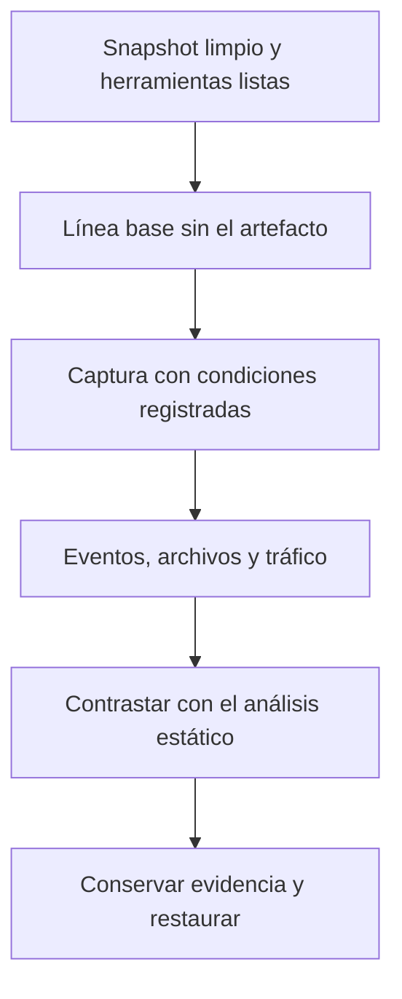
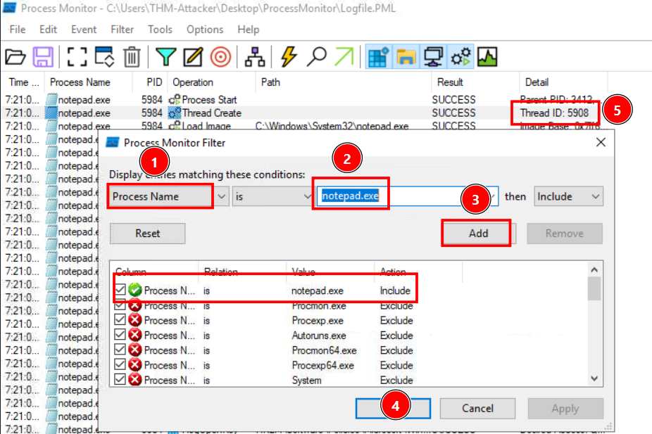
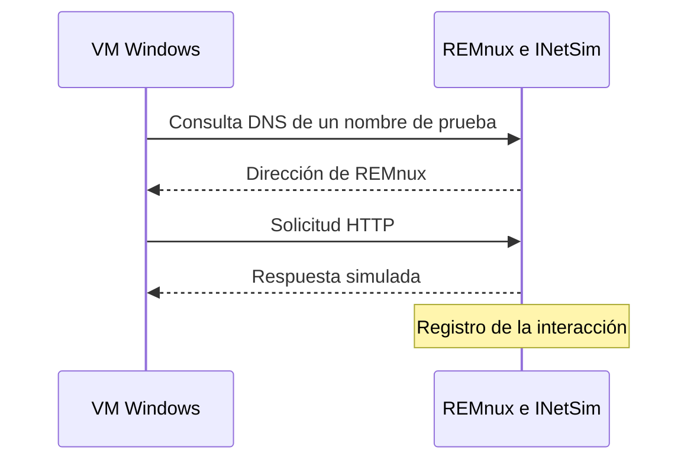

# 05 · Fundamentos de análisis estático y dinámico

[Anterior](../04-arquitectura-x86-y-memoria/README.md) · [Índice](../README.md) · [Siguiente](../06-triaje-estatico/README.md)

## 1. Dos preguntas diferentes sobre el mismo programa

El análisis estático examina el contenido y las estructuras de un archivo sin iniciar su ejecución normal. El análisis dinámico observa una ejecución concreta en un entorno controlado. Ambos aportan evidencia distinta: posibilidad de comportamiento frente a acciones observadas bajo unas condiciones determinadas.

Un desensamblador permite estudiar instrucciones sin ejecutar el programa como aplicación. Un depurador que lo inicia y avanza instrucciones participa en análisis dinámico. Una herramienta automática puede mezclar técnicas, por ejemplo análisis de código y emulación parcial; conviene conocer su mecanismo y sus límites.

| Aspecto | Estático | Dinámico |
|---|---|---|
| Objeto inmediato | Bytes, cabeceras, símbolos, cadenas y código. | Proceso, memoria y eventos de una ejecución. |
| Resultados habituales | Hash, formato, arquitectura, imports y posibles capacidades. | Archivos modificados, procesos creados, claves alteradas y tráfico observado. |
| Ventaja | Examina contenido y rutas que quizá no se alcancen al ejecutar. | Muestra valores y acciones que se construyen durante la ejecución. |
| Límite | Empaquetado, cifrado, código no alcanzable y dependencias dinámicas. | Dependencia de tiempo, argumentos, permisos, red y mecanismos de evasión. |

Ninguno certifica por sí solo que un archivo sea seguro. No observar una acción puede significar que no ocurrió en esa ejecución o que la instrumentación no la capturó.

## 2. Qué revisar sin ejecutar

El primer recorrido estático establece qué se recibió: tamaño, hash y formato real. Después se estudian arquitectura y estructura PE, secciones, importaciones, exportaciones, cadenas y puntos de interés en el código.

- **Cabeceras:** describen la imagen y ayudan a localizar otras estructuras.
- **Importaciones:** orientan sobre dependencias y funciones que el archivo puede utilizar.
- **Exportaciones:** muestran símbolos ofrecidos por un módulo, cuando existen.
- **Cadenas:** revelan textos presentes o recuperados por herramientas, no necesariamente utilizados.
- **Instrucciones:** permiten relacionar condiciones, argumentos y llamadas.

Este recorrido se desarrolla con capturas y comandos en [Triaje estático](../06-triaje-estatico/README.md). Aunque no se lance la muestra, se mantiene el laboratorio aislado: los analizadores también procesan entradas potencialmente malformadas.

## 3. Qué registrar durante una ejecución

| Fuente | Información que aporta | Pregunta técnica |
|---|---|---|
| Procesos e hilos | Creación, terminación, relaciones y contexto. | ¿Qué instancia realizó cada operación? |
| Sistema de archivos | Aperturas, lecturas, escrituras, renombrados y borrados. | ¿Qué ruta cambió y con qué resultado? |
| Registro | Acceso y modificación de claves o valores. | ¿Es lectura de configuración o una modificación persistente? |
| Red | DNS, conexiones y datos transferidos según la captura. | ¿Qué destino se solicitó y qué respondió el laboratorio? |
| Memoria | Datos construidos o regiones presentes durante ejecución. | ¿Qué contenido no estaba visible igual en disco? |

Una operación fallida también es información. Por ejemplo, `ACCESS DENIED` no prueba una modificación exitosa y un nombre solicitado por DNS no prueba que se haya completado una conexión TCP.

## 4. Diseñar una observación reproducible

Antes de ejecutar un artefacto se fija el estado inicial: snapshot, identidad de la VM, red, versiones de herramientas, argumentos y tiempo de observación. Así se puede repetir el análisis y comparar diferencias.

La línea base ayuda a distinguir actividad del sistema, de las herramientas y del programa. Un archivo creado cerca del inicio de la muestra no queda atribuido solo por proximidad temporal: se busca el proceso y la operación que lo originaron.

Al guardar resultados se conserva el original en su formato útil: por ejemplo PML de Process Monitor y PCAP cuando exista captura de red, además de notas y extractos. Una captura de pantalla es una explicación visual; no sustituye los datos completos.

## 5. Configuración de captura con Process Monitor

La [preparación de Process Monitor](../03-windows-internals/README.md#8-preparar-process-monitor-y-revisar-un-evento) explica la descarga del ZIP oficial y su apertura. Para aprender el procedimiento utiliza `notepad.exe`, sin una muestra maliciosa.

1. Detén y limpia la captura anterior.
2. Añade un filtro de proceso. Si ya conoces su PID, úsalo para distinguir instancias.
3. Activa la captura, realiza una acción controlada en Bloc de notas y detén la captura.
4. Ordena por tiempo y relaciona operaciones con rutas y resultados. Guarda el PML desde **File → Save**.

El filtro mostrado usa el nombre del proceso; no debe asumirse que incluye automáticamente todos los hijos o todos los procesos relacionados. Si necesitas seguir una cadena, revisa el árbol y agrega las instancias correspondientes. Los filtros muy estrechos pueden ocultar evidencia útil, y las opciones que descartan eventos pueden impedir recuperarlos después.

## 6. Comunicación simulada con REMnux

INetSim permite que ciertos servicios solicitados por el programa respondan dentro del laboratorio. Esto facilita ver solicitudes sin contactar un servidor externo. La [guía del entorno](../01-preparacion-del-entorno/README.md#5-configurar-inetsim-en-remnux) contiene las capturas de configuración de escucha y DNS.

Una respuesta simulada no reproduce necesariamente la lógica del servidor original. Un programa que requiera HTTPS validado, datos específicos o una IP fija puede comportarse de otra manera. Se registra lo que el entorno respondió, para no presentar esa respuesta como evidencia del C2 real.

## 7. Correlacionar estático y dinámico

Ejemplo didáctico: el archivo contiene una URL de prueba y declara una función de red. La primera hipótesis es que puede realizar una solicitud. Si durante la ejecución observamos una consulta y una conexión atribuibles a su proceso, avanzamos desde la posibilidad hacia una acción observada.

| Dato estático | Dato de ejecución | Conclusión prudente |
|---|---|---|
| Cadena con ruta de archivo | Escritura exitosa a esa ruta. | Se utilizó esa ruta en la ejecución observada. |
| Importación relacionada con red | Solicitud registrada en INetSim. | Se produjo comunicación con el servicio simulado. |
| Referencia a tarea programada | Modificación de configuración registrada. | Se intentó o realizó ese cambio según el resultado. |
| Cadena de comando | Ninguna ejecución registrada. | La cadena existe; su uso sigue pendiente de confirmar. |

La ausencia de actividad puede deberse a errores, dependencias, argumentos, esperas o condiciones del entorno. Tampoco debe afirmarse automáticamente que existe evasión de VM: primero se descartan explicaciones más sencillas y se buscan las comprobaciones concretas en el código.

## 8. Resultado técnico del análisis

Un registro útil incluye el hash del archivo, entorno, condiciones, acciones observadas y límites. Para cada hallazgo se conserva el dato que lo respalda: offset, instrucción, evento, ruta o paquete. Los indicadores que se extraen se distinguen de los valores de simulación del laboratorio.

La salida final puede expresarse como una relación verificable: «la instancia PID X escribió el archivo Y a la hora Z y la operación terminó con éxito». Esa formulación aporta más información que una etiqueta genérica de malware.

[Continuar con triaje estático](../06-triaje-estatico/README.md)
