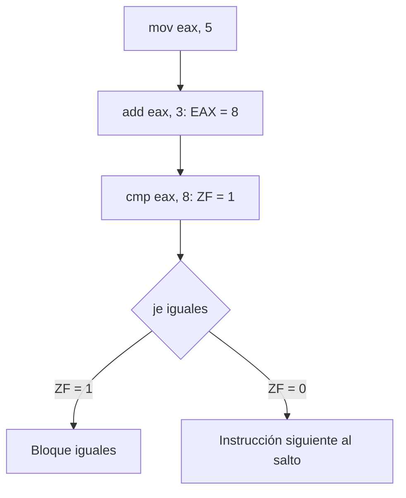

# 07 · Ensamblador básico para reversing

[Anterior](../06-triaje-estatico/README.md) · [Índice](../README.md)

Los ejemplos utilizan sintaxis Intel: `instrucción destino, origen`. Los bloques son fragmentos de aprendizaje y sus direcciones de memoria son supuestas, no ubicaciones que deban escribirse en un equipo. Puedes seguirlos mediante las trazas sin instalar un compilador o un emulador.

## 1. Del código fuente a las instrucciones

La CPU ejecuta código máquina. Un compilador de código nativo transforma construcciones del lenguaje en instrucciones y datos, y el enlazador organiza el resultado con sus dependencias. Un desensamblador interpreta bytes como instrucciones; un descompilador intenta recuperar una representación de mayor nivel.

No existe una correspondencia fija entre una línea de C y una instrucción. La optimización puede eliminar variables, calcular resultados de antemano o reorganizar operaciones. Los comentarios, nombres locales y estructura original no suelen conservarse de forma completa.


El esquema describe código nativo. Los programas interpretados y los entornos administrados pueden usar bytecode, intérpretes o compilación JIT; no todo lenguaje se convierte del mismo modo en instrucciones x86 almacenadas en un PE.

## 2. Codificación, opcodes y operandos

Considera estos bytes decodificados en modo de 32 bits:

```text
B8 05 00 00 00       mov eax, 5
83 C0 03             add eax, 3
83 F8 08             cmp eax, 8
```

La codificación puede incluir prefijos, bytes de opcode, campos para registros o direccionamiento, desplazamientos e inmediatos. `B8` es parte de la codificación concreta del primer `mov`; no es «el opcode universal de MOV».

Los tres tipos básicos de operandos son:

| Tipo | Ejemplo | Interpretación |
|---|---|---|
| Inmediato | `mov eax, 5` | El 5 está codificado como constante. |
| Registro | `mov ebx, eax` | Se copia el valor de un registro. |
| Memoria | `mov eax, [ebx]` | Se lee desde la dirección contenida en EBX. |

En un `mov` ordinario, un operando puede ser memoria, pero no ambos a la vez. Para copiar entre dos ubicaciones se utiliza un registro intermedio:

```asm
mov eax, [ebx]
mov [ecx], eax
```

El tamaño debe quedar definido. `mov byte ptr [ebx], 1` escribe un byte y `mov dword ptr [ebx], 1` escribe cuatro. Cuando el registro lo determina, como en `mov al, [ebx]`, el ancho ya es de un byte.

## 3. Valores, direcciones y little-endian

Supongamos que `EBX = 0x1000` y que los bytes desde esa dirección son `78 56 34 12`:

| Instrucción | Resultado |
|---|---|
| `mov eax, ebx` | EAX recibe el valor `0x1000`. |
| `mov al, [ebx]` | AL recibe el primer byte: `0x78`. |
| `mov eax, [ebx]` | EAX recibe el DWORD: `0x12345678`. |
| `lea eax, [ebx+4]` | EAX recibe la dirección calculada: `0x1004`. |

Los corchetes de un operando de memoria implican acceso al contenido. En `lea`, esos corchetes describen el cálculo de la dirección; no hacen que LEA lea los bytes almacenados allí.

Antes de continuar, recuerda la [relación entre subregistros](../04-arquitectura-x86-y-memoria/README.md#3-subregistros-una-misma-región-con-varios-tamaños): cambiar AL no equivale a reemplazar todo EAX, y escribir EAX en modo de 64 bits pone a cero la mitad superior de RAX.

## 4. Instrucciones generales

### MOV

Copia el origen en el destino y conserva las banderas. No modifica el origen por el hecho de copiarlo.

```asm
mov eax, 10
mov ebx, eax       ; EAX = 10, EBX = 10
```

### LEA

Calcula una dirección efectiva y conserva las banderas. Puede aparecer tanto para preparar un puntero como para hacer aritmética:

```asm
; EBX = 0x1000, ECX = 3
lea eax, [ebx+ecx*4+8]   ; EAX = 0x1014; no se lee memoria
```

Los factores de escala habituales del direccionamiento x86 son 1, 2, 4 y 8. Que una instrucción use LEA no demuestra por sí mismo que el resultado vaya a utilizarse como puntero.

### NOP

No realiza una operación funcional sobre los datos del programa. Puede usarse para alineación o para ocupar espacio de código. La forma de un byte es `90`, pero también hay NOP de varias longitudes. Una secuencia de NOP requiere contexto; no demuestra automáticamente la presencia de un exploit.

## 5. Shifts y rotaciones

Para los siguientes ejemplos se usa un valor de ocho bits y un desplazamiento de **un bit**:

| Instrucción | Entrada binaria | Resultado | Qué ocurre con el bit que sale |
|---|---|---|---|
| `shl al, 1` | `10000001` | `00000010` | El bit alto pasa a CF; entra cero por abajo. |
| `shr al, 1` | `10000001` | `01000000` | El bit bajo pasa a CF; entra cero por arriba. |
| `rol al, 1` | `10000001` | `00000011` | El bit alto vuelve por abajo y también determina CF. |
| `ror al, 1` | `10000001` | `11000000` | El bit bajo vuelve por arriba y también determina CF. |

Un shift descarta bits del ancho del destino; una rotación los reintroduce por el extremo opuesto. SHL y SHR actualizan varias banderas de resultado para conteos efectivos no nulos; ROL y ROR no actualizan ZF ni SF. El comportamiento de OF depende del conteo y de la instrucción: no se extrapola el caso de un bit a cualquier desplazamiento.

En reversing estas operaciones pueden aparecer en cálculos, máscaras o transformaciones de datos. El propósito se deduce de cómo se utilizan los resultados.

## 6. Aritmética y lógica

| Instrucción | Efecto básico | Detalle relevante |
|---|---|---|
| `add eax, ebx` | EAX recibe EAX + EBX. | Actualiza banderas aritméticas. |
| `sub eax, 4` | Resta 4 a EAX. | El resultado queda en EAX. |
| `inc eax` / `dec eax` | Suma o resta uno. | Conservan CF, a diferencia de ADD/SUB de uno. |
| `and eax, 0xFF` | Conserva los bits permitidos por la máscara. | CF y OF se ponen a cero. |
| `or eax, 1` | Activa el bit bajo. | Actualiza banderas de resultado y borra CF/OF. |
| `xor eax, eax` | Pone EAX a cero. | ZF queda en uno; no equivale a MOV respecto a flags. |
| `not eax` | Invierte todos los bits de EAX. | Conserva las banderas. |

Para multiplicación y división **sin signo**, con operandos de 32 bits:

```asm
mul ebx          ; EDX:EAX = EAX * EBX
div ebx          ; divide EDX:EAX entre EBX; cociente en EAX y resto en EDX
```

La expresión `EDX:EAX` significa concatenar la mitad alta y la baja. DIV no divide solamente EAX si EDX contiene otro valor. Una preparación didáctica para dividir un entero de 32 bits sin signo es poner EDX a cero; además, el divisor debe ser distinto de cero y el cociente debe caber. `imul` e `idiv` tratan operaciones con signo y tienen variantes y preparación propias.

## 7. Banderas: diferencia entre CF y OF

Los bits no son intrínsecamente signed o unsigned. Esa interpretación cambia qué bandera permite detectar un resultado fuera de rango.

| Operación de 8 bits | Resultado guardado | CF | OF | Lectura |
|---|---|---|---|---|
| `0xFF + 1` | `0x00` | 1 | 0 | 255 + 1 desborda sin signo; −1 + 1 cabe con signo. |
| `0x7F + 1` | `0x80` | 0 | 1 | 127 + 1 cabe sin signo; no cabe como entero con signo de 8 bits. |
| `0 - 1` | `0xFF` | 1 | 0 | Hay préstamo sin signo; −1 es representable con signo. |

ZF indica resultado cero, y SF refleja su bit más significativo. Para interpretar una bandera hay que identificar la última instrucción que la cambió. Por ejemplo, un MOV entre CMP y JE no destruye las flags del CMP, pero un ADD intermedio puede reemplazarlas.

Como referencia secundaria, PF refleja paridad en el byte bajo, AF el acarreo entre los bits 3 y 4, y DF la dirección de las instrucciones de cadenas. Para comenzar se priorizan ZF, CF, SF y OF.

## 8. CMP, TEST y saltos

`cmp destino, origen` actualiza flags como una resta y descarta el resultado. `test destino, origen` hace lo mismo a partir de un AND. Ninguna de las dos guarda el resultado en los operandos.

```asm
cmp eax, 8       ; pregunta por relación aritmética entre EAX y 8
test eax, eax   ; permite comprobar si EAX es cero
```

Un salto condicional consulta esas banderas:

| Salto | Condición | Interpretación tras una comparación |
|---|---|---|
| `je` / `jz` | ZF = 1 | Igual / resultado cero. |
| `jne` / `jnz` | ZF = 0 | Distinto / resultado no cero. |
| `ja` | CF = 0 y ZF = 0 | Mayor sin signo. |
| `jae` | CF = 0 | Mayor o igual sin signo. |
| `jb` | CF = 1 | Menor sin signo. |
| `jbe` | CF = 1 o ZF = 1 | Menor o igual sin signo. |
| `jg` | ZF = 0 y SF = OF | Mayor con signo. |
| `jge` | SF = OF | Mayor o igual con signo. |
| `jl` | SF distinto de OF | Menor con signo. |
| `jle` | ZF = 1 o SF distinto de OF | Menor o igual con signo. |

`jmp` cambia el flujo sin consultar una condición. Para leer un bloque se sigue la ruta de cada salto, sin deducir su condición únicamente por el nombre de una etiqueta.



Si los valores fueran `0xFFFFFFFF` y `1`, una comparación con signo consideraría el primero menor (−1 < 1); una comparación sin signo lo consideraría mayor (4294967295 > 1). Elegir JL o JA cambia la interpretación, aunque los operandos tengan los mismos bits.

## 9. Pila, CALL y RET

En los siguientes fragmentos se supone modo de 32 bits. Cada `push` de un registro de 32 bits ocupa cuatro bytes y cada `pop` correspondiente los recupera.

```asm
mov eax, 0x10
mov ebx, 0x20
push eax
push ebx
pop ecx       ; ECX = 0x20
pop edx       ; EDX = 0x10
```

| Paso | ESP si comenzó en 0x2000 | Contenido relevante |
|---|---|---|
| `push eax` | `0x1FFC` | Cima: `0x10`. |
| `push ebx` | `0x1FF8` | Cima: `0x20`; debajo: `0x10`. |
| `pop ecx` | `0x1FFC` | ECX recibe `0x20`. |
| `pop edx` | `0x2000` | EDX recibe `0x10`. |

Un CALL cercano guarda la dirección de retorno y transfiere la ejecución a la función. RET recupera esa dirección. No es equivalente a saltar siempre al principio del programa ni a terminar necesariamente el proceso.

### Ejemplo de función con frame de 32 bits

Fragmento del llamador, siguiendo un esquema cdecl:

```asm
push 3          ; segundo argumento
push 5          ; primer argumento
call sumar
add esp, 8      ; el llamador retira los argumentos
```

Fragmento de la función:

```asm
sumar:
    push ebp
    mov ebp, esp
    mov eax, [ebp+8]
    add eax, [ebp+12]
    mov esp, ebp
    pop ebp
    ret
```

Al finalizar, EAX contiene 8. Los offsets se explican por el EBP guardado y la dirección de retorno, tal como se mostró en [arquitectura x86](../04-arquitectura-x86-y-memoria/README.md#7-pila-y-stack-frame-en-x86-de-32-bits). Otras convenciones distribuyen argumentos o limpieza de forma distinta.

### Qué cambia en Windows x64

Para argumentos enteros o punteros en posiciones iniciales, la convención habitual utiliza RCX, RDX, R8 y R9; otros argumentos y tipos tienen reglas específicas. El llamador reserva 32 bytes de shadow space y mantiene los requisitos de alineación de pila. Un valor escalar suele devolverse en RAX.

Por tanto, buscar automáticamente el primer argumento en `[RBP+8]` sería un error. Se identifica primero el modo, la convención y el prólogo real. La [ABI de Windows x64](https://learn.microsoft.com/en-us/cpp/build/x64-calling-convention) detalla esas reglas.

## 10. Traza completa de un bloque

```asm
mov eax, 5
add eax, 3
cmp eax, 8
jne distinto
mov ebx, 1
jmp fin
distinto:
mov ebx, 0
fin:
nop
```

| Momento | EAX | Dato para decidir |
|---|---|---|
| Tras MOV | 5 | MOV no establece ZF según el 5. |
| Tras ADD | 8 | ADD actualiza flags. |
| Tras CMP | 8 | ZF = 1 porque 8 − 8 es cero. |
| En JNE | 8 | No salta: consulta ZF = 0, condición que no se cumple. |
| En `fin` | 8 | EBX quedó en 1; la rama `distinto` no se ejecutó. |

El método de lectura consiste en fijar el ancho y el modo, seguir los valores modificados, identificar quién establece las flags y recorrer las ramas alcanzadas. Esa base permite empezar a explicar funciones sin adivinar su propósito por una instrucción aislada.

## Documentación técnica

- [Intel: manuales de arquitectura y referencia de instrucciones](https://www.intel.com/content/www/us/en/developer/articles/technical/intel-sdm.html).
- [Microsoft: convención de llamadas x64](https://learn.microsoft.com/en-us/cpp/build/x64-calling-convention).

[Volver al índice de teoría](../README.md)
