# 00 · Guía visual de instalación y configuración del laboratorio

Esta guía prepara dos máquinas virtuales: Windows con FLARE-VM para análisis estático y reversing; Linux con REMnux para herramientas auxiliares y simulación de servicios de red. La instalación se realiza antes de la clase, porque FLARE-VM descarga y configura muchas herramientas.

Las capturas son pantallas reales de referencia y muestran versiones anteriores de VirtualBox y Windows. Descarga las versiones actuales desde los enlaces oficiales. Sigue los nombres, requisitos y valores indicados en el texto: los valores visibles en una captura pueden corresponder a otro ejemplo. Pulsa una imagen para ampliarla.

[VirtualBox](#1-preparar-el-host-y-virtualbox) · [Windows y FLARE-VM](#2-crear-la-vm-windows-para-flare-vm) · [REMnux](#3-importar-remnux) · [Red aislada](#4-configurar-la-red-aislada) · [INetSim](#5-configurar-inetsim-en-remnux) · [Snapshots](#6-cierre-y-snapshots)

> [!CAUTION]
> Instala FLARE-VM solo dentro de una VM desechable. Nunca desactives las defensas del equipo anfitrión. Mantén la VM sin muestras durante la instalación, crea snapshots y cambia la red a un modo aislado antes de analizar archivos sospechosos.

## 1. Preparar el host y VirtualBox

1. Confirma que la virtualización por hardware esté habilitada en BIOS/UEFI y que el procesador permita ejecutar invitados x64.
2. Instala VirtualBox desde la [página oficial](https://www.virtualbox.org/wiki/Downloads). Para consultar la importación de appliances, redes y snapshots, usa la [guía oficial de VirtualBox](https://docs.oracle.com/en/virtualization/virtualbox/7.2/user/).

   Ejecuta el instalador para tu sistema operativo y avanza hasta **Install / Instalar**. Completa el asistente y abre VirtualBox Manager.

   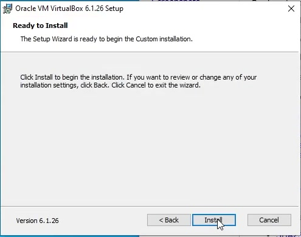

   *Pantalla de referencia del botón Install. Usa el instalador actual, no la versión antigua visible en la imagen.*

3. Reserva espacio suficiente en el host para las dos máquinas y sus snapshots. La imagen de REMnux ocupa varios gigabytes; FLARE-VM requiere espacio adicional para herramientas y paquetes.

## 2. Crear la VM Windows para FLARE-VM

FLARE-VM es un conjunto de scripts de instalación para Windows. El proyecto indica que debe instalarse únicamente en una máquina virtual. Sus requisitos publicados incluyen Windows 10 o posterior, PowerShell 5 o posterior, al menos 60 GB de disco, al menos 2 GB de RAM, conexión a Internet durante la instalación y un nombre de usuario sin espacios ni caracteres especiales. Revisa los [requisitos actuales del instalador](https://github.com/mandiant/flare-vm#requirements) antes de comenzar.

Estos mínimos del toolkit no sustituyen los del sistema operativo. Windows 11 requiere al menos 4 GB de RAM y 64 GB de almacenamiento, además de CPU compatible, UEFI con capacidad de Secure Boot y TPM 2.0; deja espacio adicional para las herramientas. Consulta los [requisitos de Windows 11](https://support.microsoft.com/en-us/windows/experience/compatibility/windows-11-system-requirements).

1. En VirtualBox, pulsa **New / Nueva** y crea una VM llamada `CMA-FLARE`. Selecciona Windows x64 y una ISO oficial de [Windows 11 x64](https://www.microsoft.com/software-download/windows11). Configura RAM y CPU según el sistema y los recursos del host. En el disco, elige **Create a virtual hard disk now / Crear un disco duro virtual ahora** y asigna al menos el espacio requerido por Windows más un margen para FLARE-VM. Usa un nombre de perfil sin espacios.

   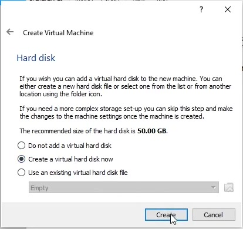

   *Selecciona crear un disco nuevo. La sugerencia de 50 GB visible en este asistente antiguo no sirve como mínimo para Windows 11; sigue los requisitos del texto.*

2. Instala Windows y las actualizaciones necesarias para el instalador. Deja la red temporal en NAT para descargar los componentes; no uses una red puenteada.
3. Apaga la VM y crea un snapshot llamado `Windows limpio - antes de FLARE-VM`. El [apartado de snapshots](#6-cierre-y-snapshots) muestra la ventana correspondiente.
4. Inicia la VM y realiza las condiciones previas del instalador dentro de esa VM. La guía oficial de FLARE-VM señala que, durante la instalación, deben desactivarse temporalmente Windows Update y la protección antimalware/Tamper Protection porque pueden bloquear la instalación de herramientas. Hazlo solo en esta VM desechable, nunca en el host; no guardes datos personales ni muestras en ella en esta fase.
5. Abre PowerShell como administrador. Descarga el instalador únicamente desde el repositorio oficial, desbloquea el archivo y ejecútalo:

   Busca **Windows PowerShell**, pulsa el botón derecho y selecciona **Ejecutar como administrador**. Confirma que el título de la ventana muestre **Administrator / Administrador** antes de ejecutar los comandos.

   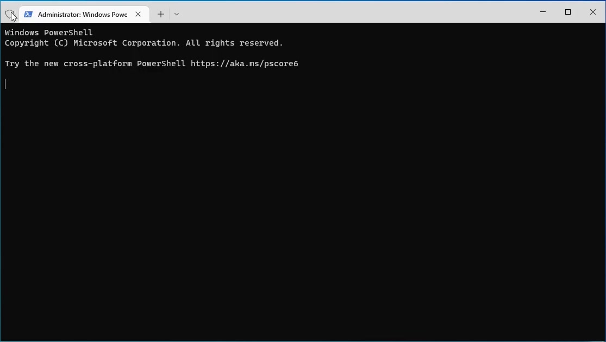

   ```powershell
   $installer = "$env:USERPROFILE\Desktop\install.ps1"
   Invoke-WebRequest -Uri "https://raw.githubusercontent.com/mandiant/flare-vm/main/install.ps1" -OutFile $installer
   Unblock-File $installer
   Set-ExecutionPolicy Unrestricted -Scope Process -Force
   & $installer
   ```

6. Deja que el proceso termine y acepta los reinicios solicitados. La instalación depende de descargas de varios paquetes y puede tardar; si falla, revisa los registros indicados por la [guía de FLARE-VM](https://github.com/mandiant/flare-vm#troubleshooting).

   Si aparece **FLARE VM Install Customization**, revisa las rutas y los paquetes que ofrece el instalador. Mantén la selección predeterminada salvo que el ejercicio indique otra configuración y confirma con **OK**. La lista exacta cambia entre versiones.

   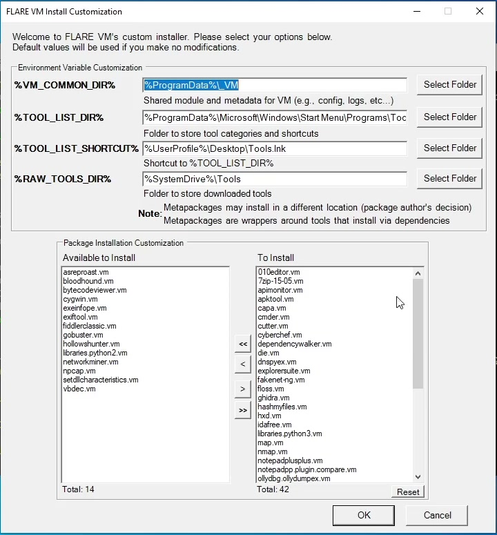

7. Cuando termine, apaga la VM. Desconecta su acceso a Internet y configura su adaptador en una red **Internal Network** llamada `CMA-LAB` o en una red **Host-Only** compartida con REMnux. No uses Bridged para detonar muestras.
8. Inicia la VM, confirma que las herramientas instaladas abran correctamente y crea el snapshot `FLARE-VM lista`.

## 3. Importar REMnux

REMnux ofrece un appliance virtual ya preparado. Descarga el archivo **VirtualBox OVA** desde la [documentación oficial de REMnux](https://docs.remnux.org/install-distro/get-virtual-appliance) y verifica el SHA-256 publicado junto al archivo.

1. En VirtualBox, elige **Importar** y selecciona el OVA descargado.
2. Revisa el nombre, la carpeta de destino y los recursos asignados; completa la importación.

   En **Import Virtual Appliance / Importar servicio virtualizado**, comprueba que el sistema invitado sea Linux/Ubuntu de 64 bits y que la carpeta de destino tenga espacio disponible. Puedes nombrar la máquina `CMA-REMNUX`. Pulsa **Import / Importar**.

   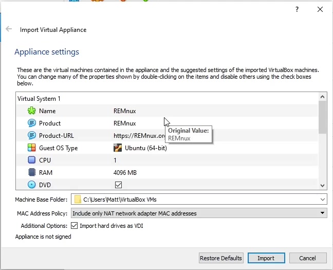

   *La RAM y las rutas visibles pertenecen al ejemplo de la captura; ajústalas a tu equipo.*

3. Inicia REMnux y comprueba que el sistema cargue. Si necesitas actualizar el appliance, conecta temporalmente la VM a Internet y ejecuta `remnux install` como usuario normal; después reinicia y vuelve a aislarla. La actualización está documentada en [Keep the Distro Up to Date](https://docs.remnux.org/install-distro/keep-the-distro-up-to-date).
4. Crea el snapshot `REMnux limpia y actualizada`.

## 4. Configurar la red aislada

VirtualBox ofrece dos modos apropiados para un laboratorio local:

- **Internal Network:** conecta las VMs que usan el mismo nombre de red entre sí, sin conectar el host ni la red externa. Úsala como opción predeterminada durante la detonación.
- **Host-Only:** conecta las VMs y también el host, pero no las conecta por sí sola a una red física externa. Úsala cuando el host necesite acceder al laboratorio; comprende que amplía la superficie conectada.

En la configuración de red de cada VM, activa un adaptador y asigna el mismo modo y nombre de red. En Internal Network, escribe `CMA-LAB` en ambas. No añadas un segundo adaptador NAT o Bridged durante una detonación. La diferencia entre modos se detalla en la [documentación de redes de VirtualBox](https://docs.oracle.com/en/virtualization/virtualbox/7.2/user/networkingdetails.html).

Con las VMs apagadas, abre **Settings / Configuración → Network / Red → Adapter 1 / Adaptador 1**. En **Attached to / Conectado a**, elige **Internal Network** e introduce `CMA-LAB` en **Name / Nombre**. Repite en Windows y REMnux.

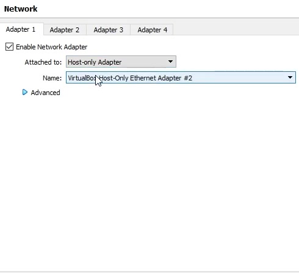

*La imagen muestra la alternativa Host-Only: en esa modalidad debes elegir el mismo adaptador Host-Only en ambas VMs. Para la ruta recomendada de C-MA, cambia ese campo a Internal Network y usa `CMA-LAB`.*

Revisa **Adapter 2, 3 y 4** y desmarca **Enable Network Adapter / Habilitar adaptador de red** en los adaptadores adicionales. Así evitas que otro adaptador mantenga una conexión NAT o Bridged.

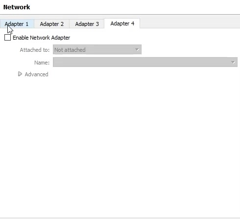

## 5. Configurar INetSim en REMnux

INetSim simula servicios de Internet comunes, como DNS, HTTP y SMTP, y registra solicitudes de los equipos conectados. En REMnux, la herramienta forma parte del conjunto de análisis.

1. Identifica la IP de la interfaz de REMnux conectada a `CMA-LAB`.
2. En la red **Internal Network**, configura IPs estáticas en ambas VMs dentro de la misma subred privada. No configures una puerta de enlace hacia Internet. Si usas Host-Only, puedes usar el DHCP de VirtualBox o asignar IPs estáticas.
3. Abre `/etc/inetsim/inetsim.conf`. Ajusta el enlace del servicio a la IP de REMnux y activa solo los servicios necesarios para la práctica. Por ejemplo, para DNS y HTTP:

   Puedes editarlo con `sudo nano /etc/inetsim/inetsim.conf`. Busca las líneas **start_service**, habilita DNS y HTTP y comenta los servicios que no vaya a usar el ejercicio. En nano, guarda con **Ctrl+O**, confirma con **Enter** y sal con **Ctrl+X**.

   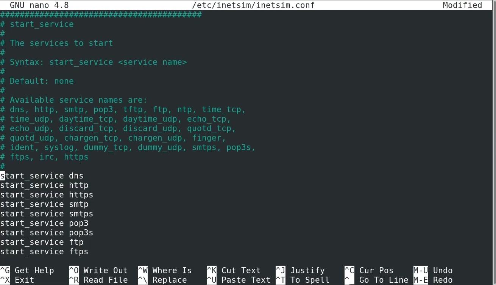

   Busca después **service_bind_address**: debe contener la IP de REMnux en la red del laboratorio, no `127.0.0.1`.

   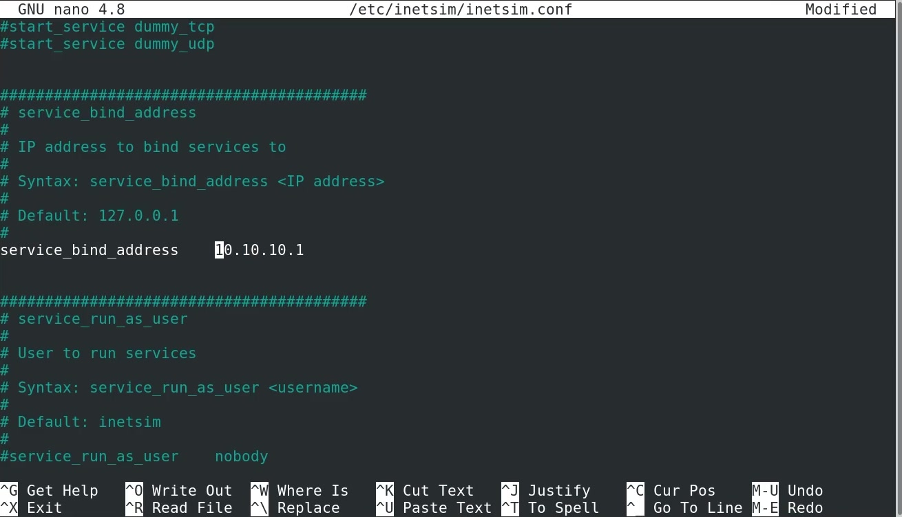

   Busca **dns_default_ip** y utiliza la misma IP de REMnux.

   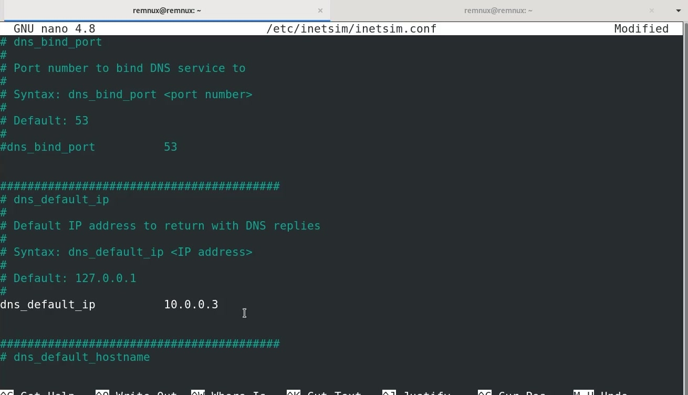

   *Las dos capturas muestran valores de ejemplo distintos. En tu laboratorio, sustituye ambos por la misma IP real de REMnux; no copies las IP de las imágenes.*

   ```text
   service_bind_address <IP-REMnux>
   start_service dns
   start_service http
   dns_default_ip <IP-REMnux>
   ```

   Las líneas pueden estar presentes en el archivo de configuración; modifica las existentes en lugar de duplicarlas. `service_bind_address` controla dónde escucha INetSim y `dns_default_ip` indica qué dirección devuelve para consultas sin una regla estática.
4. Configura la VM Windows para usar la IP de REMnux como servidor DNS y confirma que ambas máquinas estén en la misma red virtual.

   Dentro de Windows, abre **Win+R → `ncpa.cpl` → Ethernet → Propiedades → Protocolo de Internet versión 4 (TCP/IPv4) → Propiedades**. Selecciona **Usar las siguientes direcciones de servidor DNS** y escribe la IP de REMnux como DNS preferido. En Internal Network, configura también la IP estática y la máscara descritas en el paso 2; la opción de IP automática de la captura corresponde a un ejemplo con DHCP.

   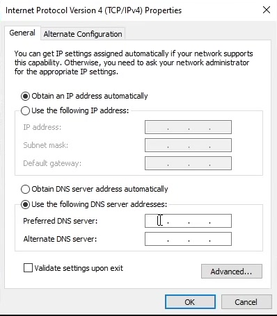

5. Inicia INetSim con `sudo inetsim`. Comprueba desde Windows la resolución DNS y una respuesta HTTP simulada antes de abrir una muestra. Si no hay respuesta, revisa la IP de escucha, la red, la configuración DNS y el firewall de las VMs.

   Para comprobarlo sin una muestra, solicita un nombre de prueba como `cma.test` mediante `nslookup cma.test` y abre `http://cma.test` en el navegador. El DNS debe responder con la IP de REMnux y el navegador debe mostrar la página de simulación de INetSim. Utiliza HTTP para esta prueba inicial, ya que HTTPS añade la validación de certificados.

   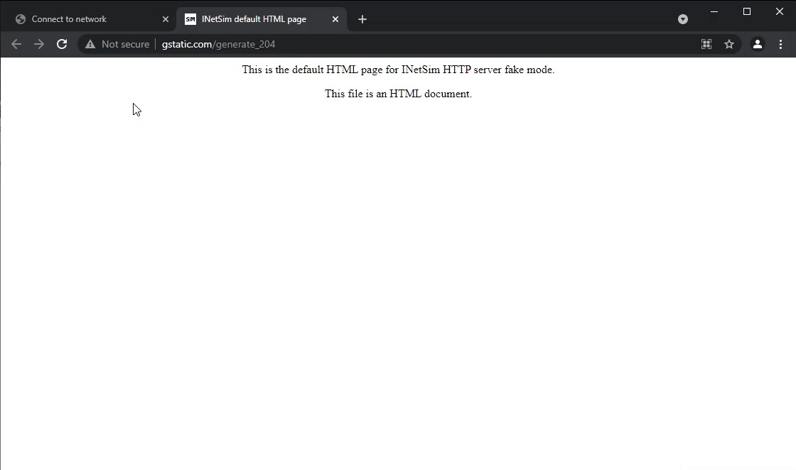

   *El dominio de la barra corresponde a la captura de referencia. La página que debe aparecer es la de INetSim; en C-MA usamos `http://cma.test`.*

Consulta la [documentación de INetSim](https://www.inetsim.org/) para los parámetros disponibles y la [lista de herramientas de servicios de red de REMnux](https://docs.remnux.org/discover-the-tools/explore+network+interactions/services).

## 6. Cierre y snapshots

En VirtualBox Manager, selecciona la VM y abre la vista **Snapshots / Instantáneas → Take / Tomar**. Si la VM está abierta, también puedes usar **Machine / Máquina → Take Snapshot / Tomar instantánea**. Escribe un nombre que describa el estado y confirma con **OK**.

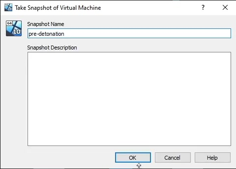

*Nombres propuestos para C-MA: `Windows limpio - antes de FLARE-VM`, `FLARE-VM lista` y `REMnux limpia y actualizada`.*

- Mantén una instantánea limpia de cada VM y otra después de terminar su configuración.
- Antes de detonar una muestra, restaura el snapshot correspondiente y comprueba que no exista una ruta hacia Internet.
- Conserva las muestras dentro del entorno aislado; evita carpetas compartidas, portapapeles compartido y arrastrar/soltar entre host e invitado.
- Al finalizar la práctica, apaga las VMs o restaura sus snapshots.

## Documentación oficial

- [VirtualBox — descargas](https://www.virtualbox.org/wiki/Downloads) · [manual](https://docs.oracle.com/en/virtualization/virtualbox/7.2/user/)
- [FLARE-VM — instalación y requisitos](https://github.com/mandiant/flare-vm)
- [REMnux — appliance e instalación](https://docs.remnux.org/install-distro/get-virtual-appliance)
- [INetSim](https://www.inetsim.org/)
