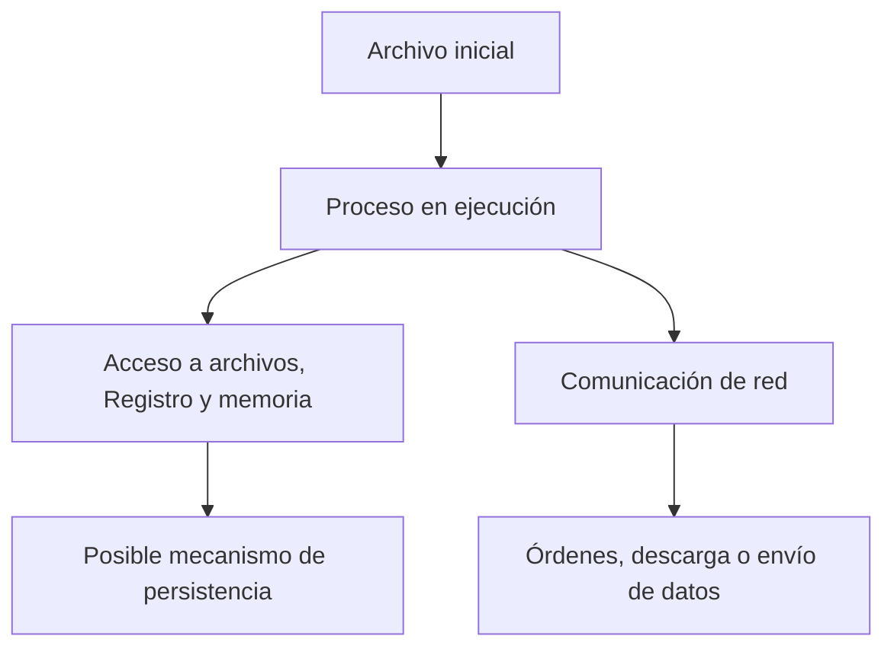

# 01 · Fundamentos técnicos del malware

[Índice del bloque](../README.md) · [Siguiente: Windows internals](../02-windows-internals/README.md)

## 1. Qué se analiza

Malware es software diseñado para realizar acciones maliciosas: robar información, alterar el funcionamiento de un sistema, permitir acceso no autorizado o impedir el acceso a datos. El análisis busca explicar cómo consigue ese propósito a partir de su código, sus datos y el comportamiento que se puede observar.

Un archivo ejecutable, el proceso que nace de él y los archivos que crea son objetos diferentes. El ejecutable puede estar almacenado sin ejecutarse; un proceso es una instancia en ejecución; un componente descargado puede ser otro archivo con un hash distinto. Registrar estas relaciones evita atribuir toda la actividad a una sola pieza.

La extensión tampoco decide qué es un archivo. Un nombre terminado en `.pdf.exe` continúa siendo un nombre elegido por alguien; el formato real se comprueba mediante sus bytes y estructuras. Una DLL, un script o un documento con código también pueden participar en una cadena maliciosa.

## 2. Tipos de malware y comportamiento

Las categorías describen funciones o mecanismos. Se pueden superponer y no reemplazan una descripción técnica de lo observado.

| Tipo | Característica técnica | Qué buscar durante el análisis |
|---|---|---|
| Backdoor | Introduce una vía de acceso que evita el procedimiento de acceso previsto. | Escucha de conexiones, recepción de órdenes o ejecución de acciones remotas. |
| Adware | Muestra publicidad o modifica componentes relacionados con ella; no todo software publicitario es malicioso. | Cambios en navegador, extensiones, configuración y solicitudes publicitarias. |
| Ransomware | Impide el acceso a datos o al sistema y lo asocia a una exigencia de rescate. | Escrituras masivas, cambios de extensión, cifrado y notas de rescate. La exfiltración puede existir, pero no es obligatoria. |
| Virus | Se replica infectando otros archivos o componentes anfitriones. | Cambios repetidos en archivos y código añadido o alterado. |
| Worm | Se propaga entre sistemas mediante mecanismos de autorreplicación. | Descubrimiento de equipos y actividad de propagación. Puede combinarse con otras funciones. |
| Rootkit | Busca ocultar actividad o componentes y mantener acceso privilegiado. | Diferencias entre vistas del sistema, componentes ocultos y alteración de mecanismos de observación. Puede operar en distintos niveles. |
| RAT | Proporciona al atacante funciones de administración remota mediante un troyano. | Canal de órdenes, transferencia de archivos, control de procesos u otras capacidades remotas. |
| Malware bancario | Se orienta al robo o manipulación de información y operaciones bancarias. | Captura de credenciales, interacción con aplicaciones financieras o manipulación de sesiones. |
| Keylogger | Registra pulsaciones de teclado. | Acceso a entrada de teclado, almacenamiento de pulsaciones y eventual envío de datos. |

Un mismo binario puede registrar teclas, comunicarse con un servidor y mantener acceso remoto. En ese caso conviene describir cada capacidad y la evidencia que la respalda, en lugar de forzar una única etiqueta.

## 3. Ejecución, persistencia y componentes

**Ejecución** significa que el sistema comienza a interpretar instrucciones. **Persistencia** significa que existe un mecanismo para volver a ejecutar o mantener acceso después de un evento, como cerrar sesión o reiniciar. Ejecutarse una vez no demuestra persistencia.

En Windows pueden intervenir mecanismos normales del sistema:

- **Programador de tareas:** una tarea puede iniciar un programa ante un horario o desencadenante.
- **Servicios:** Windows puede arrancar componentes mediante el administrador de servicios.
- **Registro:** determinadas claves de inicio pueden hacer referencia a programas que se ejecutan al iniciar sesión.

Todos tienen usos legítimos. Para interpretar una modificación hacen falta el valor concreto, la ruta de destino, quién la creó y cuándo ocurrió.

Este diagrama representa relaciones posibles. No todos los programas recorren todas las ramas ni lo hacen en ese orden.

## 4. Relación con el sistema operativo

Un programa necesita servicios del sistema para abrir archivos, reservar memoria, crear procesos o usar la red. En Windows suele solicitarlos mediante APIs. Sus nombres ayudan a formular hipótesis sobre qué operaciones puede realizar el binario.

Encontrar una función importada indica una dependencia declarada; no demuestra que haya sido llamada. Incluso una llamada observada necesita contexto: argumentos, resultado y operaciones que la rodean. Por ejemplo, crear un proceso puede formar parte de un instalador legítimo o de una cadena maliciosa.

La memoria permite mantener instrucciones y datos que no tienen por qué estar visibles del mismo modo en disco. Un programa puede construir una cadena durante la ejecución o descomprimir un componente antes de utilizarlo. Por eso se distinguen propiedades del archivo y propiedades del proceso.

## 5. Red: C2, descarga y exfiltración

El **mando y control**, o C2, es la comunicación que permite recibir instrucciones o devolver información al operador. Una **descarga de componentes** introduce contenido adicional. La **exfiltración** envía información fuera del entorno afectado. Una conexión puede servir a uno o varios de estos fines.

Para interpretar una comunicación se consideran destino, resolución DNS, protocolo, proceso de origen, momento y datos transferidos. Usar HTTP, HTTPS o SMTP no convierte una conexión en maliciosa: son protocolos de uso general. Del mismo modo, una cadena con aspecto de URL no demuestra que el archivo haya establecido una conexión.

## 6. Hash, codificación y cifrado

| Operación | Qué transforma | Consecuencia para el análisis |
|---|---|---|
| Hash criptográfico | Bytes de entrada en un resumen de longitud fija. | Permite comparar contenidos y consultar referencias de un archivo. No describe su comportamiento. |
| Codificación | Una representación de datos en otra representación, como Base64. | Puede ocultar cadenas a una búsqueda simple, aunque no proporciona por sí misma secreto criptográfico. |
| Cifrado | Datos en una forma protegida mediante un algoritmo y una clave. | Puede proteger tráfico, impedir acceso a archivos o dificultar ver datos internos. |

Una cadena Base64 no equivale a una contraseña cifrada. Un hash tampoco se «descifra» para recuperar el archivo. Identificar correctamente la operación cambia el siguiente paso del análisis.

## 7. Separar evidencia e interpretación

Supongamos que el análisis estático encuentra una URL y una API relacionada con red. El resultado correcto es que el archivo contiene esa cadena y declara esa función; la comunicación es una hipótesis pendiente de comprobar.

| Hallazgo | Afirmación sustentada | Lo que aún falta |
|---|---|---|
| Nombre de API en importaciones | La imagen declara esa importación. | Si se alcanza la llamada y con qué argumentos. |
| Ruta de archivo en una cadena | Esos caracteres están en el contenido analizado. | Si la ruta se usa y qué operación se realiza. |
| Escritura de una tarea programada observada | Se produjo esa modificación en esa ejecución. | Si el desencadenante vuelve a ejecutar el componente. |

La base del análisis es conservar el vínculo entre cada conclusión y el dato que permite sostenerla. Los siguientes capítulos explican las estructuras de Windows y de la CPU que hacen posible ese seguimiento.

[Continuar con Windows internals](../02-windows-internals/README.md)
