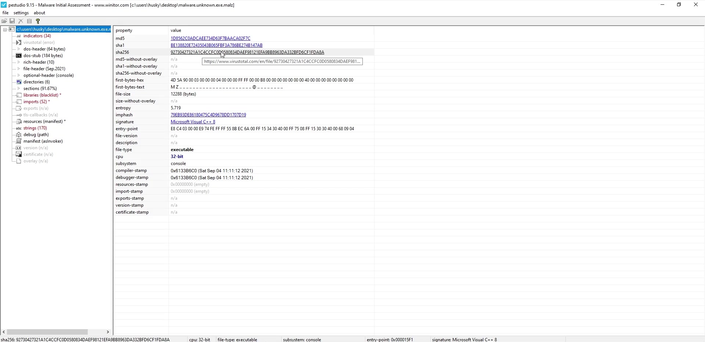
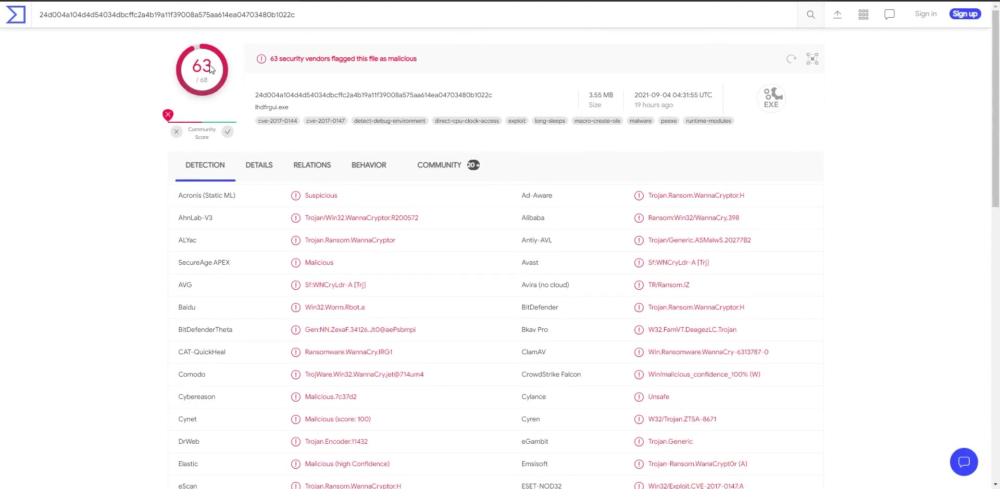
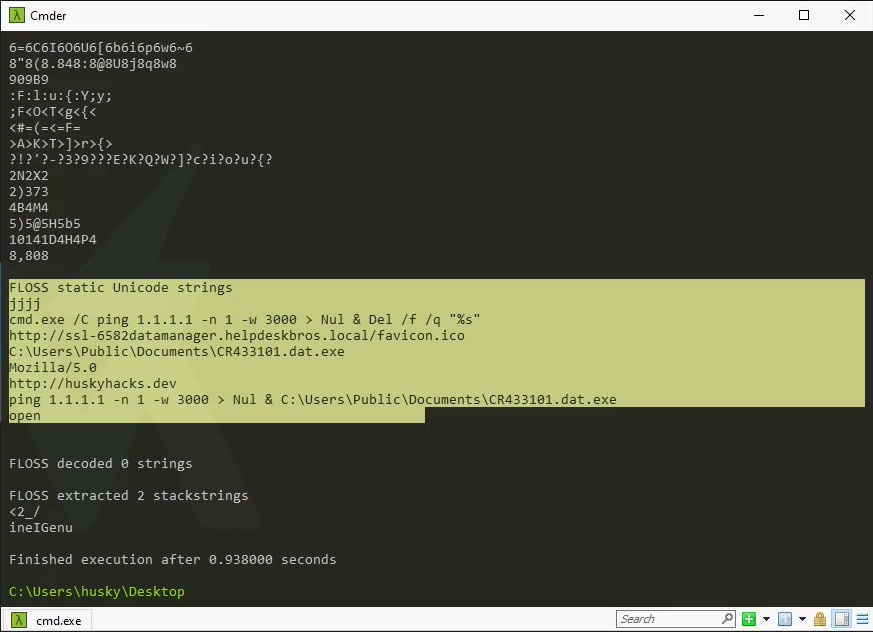
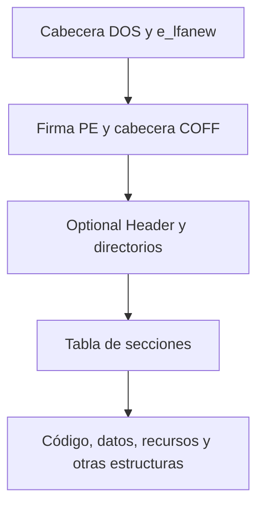
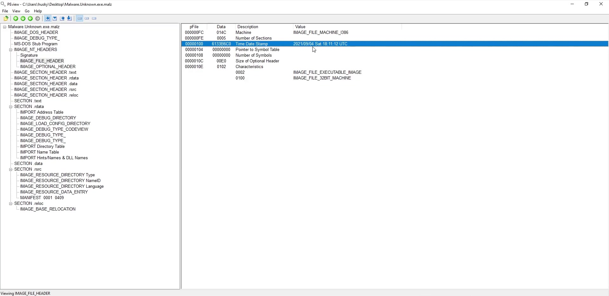
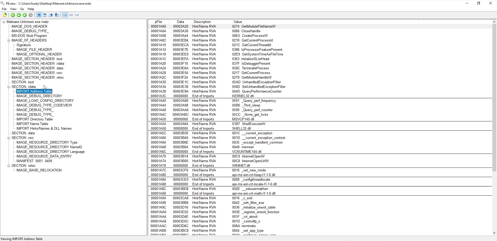
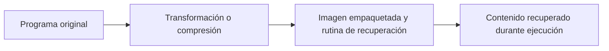
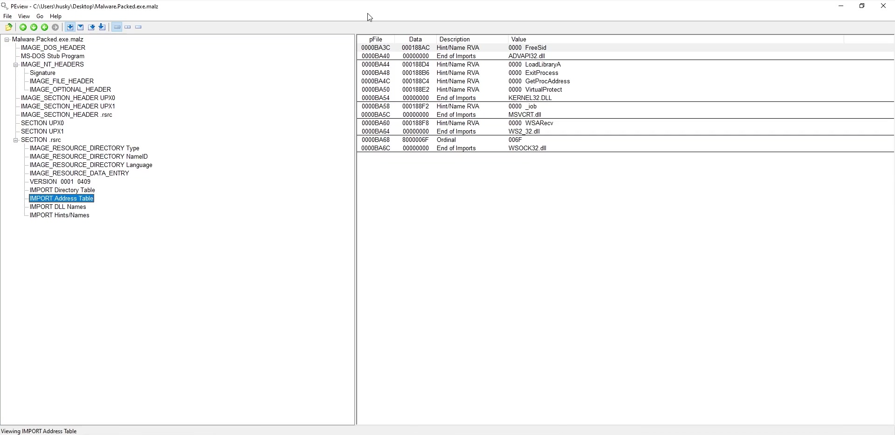
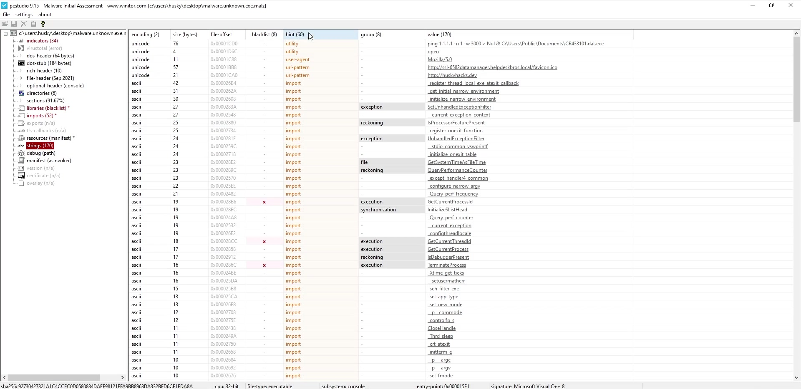
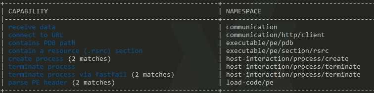

# 05 · Triaje estático y capacidades del ejecutable

[Anterior](../04-enfoques-de-analisis/README.md) · [Índice](../README.md) · [Siguiente](../06-ensamblador-basico/README.md)

El triaje reúne los primeros datos que permiten decidir qué estudiar con más detalle. Se sigue el recorrido hashes y referencias → cadenas → estructura e importaciones → empaquetado → correlación de capacidades. Los resultados son evidencia inicial, no una sentencia automática sobre el archivo.

Las capturas muestran herramientas reales de versiones anteriores. Los nombres, hashes, rutas y direcciones pertenecen al archivo del ejemplo visual; tus resultados cambiarán según el artefacto y la versión. No ejecutes los comandos que aparezcan dentro de las cadenas extraídas.

## 1. Preparar las herramientas

Utiliza la VM de análisis configurada en la [guía del entorno](../00-preparacion-del-entorno/README.md). Comprueba primero lo que ya instaló FLARE-VM; una herramienta portable no necesita volver a instalarse si su ejecutable funciona.

| Herramienta | Función en el recorrido | Descarga oficial si falta |
|---|---|---|
| Strings | Extraer secuencias imprimibles del archivo. | [Microsoft Sysinternals](https://learn.microsoft.com/en-us/sysinternals/downloads/strings). |
| FLOSS | Recuperar cadenas estáticas y algunas construidas u ofuscadas. | [Releases de FLOSS](https://github.com/mandiant/flare-floss/releases). |
| PEView | Examinar cabeceras, secciones y tablas PE. | [Sitio del autor](https://wjradburn.com/software/). Si no está disponible, usa PEStudio para las vistas equivalentes. |
| PEStudio | Reunir metadatos, imports, secciones e indicadores. | [Winitor](https://www.winitor.com/download). Revisa las condiciones de la edición que utilices. |
| UPX | Examinar y desempaquetar archivos compatibles con ese empaquetador. | [Proyecto UPX](https://upx.github.io/). |
| capa | Buscar capacidades mediante reglas sobre las características del programa. | [Releases de capa](https://github.com/mandiant/capa/releases). |

Para una instalación manual, descarga los paquetes de herramientas durante la preparación, antes de introducir muestras. Extrae cada ZIP en su propia carpeta dentro de la VM, conserva los archivos acompañantes y abre una terminal en esa ubicación. Los binarios standalone de FLOSS y capa permiten empezar sin instalar Python por separado.

Comprueba desde PowerShell si los comandos están disponibles en PATH:

```powershell
Get-Command strings.exe, floss.exe, capa.exe, upx.exe -ErrorAction SilentlyContinue
```

Si el comando no aparece, usa su ruta completa o la carpeta donde lo extrajiste. Por ejemplo, si elegiste `C:\Tools\CMA\FLOSS`:

```powershell
& 'C:\Tools\CMA\FLOSS\floss.exe' -h
& 'C:\Tools\CMA\capa\capa.exe' -h
```

No mezcles una ruta de ejemplo con una instalación real sin comprobarla. Para las herramientas gráficas, abre su ejecutable y utiliza **File → Open** para seleccionar el archivo; abrirlo en el analizador no es lo mismo que iniciarlo como aplicación.



La vista inicial de PEStudio permite comprobar que el archivo se cargó y localizar su arquitectura, tamaño y resúmenes. Mantén la VM sin acceso externo durante el análisis; las consultas de reputación se pueden hacer por separado usando solo el hash.

## 2. Identidad del archivo: tamaño, formato y hashes

Un hash criptográfico resume el contenido completo. Cambiar el nombre o mover un archivo no modifica sus bytes y, por tanto, no cambia su hash. Cambiar un byte sí cambia normalmente el resumen. Se usa SHA-256 como referencia principal; MD5 o SHA-1 pueden ayudar a localizar registros antiguos, pero tienen debilidades criptográficas conocidas y no reemplazan esa referencia.

En PowerShell, establece la ruta de trabajo sin ejecutar el archivo:

```powershell
$muestra = 'C:\Lab\muestra.exe'
Get-Item -LiteralPath $muestra | Select-Object Name, Length
Get-FileHash -LiteralPath $muestra -Algorithm SHA256
```

En REMnux puedes obtener el equivalente con:

```bash
file ./muestra.exe
sha256sum ./muestra.exe
```

`file` propone un tipo a partir de firmas y estructuras; no es una prueba de inocuidad. Un hash identifica contenido, no la intención del programa. Dos archivos con hashes diferentes pueden pertenecer a una misma familia; obtener el mismo SHA-256 permite tratar dos copias como el mismo contenido a efectos prácticos del análisis.

## 3. Consultar reputación y repositorios

Una consulta por hash permite buscar si otra fuente ya registró ese contenido. En VirusTotal se utiliza el campo de búsqueda y se pega el resumen. No hace falta subir el archivo para buscar un hash existente.



Interpreta el resultado como una referencia externa: registra el hash, la fecha de consulta y las observaciones relevantes. La cantidad de detecciones puede cambiar. Un resultado sin coincidencias no demuestra que el archivo sea benigno; distintos motores pueden usar nombres diferentes para el mismo contenido.

Los repositorios también ayudan a localizar muestras y sus metadatos, pero una etiqueta de familia no sustituye el análisis del archivo recibido. No introduzcas muestras en el host para seguir este capítulo. Si un archivo contiene información privada, una consulta o carga en un servicio externo requiere considerar qué datos se están compartiendo; aquí la consulta propuesta es únicamente por hash.

## 4. Cadenas ASCII, Unicode y FLOSS

Una cadena puede revelar rutas, nombres de archivos, parámetros, bibliotecas, mensajes y destinos de red. El extractor busca secuencias de caracteres: no entiende por sí solo si el programa las utilizará.

Ejemplo didáctico de representaciones de `CMA`:

```text
ASCII:       43 4D 41
UTF-16LE:    43 00 4D 00 41 00
```

Si buscas solo ASCII puedes perder el segundo caso. Aumentar la longitud mínima reduce ruido, pero puede ocultar cadenas útiles cortas.

### 4.1. Strings en Windows y REMnux

En la implementación de Sysinternals:

```powershell
strings.exe -n 6 -o $muestra > .\strings.txt
```

`-n 6` exige seis caracteres y `-o` incluye el offset de archivo. Esta herramienta busca ASCII y Unicode por defecto; `-a` limita a ASCII y `-u` a Unicode.

En la implementación GNU que puedes encontrar en Linux, los parámetros no son idénticos:

```bash
strings -a -n 6 -t x ./muestra.exe > strings-ascii.txt
strings -a -e l -n 6 -t x ./muestra.exe > strings-utf16le.txt
```

Aquí `-a` examina todo el archivo, `-t x` muestra offsets hexadecimales y `-e l` selecciona caracteres de 16 bits little-endian. No traslades el significado de `-a` entre ambas herramientas sin revisar su ayuda.

### 4.2. Cadenas construidas durante ejecución

Un binario puede construir texto mediante instrucciones, guardarlo temporalmente en la pila o decodificarlo antes de usarlo. FLOSS complementa la extracción simple mediante análisis y emulación de fragmentos. No equivale a observar una ejecución completa del programa.

```powershell
floss.exe $muestra > .\floss.txt
```



Relaciona cada resultado con su categoría y ubicación cuando la herramienta las proporcione. Que FLOSS no recupere cadenas decodificadas no demuestra que no exista ofuscación; puede faltar soporte o no haberse reconocido la rutina relevante.

Una ruta PDB puede dar pistas de compilación, pero puede ser antigua, copiada o manipulada. Una URL podría ser un recurso legítimo, un dato de prueba o una cadena no utilizada. Conserva los valores sin convertirlos automáticamente en atribución o comunicación confirmada.

## 5. PE, secciones y direcciones

Los PE suelen comenzar con la firma DOS `MZ`. El campo `e_lfanew`, situado en el offset `0x3C`, indica dónde buscar la cabecera con firma `PE\0\0`. También se examinan arquitectura, características de la imagen y directorios.



El término Optional Header es histórico: forma parte de la estructura esperada de una imagen ejecutable PE. PE32 y PE32+ describen variantes; la arquitectura se contrasta con el campo Machine. Los nombres `.text`, `.data`, `.rdata` o `.rsrc` son convenciones y pueden cambiarse.

En PEView, abre el archivo y expande las cabeceras y las secciones. Revisa tamaño en disco, tamaño virtual y características, sin asumir que una sección equivale a un único propósito.



Para una RVA respaldada por bytes de una sección:

```text
VA cargada = base de imagen + RVA
offset de archivo = PointerToRawData + (RVA - VirtualAddress de la sección)
```

La segunda fórmula exige identificar la sección correcta y comprobar que el rango tiene datos en el archivo. Una región inicializada a cero en memoria puede no tener bytes equivalentes en disco. No confundas el offset que presenta Strings con una dirección virtual ya cargada.

## 6. Importaciones, IAT y Windows API

Las importaciones describen dependencias por biblioteca y símbolo. Durante la carga, el sistema resuelve las funciones y dispone sus direcciones en la IAT. Antes de la resolución, los valores del archivo no deben interpretarse sin más como punteros válidos dentro de un proceso vivo.

En PEView, busca las estructuras de importación y **IMPORT Address Table**. La sección concreta puede variar entre archivos: no siempre estará en `.idata` ni siempre en `.rdata`.



La captura permite distinguir funciones y bibliotecas, por ejemplo `InternetOpenW` e `InternetOpenUrlW` junto a `WININET.dll`. Se examina cada API en su documentación para conocer parámetros y valores de retorno.

| Familia de operaciones | Ejemplos de funciones | Hipótesis inicial |
|---|---|---|
| Procesos | `CreateProcessW`, `ShellExecuteW` | Inicio de otro programa o apertura de un recurso. |
| Archivos | `CreateFileW`, `WriteFile` | Acceso o escritura según argumentos y permisos. |
| Red | `InternetOpenW`, `InternetOpenUrlW` | Uso de servicios de Internet. |
| Carga dinámica | `LoadLibraryW`, `GetProcAddress` | Obtención de módulos y funciones durante ejecución. |
| Memoria | `VirtualAlloc`, `VirtualProtect` | Asignación o cambio de permisos de páginas. |

Una importación no confirma una llamada, y su ausencia no confirma ausencia de capacidad. La resolución dinámica, los ordinales, los módulos añadidos y el empaquetado pueden cambiar lo visible. [MalAPI.io](https://malapi.io/) sirve como catálogo orientativo; el contrato de cada función se comprueba en la documentación de la Windows API.

## 7. Empaquetado y UPX

Un empaquetador transforma la representación del programa e incorpora un componente que recupera contenido durante la ejecución. Comprimir un ejecutable no lo convierte en malicioso. Para el analista significa que puede estar examinando principalmente el contenedor y su rutina de preparación.



Indicios posibles: pocas cadenas útiles, importaciones concentradas en carga dinámica, diferencias entre tamaños virtuales y físicos o nombres de sección asociados a un empaquetador. La entropía alta también puede deberse a datos comprimidos o cifrados legítimos; ningún indicio aislado basta.



En la captura aparecen `UPX0` y `UPX1`. Los nombres se pueden cambiar, por lo que deben contrastarse con la estructura. Para un archivo reconocido por UPX, trabaja sobre una copia y utiliza su herramienta:

```powershell
upx.exe -l $muestra
upx.exe -t $muestra
upx.exe -d -o .\muestra-desempaquetada.exe $muestra
```

`-l` lista información, `-t` comprueba la integridad según UPX y `-d` solicita descompresión. No valida que el programa sea benigno. Si el formato fue modificado o no está soportado, la operación puede fallar. Tras obtener una copia, vuelve a calcular hashes y compara cadenas e imports; el hash del original debe conservarse aparte.

## 8. Correlación con PEStudio

PEStudio reúne vistas que ya conoces. Abre el archivo y recorre propiedades, secciones, bibliotecas, importaciones y cadenas. No necesitas habilitar consultas externas para estudiar esas estructuras.



La vista de cadenas muestra el texto, su codificación y su offset en el archivo. En el ejemplo aparecen tanto URLs como nombres de funciones; que un nombre figure en esta vista no equivale a haber comprobado su entrada en la tabla de importaciones. Contrástalo con las vistas de bibliotecas e imports.

Las marcas de color y listas de interés son reglas de la herramienta. Se usan para priorizar revisión, no como prueba independiente. Una fecha de compilación puede ser alterada y ciertos campos de tiempo tienen significados especiales; tampoco una firma digital garantiza que todo comportamiento sea aceptable.

## 9. Capacidades con capa

Para comenzar basta el ejecutable standalone de su [distribución oficial](https://github.com/mandiant/capa/releases). Extrae el paquete completo en la VM y comprueba `capa.exe -h`. Si ya funciona en FLARE-VM, utiliza esa instalación.

```powershell
capa.exe $muestra
capa.exe -v $muestra
capa.exe -vv $muestra
```

Las reglas relacionan características, como instrucciones, cadenas y APIs, con capacidades. Las opciones de detalle permiten revisar ubicaciones y qué evidencia disparó una coincidencia.



La captura es un ejemplo de interpretación de resultados, no la salida esperada para cualquier archivo. Una coincidencia de «crear proceso» debe llevarte a la función y sus referencias. Si el archivo está empaquetado, los resultados pueden describir el stub y no toda la lógica recuperada. Una regla no demuestra que esa ruta se haya ejecutado.

## 10. Construir una conclusión inicial

| Evidencia reunida | Qué aporta | Límite que debe anotarse |
|---|---|---|
| Hash y tamaño | Referencia del contenido recibido. | No prueban comportamiento. |
| Cadenas y sus ubicaciones | Datos de interés para seguir en el código. | Pueden no utilizarse. |
| Imports y secciones | Dependencias declaradas y estructura. | Puede haber carga dinámica o empaquetado. |
| Reglas de capacidades | Lugares del código para priorizar. | Son inferencias del analizador. |
| Relación entre hallazgos | Hipótesis sobre función del programa. | Falta comprobar condiciones y ejecución. |

Una conclusión inicial útil explica qué se sabe, qué se sospecha y qué dato falta. Por ejemplo: «el binario contiene una URL y funciones de WinINet; se revisará la función que referencia ambos elementos para establecer sus argumentos y condiciones».

## Documentación de consulta

- [Microsoft: formato PE](https://learn.microsoft.com/en-us/windows/win32/debug/pe-format).
- [Strings](https://learn.microsoft.com/en-us/sysinternals/downloads/strings) · [FLOSS](https://github.com/mandiant/flare-floss).
- [PEStudio](https://www.winitor.com/) · [UPX](https://upx.github.io/) · [capa](https://github.com/mandiant/capa).

[Continuar con ensamblador básico](../06-ensamblador-basico/README.md)
