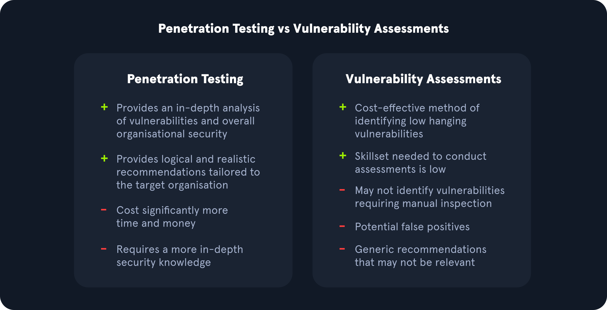
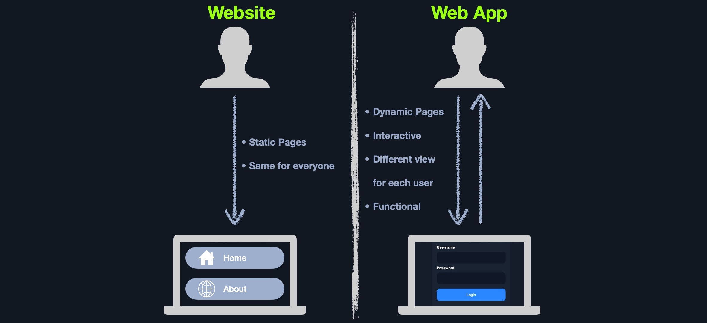
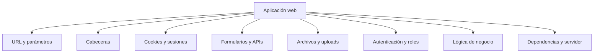
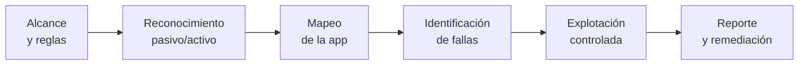

# 01 — Introducción al pentesting web

**Curso:** C|PW · Pentesting Web  
**Tiempo de lectura:** 30–40 min  
**Laboratorio asociado:** análisis de superficie y OWASP Top 10

---

## 1.1 Qué es el pentesting web

El pentesting web es una evaluación **autorizada** que simula las técnicas de un atacante para comprobar si una falla compromete datos o funciones de la aplicación.



*Diferencia entre pentesting y análisis de vulnerabilidades. Fuente: HTB Academy, Vulnerability Assessment.*

| Actividad | Objetivo | Método | Resultado |
|---|---|---|---|
| **Análisis de vulnerabilidades** | Inventariar fallas conocidas | Escaneo automatizado | Lista de candidatos |
| **Pentesting** | Demostrar impacto real | Validación manual + explotación controlada | Hallazgos con evidencia |
| **Bug bounty** | Encontrar fallas para recompensa | Reglas del programa | Reporte al programa |



*Aplicación web frente a sitio web: la primera procesa datos y lógica. Fuente: material del curso.*

### Qué evaluamos

- **Confidencialidad:** ¿puedo leer datos de otros usuarios?
- **Integridad:** ¿puedo modificar datos o funciones?
- **Disponibilidad:** ¿puedo afectar el servicio?
- **Autenticación:** ¿puedo entrar sin credenciales?
- **Autorización:** ¿puedo hacer lo que mi rol no permite?
- **Lógica de negocio:** ¿puedo abusar del flujo previsto?

> [!IMPORTANT]
> Un pentest web no es "buscar XSS". Es entender la aplicación, su modelo de confianza y el impacto de romperlo.

---

## 1.2 Pentesting web vs. infraestructura

| Aspecto | Pentesting web | Infraestructura |
|---|---|---|
| **Objetivo** | Datos y funciones de la aplicación | Control del sistema o la red |
| **Entradas** | Parámetros HTTP, sesiones, cookies | Puertos, protocolos, servicios |
| **Fallas típicas** | SQLi, XSS, control de acceso | CVEs, credenciales, configuración |
| **Herramientas** | Burp Suite, navegador, ffuf | Nmap, Metasploit, exploits |
| **Evidencia** | Peticiones y respuestas reproducibles | Sesiones y shells |
| **Impacto** | Acceso a datos, fraude, suplantación | Compromiso del host |

> [!NOTE]
> La frontera no es absoluta. Un RCE web puede llevar a compromiso de infraestructura; un fallo de red puede exponer una aplicación interna.

---

## 1.3 Superficie de ataque web



| Superficie | Ejemplo | Pregunta |
|---|---|---|
| **URL** | `/producto?id=7` | ¿Puedo cambiar el ID? |
| **Cabeceras** | `X-Forwarded-For`, `Host` | ¿Se confía en ellas? |
| **Cookies** | `session=abc` | ¿Puedo predecirla o robarla? |
| **Formularios** | Login, registro | ¿Se valida en servidor? |
| **APIs** | `/api/v1/users` | ¿Autoriza por objeto? |
| **Uploads** | Avatar, PDF | ¿Se valida tipo y contenido? |
| **Roles** | Admin, usuario | ¿Se comprueba en cada request? |
| **Lógica** | Carrito, cupones | ¿Puedo alterar el flujo? |

---

## 1.4 OWASP Top 10 (2021)

OWASP Top 10 es una lista de las categorías de riesgo web más frecuentes. No es un checklist exhaustivo, pero ordena el estudio.

| ID | Categoría | Qué significa | Ejemplo |
|---|---|---|---|
| **A01** | Broken Access Control | El usuario hace lo que no debería | IDOR, panel admin sin rol |
| **A02** | Cryptographic Failures | Cifrado mal usado o ausente | Datos en claro, TLS débil |
| **A03** | Injection | Datos no confiables se interpretan como código | SQLi, command injection |
| **A04** | Insecure Design | La lógica permite abuso | Recuperación de cuenta débil |
| **A05** | Security Misconfiguration | Configuración insegura | Directorios abiertos, defaults |
| **A06** | Vulnerable Components | Dependencias con CVEs | Librería antigua |
| **A07** | Identification and Authentication Failures | Autenticación débil | Fuerza bruta, sesión fija |
| **A08** | Software and Data Integrity Failures | Confianza en datos/paquetes | Deserialización, CI/CD |
| **A09** | Security Logging and Monitoring Failures | Sin logs o sin alertas | Ataque no detectado |
| **A10** | SSRF | El servidor hace peticiones por ti | Acceso a metadata cloud |

### A01 — Broken Access Control

Es la categoría más frecuente. Ocurre cuando la aplicación no verifica **quién** puede hacer **qué** sobre **cada objeto**.

- **Vertical:** un usuario normal accede a funciones de admin.
- **Horizontal:** un usuario accede a datos de otro usuario.
- **IDOR:** se cambia un identificador y se accede a otro objeto.
- **Forced browsing:** se accede a una URL oculta sin autorización.

> [!WARNING]
> Ocultar un panel en el menú no es control de acceso. Si la URL responde sin verificar el rol, el panel está abierto.

### A03 — Injection

Los datos del usuario se interpretan como código en otro contexto: SQL, comandos, LDAP, XML.

```text
Entrada: ' OR '1'='1
Consulta: SELECT * FROM users WHERE user = '' OR '1'='1' AND pass = '...'
```

La defensa principal es **separar datos de código**: consultas parametrizadas, validación, escape contextual.

### A10 — SSRF

El servidor recibe una URL y hace la petición. Si no valida el destino, un atacante puede acceder a servicios internos o metadata cloud.

```text
POST /fetch
url=http://169.254.169.254/latest/meta-data/
```

---

## 1.5 Metodología de un pentest web



| Fase | Entregable |
|---|---|
| Alcance | Dominios, roles, cuentas, exclusiones |
| Reconocimiento | Tecnologías, rutas, endpoints |
| Mapeo | Flujos, roles, parámetros, APIs |
| Identificación | Hipótesis de fallas |
| Explotación | Evidencia reproducible |
| Reporte | Impacto y recomendación |

### Reglas de compromiso

- ¿Qué dominios y subdominios están incluidos?
- ¿Se permiten pruebas de fuerza bruta?
- ¿Se permite subir archivos?
- ¿Qué cuentas de prueba hay?
- ¿Qué horarios?
- ¿Qué hacer si se encuentra un dato real?

> [!TIP]
> Define **scope** en Burp antes de navegar. Así evitas enviar tráfico fuera del objetivo por accidente.

---

## 1.6 Roles y modelo de confianza

Una aplicación web tiene varios actores:

| Actor | Confianza | Ejemplo |
|---|---|---|
| **Usuario anónimo** | Baja | Visitante |
| **Usuario autenticado** | Media | Cliente |
| **Administrador** | Alta | Panel de gestión |
| **Servicio interno** | Alta | API entre microservicios |
| **Proveedor externo** | Variable | Pasarela de pago |

Cada frontera de confianza debe validar:

1. **Autenticación:** ¿quién eres?
2. **Autorización:** ¿qué puedes hacer?
3. **Validación:** ¿el dato es válido?
4. **Auditoría:** ¿quedó registro?

---

## 1.7 Qué no es un hallazgo

| No es un hallazgo | Por qué |
|---|---|
| "El servidor usa Apache" | Es información, no impacto |
| "Hay un formulario" | Es funcionalidad normal |
| "Burp muestra una cookie" | Es esperado |
| "El escaneo marcó crítico" | Falta validación manual |
| "Encontré un panel" | Falta demostrar acceso no autorizado |

Un hallazgo necesita: **activo, condición, evidencia, impacto y recomendación**.

---

## 1.8 Autoevaluación

1. ¿Qué diferencia hay entre análisis de vulnerabilidades y pentesting?
2. ¿Qué es un IDOR?
3. ¿Por qué A01 es tan frecuente?
4. ¿Qué defensa principal aplica contra injection?
5. ¿Qué es SSRF y por qué importa en cloud?
6. ¿Qué debe incluir un scope web?
7. ¿Qué convierte una observación en un hallazgo?

---

**Siguiente:** [02 — Arquitectura y HTTP](02-arquitectura-http.md)
