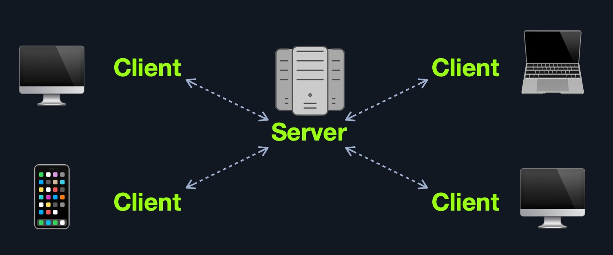
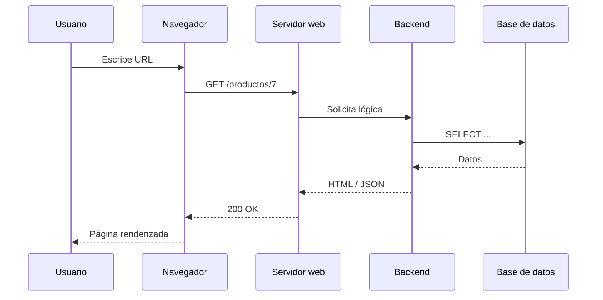
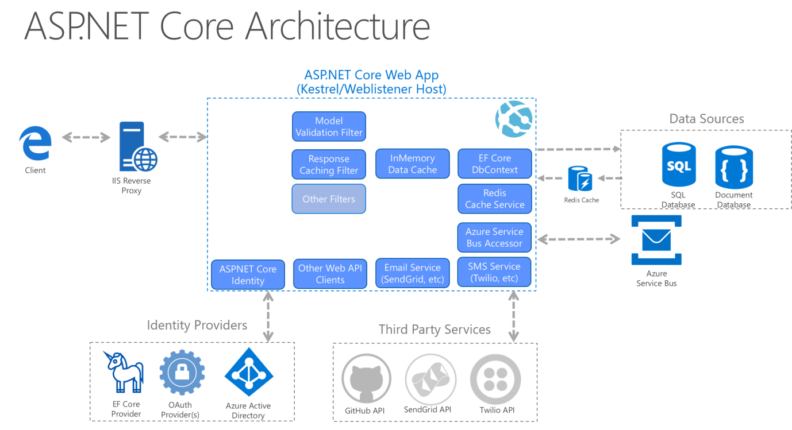
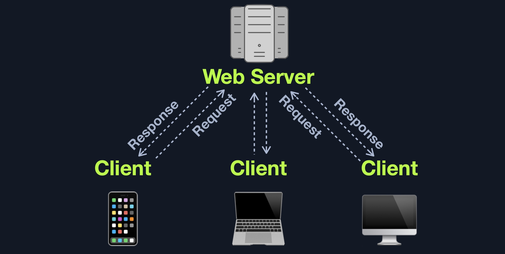
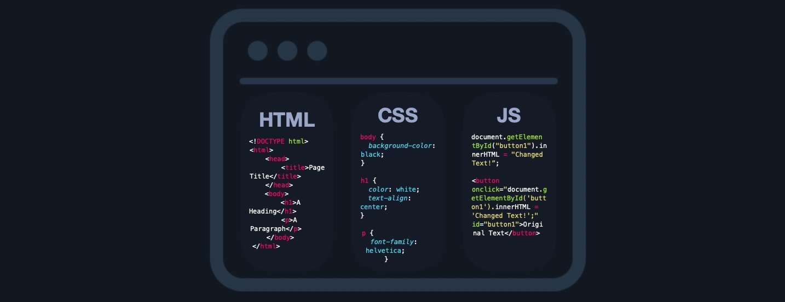
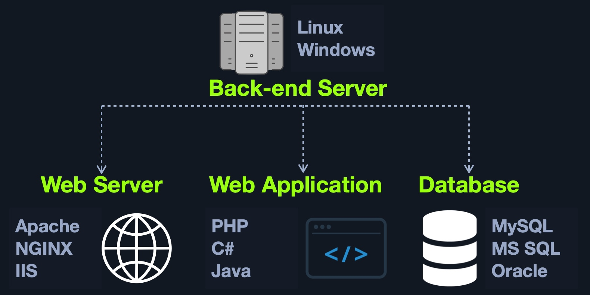
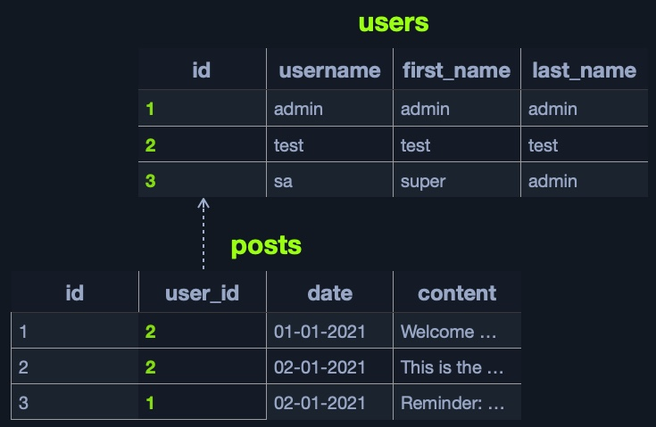
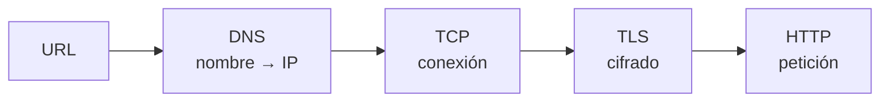
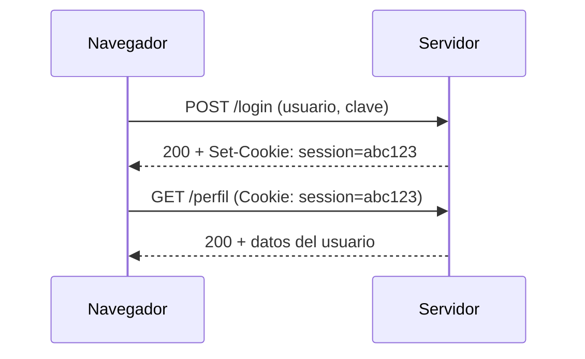

# 02 — Arquitectura y HTTP

**Curso:** C|PW · Pentesting Web  
**Tiempo de lectura:** 40–50 min  
**Laboratorio asociado:** inspección de peticiones con DevTools y Burp

---

## 2.1 Arquitectura cliente-servidor



*Modelo cliente-servidor. Fuente: HTB Academy.*



| Componente | Función | Ejemplo |
|---|---|---|
| **Cliente** | Solicita y renderiza | Navegador, app móvil |
| **Servidor web** | Recibe HTTP y responde | Nginx, Apache |
| **Backend** | Lógica de negocio | Node.js, Django, PHP |
| **Base de datos** | Persistencia | MySQL, PostgreSQL |
| **API** | Interfaz entre sistemas | REST, GraphQL |

---

## 2.2 Frontend, backend y base de datos



*Capas de una aplicación web. Fuente: HTB Academy.*

| Capa | Tecnologías | Qué ve el atacante |
|---|---|---|
| **Frontend** | HTML, CSS, JavaScript | Código, rutas, APIs |
| **Backend** | Node, Python, PHP, Java | Errores, tiempos, lógica |
| **Base de datos** | SQL/NoSQL | Datos, esquemas, permisos |
| **Infraestructura** | Servidor, CDN, WAF | Cabeceras, versiones |



*Flujo de una petición entre cliente, servidor y backend. Fuente: material del curso.*

### Frontend



*Ejemplo de código frontend. Fuente: HTB Academy.*

El frontend **no es una frontera de seguridad**. Cualquier validación en JavaScript puede saltarse con Burp, `curl` o DevTools.

```javascript
// Validación solo en cliente: no confiar
if (edad >= 18) {
  enviarFormulario();
}
```

> [!WARNING]
> Si la única validación está en el navegador, el servidor aceptará cualquier cosa que le envíes.

### Backend



*Componentes del backend. Fuente: HTB Academy.*

El backend decide, autoriza y consulta. Aquí viven las fallas de lógica y control de acceso.

### Base de datos



*Esquema relacional. Fuente: HTB Academy.*

| Concepto | Ejemplo |
|---|---|
| **Tabla** | `usuarios` |
| **Columna** | `id`, `email`, `rol` |
| **Clave primaria** | `id` |
| **Clave foránea** | `usuario_id` |
| **Consulta** | `SELECT * FROM usuarios WHERE id = 7` |

---

## 2.3 DNS, TCP y TLS



| Paso | Qué ocurre | Herramienta |
|---|---|---|
| **DNS** | Resuelve el dominio | `dig`, `nslookup` |
| **TCP** | Three-way handshake | `nc`, `curl -v` |
| **TLS** | Negocia cifrado y certificado | `openssl s_client` |
| **HTTP** | Envía petición y recibe respuesta | `curl`, Burp |

> [!NOTE]
> HTTPS cifra el transporte, no la aplicación. Una web HTTPS puede seguir siendo vulnerable a SQLi, XSS o control de acceso.

---

## 2.4 Anatomía de una petición HTTP

```http
GET /productos/7 HTTP/1.1
Host: tienda.example
User-Agent: Mozilla/5.0
Accept: application/json
Cookie: session=abc123
```

| Parte | Ejemplo | Función |
|---|---|---|
| **Método** | `GET` | Acción |
| **Ruta** | `/productos/7` | Recurso |
| **Versión** | `HTTP/1.1` | Protocolo |
| **Cabeceras** | `Host`, `Cookie` | Metadatos |
| **Cuerpo** | `{"nombre":"Libro"}` | Datos (POST/PUT) |

### Respuesta

```http
HTTP/1.1 200 OK
Content-Type: application/json
Content-Length: 42
Set-Cookie: session=abc123; HttpOnly; Secure

{"id":7,"nombre":"Libro","precio":25}
```

| Parte | Ejemplo |
|---|---|
| **Estado** | `200 OK` |
| **Cabeceras** | `Content-Type`, `Set-Cookie` |
| **Cuerpo** | JSON, HTML, XML |

---

## 2.5 Métodos HTTP

| Método | Acción | Idempotente | Seguro |
|---|---|---|---|
| **GET** | Consultar | Sí | Sí |
| **POST** | Crear / enviar | No | No |
| **PUT** | Reemplazar | Sí | No |
| **PATCH** | Modificar parcialmente | No | No |
| **DELETE** | Eliminar | Sí | No |
| **HEAD** | Solo cabeceras | Sí | Sí |
| **OPTIONS** | Métodos permitidos | Sí | Sí |

> [!TIP]
> Si un endpoint acepta `GET` para cambiar estado, es sospechoso. Los cambios deberían usar `POST`, `PUT`, `PATCH` o `DELETE` con protección CSRF.

---

## 2.6 Códigos de estado

| Código | Significado | Uso en pentesting |
|---|---|---|
| **200** | OK | Recurso accesible |
| **201** | Creado | POST exitoso |
| **301/302** | Redirección | Flujos de login |
| **400** | Bad Request | Validación |
| **401** | No autenticado | Falta credencial |
| **403** | Prohibido | Autenticado sin permiso |
| **404** | No encontrado | Ruta inexistente |
| **405** | Método no permitido | Endpoint existe |
| **500** | Error interno | Posible fuga de información |

> [!IMPORTANT]
> Un `403` no siempre significa "seguro". A veces la ruta existe y el control se puede saltar con otro método, otra ruta o un parámetro.

---

## 2.7 Cabeceras importantes

| Cabecera | Función | Interés |
|---|---|---|
| `Host` | Dominio solicitado | Virtual hosts, SSRF |
| `Cookie` | Sesión | Robo, fijación |
| `Authorization` | Token | Bearer, Basic |
| `User-Agent` | Cliente | Filtros débiles |
| `X-Forwarded-For` | IP original | Confianza indebida |
| `Content-Type` | Tipo de cuerpo | Parsing, bypass |
| `Referer` | Origen | CSRF, lógica |
| `Origin` | Origen CORS | Políticas |
| `Set-Cookie` | Cookie del servidor | Flags |

### Flags de cookie

| Flag | Protege contra | Ejemplo |
|---|---|---|
| `HttpOnly` | Robo por JavaScript | `Set-Cookie: session=abc; HttpOnly` |
| `Secure` | Envío por HTTP | `; Secure` |
| `SameSite` | CSRF | `; SameSite=Lax` |
| `Path` | Alcance | `; Path=/app` |
| `Domain` | Dominio | `; Domain=.example.com` |

> [!WARNING]
> Una cookie sin `HttpOnly` puede ser robada con XSS. Una cookie sin `Secure` puede viajar por HTTP. Una cookie sin `SameSite` facilita CSRF.

---

## 2.8 Cookies, sesiones y tokens



| Mecanismo | Dónde se guarda | Ventaja | Riesgo |
|---|---|---|---|
| **Cookie de sesión** | Navegador | Simple, estándar | Robo, CSRF |
| **JWT** | Cliente | Stateless | Firma débil, expiración |
| **OAuth token** | Cliente | Delegación | Scope excesivo |
| **API key** | Cliente/servidor | Simple | Fuga en repos |

### JWT: qué revisar

- ¿La firma se verifica?
- ¿El algoritmo es `none` o débil?
- ¿El token expira?
- ¿El `kid` es manipulable?
- ¿Los claims de rol se validan en servidor?

> [!NOTE]
> Un JWT no es "seguro por defecto". Si el servidor confía en el claim `role` sin verificar la firma, cualquiera puede editar el token.

---

## 2.9 URL, parámetros y codificación

```text
https://tienda.example/buscar?q=libro&pag=2#resultados
└──────┬──────┘└──────────┬──────┘└──────┬──────┘└──┬──┘
     esquema              host            ruta      query
```

| Parte | Ejemplo | Uso |
|---|---|---|
| **Esquema** | `https` | Protocolo |
| **Host** | `tienda.example` | Dominio |
| **Puerto** | `:443` | Servicio |
| **Ruta** | `/buscar` | Recurso |
| **Query** | `?q=libro&pag=2` | Parámetros |
| **Fragmento** | `#resultados` | Cliente |

### Codificación

| Carácter | URL encode |
|---|---|
| Espacio | `%20` |
| `/` | `%2F` |
| `?` | `%3F` |
| `&` | `%26` |
| `#` | `%23` |
| `'` | `%27` |

> [!TIP]
> Prueba codificaciones alternativas (`%2e`, `%252e`, doble encoding) cuando un filtro bloquea una ruta o un carácter.

---

## 2.10 Same-Origin Policy y CORS

La **Same-Origin Policy** impide que JavaScript de un origen lea respuestas de otro origen sin permiso.

```text
Origen = esquema + host + puerto
https://app.example:443
```

**CORS** relaja esa política mediante cabeceras:

```http
Access-Control-Allow-Origin: https://app.example
Access-Control-Allow-Credentials: true
```

| Configuración | Riesgo |
|---|---|
| `Access-Control-Allow-Origin: *` | Cualquiera puede leer |
| `*` + `Allow-Credentials: true` | Incompatible y peligroso |
| Reflejar `Origin` sin validar | Bypass |
| `null` permitido | iframes sandbox |

---

## 2.11 Herramientas para ver HTTP

```bash
# Ver cabeceras
curl -I https://tienda.example

# Ver petición y respuesta completas
curl -v https://tienda.example/productos/7

# Enviar JSON
curl -X POST https://tienda.example/api/login \
  -H "Content-Type: application/json" \
  -d '{"user":"ana","pass":"secreto"}'

# Guardar cookies
curl -c cookies.txt -b cookies.txt https://tienda.example
```

| Herramienta | Uso |
|---|---|
| **DevTools** | Ver requests, storage, consola |
| **Burp Suite** | Interceptar y modificar |
| **curl** | Reproducir sin navegador |
| **Postman** | Probar APIs |
| **Wireshark** | Tráfico de red (si aplica) |

---

## 2.12 Autoevaluación

1. ¿Qué diferencia hay entre frontend y backend?
2. ¿Por qué la validación en JavaScript no es suficiente?
3. ¿Qué partes tiene una petición HTTP?
4. ¿Qué significa un `403` y por qué no garantiza seguridad?
5. ¿Qué flags de cookie conoces y qué protegen?
6. ¿Qué es Same-Origin Policy?
7. ¿Cómo reproducirías una petición con `curl`?

---

**Anterior:** [01 — Introducción](01-introduccion-pentesting-web.md) · **Siguiente:** [03 — Burp Suite](03-burp-suite.md)
