# 03 — Burp Suite

**Curso:** C|PW · Pentesting Web  
**Tiempo de lectura:** 35–45 min  
**Laboratorio asociado:** interceptar, repetir y automatizar peticiones en PortSwigger

---

## 3.1 Qué es Burp Suite

Burp Suite es un proxy de interceptación para pruebas de seguridad web. Se coloca entre el navegador y el servidor para **ver, modificar y repetir** peticiones HTTP/HTTPS.

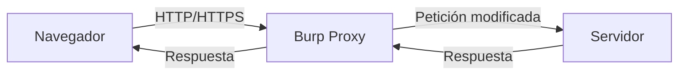

| Edición | Características | Uso |
|---|---|---|
| **Community** | Proxy, Repeater, Intruder limitado | Curso y práctica |
| **Professional** | Scanner, Intruder sin límites, extensiones | Producción |
| **Enterprise** | Escaneo continuo | Organizaciones |

> [!NOTE]
> Burp no "hackea" solo. Es una herramienta de precisión: depende de tu criterio para elegir qué modificar y qué conclusión sacar.

---

## 3.2 Configuración inicial

Burp puede trabajar con un proyecto temporal o persistente. En el curso basta el temporal; en una prueba larga conviene guardar el proyecto para conservar historial y evidencia.

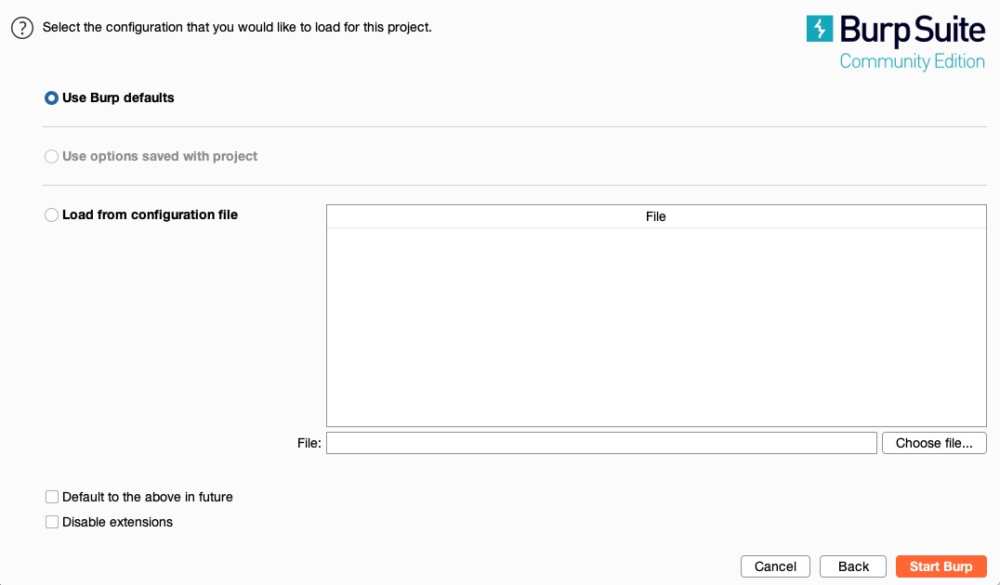

*Creación de un proyecto en Burp. Fuente: captura del curso.*

### 1. Proxy

- Burp escucha en `127.0.0.1:8080` por defecto.
- El navegador debe usar ese proxy.
- Burp incluye un navegador integrado (Chromium) ya configurado.

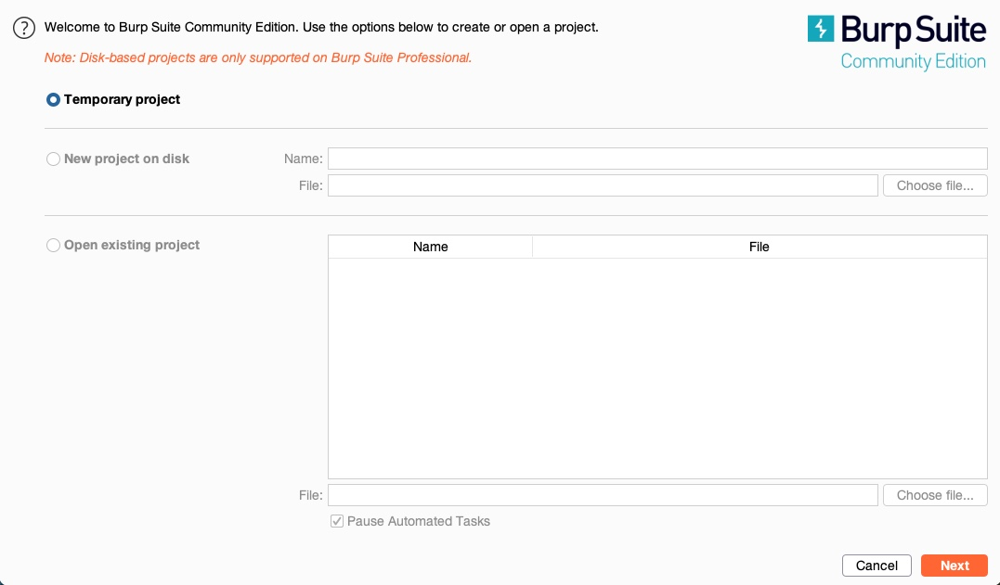

*Configuración del proxy en Burp. Fuente: captura del curso.*

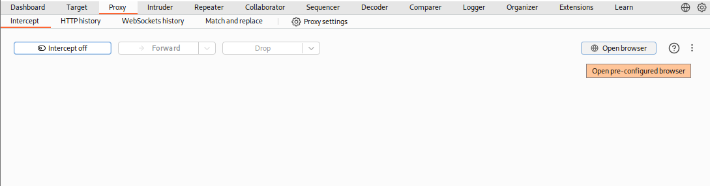

*Acceso al navegador integrado. Fuente: captura del curso.*

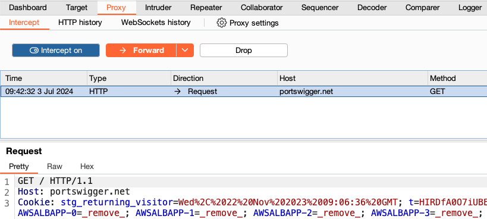

*Proxy de interceptación. Fuente: captura local del curso.*

### 2. Certificado CA

Para HTTPS, instala el certificado de Burp en el navegador:

1. Con el proxy activo, visita `http://burp`.
2. Descarga el certificado CA.
3. Impórtalo como autoridad de confianza.
4. Verifica que no aparezcan advertencias TLS.

> [!WARNING]
> Instala el certificado solo en el navegador del laboratorio. No lo dejes en tu navegador personal.

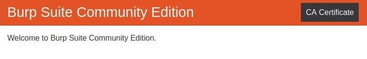

*Descarga e importación del certificado CA. Fuente: captura del curso.*

### 3. Scope

Define el alcance antes de navegar:

```text
Target → Scope → Add → https://*.portswigger.net
```

| Ventaja | Por qué |
|---|---|
| Evita ruido | Solo ves tráfico del objetivo |
| Evita accidentes | No envías pruebas fuera del alcance |
| Filtra historial | Menos distracción |

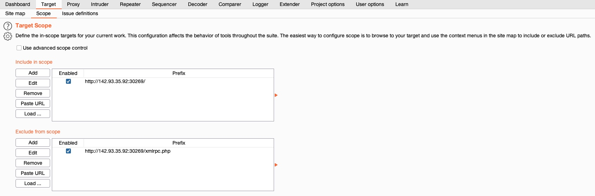

*Configuración del alcance en Burp. Fuente: captura del curso.*

---

## 3.3 Proxy e interceptación

| Acción | Atajo | Uso |
|---|---|---|
| **Intercept on/off** | — | Capturar o dejar pasar |
| **Forward** | — | Enviar petición |
| **Drop** | — | Descartar |
| **Action** | — | Enviar a Repeater/Intruder |
| **HTTP history** | — | Ver todo el tráfico |

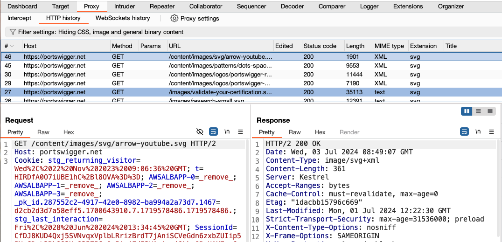

*Historial HTTP de Burp. Fuente: captura local del curso.*

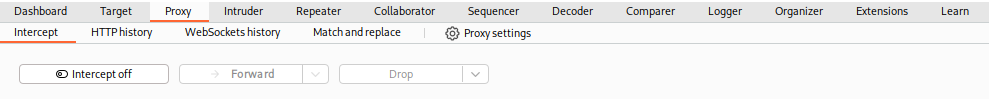

*Petición interceptada antes de llegar al servidor. Fuente: captura del curso.*

> [!TIP]
> Si el navegador no carga, revisa: proxy activo, certificado CA, scope y que Burp esté escuchando.

---

## 3.4 Repeater

Repeater permite modificar una petición y enviarla repetidamente, viendo la respuesta al instante.

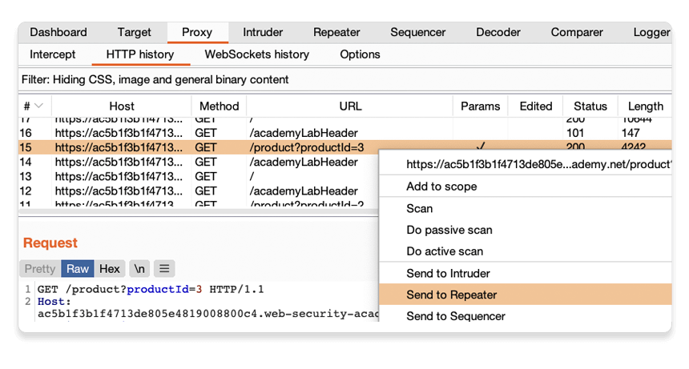

*Envío de una solicitud a Repeater. Fuente: captura local del curso.*

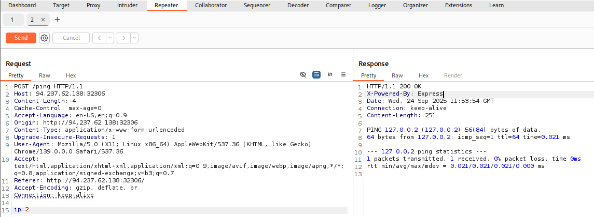

*Interfaz de Repeater. Fuente: captura local del curso.*

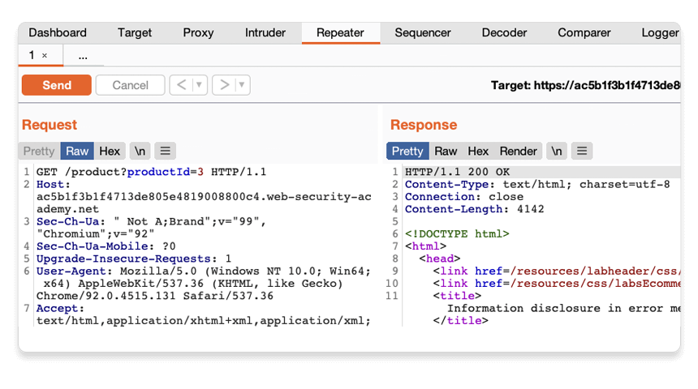

*Petición y respuesta en Repeater. Fuente: captura del curso.*

### Flujo típico

1. Navega al endpoint.
2. Clic derecho → **Send to Repeater**.
3. Modifica un parámetro, cabecera o cuerpo.
4. Envía y compara la respuesta.
5. Guarda la evidencia.

| Prueba | Qué cambiar |
|---|---|
| IDOR | `id=7` → `id=8` |
| Control de acceso | Cookie de otro rol |
| SQLi | `'` en un parámetro |
| XSS | `<script>alert(1)</script>` |
| Path traversal | `../../etc/passwd` |

> [!IMPORTANT]
> Repeater es para **una** petición a la vez. Para muchas variaciones, usa Intruder o un script.

---

## 3.5 Intruder

Intruder automatiza el envío de muchas peticiones con payloads.

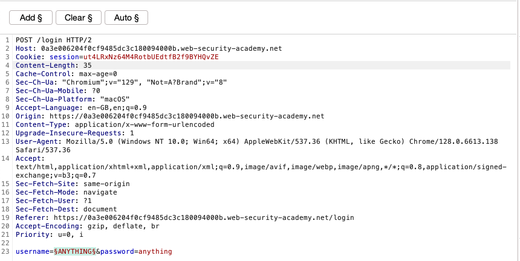

*Marcado de posiciones en Intruder. Fuente: captura local del curso.*

| Ataque | Comportamiento | Uso |
|---|---|---|
| **Sniper** | Un payload por posición | Un parámetro |
| **Battering ram** | Mismo payload en todas | Misma credencial |
| **Pitchfork** | Payloads en paralelo | Usuario + contraseña |
| **Cluster bomb** | Todas las combinaciones | Fuerza bruta |

### Ejemplo: enumerar IDs

```text
GET /mi-cuenta?id=§7§
```

Payload: `1-100`, tipo `Numbers`.

> [!WARNING]
> Intruder puede generar mucho tráfico. En el laboratorio está bien; en producción, respeta los límites y el scope. La edición Community limita la velocidad.

---

## 3.6 Decoder y Comparer

| Herramienta | Uso |
|---|---|
| **Decoder** | URL, Base64, hex, HTML |
| **Comparer** | Diferencias entre respuestas |
| **Logger** | Registro de tráfico |
| **Organizer** | Guardar requests |

### Decoder

```text
Entrada:  %3Cscript%3Ealert(1)%3C%2Fscript%3E
Decodificado: <script>alert(1)</script>
```

> [!TIP]
> Usa Decoder para entender payloads ofuscados y para preparar variantes codificadas.

---

## 3.7 Scanner (Professional)

El scanner automatiza pruebas de vulnerabilidades. No reemplaza la validación manual.

| Ventaja | Limitación |
|---|---|
| Cobertura rápida | Falsos positivos/negativos |
| Pruebas repetibles | No entiende lógica de negocio |
| Priorización | Requiere revisión |

> [!NOTE]
> Un scanner puede marcar un `403` como "accesible" o perder un IDOR. La evidencia manual sigue siendo la fuente de verdad.

---

## 3.8 Extensiones

| Extensión | Uso |
|---|---|
| **Logger++** | Historial avanzado |
| **Autorize** | Comparar respuestas por rol |
| **Param Miner** | Descubrir parámetros |
| **Turbo Intruder** | Ataques rápidos |
| **JWT Editor** | Manipular JWT |
| **Collaborator** | SSRF, blind XSS (Pro) |

> [!WARNING]
> Las extensiones ejecutan código dentro de Burp. Instala solo las que entiendas y desde fuentes confiables.

---

## 3.9 Flujo de trabajo

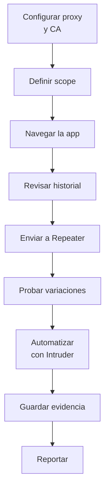

### Buenas prácticas

- Nombra las peticiones importantes.
- Guarda capturas y respuestas.
- Anota la hora y el payload.
- No mezcles datos de producción.
- Cierra Burp al terminar.

---

## 3.10 Troubleshooting

| Problema | Causa | Solución |
|---|---|---|
| No carga HTTPS | CA no instalada | Importar certificado |
| No hay tráfico | Proxy mal configurado | Revisar `127.0.0.1:8080` |
| Todo es ruido | Scope vacío | Añadir dominio |
| Repeater no responde | Petición inválida | Revisar método/headers |
| Intruder lento | Community | Reducir payloads |
| Respuestas distintas | Cookies/sesión | Usar el mismo contexto |

---

## 3.11 Autoevaluación

1. ¿Qué hace un proxy de interceptación?
2. ¿Para qué sirve el certificado CA?
3. ¿Qué diferencia hay entre Proxy y Repeater?
4. ¿Cuándo usarías Intruder?
5. ¿Qué es el scope y por qué importa?
6. ¿Qué herramienta usarías para decodificar un payload?
7. ¿Qué evidencia guardarías de una prueba en Repeater?

---

**Anterior:** [02 — Arquitectura y HTTP](02-arquitectura-http.md) · **Siguiente:** [04 — Reconocimiento web](04-reconocimiento-web.md)
