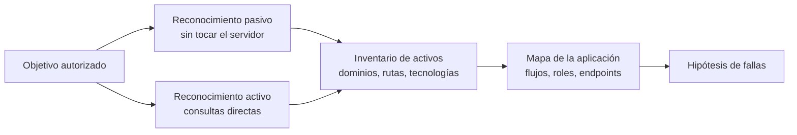
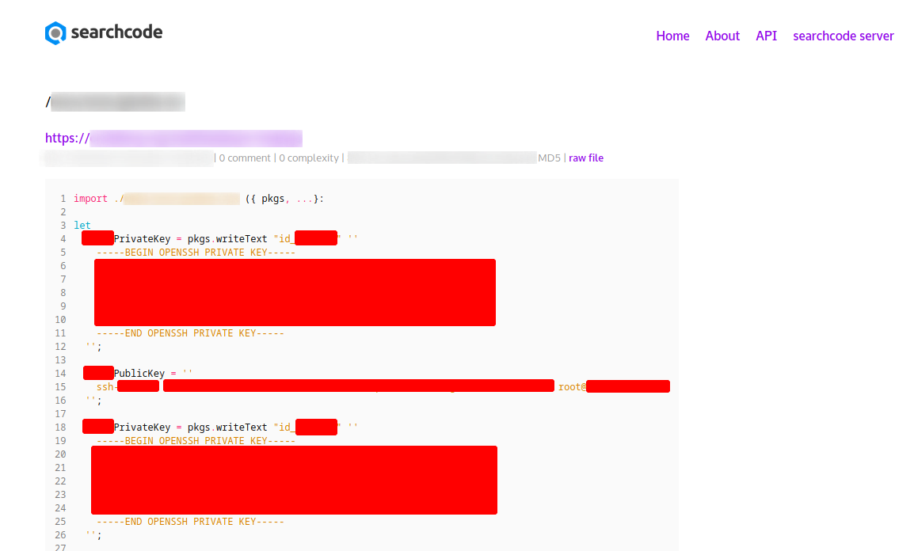
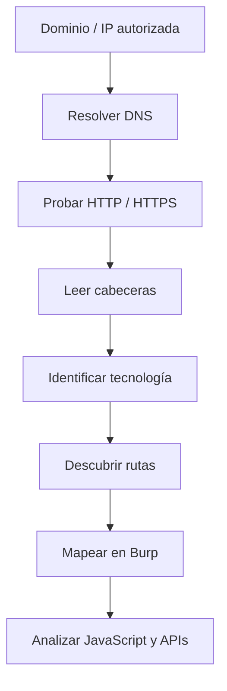
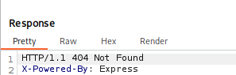
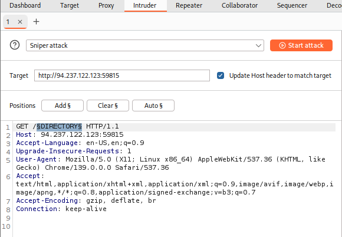
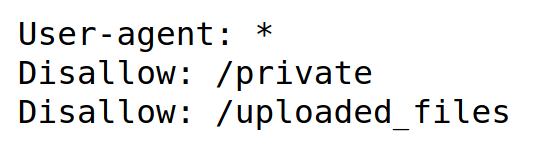
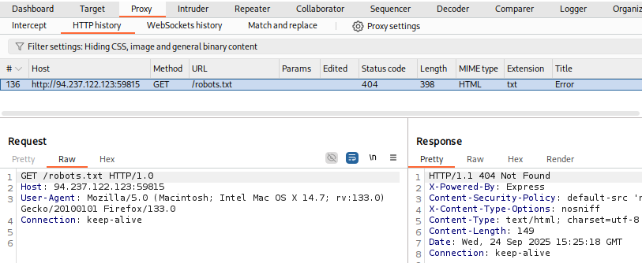
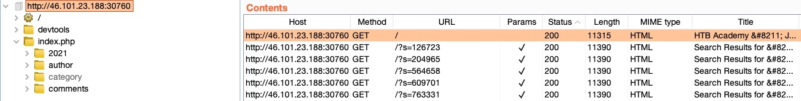
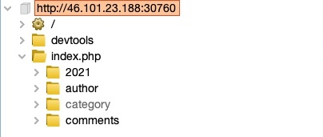
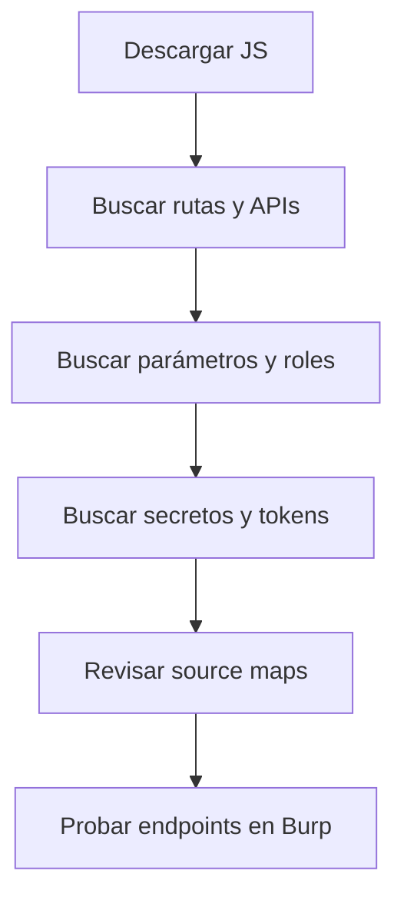

# 04 — Reconocimiento web

**Curso:** C|PW · Pentesting Web  
**Tiempo de lectura:** 40–50 min  
**Laboratorio asociado:** mapeo de una aplicación con Burp, `ffuf` y `robots.txt`

---

## 4.1 Qué es el reconocimiento web

El reconocimiento es la fase en la que respondes una pregunta simple: **¿qué hay ahí y cómo está construido?** Antes de probar una sola inyección necesitas saber qué rutas existen, qué tecnologías corren, qué roles hay y qué parte de la aplicación es alcanzable.



| Tipo | Qué haces | Deja huella en el objetivo | Ejemplo |
|---|---|---|---|
| **Pasivo** | Consultas fuentes externas | No | `crt.sh`, Wayback, buscadores |
| **Activo** | Envías tráfico al objetivo | Sí, en logs y WAF | `ffuf`, `whatweb`, Burp |
| **Semi-pasivo** | Consultas públicas al propio dominio | Mínima | `robots.txt`, `sitemap.xml` |

> [!IMPORTANT]
> El reconocimiento no termina cuando empiezas a explotar. Cada respuesta HTTP nueva puede abrir una hipótesis y obligarte a volver al mapa.

---

## 4.2 Reconocimiento pasivo

### Fuentes principales



*Fuentes de reconocimiento pasivo. Fuente: material del curso.*

| Fuente | Qué obtienes | Cómo usarla |
|---|---|---|
| **Certificate Transparency** | Subdominios por certificados emitidos | `crt.sh`, `certspotter` |
| **Buscadores** | Páginas indexadas, rutas, errores | Operadores `site:`, `inurl:`, `filetype:` |
| **Wayback Machine** | Versiones antiguas, endpoints retirados | `web.archive.org` |
| **GitHub / GitLab** | Código, rutas, claves filtradas | Búsqueda por dominio y organización |
| **Shodan / Censys** | Servicios y banners expuestos | Puertos, tecnologías, certificados |
| **DNS** | Registros A, MX, TXT, CNAME | `dig`, `nslookup`, `dnsrecon` |
| **Redes sociales** | Empleados, tecnologías, proveedores | OSINT con límites éticos |
| **Job postings** | Stack tecnológico | Ofertas que mencionan frameworks |

### Operadores de búsqueda útiles

```text
site:tienda.example
site:tienda.example inurl:admin
site:tienda.example filetype:pdf
site:tienda.example ext:env
"-"tienda.example "api"
```

> [!NOTE]
> Los resultados de un buscador están desactualizados por definición. Una ruta que aparece indexada puede ya no existir, y una ruta nueva puede no estar indexada todavía.

### Certificate Transparency

```bash
# Consulta simple a crt.sh
curl -s "https://crt.sh/?q=%25.tienda.example&output=json" | jq -r '.[].name_value' | sort -u
```

| Ventaja | Limitación |
|---|---|
| Revela subdominios que no están enlazados | Solo ve certificados emitidos |
| No toca el objetivo | Puede incluir dominios de terceros |
| Histórico | No dice si el host sigue activo |

### DNS

```bash
dig tienda.example A
dig tienda.example MX
dig tienda.example TXT
dig +short sub.tienda.example
```

| Registro | Qué revela |
|---|---|
| `A` / `AAAA` | Dirección IPv4 / IPv6 |
| `CNAME` | Alias hacia otro dominio |
| `MX` | Proveedor de correo |
| `TXT` | Verificaciones, SPF, DMARC |
| `NS` | Servidores DNS |

> [!WARNING]
> El reconocimiento pasivo también tiene límites legales y de términos de servicio. No automatices consultas masivas contra terceros ni uses credenciales ajenas.

---

## 4.3 Reconocimiento activo

El reconocimiento activo consulta directamente al objetivo. Es más preciso, pero deja rastro.



### Primeras consultas

```bash
# Resolución y conectividad
dig +short tienda.example
curl -I https://tienda.example
curl -v https://tienda.example 2>&1 | head -n 40

# Certificado TLS
openssl s_client -connect tienda.example:443 -servername tienda.example </dev/null 2>/dev/null | openssl x509 -noout -subject -issuer -dates
```

### Qué mirar en las cabeceras

```http
HTTP/1.1 200 OK
Server: nginx/1.24.0
X-Powered-By: Express
Set-Cookie: session=abc; Path=/; HttpOnly
Content-Security-Policy: default-src 'self'
X-Frame-Options: DENY
```

| Cabecera | Qué indica | Interés para el pentest |
|---|---|---|
| `Server` | Servidor web y versión | Versiones con CVEs |
| `X-Powered-By` | Framework o lenguaje | Stack y posibles rutas |
| `Set-Cookie` | Cookies y flags | `HttpOnly`, `Secure`, `SameSite` |
| `Content-Security-Policy` | Política de contenido | Calidad del hardening |
| `X-Frame-Options` | Protección contra clickjacking | Ausencia o mala configuración |
| `Access-Control-Allow-Origin` | CORS | Orígenes permitidos |
| `Location` | Redirecciones | Flujos y rutas internas |

> [!TIP]
> Las cabeceras son pistas, no pruebas. `X-Powered-By: Express` sugiere Node.js, pero no confirma la versión ni que la aplicación sea vulnerable.

---

## 4.4 Fingerprinting de tecnologías

El fingerprinting consiste en identificar el stack: servidor, lenguaje, framework, base de datos, CDN y librerías.



*Cabeceras que revelan Express. Fuente: captura del curso.*

### Señales que se cruzan

| Señal | Ejemplo | Qué sugiere |
|---|---|---|
| **Cabeceras** | `X-Powered-By: Express` | Node.js / Express |
| **Cookies** | `PHPSESSID`, `JSESSIONID`, `csrftoken` | PHP, Java, Django |
| **HTML** | `<script src="/assets/app.js">` | SPA o frontend con bundler |
| **Rutas** | `/wp-content/`, `/administrator/` | WordPress, Joomla |
| **Errores** | Stack trace con rutas | Framework y versión |
| **Favicon** | Hash del icono | Producto conocido |
| **Extensiones** | `.php`, `.aspx`, `.jsp` | Lenguaje del backend |

### Herramientas

| Herramienta | Uso | Nota |
|---|---|---|
| **Wappalyzer** | Extensión de navegador | Rápida, basada en firmas |
| **WhatWeb** | Fingerprinting por CLI | `whatweb -a 3 https://tienda.example` |
| **Burp** | Cabeceras y respuestas | Integrado con el flujo |
| **Nmap NSE** | `http-title`, `http-headers` | Complemento de red |
| **BuiltWith** | Perfil tecnológico | Fuente externa |

```bash
whatweb -a 3 https://tienda.example
```

> [!WARNING]
> El fingerprinting automático se equivoca. Un `Server: nginx` puede ser un proxy delante de otra tecnología. Confirma con varias señales antes de concluir.

---

## 4.5 Descubrimiento de rutas y directorios

La aplicación puede tener rutas que no están enlazadas en el menú: paneles, APIs internas, backups, entornos de prueba.

### Códigos de estado como señal

| Código | Interpretación | Acción |
|---|---|---|
| **200** | Existe y es accesible | Investigar |
| **301/302** | Existe y redirige | Seguir la redirección |
| **401** | Existe, requiere autenticación | Probar credenciales de lab |
| **403** | Existe, prohíbe acceso | Probar bypass y otros métodos |
| **404** | No existe | Descartar |
| **500** | Error del servidor | Posible entrada inválida |
| **429** | Rate limit | Reducir velocidad |

> [!IMPORTANT]
> Un `403` confirma que la ruta existe. Eso ya es información: el panel está ahí, solo falta comprobar si el control se aplica de verdad.

### ffuf

```bash
# Descubrimiento básico
ffuf -u https://tienda.example/FUZZ -w /usr/share/wordlists/dirb/common.txt

# Filtrar respuestas por tamaño y código
ffuf -u https://tienda.example/FUZZ \
  -w /usr/share/seclists/Discovery/Web-Content/raft-medium-directories.txt \
  -mc 200,204,301,302,307,401,403 \
  -fs 0

# Extensiones
ffuf -u https://tienda.example/FUZZ \
  -w wordlist.txt \
  -e .php,.bak,.old,.txt,.zip
```

| Flag | Función |
|---|---|
| `-u` | URL con `FUZZ` |
| `-w` | Wordlist |
| `-mc` | Códigos a mostrar |
| `-fc` | Códigos a ocultar |
| `-fs` | Tamaño a ocultar |
| `-e` | Extensiones |
| `-t` | Hilos |
| `-rate` | Peticiones por segundo |

### Gobuster

```bash
gobuster dir -u https://tienda.example \
  -w /usr/share/wordlists/dirb/common.txt \
  -t 20 -k
```

### Burp Intruder para directorios



*Intruder con la posición marcada sobre el directorio. Fuente: captura del curso.*

Burp Intruder permite reutilizar una petición válida y sustituir solo el segmento de ruta. Es más lento que `ffuf`, pero útil cuando la petición necesita cookies, cabeceras o un token CSRF que ya están en el navegador.

| Modo | Uso |
|---|---|
| `dir` | Directorios y archivos |
| `vhost` | Virtual hosts |
| `dns` | Subdominios |
| `fuzz` | Fuzzing genérico |

### Wordlists

| Wordlist | Uso |
|---|---|
| `common.txt` | Primer barrido rápido |
| `raft-medium-directories.txt` | Cobertura media |
| `directory-list-2.3-medium.txt` | Barrido amplio |
| `api-endpoints.txt` | APIs |
| Wordlists propias | Rutas observadas en la app |

> [!TIP]
> Empieza con una wordlist pequeña y añade rutas que veas en la aplicación. Una lista gigante sin criterio genera ruido y puede activar el WAF.

### Descubrimiento de virtual hosts

```bash
gobuster vhost -u https://tienda.example -w subdomains.txt --append-domain
ffuf -u https://tienda.example -H "Host: FUZZ.tienda.example" -w subdomains.txt -fs 0
```

> [!NOTE]
> Un virtual host puede servir una aplicación distinta en la misma IP. Si el alcance lo permite, es una superficie que conviene revisar.

---

## 4.6 robots.txt y sitemap.xml

### robots.txt

`robots.txt` es una convención para que los rastreadores no indexen ciertas rutas. **No es un control de acceso.** El archivo es público y cualquiera puede leerlo.



*Ejemplo de `robots.txt`. Fuente: material del curso.*

```text
User-agent: *
Disallow: /admin/
Disallow: /backup/
Disallow: /private/
Sitemap: https://tienda.example/sitemap.xml
```

| Interpretación correcta | Interpretación incorrecta |
|---|---|
| Lista de rutas que el dueño no quiere indexar | Lista de rutas protegidas |
| Pista de rutas internas | Prueba de que no se puede entrar |
| Puede revelar paneles y backups | Mecanismo de autorización |

```bash
curl -s https://tienda.example/robots.txt
```

> [!WARNING]
> Si `robots.txt` dice `Disallow: /admin/`, el siguiente paso no es asumir que está protegido: es comprobar si `GET /admin/` responde `200`, `302` o `403`. Muchas veces el archivo revela justo lo que se quería ocultar.



*No todos los sitios publican `robots.txt`; un `404` no dice nada sobre la seguridad del panel. Fuente: captura del curso.*

### sitemap.xml

El `sitemap.xml` lista URLs que el sitio quiere que los buscadores indexen. Es útil para descubrir contenido público y parámetros.

```xml
<?xml version="1.0" encoding="UTF-8"?>
<urlset xmlns="http://www.sitemaps.org/schemas/sitemap/0.9">
  <url>
    <loc>https://tienda.example/productos</loc>
    <lastmod>2026-10-01</lastmod>
  </url>
  <url>
    <loc>https://tienda.example/p/7</loc>
  </url>
</urlset>
```

```bash
curl -s https://tienda.example/sitemap.xml | grep -o "<loc>[^<]*" | sed 's/<loc>//'
```

| Archivo | Qué aporta | Qué no aporta |
|---|---|---|
| `robots.txt` | Rutas que se quieren ocultar de buscadores | Seguridad |
| `sitemap.xml` | Inventario de URLs públicas | Rutas privadas |
| `security.txt` | Contacto de seguridad | Vectores de ataque |

> [!TIP]
> Revisa también `/.well-known/security.txt`, `/humans.txt`, `/crossdomain.xml` y `/favicon.ico`. Son archivos de bajo ruido que a veces revelan contacto, tecnologías o políticas.

---

## 4.7 Burp Site Map

Burp construye un **mapa del sitio** con todo el tráfico que pasa por el proxy. Es la forma más cómoda de ver la aplicación como un árbol de rutas y parámetros.



*Site Map de Burp. Fuente: material del curso.*



*Árbol de rutas descubiertas. Fuente: material del curso.*

### Cómo usarlo

1. Define el **scope** antes de navegar.
2. Recorre la aplicación con distintos roles.
3. Revisa **Target → Site map**.
4. Filtra por código de estado y por tipo de contenido.
5. Envía las peticiones interesantes a Repeater.
6. Anota las rutas que no aparecen en el menú.

| Vista | Qué muestra |
|---|---|
| **Site map** | Árbol de hosts, rutas y parámetros |
| **Issue activity** | Hallazgos del scanner (Pro) |
| **Scope** | Qué está incluido |
| **Filter** | Códigos, MIME, extensiones |

> [!NOTE]
> El Site Map solo contiene lo que pasó por Burp. Si una ruta no se visitó, no aparece. Combínalo con `ffuf`, enlaces y JavaScript.

---

## 4.8 Análisis de JavaScript

Las aplicaciones modernas exponen gran parte de su lógica en el frontend. El JavaScript puede revelar endpoints, parámetros, roles y hasta claves.



### Qué buscar

| Patrón | Ejemplo | Por qué importa |
|---|---|---|
| Rutas | `/api/v1/users` | Superficie no enlazada |
| Parámetros | `?debug=true`, `?role=admin` | Lógica oculta |
| Roles | `isAdmin`, `role` | Control en cliente |
| URLs | `https://api.internal` | Backends y entornos |
| Claves | `apiKey`, `token` | Secretos expuestos |
| Comentarios | `// TODO: remove` | Pistas de desarrollo |

```bash
# Descargar los JS referenciados
curl -s https://tienda.example | grep -oE 'src="[^"]+\.js"' | cut -d'"' -f2

# Buscar rutas y palabras clave
curl -s https://tienda.example/assets/app.js | grep -oE '"/[a-zA-Z0-9_/-]+"' | sort -u

# Buscar posibles secretos
curl -s https://tienda.example/assets/app.js | grep -iE "api[_-]?key|token|secret|password"
```

### Source maps

Si existe `app.js.map`, puedes reconstruir el código fuente original:

```bash
curl -s -o app.js.map https://tienda.example/assets/app.js.map
jq -r '.sources[]' app.js.map
```

> [!WARNING]
> Un secreto en el frontend no siempre es explotable: puede ser una clave pública o un token de solo lectura. Confirma el alcance y el impacto antes de reportarlo.

---

## 4.9 Reconocimiento de APIs

Las APIs suelen ser la parte más expuesta y menos visible de la aplicación.

| Señal | Dónde buscarla |
|---|---|
| `/api/`, `/v1/`, `/graphql` | JavaScript, tráfico de Burp |
| `swagger.json`, `openapi.json` | Documentación expuesta |
| `/.well-known/` | Configuración estándar |
| Métodos `OPTIONS` | Cabecera `Allow` |
| Respuestas JSON | Content-Type |

```bash
# Documentación de API
curl -s https://tienda.example/swagger.json | jq '.paths | keys'
curl -s https://tienda.example/openapi.json | jq '.paths | keys'

# Métodos permitidos
curl -s -X OPTIONS -i https://tienda.example/api/v1/users
```

> [!TIP]
> Si encuentras una API, prueba primero los endpoints con el rol menos privilegiado. La mayoría de fallos de control de acceso aparecen ahí, no en la interfaz web.

---

## 4.10 Evidencia del reconocimiento

| Elemento | Ejemplo |
|---|---|
| Comando | `ffuf -u https://tienda.example/FUZZ -w common.txt` |
| Fecha y hora | `2026-10-30 10:15 UTC-5` |
| Resultado | `/admin/` → `403`, `/backup/` → `200` |
| Interpretación | Panel admin existe; backup accesible |
| Evidencia | Captura, salida completa, request en Burp |
| Siguiente paso | Probar control de acceso y listado del backup |

> [!IMPORTANT]
> El reconocimiento produce **hipótesis**, no hallazgos. Un `200` en `/backup/` es interesante, pero el hallazgo se confirma cuando demuestras qué información expone y a quién.

---

## 4.11 Errores frecuentes

| Error | Consecuencia | Corrección |
|---|---|---|
| Escanear sin scope | Tráfico fuera del objetivo | Definir alcance en Burp y en la wordlist |
| Confiar en `robots.txt` como control | Falsa sensación de seguridad | Probar acceso real |
| Wordlist gigante sin filtrar | Ruido y bloqueos | Empezar pequeño, filtrar por tamaño |
| Ignorar `403` | Se pierde superficie | Probar bypass y métodos |
| No revisar JavaScript | Endpoints ocultos sin descubrir | Analizar bundles y source maps |
| Confundir fingerprint con vulnerabilidad | Reporte inflado | Validar impacto |
| No guardar evidencia | Hallazgo no reproducible | Guardar comandos y respuestas |

---

## 4.12 Autoevaluación

1. ¿Qué diferencia hay entre reconocimiento pasivo y activo?
2. ¿Qué revela Certificate Transparency que no revela un escaneo de puertos?
3. ¿Por qué `robots.txt` no es un control de acceso?
4. ¿Qué significa un `403` al descubrir rutas?
5. ¿Cómo usarías Burp Site Map para mapear una aplicación?
6. ¿Qué buscarías en un archivo JavaScript?
7. ¿Qué evidencia guardarías de un descubrimiento de rutas?

---

**Anterior:** [03 — Burp Suite](03-burp-suite.md) · **Siguiente:** [05 — Control de acceso](05-control-acceso.md)
