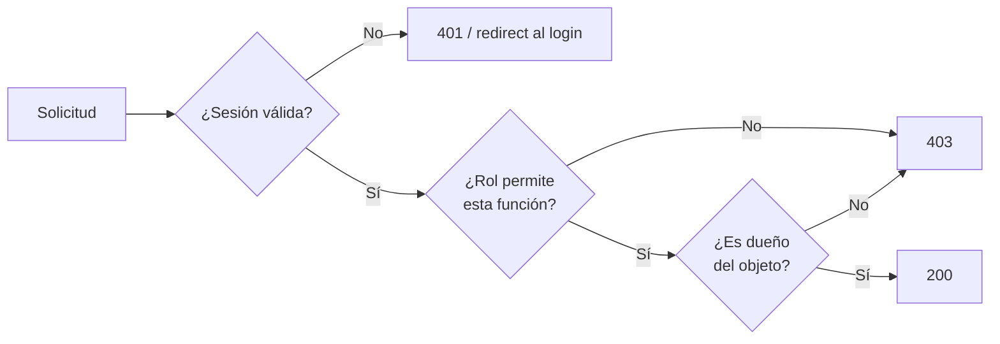
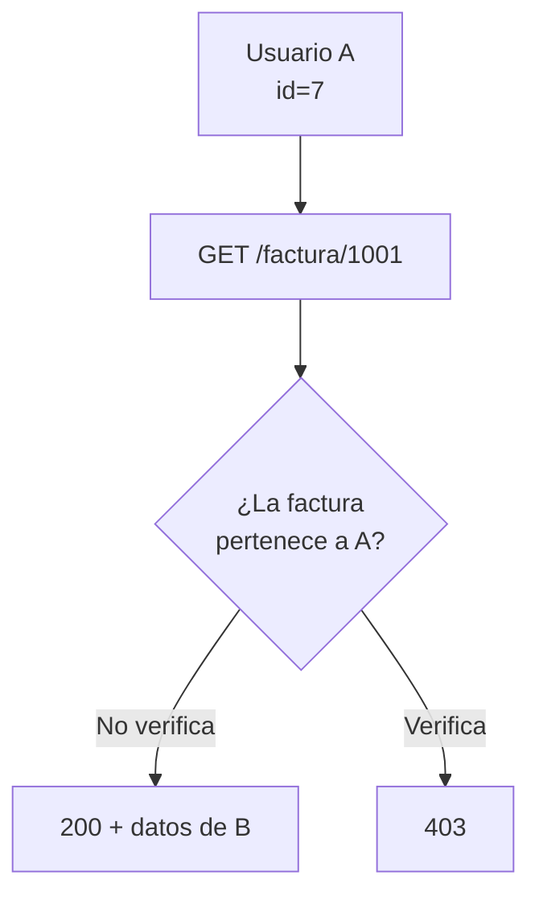
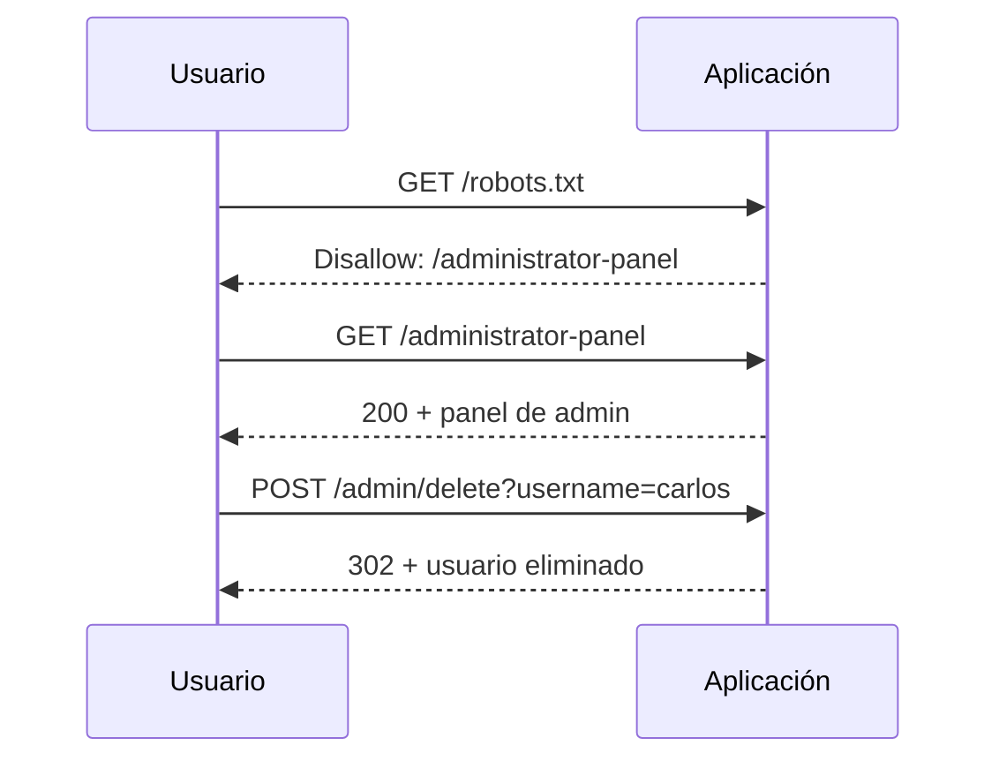
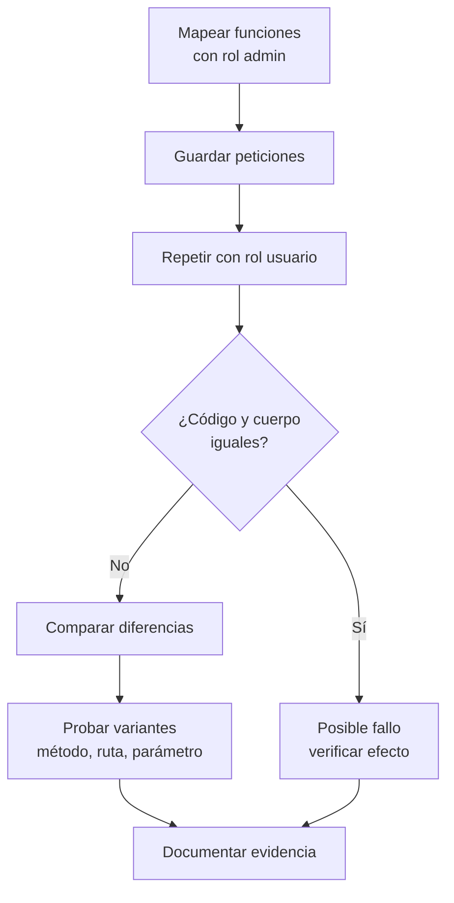
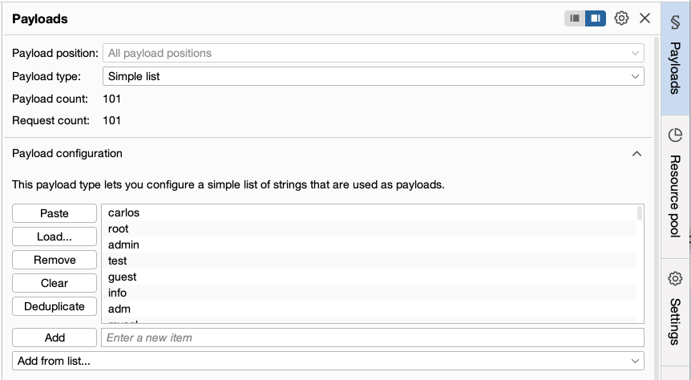
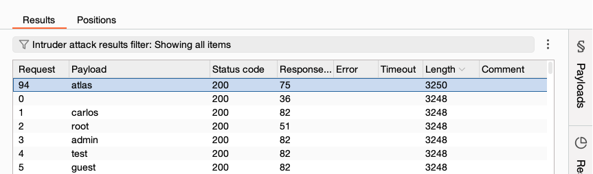

# 05 — Control de acceso

**Curso:** C|PW · Pentesting Web  
**Tiempo de lectura:** 40–50 min  
**Laboratorio asociado:** panel de administración sin protección y pruebas con dos roles

---

## 5.1 Autenticación no es autorización

Son dos preguntas distintas y se confunden todo el tiempo:

| Pregunta | Mecanismo | Falla típica |
|---|---|---|
| **¿Quién eres?** | Autenticación | Contraseña débil, sesión predecible |
| **¿Qué puedes hacer?** | Autorización | Acceso a funciones o datos de otro rol |

Un usuario puede estar perfectamente autenticado y, aun así, hacer cosas que no le corresponden. Eso es un fallo de **control de acceso**.



> [!IMPORTANT]
> La autenticación dice **quién eres**. La autorización dice **qué puedes tocar**. Un panel que exige login pero no valida el rol sigue siendo un panel abierto.

---

## 5.2 OWASP A01: Broken Access Control

En el OWASP Top 10 2021, **A01 Broken Access Control** es la categoría más frecuente. Agrupa todos los casos en los que la aplicación no impone correctamente los límites de lo que cada usuario puede hacer.

| Subtipo | Qué ocurre | Ejemplo |
|---|---|---|
| **Vertical** | Usuario común accede a funciones de admin | `GET /admin/` sin rol admin |
| **Horizontal** | Usuario accede a datos de otro usuario | `GET /factura?id=1002` |
| **IDOR** | Se manipula un identificador de objeto | `?id=7` → `?id=8` |
| **Forced browsing** | Se accede a una URL no enlazada | `/backup/`, `/debug` |
| **Missing function-level check** | La función existe pero no valida rol | `POST /api/users/delete` |
| **Context-dependent** | El permiso depende del estado o flujo | Saltarse un paso del checkout |
| **Multi-tenant** | Un cliente accede a datos de otro | `tenant_id` manipulable |

> [!NOTE]
> A01 no es una vulnerabilidad única: es una familia. El informe debe decir **qué tipo** de control de acceso falló y sobre **qué objeto o función**.

---

## 5.3 Control de acceso vertical

El usuario con menos privilegios intenta ejecutar funciones reservadas a un rol superior.

### Ejemplos

```http
GET /admin/ HTTP/1.1
Host: tienda.example
Cookie: session=usuario_normal
```

```http
POST /api/v1/users/delete HTTP/1.1
Host: tienda.example
Cookie: session=usuario_normal
Content-Type: application/json

{"id": 42}
```

| Señal | Interpretación |
|---|---|
| `200` con contenido de admin | Control ausente |
| `302` al login | Puede ser control o simple redirección |
| `403` | Control presente, pero verifica bypass |
| `401` | Falta autenticación |

### Cómo se prueba

1. Inicia sesión con una cuenta de **usuario normal**.
2. Navega con una cuenta **admin** y guarda las peticiones.
3. Repite las peticiones admin con la cookie de usuario normal.
4. Compara código, cuerpo y efectos secundarios.
5. Verifica si el cambio se aplicó de verdad, no solo si la respuesta fue `200`.

> [!WARNING]
> Un `302` al login no siempre significa que la función esté protegida. A veces el backend ejecuta la acción y luego redirige. Comprueba el efecto real: si el usuario se creó o el registro se borró, el control falló.

---

## 5.4 Control de acceso horizontal e IDOR

En el acceso horizontal, el usuario tiene el rol correcto pero accede a un objeto que no le pertenece. El caso más conocido es **IDOR** (Insecure Direct Object Reference): la aplicación usa un identificador predecible y no comprueba la propiedad.



### Ejemplo

```http
GET /api/facturas/1001 HTTP/1.1
Host: tienda.example
Cookie: session=usuario_A
```

Si `1001` pertenece a otro cliente y la respuesta trae sus datos, hay IDOR.

| Identificador | ¿Es control de acceso? |
|---|---|
| Auto-incremental (`7`, `8`, `9`) | Muy fácil de enumerar |
| UUID | Más difícil, pero **no es un control** |
| Hash del ID | Ofuscación, no autorización |
| ID compuesto (`tenant:user`) | Puede ayudar, pero debe validarse |

> [!IMPORTANT]
> Cambiar un ID numérico por un UUID reduce la enumeración, pero no corrige el fallo. Si el servidor no comprueba que el objeto pertenece al usuario, un UUID filtrado sigue dando acceso.

### Variantes de IDOR

| Variante | Dónde aparece |
|---|---|
| En la URL | `/perfil/7`, `/factura/1001` |
| En el cuerpo | `{"userId": 7}` |
| En una cabecera | `X-User-Id: 7` |
| En una cookie | `user_id=7` |
| En un parámetro oculto | `?debug=1&account=7` |
| En un objeto JSON anidado | `{"order":{"id":7}}` |

> [!TIP]
> No pruebes solo el parámetro visible. Revisa el cuerpo completo y las cabeceras: muchas APIs aceptan un `userId` que el frontend nunca envía.

---

## 5.5 Forced browsing

El forced browsing es acceder directamente a una URL que no está enlazada en la interfaz. La aplicación asume que, si nadie ve el enlace, nadie va a entrar.

```text
/administrator-panel
/admin/
/backup/
/debug/
/.git/
/server-status
/actuator/env
```

| Fuente de la ruta | Ejemplo |
|---|---|
| `robots.txt` | `Disallow: /admin/` |
| JavaScript | `fetch("/api/internal/users")` |
| Comentarios HTML | `<!-- TODO: remove /debug -->` |
| Mensajes de error | Stack trace con rutas |
| Wordlists | `ffuf`, `gobuster` |
| Historial de Burp | Rutas visitadas por otro rol |

> [!WARNING]
> Ocultar el enlace en el menú no es seguridad. Si la ruta responde sin validar el rol, cualquiera que la conozca entra.

---

## 5.6 El panel de administración sin protección

Este es el caso del laboratorio del curso: existe una ruta de administración que no aparece en el menú, pero que responde a cualquier usuario.



| Paso | Qué demuestra |
|---|---|
| `robots.txt` revela la ruta | Información expuesta |
| La ruta responde `200` sin rol | Control de acceso ausente |
| La acción admin se ejecuta | Impacto real |

> [!NOTE]
> La causa no es que `robots.txt` exista. La causa es que el servidor no verifica el rol. `robots.txt` solo hizo más fácil encontrar el panel.

---

## 5.7 Cómo probar control de acceso con método

### Preparación

- Dos cuentas del mismo rol (A y B).
- Una cuenta de rol superior (admin), si el alcance lo permite.
- Burp con scope definido.
- Una tabla para registrar peticiones y respuestas.

### Flujo



### Qué comparar

| Elemento | Por qué |
|---|---|
| **Código de estado** | `200` vs `403` vs `302` |
| **Longitud de respuesta** | Cambios de contenido |
| **Cuerpo** | Datos de otro usuario |
| **Cabeceras** | `Location`, `Set-Cookie` |
| **Efecto secundario** | Registro creado, borrado o modificado |
| **Tiempo** | Consultas que revelan existencia |

### Herramientas

| Herramienta | Uso |
|---|---|
| **Repeater** | Repetir una petición con otra cookie |
| **Comparer** | Ver diferencias entre respuestas |
| **Autorize** | Comparar automáticamente respuestas por rol |
| **Intruder** | Enumerar IDs o usuarios |
| **ffuf** | Descubrir rutas |

> [!TIP]
> Autorize automatiza la comparación, pero genera mucho tráfico. Úsalo en el laboratorio y revisa manualmente los candidatos.

---

## 5.8 Enumeración de usuarios e IDs

La enumeración no es un fallo de control de acceso por sí misma, pero alimenta los ataques de acceso horizontal.



*Lista de usuarios de prueba en Intruder. Fuente: captura del curso.*



*Diferencias de longitud en las respuestas. Fuente: captura del curso.*

| Señal | Interpretación |
|---|---|
| Longitud distinta | Usuario existe o respuesta diferente |
| Código distinto | Comportamiento diferenciado |
| Mensaje distinto | Enumeración por error |
| Tiempo distinto | Consulta adicional |

> [!WARNING]
> La enumeración de usuarios puede facilitar fuerza bruta y filtración de datos. En un pentest, documéntala como riesgo, no como simple curiosidad.

---

## 5.9 Bypass de controles débiles

Cuando existe un `403`, no significa que el control sea sólido. Prueba variantes **dentro del alcance**:

| Variante | Ejemplo |
|---|---|
| Ruta alternativa | `/admin`, `/admin/`, `/Admin`, `/admin/.` |
| Codificación | `/%61dmin`, `/admin%2f` |
| Cabecera | `X-Original-URL: /admin` |
| Método | `POST` en lugar de `GET` |
| Versión de API | `/api/v1` → `/api/v2` |
| Parámetro | `?role=admin`, `?debug=true` |
| Host | `Host: internal.tienda.example` |
| Rol en JWT | Editar claim sin verificar firma |

> [!NOTE]
> Estas pruebas solo son válidas si el alcance las autoriza y si no afectan disponibilidad. Un bypass que borra datos no es un buen bypass.

---

## 5.10 Remediación

El control de acceso debe aplicarse en el **servidor**, en **cada petición**, sobre **cada objeto**.

| Control | Implementación |
|---|---|
| **Deny by default** | Si no hay regla explícita, denegar |
| **Verificación centralizada** | Middleware o guard único |
| **Autorización por objeto** | Comprobar `owner_id` en la consulta |
| **Roles en servidor** | No confiar en claims del cliente sin verificar |
| **Mínimo privilegio** | Cada rol solo lo necesario |
| **No ocultar como control** | El menú no es seguridad |
| **Logs y alertas** | Registrar accesos denegados |
| **Pruebas automatizadas** | Casos por rol en CI/CD |

### Ejemplo conceptual

```python
# Mal: confiar en el ID del cliente
factura = db.get_factura(request.args["id"])
return factura

# Bien: filtrar por propietario
factura = db.get_factura(
    id=request.args["id"],
    owner_id=current_user.id
)
if not factura:
    abort(404)
```

> [!IMPORTANT]
> Devuelve `404` en lugar de `403` cuando el objeto no pertenece al usuario. Así no confirmas que el objeto existe y reduces la enumeración.

### Checklist de remediación

- [ ] Cada endpoint valida autenticación.
- [ ] Cada endpoint valida rol.
- [ ] Cada objeto valida propietario o tenant.
- [ ] Los IDs no son la única defensa.
- [ ] Las rutas admin no dependen del menú.
- [ ] Los `403` se registran y monitorean.
- [ ] Hay pruebas de regresión por rol.

---

## 5.11 Evidencia y reporte

```markdown
### Hallazgo — Panel de administración sin control de acceso

**Activo:** https://tienda.example/administrator-panel
**Categoría:** OWASP A01 Broken Access Control
**Severidad:** Alta
**CWE:** CWE-284 (Improper Access Control)

**Descripción:**
La ruta de administración es accesible para cualquier usuario
autenticado, sin verificar el rol. Desde el panel se pueden
eliminar cuentas de usuario.

**Evidencia:**
1. `GET /robots.txt` revela `Disallow: /administrator-panel`.
2. `GET /administrator-panel` con cookie de usuario normal → `200`.
3. `POST /admin/delete` con usuario `carlos` → `302` y cuenta eliminada.

**Impacto:**
Un usuario común puede ejecutar acciones administrativas y
afectar la integridad y disponibilidad del servicio.

**Recomendación:**
- Verificar rol en el servidor para cada ruta `/admin/*`.
- Aplicar deny by default.
- Añadir pruebas de autorización por rol.
- Registrar y alertar accesos denegados.
```

### Qué hace fuerte a esta evidencia

| Elemento | Por qué |
|---|---|
| Ruta exacta | Reproducible |
| Rol usado | Demuestra el privilegio real |
| Petición y respuesta | Prueba técnica |
| Efecto secundario | Demuestra impacto |
| Recomendación | Permite corregir |

---

## 5.12 Errores frecuentes

| Error | Consecuencia |
|---|---|
| Confundir login con autorización | Se reporta un falso positivo |
| Probar solo la UI | Se pierden APIs y rutas ocultas |
| Ignorar el efecto secundario | No se demuestra impacto |
| Usar un UUID como “solución” | El fallo persiste |
| Cerrar en el primer `403` | Se pierde un bypass |
| Probar fuera de alcance | Riesgo legal |
| No comparar con otro rol | No hay evidencia clara |

---

## 5.13 Autoevaluación

1. ¿Qué diferencia hay entre autenticación y autorización?
2. ¿Qué es el control de acceso vertical y qué el horizontal?
3. ¿Qué es un IDOR y por qué un UUID no lo corrige?
4. ¿Qué es forced browsing?
5. ¿Por qué un `302` no garantiza que la acción no se ejecutó?
6. ¿Cómo probarías un panel admin con dos cuentas?
7. ¿Qué controles aplicarías para prevenir A01?

---

**Anterior:** [04 — Reconocimiento web](04-reconocimiento-web.md) · **Siguiente:** [06 — Laboratorio PortSwigger](06-laboratorio-portswigger.md)
