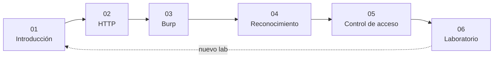
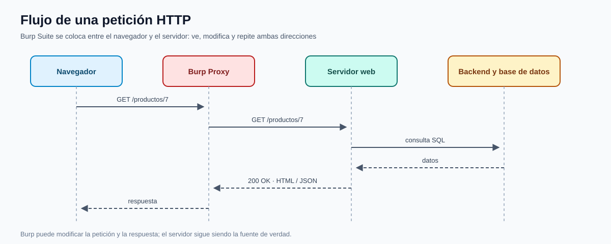

# Pentesting Web — Teoría expandida

[Pentesting Web](../README.md) | [Inicio](../../README.md)

**Curso:** C|PW · Ciberseguridad Pentesting contra aplicaciones Web  
**Edición:** 11va Edición  
**Instructor:** Anthony Gonzalo Quispe Cordova  
**Institución:** Oficina de Tecnologías de la Información (OTI) — UNI

Este directorio expande la teoría de los slides: qué es el pentesting web, cómo funciona una aplicación, cómo se intercepta y analiza el tráfico con Burp Suite, cómo se hace reconocimiento y cómo se documenta un hallazgo de control de acceso.

---

## Índice

| # | Capítulo | Pregunta que responde |
|---|---|---|
| 01 | [Introducción al pentesting web](01-introduccion-pentesting-web.md) | ¿Qué evaluamos y cuáles son las fallas comunes? |
| 02 | [Arquitectura y HTTP](02-arquitectura-http.md) | ¿Cómo viaja una petición y dónde se rompe? |
| 03 | [Burp Suite](03-burp-suite.md) | ¿Cómo intercepto, repito y automatizo? |
| 04 | [Reconocimiento web](04-reconocimiento-web.md) | ¿Cómo descubro rutas, tecnologías y superficies? |
| 05 | [Control de acceso](05-control-acceso.md) | ¿Por qué un panel oculto no es un panel seguro? |
| 06 | [Laboratorio PortSwigger](06-laboratorio-portswigger.md) | ¿Cómo aplico todo en un lab real? |

## Ruta de aprendizaje

## Diagrama de referencia

*Diagrama propio: cómo atraviesa una petición el navegador, Burp, el servidor y la base de datos.*

## Convenciones

> [!NOTE]
> Concepto que debes poder explicar y reconocer en una petición.

> [!TIP]
> Comando, atajo o configuración de Burp.

> [!WARNING]
> Riesgo legal o técnico. El laboratorio es el único entorno autorizado.

> [!IMPORTANT]
> Idea central que se evalúa o que cambia el hallazgo.

## Regla del curso

> Solo se prueba la aplicación asignada en el laboratorio. Un parámetro extra, una ruta descubierta o una cookie no son una invitación a probar sistemas ajenos.

---

**Siguiente:** [01 — Introducción al pentesting web](01-introduccion-pentesting-web.md)
