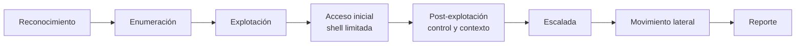
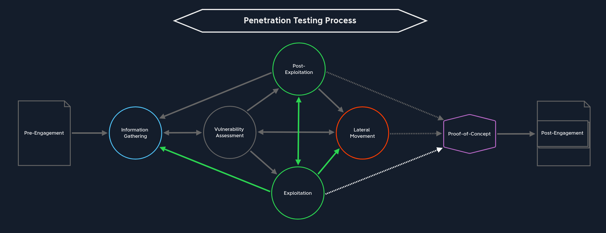
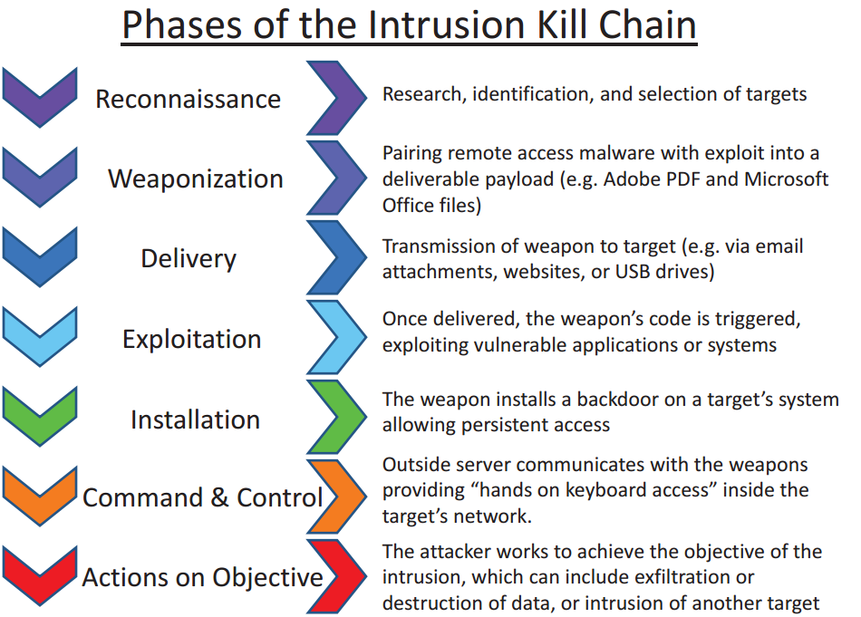
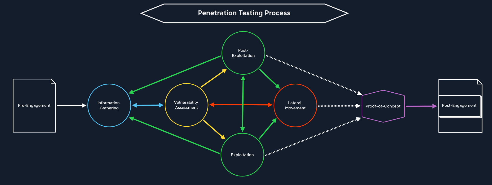
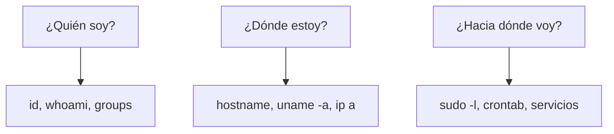
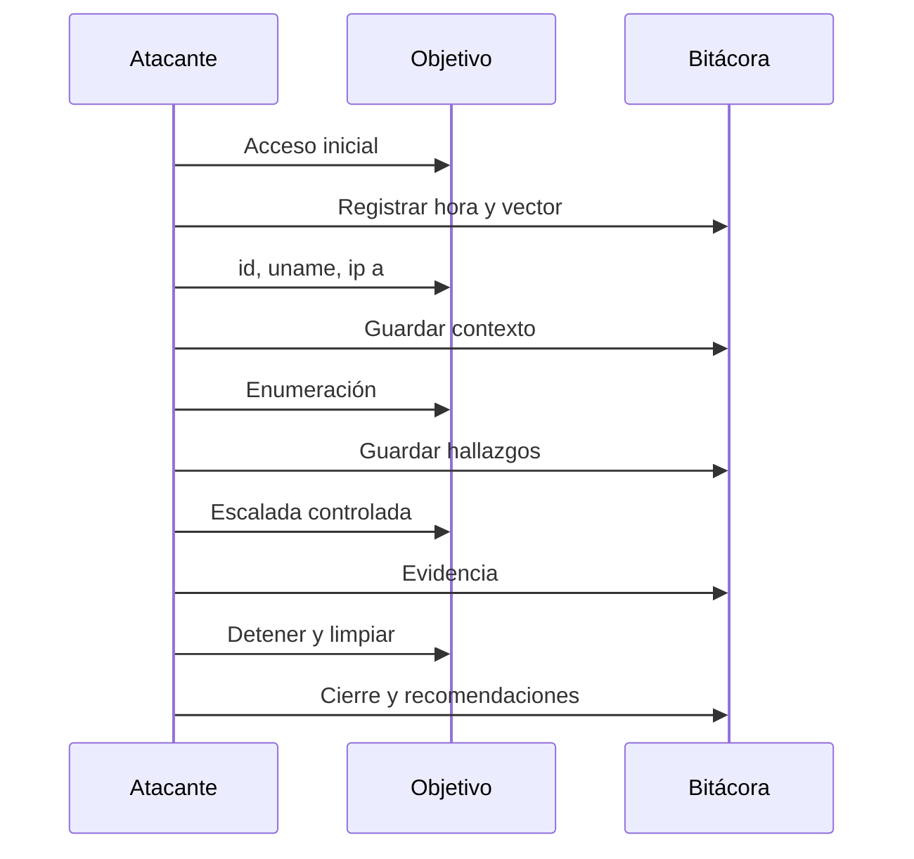

# 01 — Fundamentos de post-explotación

**Curso:** C|PTA · Pentesting y Técnicas de Ataque  
**Tiempo de lectura:** 30–40 min  
**Laboratorio asociado:** primeras preguntas en una shell limitada

---

## 1.1 Acceso inicial vs. post-explotación

El acceso inicial es la **brecha**: lograr ejecutar código en el objetivo. La post-explotación es el **control**: entender dónde estás, qué puedes hacer y hasta dónde llega el compromiso.



| Fase | Pregunta | Ejemplo |
|---|---|---|
| Acceso inicial | ¿Puedo ejecutar algo? | `www-data` en un servidor web |
| Post-explotación | ¿Dónde estoy y qué control tengo? | `id`, `uname`, `ip a` |
| Escalada | ¿Puedo ser root? | `sudo -l`, SUID, cron |
| Movimiento lateral | ¿A qué más llego? | SSH keys, túneles |
| Reporte | ¿Qué impacto demostré? | Evidencia y remediación |

> [!IMPORTANT]
> Una shell no es el objetivo. El objetivo es **demostrar impacto** y documentarlo. Una shell sin contexto no sirve para el informe.

---

## 1.2 La post-explotación en el ciclo ofensivo



*Transición de explotación a post-explotación y salto de red. Fuente: HTB Academy.*

| Etapa | Qué haces | Qué evitas |
|---|---|---|
| **Estabilizar** | TTY, historial, variables | Perder la sesión |
| **Orientarte** | Usuario, host, red, privilegios | Asumir mal el entorno |
| **Enumerar** | Servicios, archivos, credenciales | Dejar vectores sin probar |
| **Escalar** | root/admin | Explotar a ciegas |
| **Moverse** | Otros hosts | Salir del alcance |
| **Documentar** | Evidencia y timeline | Perder trazabilidad |
| **Limpiar** | Archivos y procesos | Dejar rastro innecesario |



*Fases de la Cyber Kill Chain y ubicación de la post-explotación. Fuente: material del curso.*



*Proceso general de un pentesting. Fuente: HTB Academy.*

---

## 1.3 Las tres preguntas de inicio



### ¿Quién soy?

```bash
id
whoami
groups
sudo -l
```

| Comando | Qué revela |
|---|---|
| `id` | UID, GID y grupos |
| `whoami` | Nombre del usuario |
| `groups` | Pertenencia a grupos |
| `sudo -l` | Comandos permitidos como root |

**Interpretación:** si estás en `www-data`, probablemente tengas pocos permisos. Si estás en `docker` o `lxd`, el riesgo es alto aunque no seas root.

### ¿Dónde estoy?

```bash
hostname
uname -a
cat /etc/os-release
ip a
ip route
```

| Comando | Qué revela |
|---|---|
| `hostname` | Nombre del equipo |
| `uname -a` | Kernel y arquitectura |
| `/etc/os-release` | Distribución y versión |
| `ip a` | Interfaces y redes |
| `ip route` | Rutas y gateways |

**Interpretación:** el kernel y la distribución orientan la búsqueda de exploits. La red indica si hay otros segmentos alcanzables.

### ¿Hacia dónde voy?

```bash
sudo -l
crontab -l
cat /etc/crontab
ls -la /etc/cron.*
ss -tulpn
ps aux
```

| Comando | Qué revela |
|---|---|
| `sudo -l` | Reglas de sudo |
| `crontab -l` | Tareas del usuario |
| `/etc/crontab` | Tareas del sistema |
| `ss -tulpn` | Servicios escuchando |
| `ps aux` | Procesos y propietarios |

---

## 1.4 Conciencia situacional

La conciencia situacional es saber **qué es normal** en el host para detectar lo anómalo.

| Dimensión | Preguntas |
|---|---|
| **Usuario** | ¿Es una cuenta de servicio? ¿Tiene home? ¿Tiene shell? |
| **Grupos** | ¿Está en `sudo`, `docker`, `lxd`, `disk`? |
| **Sistema** | ¿Kernel antiguo? ¿Parches? ¿Contenedores? |
| **Red** | ¿Interfaces internas? ¿Servicios en localhost? |
| **Procesos** | ¿Corren como root? ¿Tareas programadas? |
| **Archivos** | ¿Configuraciones con credenciales? ¿Backups? |
| **Historial** | ¿Comandos previos? ¿Rutas? |

> [!TIP]
> Antes de ejecutar un exploit, entiende el entorno. Un kernel exploit puede tumbar la máquina; una regla de sudo mal interpretada puede hacerte perder tiempo.

---

## 1.5 Estabilizar la sesión

Las shells obtenidas por exploits suelen ser **no interactivas**: no tienen TTY, `Ctrl+C` cierra la conexión, los editores fallan y el autocompletado no funciona.

```bash
# Comprobar si hay TTY
tty

# Si responde "not a tty", estabilizar
python3 -c 'import pty; pty.spawn("/bin/bash")'
```

> [!NOTE]
> Estabilizar no eleva privilegios. Solo mejora la usabilidad de la sesión. La escalada es otro paso.

### Checklist de estabilización

- [ ] TTY asignada.
- [ ] `Ctrl+C` no cierra la sesión.
- [ ] Historial y autocompletado funcionan.
- [ ] Variables `TERM` y `SHELL` correctas.
- [ ] Editor disponible (`vim`, `nano`).

---

## 1.6 Ética y alcance en post-explotación

| Acción | ¿Permitida? | Condición |
|---|---|---|
| Leer archivos de configuración | Sí | Dentro del alcance |
| Crear un usuario | No | Salvo autorización expresa |
| Exfiltrar datos reales | No | Solo demostrar acceso |
| Instalar persistencia | Con cuidado | Solo si el contrato lo permite |
| Movimiento lateral | Sí | Solo a activos incluidos |
| Borrar logs | No | Destruye evidencia |
| Aislar un servicio | Con cuidado | Puede afectar disponibilidad |

> [!WARNING]
> La post-explotación es la fase con mayor riesgo de daño colateral. Cada acción debe estar justificada por el alcance y detenerse si afecta producción.

---

## 1.7 Del acceso al reporte



### Qué documentar

- Hora de acceso y vector.
- Usuario y privilegios iniciales.
- Comandos ejecutados y salida relevante.
- Archivos leídos y su sensibilidad.
- Cambios realizados y reversión.
- Limitaciones y riesgos.

---

## 1.8 Autoevaluación

1. ¿Qué diferencia hay entre acceso inicial y post-explotación?
2. ¿Qué tres preguntas debes responder al inicio?
3. ¿Por qué una shell no interactiva es un problema?
4. ¿Qué comandos usas para identificar usuarios y grupos?
5. ¿Qué riesgo tiene un kernel exploit?
6. ¿Qué acciones de post-explotación requieren autorización expresa?
7. ¿Qué evidencia guardarías de un acceso?

---

**Siguiente:** [02 — Shells y control del sistema](02-shells.md)
