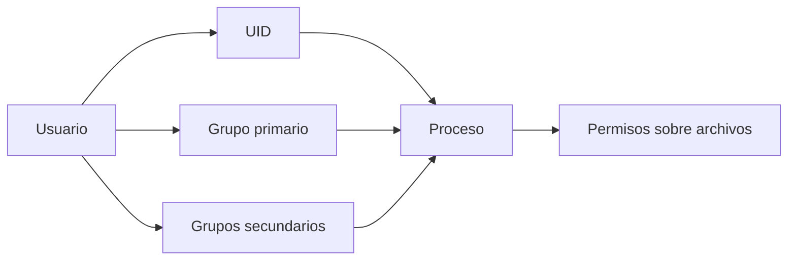
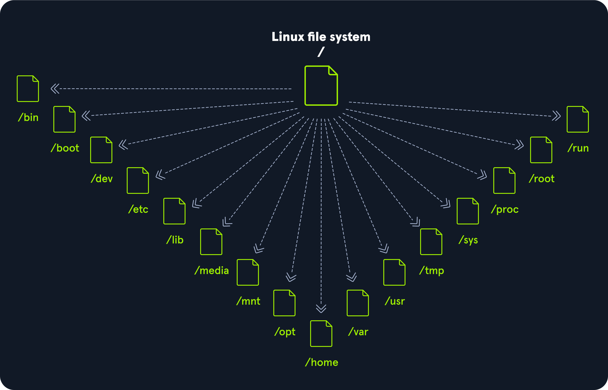
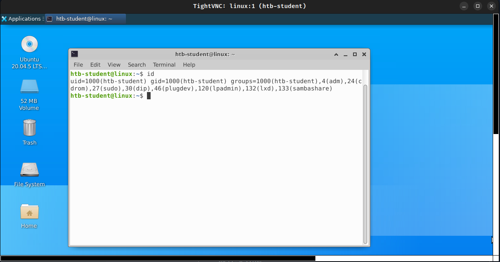

# 03 — Usuarios, grupos y permisos

**Curso:** C|PTA · Pentesting y Técnicas de Ataque  
**Tiempo de lectura:** 35–45 min  
**Laboratorio asociado:** auditoría de identidades y permisos en una VM Linux

---

## 3.1 El modelo de identidad en Linux

Linux identifica a cada proceso con un **UID** y un **GID**. Los nombres son una comodidad para humanos; el kernel decide por números.





*Jerarquía del sistema de archivos Linux. Fuente: HTB Academy.*



*UID, GID y grupos de un usuario. Fuente: HTB Academy.*

| Concepto | Descripción |
|---|---|
| **UID 0** | root |
| **UID 1–999** | Cuentas de sistema/servicio |
| **UID ≥ 1000** | Usuarios humanos (típico) |
| **GID** | Identificador de grupo |
| **Grupo primario** | Se asigna al crear archivos |
| **Grupos secundarios** | Permisos adicionales |

---

## 3.2 Archivos de identidad

### `/etc/passwd`

```text
root:x:0:0:root:/root:/bin/bash
alumno:x:1000:1000::/home/alumno:/bin/bash
www-data:x:33:33:www-data:/var/www:/usr/sbin/nologin
```

| Campo | Significado |
|---|---|
| `root` | Nombre de usuario |
| `x` | La contraseña está en `/etc/shadow` |
| `0` | UID |
| `0` | GID |
| `root` | Comentario/GECOS |
| `/root` | Home |
| `/bin/bash` | Shell |

> [!WARNING]
> Si `/etc/passwd` es escribible por un usuario no privilegiado, puede crear una cuenta con `uid=0`. Es un vector crítico.

### `/etc/shadow`

```text
root:$6$...hash...:19200:0:99999:7:::
```

| Campo | Significado |
|---|---|
| Usuario | Nombre |
| Hash | Contraseña cifrada |
| Último cambio | Días desde 1970 |
| Mínimo | Días antes de cambiar |
| Máximo | Días de validez |
| Aviso | Días de aviso |
| Inactividad | Días tras expirar |
| Expiración | Fecha de bloqueo |

> [!NOTE]
> `$6$` indica SHA-512. Si `/etc/shadow` es legible, puedes extraer hashes y atacarlos offline con John o Hashcat.

### `/etc/group`

```text
sudo:x:27:ana,luis
docker:x:999:ana
```

| Campo | Significado |
|---|---|
| Nombre | Grupo |
| `x` | Contraseña de grupo (rara vez usada) |
| GID | Identificador |
| Miembros | Usuarios secundarios |

### `/etc/sudoers`

```text
root    ALL=(ALL:ALL) ALL
%sudo   ALL=(ALL:ALL) ALL
ana     ALL=(ALL) NOPASSWD: /usr/bin/systemctl restart apache2
```

| Regla | Significado |
|---|---|
| `ALL=(ALL:ALL) ALL` | Puede ejecutar todo como cualquier usuario |
| `NOPASSWD` | Sin contraseña |
| Ruta específica | Solo ese comando |

> [!TIP]
> `sudo -l` muestra las reglas efectivas del usuario actual. Es el primer comando que deberías ejecutar en una shell nueva.

---

## 3.3 Permisos POSIX

```text
-rwxr-xr--  1 ana dev  1234 Oct 30 10:00 script.sh
│└┬┘└┬┘└┬┘
│ │  │  └── otros
│ │  └───── grupo
│ └──────── dueño
└────────── tipo
```

| Letra | Valor | Archivo | Directorio |
|---|---|---|---|
| `r` | 4 | Leer | Listar |
| `w` | 2 | Escribir | Crear/borrar |
| `x` | 1 | Ejecutar | Entrar |

### Cálculo octal

| Permiso | Binario | Octal |
|---|---|---|
| `rwx` | 111 | 7 |
| `rw-` | 110 | 6 |
| `r-x` | 101 | 5 |
| `r--` | 100 | 4 |
| `-wx` | 011 | 3 |
| `-w-` | 010 | 2 |
| `--x` | 001 | 1 |
| `---` | 000 | 0 |

```bash
chmod 754 script.sh   # rwxr-xr--
chmod 644 archivo     # rw-r--r--
chmod 600 secreto     # rw-------
```

### Semántica de directorios

| Permiso | En un directorio |
|---|---|
| `r` | Ver nombres |
| `w` | Crear, borrar, renombrar |
| `x` | Atravesar (`cd`, acceder a archivos) |

> [!IMPORTANT]
> Un directorio con `w` pero sin `x` permite crear nombres, pero no acceder a ellos. Un directorio con `x` pero sin `r` permite acceder a archivos si conoces el nombre.

---

## 3.4 Bits especiales

| Bit | Símbolo | Efecto | Ejemplo |
|---|---|---|---|
| **SUID** | `s` en usuario | Ejecuta con UID del dueño | `/usr/bin/passwd` |
| **SGID** | `s` en grupo | Ejecuta con GID del grupo | Directorios compartidos |
| **Sticky** | `t` en otros | Solo el dueño borra | `/tmp` |

```bash
# Buscar SUID
find / -perm -4000 -type f 2>/dev/null

# Buscar SGID
find / -perm -2000 -type f 2>/dev/null

# Ver sticky
ls -ld /tmp
```

> [!WARNING]
> Un SUID de root que permita leer archivos o ejecutar comandos es un vector de escalada. No todos los SUID son vulnerables, pero todos merecen revisión.

---

## 3.5 ACL y capabilities

### ACL

Las ACL permiten permisos más finos que los tres bits tradicionales.

```bash
getfacl archivo
setfacl -m u:ana:rw archivo
```

### Capabilities

Las capabilities dividen los privilegios de root en unidades más pequeñas.

```bash
getcap -r / 2>/dev/null
```

| Capability | Riesgo |
|---|---|
| `cap_setuid` | Permite cambiar UID |
| `cap_setgid` | Permite cambiar GID |
| `cap_dac_read_search` | Lee archivos sin permiso |
| `cap_dac_override` | Ignora permisos |
| `cap_net_raw` | Raw sockets |
| `cap_sys_admin` | Muy amplio |

> [!NOTE]
> Un binario con `cap_setuid+ep` puede permitir convertirte en root si permite ejecutar código o cambiar UID. Es un vector menos conocido que SUID, pero igual de importante.

---

## 3.6 Grupos críticos

| Grupo | Riesgo | Por qué |
|---|---|---|
| **sudo / wheel** | Crítico | Ejecución como root |
| **docker** | Crítico | Montar `/` en un contenedor |
| **lxd / lxc** | Crítico | Contenedor privilegiado |
| **disk** | Crítico | Acceso a dispositivos de bloque |
| **adm** | Alto | Lectura de logs |
| **shadow** | Alto | Lectura de hashes |
| **www-data** | Medio | Acceso a código web |
| **systemd-journal** | Medio | Lectura de logs |

### Docker: por qué es root

```bash
docker run -v /:/mnt --rm -it alpine chroot /mnt sh
```

Si un usuario está en el grupo `docker`, puede montar el sistema de archivos del host dentro de un contenedor y obtener root. No es un bug de Docker: es una decisión de diseño.

> [!WARNING]
> Pertenecer a `docker` equivale, en la práctica, a tener root. No lo trates como un grupo cualquiera.

---

## 3.7 Sudo: lo que debes revisar

```bash
sudo -l
```

### Patrones peligrosos

| Patrón | Riesgo |
|---|---|
| `NOPASSWD: ALL` | Root sin contraseña |
| `NOPASSWD: /bin/bash` | Shell root directa |
| `NOPASSWD: /usr/bin/vi` | Escape a shell |
| `NOPASSWD: /usr/bin/find` | `-exec` para ejecutar comandos |
| `NOPASSWD: /usr/bin/systemctl` | Servicios y unidades |
| `NOPASSWD: /usr/bin/awk` | Ejecución de comandos |
| Comodines (`*`) | Rutas manipulables |

> [!TIP]
> GTFOBins documenta cómo escapar de binarios comunes cuando se ejecutan con sudo o SUID. Úsalo como referencia, no como receta ciega.

---

## 3.8 Hardening

| Control | Acción |
|---|---|
| Mínimo privilegio | Revisar grupos y sudoers |
| Contraseñas | Política, hash fuerte, MFA |
| `/etc/passwd` | `644 root:root` |
| `/etc/shadow` | `640 root:shadow` |
| SUID | Inventario y justificación |
| Capabilities | Inventario y justificación |
| Docker | Restringir grupo y usar rootless |
| Auditoría | `auditd`, logs centralizados |

---

## 3.9 Autoevaluación

1. ¿Qué diferencia hay entre UID y GID?
2. ¿Qué contiene `/etc/shadow` que no está en `/etc/passwd`?
3. ¿Qué significa `chmod 640`?
4. ¿Qué hace el bit SUID?
5. ¿Por qué el grupo `docker` es crítico?
6. ¿Qué patrón de `sudoers` es más peligroso?
7. ¿Cómo buscarías capabilities en un sistema?

---

**Anterior:** [02 — Shells](02-shells.md) · **Siguiente:** [04 — Enumeración y LinPEAS](04-enumeracion-linpeas.md)
