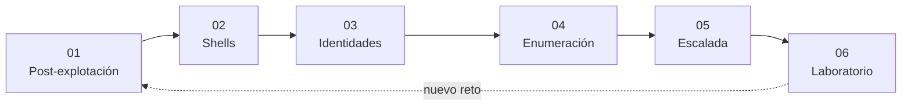
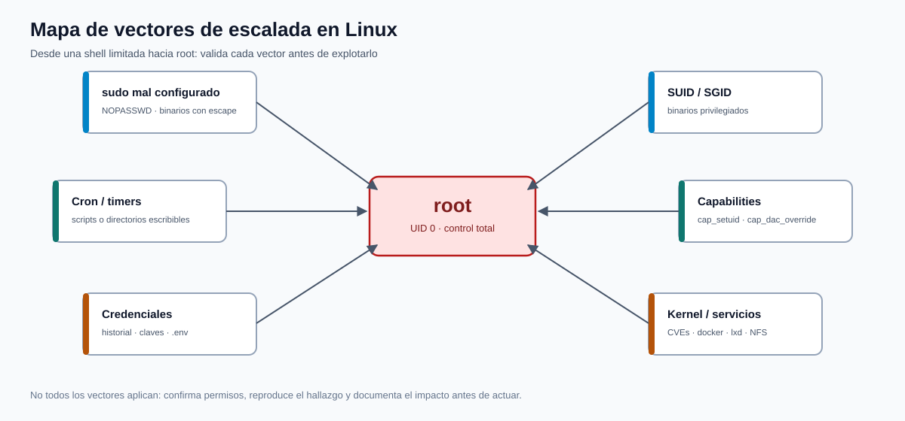

# Pentesting y Técnicas de Ataque — Teoría expandida

[Privilege Escalation](../README.md) | [Inicio](../../README.md)

**Curso:** C|PTA · Pentesting y Técnicas de Ataque  
**Edición:** 11va Edición  
**Instructor:** Anthony Gonzalo Quispe Cordova  
**Institución:** Oficina de Tecnologías de la Información (OTI) — UNI

Este directorio expande la teoría de los slides de post-explotación: qué hacer después del acceso inicial, cómo estabilizar una shell, cómo entender identidades y permisos en Linux, cómo enumerar con método y cómo reconocer vectores de escalada.

---

## Índice

| # | Capítulo | Pregunta que responde |
|---|---|---|
| 01 | [Fundamentos de post-explotación](01-post-explotacion.md) | ¿Qué hago después de entrar? |
| 02 | [Shells y control del sistema](02-shells.md) | ¿Cómo mantengo una sesión usable? |
| 03 | [Usuarios, grupos y permisos](03-usuarios-permisos.md) | ¿Quién soy y qué puedo hacer? |
| 04 | [Enumeración y LinPEAS](04-enumeracion-linpeas.md) | ¿Cómo encuentro el camino a root? |
| 05 | [Vectores de escalada en Linux](05-escalada-linux.md) | ¿Qué configuraciones permiten ser root? |
| 06 | [Laboratorio: entorno Kali](06-laboratorio-kali.md) | ¿Cómo practico todo de forma segura? |

## Ruta de aprendizaje

## Diagrama de referencia

*Diagrama propio: las familias de vectores que convergen en root y la necesidad de validar cada una.*

## Convenciones

> [!NOTE]
> Concepto que debes dominar antes de ejecutar comandos.

> [!TIP]
> Comando o técnica de laboratorio.

> [!WARNING]
> Riesgo de daño, detección o violación de alcance.

> [!IMPORTANT]
> Idea que cambia la decisión o que se evalúa.

## Regla del curso

> La post-explotación se practica **solo** en máquinas vulnerables propias o plataformas que autorizan la prueba. Un acceso fuera de alcance no es un logro: es un incidente.

---

**Siguiente:** [01 — Fundamentos de post-explotación](01-post-explotacion.md)
